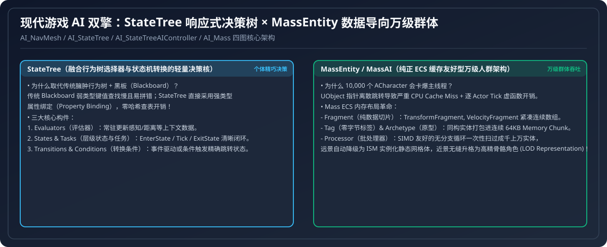
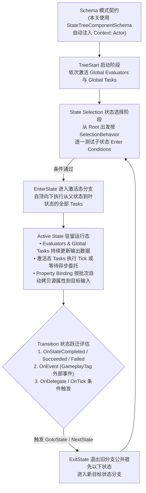
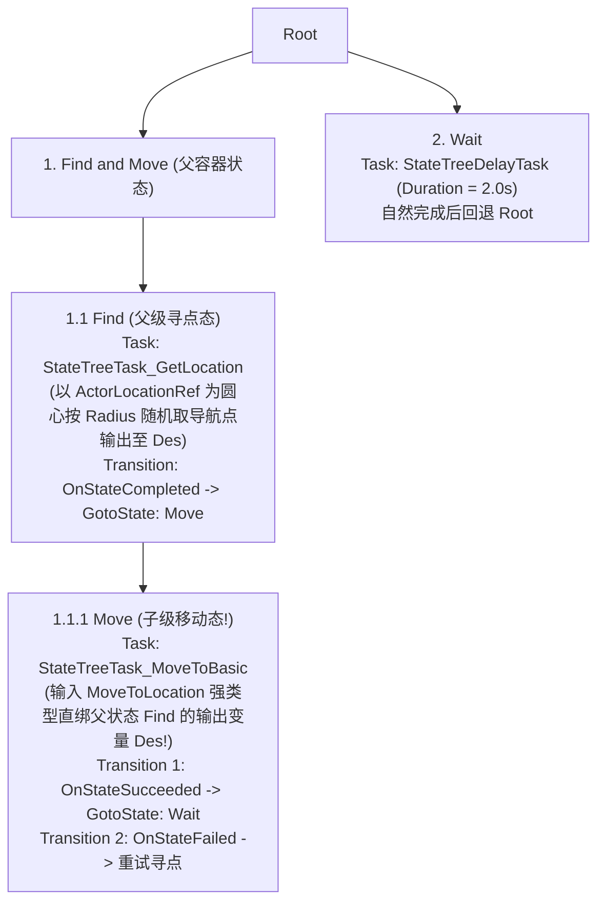

# 02 · 轻量级层级状态树：评估器、进入条件、Task 与 Transition 全解（`AI_StateTree`）

> **本篇实测拆解关卡档案**
> - **关卡路径**：`/Game/Maps/AI/AI_StateTree`（关卡总 Actor 数：`61` | 展台数：`13` | 示例 Actor 数：`30`）
> - **展厅三大分区（`BP_DemoRoom0`）**：`Introduction`（#1~#2）$\to$ `Basics`（#3~#9）$\to$ `Feature Examples`（#10~#13）
> - **关卡脚本与玩法框架**：`/Game/Maps/AI/AI_StateTree.AI_StateTree_C` | 玩家角色 `BP_PlayerCharacter_Gameplay` + HUD `WBP_PlayerHUD_StateTree`
> - **核心资产目录**：`/Game/ExampleContent/StateTree/StateTrees/Intro/`、`/FeatureExamples/` 及配套自定义蓝图 `Tasks` / `Evaluators` / `Conditions`

---

## 一、 决策架构的代际革命：为什么 UE5 要用 StateTree 革新传统 BehaviorTree + Blackboard？

在过去十余年的虚幻引擎开发中，只要提到编写 AI 或复杂状态逻辑，开发者几乎只能在两套经典方案中二选一，却又不得不忍受它们各自的先天顽疾：

1. **传统有限状态机（FSM / 蓝图状态连线）的“蜘蛛网爆炸”**：
   状态少时（`Idle -> Patrol -> Attack`）直观明了；一旦扩展到 15 个状态，并且要求“在任意 10 个日常状态下被玩家攻击时都要立刻切入受击态”，就必须拉出 10 条重复的转换连线，维护成本呈 $O(N^2)$ 失控。
2. **传统行为树（Behavior Tree, BT）+ 黑板（Blackboard）的三大历史包袱**：
   - **弱类型字典查表开销与拼写脆弱性**：节点之间无法直接传递变量，哪怕只是把“找点节点”算出的 `FVector` 传给紧挨着的“移动节点”，也必须在 `UBlackboardData` 里新建一个键（Key），运行时通过 `FName` 或键值槽位间接读写；一旦重构改名，极易出现静默失效。
   - **缺乏显式“状态驻留（State Persistence）”语义与 Selector 轮询抖动**：行为树本质是一棵从根节点自左向右反复重评估的动作选择树。若没有精心配置 `Observer Aborts (Self / Lower Priority)` 装饰器，极易引发每帧高频重入（Thrashing）或无法优雅表达“必须等当前过场做完才能响应次优请求”的状态保持逻辑。
   - **实例内存碎片化**：传统 BT 中大量自定义蓝图 `UBTTask_BlueprintBase` 实例化为独立 `UObject`，难以承载上千规模的并发智能体。

**UE5 推出的 `StateTree`（层级状态树）正是集两家之所长、彻底剔除黑板中间件的新一代通用状态决策引擎！**



### 1.1 BehaviorTree + Blackboard vs StateTree 核心架构全维对比

| 核心架构维度 | 传统 BehaviorTree + Blackboard | 现代 UE5 StateTree |
| :--- | :--- | :--- |
| **拓扑组织范式** | 纯选择/序列控制流树（无显式状态驻留与任意跨分支跳转） | **HFSM 层级有限状态机 + BT Selector 条件选择融合体**：自顶向下像 BT 一样按 `Enter Conditions` 择优选子状态，进入后像 FSM 一样稳定驻留并通过 `Transitions` 自由跃迁 |
| **节点间数据通信** | **弱类型 `UBlackboardComponent` 键值字典**（节点与黑板强耦合，重构易碎） | **零黑板！编译期强类型属性绑定（Property Binding）**：Evaluator/GlobalTask/父状态/前序 Task 的输出引脚直接内存偏移直连目标 Task 输入引脚 |
| **中断与外部响应** | 依赖 `BTService` 定时轮询改写黑板 + `Decorator` 监听黑板键变更触发子树中断 | **原生事件驱动跃迁（`On Event` GameplayTag / `On Delegate` 委托信号）**：零轮询开销，父状态挂载一条 `OnEvent` 即可统管所有子孙状态的紧急打断！ |
| **内存布局模型** | 节点逻辑与实例状态常混存于 `UObject` 堆对象 | **逻辑模板（`FStateTreeNodeBase` 只读共享）与实例数据（`FInstanceDataStruct` 紧凑值结构体）严格分离**，天然无缝接入 `MassEntity` 万级 ECS！ |
| **适用领域边界** | 强绑定 `AAIController`，几乎只用于 NPC 怪物 | **Schema 插件化契约设计**：既能驱动 NPC（`StateTreeAIComponent`），也能挂在任意机关门、电梯、分支文字冒险、技能树与并行任务管理器上（`StateTreeComponent`）！ |


### 1.2 StateTree 运行期生命周期与数据绑定流水线

打开 `/Game/Maps/AI/AI_StateTree`，在步入 13 座展台之前，先用一张核心时序图掌握一棵 StateTree 从启动、选态、并发执行到跃迁的完整脉搏：



现在，让我们沿着展厅三大分区，逐一解剖全部 **13 座展台** 的每一个 Actor、每一棵 StateTree 资产与每一个自定义蓝图节点！

---

## 二、 第一展区 `Introduction`：初识通用状态树（展台 #1 ~ #2）

### 展台 #1：`State Tree` — 通用层级状态机宣言与测试光场基座

- **空间元数据**：展牌 Label `BP_DemoDisplay4` | 坐标 `(499, -900, 0)`
- **官方展牌原文**：
  > *StateTree is a general-purpose hierarchical state machine that combines the Selectors from behavior trees with States and Transitions from state machines. With StateTree, you can create highly performant logic that stays flexible and organized. Some examples share a BP Character class. It's reccomended to click on the class in viewport and check the State Tree in use.*

#### 1.1 展台陈列 Actor 与环境参数清单（共 6 个）
- **`DirectionalLight`**（`Intensity = 3`，`Mobility = Movable`）与 **`SkyLight`**（`Intensity = 3`，`Mobility = Movable`）：采用均衡柔和的 `1 : 1` 光比，确保后续展台中半透明变色材质球（`M_Color_Param`）与屏幕空间调试文字（`StateTreeDebugTextTask`）清晰易读。
- **`SkyAtmosphere2`**、**`ExponentialHeightFog2`**：标准环境大气组件。
- **`DocumentationActor`** 与 **`Actor`**（挂载 `ChaosDebugDrawComponent_0`）：官方文档跳转锚点与调试渲染支持组件。
- **架构要点**：本关所有示例均直接将 **`UStateTreeComponent`** 挂载在普通 `AActor` 或无 AIController 逻辑的 `ACharacter` 身上（使用 `StateTreeComponentSchema`），直接向开发者宣告——**StateTree 不是 AI 专属品，而是整个 Gameplay 层的通用状态编程器**！

---

### 展台 #2：`Hello World` — 最简状态树、实例参数覆写与“永不结束任务”驻留机制

- **空间元数据**：展牌 Label `BP_DemoDisplay5` | 坐标 `(1484, -900, 0)`


#### 2.1 官方展牌说明与陈列 Actor 实测深拆
> *Basic state tree. Transitions directly into a Child State and executes a Debug Task to print text at the Context Actor's location (The Blueprint Class).*

- **陈列 Actor（1 个）**：**`BP_StateTree_Intro`**（父类 `/Script/Engine.Actor`）
  - **组件树**：`MyMesh`（引擎基础立方体 `/Engine/BasicShapes/Cube`）、`Sphere`（碰撞球）、以及状态树组件 **`ST_Intro`**。
  - **MCP 实测实例覆写参数**：`StateTreeRef` 指向 `/Game/ExampleContent/StateTree/StateTrees/Intro/ST_Intro`，并在关卡实例面板覆写了树参数 `walkDistance = 100`（`propertyOverrides = ["9EF40738-4342-25EC-8946-77BC832B1537"]`）——展示了**同一份 StateTree 资产可在不同 Actor 实例上暴露并覆写不同初始参数（Parameters）**的能力。

#### 2.2 状态树 `ST_Intro` 内部节点拆解与驻留原理解析
- **全局评估器 / 全局任务**：均为 `[]`。
- **状态层级树**：
  - `Root`（`selectionBehavior = TrySelectChildrenInOrder`）
    - $\hookrightarrow$ `Child State`（无进入条件，挂载 1 个内置 C++ 任务 **`FStateTreeDebugTextTask`**）：
      - `text = "Hello World"`，`textColor = (1, 1, 1, 1)`，`fontScale = 1`，`referenceActor` 绑定至 `Context: Actor`。
      - **核心标志位揭秘**：注意实测数据中 **`bConsideredForCompletion = false`**！在 StateTree 中，如果一个状态内的所有参与完成的任务都瞬间返回成功，状态会立即触发 `OnStateCompleted` 并默认重回 `Root` 反复闪烁；而 `StateTreeDebugTextTask` 不参与完成判定（持续常驻），使得状态树平稳地一直停留在 `Child State` 中，将白色 `"Hello World"` 悬浮渲染在白色方块正上方。

---

## 三、 第二展区 `Basics`：五大核心积木逐级通关（展台 #3 ~ #9）

### 展台 #3：`State Tree Tasks (Move To)` — 强类型参数注入与双状态循环跃迁

- **空间元数据**：展牌 Label `BP_DemoDisplay6` | 坐标 `(3003, -900, 0)`
- **官方展牌原文**：
  > *Simple Move To using a State Tree Task (STT) and Paramaeters. The State Tree has 2 Paramaters that feed into the STT Location Variable.*

#### 3.1 展台陈列 Actor 与实例级强类型参数表（共 2 个）
1. **`Nav`**（`StaticMeshActor`）：垫在展台下方的导航承载地板立方体。
2. **`BP_StateTree_BasicMoveTo`**（父类 `ACharacter`，无骨骼网格体，使用球体静态网格 `Attenuation_sphere_01` 作为简洁视觉代理）：
   - 其 `StateTree` 组件引用 **`ST_BasicMoveTo`**，直接通过实例参数面板传入了三个强类型参数：
     - `target_Location = (2800.21, -651.92, 169.10)`
     - `start_Location = (3183.65, -651.92, 169.10)`
     - `acceptance_Radius = 1.0`

#### 3.2 状态树 `ST_BasicMoveTo` 与自定义蓝图任务 `StateTreeTask_MoveToBasic` 深拆
- **自定义蓝图任务 `StateTreeTask_MoveToBasic`**（父类 `UStateTreeTaskBlueprintBase`）：
  - 声明了 3 个公开输入变量（Category 设为 `Input` 或可绑定）：`Actor`（自动绑定或连入 `Context: Actor`）、`MoveToLocation`（三维目标坐标）、`Acceptance Radius`（到达容差）。
  - 在 `ReceiveEnterState` 中发起异步移动，抵达目标点时调用 **`FinishTask(bSucceeded = true)`** 通知状态树当前任务圆满结束！
- **状态层级与循环跃迁拓扑**：
  - `Root` (`TrySelectChildrenInOrder`)
    - $\hookrightarrow$ **`MoveTo`**：运行 `StateTreeTask_MoveToBasic`（属性绑定：`MoveToLocation` $\leftarrow$ 树参数 `target_Location`），`bConsideredForCompletion = true`。配置转换：**`OnStateSucceeded` $\to$ `GotoState: MoveTo2`**。
    - $\hookrightarrow$ **`MoveTo2`**：复用同一个 `StateTreeTask_MoveToBasic`（属性绑定：`MoveToLocation` $\leftarrow$ 树参数 `start_Location`）。配置转换：**`OnStateSucceeded` $\to$ `GotoState: Root`**（回到 `Root` 后按顺序再次选中第一个子状态 `MoveTo`，形成严丝合缝的无限往返乒乓运动，全程零黑板参与！）。

---

### 展台 #4：`Find Location and Move To` — 多状态串行流水线与跨状态输出属性绑定

- **空间元数据**：展牌 Label `BP_DemoDisplay7` | 坐标 `(3025, 897, 0)`（位于走廊对侧，与 #6 形成上下对照）
- **官方展牌原文**：
  > *Seperate States Contains transition rules to move to a new state once each task has compleated. In this case, Find Location, Move to, Wait*

#### 4.1 展台陈列 Actor 与视觉朝向指示器（共 2 个）
- **`FindMoveToRef`**（`Actor`）：区域中心搜索锚点引用。
- **`BP_StateTree_FindLocAndMoveTo`**（父类 `ACharacter`，含成员变量 `ActorLocationRef`）：由白色圆柱体 `Cylinder` 代表躯干、覆写了深蓝色材质 `/Game/ExampleContent/ControlRig/Materials/blue`（实测 `BaseColor = (0, 0.0063, 0.656)`）的圆锥体 `Cone` 代表车头朝向。

#### 4.2 状态树 `ST_Basic_FindLocAndMove` 深度嵌套层级与数据流解剖
通过 `ai_assets_full.json` 的精确对象路径（`StateTreeState_5.StateTreeState_1.StateTreeState_0.StateTreeState_2`），我们还原出它真实的**四层父子嵌套结构**：



> [!IMPORTANT]
> **为什么这里特意把 `Move` 做成 `Find` 的子状态（Child State），而不是平级兄弟状态？**
> 这是 StateTree 作用域生命周期设计的神来之笔！在 StateTree 中，**一个 Task 的实例数据（如 `StateTreeTask_GetLocation` 算出的随机目标点 `Des`）仅在该状态处于激活栈（Active State Stack）期间有效**。如果 `Find` 与 `Move` 是平级兄弟，一旦退出 `Find` 进入 `Move`，`Find` 的状态栈帧就会被销毁；而将 `Move` 设为 `Find` 的子状态（或把共享数据提升到公共父状态/树级属性），进入 `Move` 时父状态 `Find` 依然活跃在栈上，`Move` 的 `MoveToLocation` 即可安全无虞地直读父级 Task 的输出属性 `Des`！

---

### 展台 #5：`Transition Events` — GameplayTag 事件驱动零轮询开关灯状态机

- **空间元数据**：展牌 Label `BP_DemoDisplay9` | 坐标 `(4003, -900, 0)`
- **官方展牌原文**：
  > *This State Tree uses Gameplay Tags to control transitions between states. A default State is entered and will listen for a Gameplay Tag event to enter the Light On or Off states. BP_LightStransitionEvent listens for a button press, then sends a State Tree Event. ST_LightTransition then moves into the correct state and runs a State Tree Task that toggles the lights visibility.*

#### 5.1 交互链路拆解（共 2 个陈列 Actor）
1. **`BP_Button_Parent_SinglePress`**：玩家走近交互按下按钮时，广播事件分发器 `OnButtonPressed`。
2. **`BP_LightTransitionEvent`**（挂载 `PointLight` 强度 `5000`、衰减半径 `1000` 及 `StateTree` 组件）：监听按钮按下事件，翻转布尔变量 `CurrentLightValue`，构造 `FStateTreeEvent` 并调用 **`StateTreeComponent -> SendStateTreeEvent`**，根据当前开关状态发送精确的 GameplayTag：
   - **`StateTree.LightToggle.On`** 或 **`StateTree.LightToggle.Off`**！

#### 5.2 状态树 `ST_LightTransition`：父状态统一事件路由模式
- **根状态 `Check`**（拥有 3 个子状态 `Waiting`、`Light On`、`Light Off`）：
  - **父级全局事件拦截转换**：在父状态 `Check` 上直接挂载两条 `trigger = OnEvent` 转换规则（勾选 `bConsumeEventOnSelect = true` 防止同一事件重复触发）：
    1. 收到 `StateTree.LightToggle.On` $\to$ `GotoState: Light On`
    2. 收到 `StateTree.LightToggle.Off` $\to$ `GotoState: Light Off`
- **三个子状态职责**：
  - `Waiting`（首位默认子状态）：运行 `StateTreeDebugTextTask` 显示 `'Default state on: Waiting for user input'`，零 CPU 消耗静默挂起。
  - `Light On` 与 `Light Off`：**复用同一个蓝图任务 `StateTreeTask_SetLightState`**（输入变量 `Actor` 与布尔值 `TurnOnLight`），仅在状态面板分别将 `TurnOnLight` 设为 `true` 与 `false` 控制点光源显隐！由于事件转换挂在公共父状态 `Check` 上，无论当前处于 `Waiting`、`Light On` 还是 `Light Off`，外部任意时刻发来标签事件都能一键精准切态！

---

### 展台 #6：`Find Location and Move To (Combined)` — 单状态多 Task 聚合与完成策略 `All` vs `Any`

- **空间元数据**：展牌 Label `BP_DemoDisplay8` | 坐标 `(4003, 897, 0)`


#### 6.1 与展台 #4 的镜像对照：把 3 个状态压缩进 1 个状态会发生什么？
> *Running Multiple State Tree Tasks in one State (Find Location, Move to, Wait). The Tasks Details is set to "All" meaning all tasks need to be compleated for the state to be marked completed.*

- **陈列 Actor（2 个）**：`FindMoveToCombinedRef` 与 `BP_StateTree_FindLocAndMoveTo2`（与 #4 使用完全相同的角色蓝图，仅将状态树替换为 **`ST_Basic_FindLocAndMoveCombined`**）。
- **`ST_Basic_FindLocAndMoveCombined` 内部结构**：
  - `Root` $\to$ 唯一子状态 **`FindMoveandWait`**（`selectionBehavior = TryEnterState`）。
  - 在这**同一个状态**的 `Tasks` 数组里，自上而下依次挂载了 3 个任务：
    1. `StateTreeTask_FindLocation`（在 `EnterState` 瞬间同步算出随机目标点 `Des`，立即标记自身完成）；
    2. `StateTreeTask_MoveToBasic`（**同状态内后序 Task 直接绑定前序 Task `FindLocation` 的输出变量 `Des`！** 异步走向目标点）；
    3. `StateTreeDelayTask`（计时等待）。

#### 6.2 深度原理：单状态多 Task 的执行顺序契约与 `Tasks Completion` 策略
1. **严格的声明序 `EnterState` 执行保证**：当进入 `FindMoveandWait` 时，StateTree 严格按照 `Tasks` 数组**从上到下**的顺序依次同步刷新属性绑定并调用每个 Task 的 `EnterState`。因此排在第 1 位的 `FindLocation` 只要在 `EnterState` 里同步算出 `Des`，排在第 2 位的 `MoveToBasic` 在它的 `EnterState` 执行前就会立刻拿到最新的 `Des` 坐标！
2. **注意行为差异！**：在 #4（分状态串行）中，角色是“先找点 $\to$ 走过去 $\to$ **到了之后再原地等 2 秒**”；而在 #6（单状态并发）中，第 2 个任务 `MoveTo` 与第 3 个任务 `Delay` 是**在进入状态的同一帧同时开始计时的**！因为状态的完成条件设为 **`All`（全部参与完成的任务都结束才算状态完成）**，如果走路花了 `1.2s`、Delay 设了 `2.0s`，角色走到终点后只会再等剩余的 `0.8s` 就立即开启下一轮！
   - 若将策略改为 **`Any`（任意一个任务完成即结束状态）**，则常用于制作**“移动超时保护”**（例如 `MoveTo` 并联一个 `5.0s Delay`，谁先跑完都立刻退出状态，防止 AI 卡在死角无限死等！）。

---

### 展台 #7：`Global Tasks` — 跨越全生命周期的后台常驻算子与实时距离着色

- **空间元数据**：展牌 Label `BP_DemoDisplay10` | 坐标 `(5018, -900, 0)`
- **官方展牌原文**：
  > *Global Tasks run for the lifetime of the StateTree and are active between the Tree Start and Stop events. These can be useful in exposing external data to the tree, configuring event listeners, and cleaning up the tree when stopping. This Global Task calculates and outputs the distance between this actor and the player.*

#### 7.1 展台陈列 Actor 与 `ST_Basic_GlobalTaskDemo` 资产深拆
- **陈列 Actor（1 个）**：**`BP_GlobalTaskDemo`**（挂载球体 `Sphere`，材质为半透明动态参数材质 `/Game/ExampleContent/StateTree/Materials/M_Color_Param` 生成的 `MID_M_Color_Param_0`）。
- **全局任务 `StateTreeTask_GlobalTaskDemo`**：
  - 成员变量：`Actor`、`PlayableCharacterRef`、`Distance`、`DebugDistance`。
  - 它在 `TreeStart` 时缓存玩家引用，每帧 `Tick` 计算玩家到球心的实时欧氏距离，一方面驱动球体材质参数随远近动态变色，另一方面将格式化后的距离字符串 `DebugDistance` 暴露为输出属性。
- **子状态 `DebugText`**：挂载内置 `StateTreeDebugTextTask`，其 `text` 引脚直接通过属性绑定连接至上方全局任务的 `DebugDistance` 输出！无论下方状态树未来扩展出多少个复杂的子状态跳转，顶层的全局任务始终稳如泰山地持续供给最新距离数据，绝不会因为子状态 `ExitState` 而中断。

---

### 展台 #8：`Conditions` — 基于向量点积（Dot Product）的视线朝向门控选择

- **空间元数据**：展牌 Label `BP_DemoDisplay11` | 坐标 `(5018, 896, 0)`
- **官方展牌原文**：
  > *Conditions can be used to enter a child state. If a condition is met, the chosen sstate will begin evaluating. If a condition fails, the next child state is tested. This condition checks if the player is facing the target.*

#### 8.1 自定义蓝图条件 `StateTreeCondition_LookAt` 与状态回退机制
- **陈列 Actor（1 个）**：**`BP_ConditionDemo`**（挂载动态变色圆柱体 `Cylinder`，树参数 `color = (1, 0, 0)`）。
- **自定义条件资产 `StateTreeCondition_LookAt`**（父类 `UStateTreeConditionBlueprintBase`）：
  - 重载纯函数 **`ReceiveTestCondition`**，读取玩家摄像机/角色前向单位向量 $\hat{F}_{\text{player}}$ 与从玩家指向目标圆柱体 `TargetLookAt` 的归一化方位向量 $\hat{D} = \text{ Normalize}(P_{\text{target}} - P_{\text{player}})$，计算点积：
    $$\hat{F}_{\text{player}} \cdot \hat{D} > \cos\theta_{\text{threshold}}$$
    当玩家正视圆柱体时返回 `true`，背对或侧视时返回 `false`。
- **`ST_Condition` 状态选择流**：
  - `Root` (`TrySelectChildrenInOrder`) 自上而下依次叩门：
    1. 子状态 **`IsLooking?`**：挂载进入条件 `StateTreeCondition_LookAt`（`operand = And`）。若玩家正视圆柱体，条件通过，进入该状态显示 `'Looking'` 并执行 `StateTreeTask_LookAt` 将圆柱体染红；
    2. 子状态 **`Rerun`**（无进入条件兜底态）：若玩家移开视线，`IsLooking?` 条件为假，选择器自动顺延落入第 2 个子状态 `Rerun` 恢复默认颜色并触发下一轮重评估——完美复现了类似《超级马里奥》害羞幽灵（Boo）“盯着它就不动、转头就追你”的经典视线门控机制！

---

### 展台 #9：`Evaluators` — 树级数据采集器与起停生命周期管理

- **空间元数据**：展牌 Label `BP_DemoDisplay15` | 坐标 `(6007, -900, 0)`
- **官方展牌原文**：
  > *Evaluators provide a way to expose data to the State Tree that would otherwise not be possible to do with Parameters or Context Data. They run at runtime and can store variables, execute logic on Start, Stop, and Tick, and their properties can be bound to Parameters, Context Data, or earlier Evaluators in the list. Use the button to Start and Stop the State Tree. (Tick will start automatically but this demo has added a slight delay.)*

#### 9.1 展台交互闭环与 `StateTreeEvaluator_EvaluatorDemo` 深拆（共 3 个 Actor）
1. **`BP_Button_Parent_Toggle2`**：双态自锁开关按钮，抛出 `OnButtonEnabled` 与 `OnButtonDisabled` 委托。
2. **`BP_EvaluatorDemo`**（含变色方块 `Cube`、状态文本 `TextStatus`、开关引用 `Switch`）：监听按钮开闭，显式调用 `StateTreeComponent` 的 **`StartLogic()`** 与 **`StopLogic()`**。
3. **`ST_Basic_Evaluator`** 与 **`StateTreeEvaluator_EvaluatorDemo`**（父类 `UStateTreeEvaluatorBlueprintBase`）：
   - 评估器内部维护变量 `ActorRef`、`StartColor`、`StopColor`、`LerpAlpha`、`Alpha Dir` 与 `TickDelay`：
     - **`TreeStart`**：树启动瞬间立刻将方块设为启动提示色；
     - **`Tick`**：经过短暂 `TickDelay` 后，按 `Alpha Dir` 往复插值 `LerpAlpha` 驱动方块呼吸渐变，并将实时数据暴露给整棵状态树；
     - **`TreeStop`**：按下按钮停止状态树时，触发清理收尾逻辑，将方块定格为 `StopColor`！
   - 下方子状态 `Wait` 仅运行一个 `bRunForever = true` 的 `StateTreeDelayTask` 保持树处于运行态。

> [!TIP]
> **架构师高频面试题：`Evaluators`（评估器）和 `Global Tasks`（全局任务）都在树全生命周期运行，到底该用哪个？**
> - **`Evaluators`（纯感知与数据预处理层）**：**不能主动结束状态树，也不能发起状态完成信号**！它的唯一职责是“只读感知外部世界、聚合计算衍生变量（如威胁评分、最近掩体、距离插值）并暴露输出引脚供 Conditions 和 Tasks 绑定”。
> - **`Global Tasks`（全局动作与生命周期管控层）**：它本质是 **Task**，拥有调用 `FinishTask(Succeeded/Failed)` 直接**终止整棵状态树**的生杀大权！（例如全局挂载一个“监听角色死亡”的 Global Task，一旦 HP 归零直接令整棵 AI 状态树宣告 `Failed` 停止运转）。职责口诀：**算数据用 Evaluator，做动作/控生死用 Global Task！**

---

## 四、 第三展区 `Feature Examples`：超越 AI 的四大工业级游戏系统实战（展台 #10 ~ #13）

步入展厅后半程（`X = 7499 ~ 9497`），Epic 彻底跳出“小人走路”的思维定势，用四个惊艳的跨界工程案例展示如何用 StateTree 零面条代码搭建**分支叙事、机关平台、主动技能槽与并行多目标任务系统**！

---

### 展台 #10：`Text Adventure` — 1 个通用 Task 驱动 11 状态分支文字冒险与 `TryFollowTransitions` 妙用

- **空间元数据**：展牌 Label `BP_DemoDisplay13` | 坐标 `(7499, -900, 0)`


#### 10.1 官方展牌说明与 UMG 事件解耦架构
> *This State Tree controls branching narrative. It's run using one StateTreeTask that populates the widget componants on each state. The buttons in the widget then send an event, either A or B, to then decide the next state to enter.*

- **陈列 Actor（2 个）**：交互台按钮 **`BP_Button_Parent_SinglePress2`** 与控制器 **`BP_TextBasedAdventure`**（创建并持有 UMG 界面 `WBP_TextBasedAdventure`，绑定界面的 `ButtonPress` 与 `RemoveHUD` 分发器；当玩家点击 UI 上的选项 A 或选项 B 时，分别向状态树发送标签 **`StateTree.TextAdventure.A`** 或 **`StateTree.TextAdventure.B`**！）。

#### 10.2 状态树 `ST_TextAdventure` 全 11 状态拓扑与 `TryFollowTransitions` 核心机密
拆解 `ST_TextAdventure` 资产可以看到一幅极度整洁的架构图景——**整棵拥有 11 个剧情节点的状态树，没有写哪怕第 2 个冗余 Task，100% 复用同一个蓝图任务 `StateTreeTask_PopulateTextAdventure`**（仅在每个状态面板填入不同的 `Title`、正文 `TextInput`、按钮文案数组 `Button Names` 与结局标记 `Failure State?`）：

- `Root` (`TrySelectChildrenInOrder`)
  - **`Populate Intro`**（开篇状态，填充序章文本；监听 `OnEvent(A)` $\to$ `1.1 Button`，`OnEvent(B)` $\to$ `1.2 Blueprint`）
  - **`Choice 1`**（**注意！`selectionBehavior = TryFollowTransitions`**，挂载 `OnEvent` 路由至第二层分支）：
    - 子状态 `1.1 Button` (`TryEnterState`) / `1.2 Blueprint` (`TryEnterState`)
  - **`Choice 2`**（**`selectionBehavior = TryFollowTransitions`**，挂载 `OnEvent` 路由至第三层结局）：
    - 子状态 `2.1 - Place` / `2.2 - Script`
  - **`Choice 3`**（**`selectionBehavior = TryFollowTransitions`**）：
    - 子状态 `3.1` / `3.2`

**深层亮点解析**：为什么章节父状态 `Choice 1 / 2 / 3` 要把默认的 `TrySelectChildrenInOrder` 改成 **`TryFollowTransitions`**？
- 如果保持默认的 `TrySelectChildrenInOrder`，一旦有人跳转到 `Choice 1`，状态树会无脑立刻掉进它的第一个子状态 `1.1 Button`；
- 而设为 **`TryFollowTransitions`** 后，父状态禁止直接自动下钻子状态，而是**严格遵循自身的 Transitions 转换规则（如等待 A/B 事件条件）决定跳往哪个具体分支**，同时让 `1.1` 和 `1.2` 作为子状态共享父状态 `Choice 1` 身上的公共下一章跳转规则（点击 A 去 `2.1`、点击 B 去 `2.2`）！这正是制作大型 RPG 对话树与任务章节路由的教科书级范式。

---

### 展台 #11：`Moving Platform` — Actor 与 StateTreeTask 的双向异步委托回调与中断复位

- **空间元数据**：展牌 Label `BP_DemoDisplay12` | 坐标 `(7980, 887, 0)`
- **官方展牌原文**：
  > *This moving platform is driven by a State Tree. It checks for player overlap and moves between two points while the player is on it. When the player jumps off, it enters an Interrupted State and resets. This example shows how to call custom events between an Actor and a StateTreeTask and use Event Dispatchers between the two. Movement is handled in `BP_MovingPlatform` instead of the StateTreeTasks to demonstrate how to call back to the State Tree once the logic is complete.*

#### 11.1 为什么不在 Task 的 `Tick` 里硬写位移，而是让 Actor 自己播 Timeline 再回调 Task？
在实际项目开发中，复杂的运动插值（如 `Timeline` 曲线、动画蒙太奇、物理门轴）往往属于场景机关 Actor 自身的表现层职责；状态树只应扮演**高层指挥官（下达“去终点”或“回起点”指令，并等待动作完成的通知）**。

#### 11.2 `BP_MovingPlatform` 与 `ST_MovingPlatform` 双向通信全流程还原
- **全局任务 `StateTreeTask_GetPlatformInfo`**：持续读取 `BP_MovingPlatform` 的 `Box` 碰撞盒重叠状态（玩家是否站在平台上）与当前平台位置 `CurrentPlatformLoc`。
- **核心状态流转闭环**：
  1. **`Idle` $\to$ `Check`**：`Check` 状态挂载内置布尔比较条件 **`StateTreeCompareBoolCondition`**（检测玩家已踏上平台 == `true`）；
  2. **进入子状态 `LerpToLocation`（运行 `StateTreeTask_MovingPlatform_Move`）**：
     - `EnterState` 时，Task 把自身引用注册给 `BP_MovingPlatform.StateTreeTaskRef`，命令平台的 `Timeline` 启动向对岸移动，并挂起等待自身内部声明的事件分发器 **`Listen`**；
     - 若玩家老老实实站到终点，`BP_MovingPlatform` 的 `Timeline Finished` 回调触发 `StateTreeTaskRef -> Listen`，Task 随即调用 `FinishTask(true)` 完成当次运送；
  3. **半途跳下平台的紧急中断（`StateTree.Platform.Interupted`）**：
     - 一旦玩家在半空中跳离平台触发 `Box` 的 `OnComponentEndOverlap`，`BP_MovingPlatform` 立即向状态树发送 **`StateTree.Platform.Interupted`** 标签事件！
     - `LerpToLocation` 上的 `OnEvent(StateTree.Platform.Interupted)` 转换瞬间截胡，强制中断移动切入 **`Interupted` $\to$ `Reset`** 状态；
     - `Reset` 状态运行 **`StateTreeTask_MovingPlatform_Reset`**，命令平台反向插值归位并监听分发器 **`ListenForFinish`**，待平台彻底退回起点且透明度 `Opacity` 闪烁复位后，触发 `OnStateSucceeded -> GotoState: Root` 重新待命！

---

### 展台 #12：`Skill Tree` — 基于标签事件监听的角色主动技能槽与 HUD 状态机

- **空间元数据**：展牌 Label `BP_DemoDisplay14` | 坐标 `(8526, -900, 0)`
- **展台内 3D 悬浮文字标签**：`Jump` | `Speed` | `Slow motion`
- **官方展牌原文**：
  > *This state tree controls the active skill state. The parent state listens for a GAS Event to choose the correct state. A StateTreeTask then sets an Enum on the player and updates the HUD.*

#### 12.1 展台 4 个交互 Actor 与 `ST_SkillTree` 状态树拆解
- **陈列 Actor（4 个）**：3 座带互斥灯光反馈的技能切换台 **`BP_Button_StateTreeSkill`**（分别对应超级跳 `Jump`、疾跑加速 `Speed`、子弹时间慢动作 `Slow motion`）与总控器 **`BP_SkillPicker`**（内含 `Disable Old Buttons` 图表确保每次只点亮当前激活的那颗技能按钮，并向状态树投递对应的 `StateTree.Skills.*` GameplayTag 事件）。
- **`ST_SkillTree` 内部结构**：
  - **全局任务**：`StateTreeTask_getPlayerRef`（在树启动时获取并暴露当前关卡的玩法角色 `BP_PlayerCharacter_Gameplay` 引用供所有子状态直绑）。
  - **根状态 `Root`**：挂载多条 `OnEvent` 转换规则（如收到 `StateTree.Skills.Jump` $\to$ `GotoState: Jump`，收到其他技能标签或取消开关则分别切入 `Speed`、`Slomo` 或默认 `None` 状态）。
  - **4 个技能子状态（`None`、`Jump`、`Speed`、`Slomo`）**：全部复用同一个自定义任务 **`StateTreeTask_SelectSkill`**（输入参数 `PlayerCharRef` 绑定全局任务输出，枚举 `SkillChoice` 分别设为对应的 `E_Skills` 枚举项），一键修改玩家身上的 `SetSkill` 属性并调用 `SetupHud` 刷新屏幕左下角技能图标（玩家随后按下技能键即可触发 `Fire Skill` 体验超跳、冲刺或全局时间膨胀！）。

---

### 展台 #13：`Quest Manager` — `RunParallelStateTreeTask` 双树并发调度收集任务系统

- **空间元数据**：展牌 Label `BP_DemoDisplay16` | 坐标 `(9497, -890, 0)`
- **官方展牌原文**：
  > *This State Tree makes use of runnign State Trees in Parellel to manage quests. This demo, a single 'StateTreeTask' is shared by two other State Trees, used to count collected objects, each tracking different objectives. The main State Tree waits for both to finish, then switches to a Completed State and updates the HUD. You can toggle or restart the quest using the button.*

#### 13.1 复杂复合任务的痛点：如何同时追踪“捡 2 个红苹果”和“采 1 株绿草药”且互不干扰？
在 RPG 任务系统中，一个主线任务常常包含多个**无先后顺序要求、独立计数的并行子目标（Sub-objectives）**。如果硬塞进单棵状态树里枚举组合状态（“0苹果0草药”、“1苹果0草药”、“2苹果0草药”、“0苹果1草药”……），状态数量会按笛卡尔积 $O(M \times N)$ 爆炸！

展台 #13 给出了极度优雅的模块化答案：**用主状态树 `ST_QuestMain` 充当总包工头，通过内置任务 `FStateTreeRunParallelStateTreeTask` 在同一状态下同时拉起两棵独立的子状态树资产——`SST_AppleQuest` 与 `SST_HerbQuest`！**

#### 13.2 主从三棵状态树（`ST_QuestMain` + `SST_AppleQuest` + `SST_HerbQuest`）全链路深拆
- **场景实体层（`BP_QuestManager`）**：按下启动按钮 `BP_Button_Parent_Toggle` 后，在预设坐标数组 `appleLocations`（2 处）与 `herbLocations`（1 处）动态生成红色球锥组合体 `BP_ApplePickup` 与绿色圆锥 `BP_HerbPickup`，玩家触碰拾取后自动递增管理器上的 `ApplesCollected` 与 `HerbsCollected` 计数。
- **主控状态树 `ST_QuestMain`**：
  ```mermaid
  flowchart LR
      MainRoot["ST_QuestMain: Root\n(GlobalTask: getPlayerRef)"] --> PopHUD["1. PopulateQuest HUD\n初始化任务面板 UI"]
      PopHUD -->|"OnStateCompleted"| Quests["2. Quests -> Run Quests Parallel\n并发挂载 2 个 RunParallelStateTreeTask!"]
      Quests -->|"SubTree A"| Apple["并行子树 1: SST_AppleQuest\nInit -> LoopQuest(WaitForApples: Collected < Target)\n达标 GreaterOrEqual -> Finish Succeeded!"]
      Quests -->|"SubTree B"| Herb["并行子树 2: SST_HerbQuest\nInit -> LoopQuest(WaitForHerbs: Collected < Target)\n达标 GreaterOrEqual -> Finish Succeeded!"]
      Apple & Herb -->|"两棵并行子树全部 Succeeded"| MainComp["3. Completed (TryEnterState)\n刷新总任务完成横幅 -> Tree Succeeded!"]
  ```
- **并行子树 `SST_AppleQuest` 与 `SST_HerbQuest` 的内部精巧构造**：
  两棵子树结构完全对称，且与主树共同复用同一个高度参数化的蓝图任务 **`StateTreeTask_Quest_CollectionProgress`**（通过枚举 `E_QuestPopulate` 与 `E_QuestType` 区分“初始化 UI 行 / 刷新当前进度 / 标记单项勾号 / 标记全部完成”）：
  1. **`Init`**：当 `Collected < Target`（内置整型比较条件 **`FStateTreeCompareIntCondition`**，`operator = Less`）时初始化单项任务计数显示，随即进入 **`LoopQuest`**；
  2. **`LoopQuest -> WaitForApples / WaitForHerbs`**：只要 `Collected < Target` 依然成立，持续刷新收集进度并自循环重入 `LoopQuest`；
  3. **`LoopQuest -> Completed`**：一旦玩家捡满对应物品，第 1 子状态 `Less` 条件失败，选择器自动滑落进入条件为 **`GreaterOrEqual`（`Collected >= Target`）** 的 `Completed` 子状态！更新完单项打勾 UI 后，执行关键跃迁 **`linkType = Succeeded`**——向父级 `RunParallelStateTreeTask` 汇报“本支线圆满竣工”！
  4. 当苹果子树与草药子树**双双抛出 `Succeeded`** 时，主树 `Run Quests Parallel` 状态自动满足全部任务完成条件，丝滑跃迁至最终 `Completed` 状态！

---

## 五、 本篇核心总结与下章预告

走完 `AI_StateTree` 的全部 13 座展台，我们已经完整掌握了这套现代状态决策引擎的七种武器：
1. **属性直绑（Property Binding）与实例参数（Parameters）**：彻底告别弱类型黑板字典；
2. **多状态栈上数据共享 vs 单状态多任务（`All` / `Any`）并发聚合**；
3. **Global Evaluators（纯感知计算）与 Global Tasks（跨周期动作与生死控制）的职责黄金分割**；
4. **`Enter Conditions` 门控选择与 `TryFollowTransitions` 分支路由控制**；
5. **`OnEvent`（GameplayTag 外部零轮询中断）、双向 `Event Dispatcher` 异步回调与 `RunParallelStateTreeTask` 并行子树编排**。

在掌握了纯净通用的 `StateTreeComponent` 之后，当我们把它真正放进拥有视觉/听觉感官（`AI Perception`）、战术环境查询（`EQS`）与身体控制权的 **`AAIController`** 大脑里，又会碰撞出怎样凌厉的战斗智能火花？请翻开下一篇 **`03 · AI 控制器状态树：感知刺激、智能对象与战术决策全解（AI_StateTreeAIController）`**！
