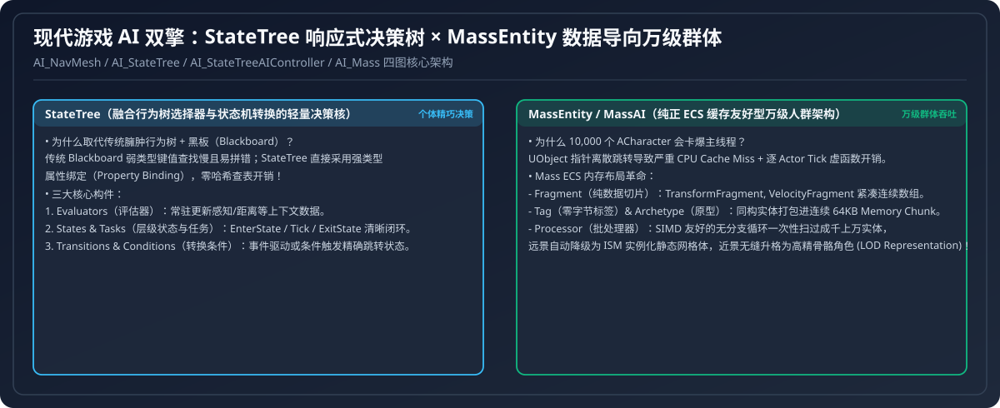
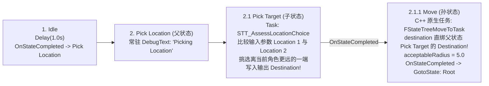
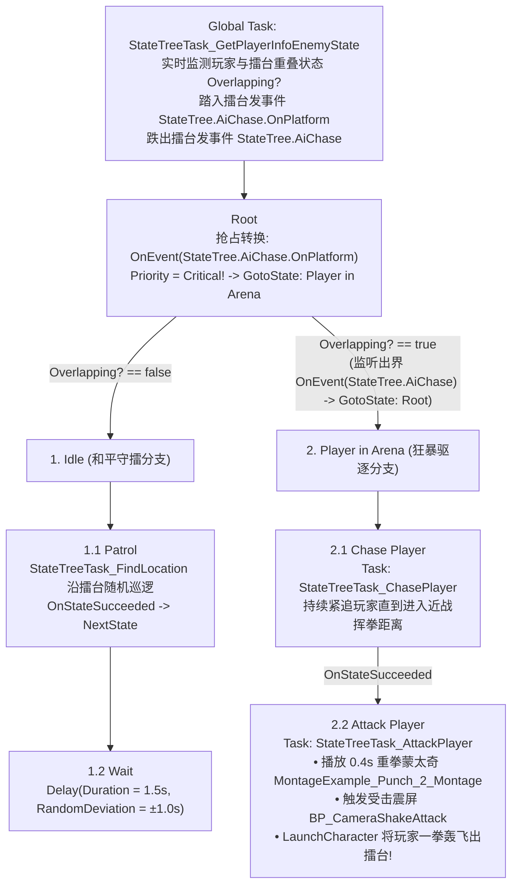

# 03 · AI 控制器状态树：感知刺激、智能对象与战术决策全解（`AI_StateTreeAIController`）

> **本篇实测拆解关卡档案**
> - **关卡路径**：`/Game/Maps/AI/AI_StateTreeAIController`（关卡总 Actor 数：`52` | 展台数：`11` | 示例 Actor 数：`26`）
> - **展厅五大分区（`BP_DemoRoom0`）**：`Introduction`（#1~#2）$\to$ `State Tree`（#3~#6）$\to$ `EQS`（#7）$\to$ `EQS 2`（#8）$\to$ `Delegates`（#9~#11）
> - **核心宿主架构**：通用敌人躯壳 `BP_EnemyAIWComponant`（`ACharacter` + `ABP_MannyStateTree`） + 灵魂控制器 `BP_AIController`（`AAIController` + `UStateTreeAIComponent`）
> - **核心资产目录**：`/Game/ExampleContent/StateTree/StateTrees/AIStateTrees/`、`/EnvironmentQueries/`、`/StateTreeAITasks/`

---

## 一、 从“机关逻辑”走向“鲜活生命”：为什么战斗 NPC 必须用 `StateTreeAIComponent`？

在上一篇 `AI_StateTree` 中，我们将普通的 `UStateTreeComponent` 直接挂在方块、灯泡、移动平台和任务管理器上，体验了通用层级状态树的干净利落。但当我们开始构建真正的**自主战术智能体（Autonomous Tactical Agent）**——比如一名能够巡逻领地、借助地形掩体包抄撤离、听到脚步声警觉转头、看到入侵者冲锋重拳出击的守卫时，虚幻引擎遵循着一条神圣的框架法则：**“肉体（`APawn` / `ACharacter`）与灵魂（`AController` / `AAIController`）彻底分离”**。

如果把 AI 状态树硬挂在肉体 `ACharacter` 身上，一旦角色钻进机甲载具（切换 Possess 的 Pawn）或肉体重生，大脑记忆就会随肉体一并销毁；更重要的是，虚幻全套底层 AI 武器库——**寻路跟随（`UPathFollowingComponent`）、视觉听觉感官（`UAIPerceptionComponent`）、焦点注视（`SetFocus`）与环境查询（`EQS`）**——全部归属于 **`AAIController`** 管辖！

为此，`/Script/GameplayStateTreeModule` 专门提供了面向 AI 控制器的高阶契约组件：**`UStateTreeAIComponent`**（绑定 `UStateTreeAIComponentSchema`）。

### 1.1 `StateTreeComponent` vs `StateTreeAIComponent` 核心能力对照表

| 架构维度 | 普通 `UStateTreeComponent`（上一章） | 专用 `UStateTreeAIComponent`（本章主角） |
| :--- | :--- | :--- |
| **挂载宿主** | 任意 `AActor`（机关门、UI 控制器、任务管理器） | **强制挂载于 `AAIController` 子类**（随 `Possess` 附身驱动任意 `APawn`） |
| **Schema 上下文注入** | 单一上下文：`Context: Actor` | **双重强类型上下文**：同时注入 `Context: Actor`（受控肉体 `APawn/ACharacter`）与 **`Context: AIController`（大脑控制器）** |
| **原生 C++ 专属任务库** | 仅基础 `Delay`、`DebugText`、`RunParallel` | **直接解锁引擎原生 C++ 高性能 AI 任务**：`FStateTreeMoveToTask`（支持动态追踪移动 Actor、自动重寻路、导航过滤器）、`FStateTreeRunEnvQueryTask`（原生异步 EQS 采样打分）等 |
| **AI 子系统打通** | 需手动跨对象查找控制器 | 原生直通 `UAIPerceptionComponent`（视听刺激）、`SetFocus`（朝向锁定）与 `SmartObjects`（智能交互对象申领） |

打开长达 155 米的 `/Game/Maps/AI/AI_StateTreeAIController` 展厅，你会看到一个令人拍案叫绝的工程设计：**从展台 #2 到展台 #11，整整 10 个行为迥异的 AI 哨兵，竟然 100% 共用同一个角色蓝图类 `BP_EnemyAIWComponant` 与同一个控制器类 `BP_AIController`**！它们之间唯一的区别，仅仅是在关卡实例细节面板里换了一棵不同的 `StateTree` 资产！

现在，让我们逐台拆解这 **11 座展台** 背后的全部状态树拓扑、EQS 战术算子与感知委托黑科技。

---

## 二、 第一与第二展区：AI 双重上下文、原生移动与父子状态协同（展台 #1 ~ #6）

### 展台 #1：`State Tree AI Componant` — 展厅总纲与柔和评测光场

- **空间元数据**：展牌 Label `BP_DemoDisplay4` | 坐标 `(499, -900, 0)` *(注：保留官方展牌原拼写 `Componant`)*
- **官方展牌原文**：
  > *StateTree is a general-purpose hierarchical state machine that combines the Selectors from behavior trees with States and Transitions from state machines. With StateTree, you can create highly performant logic that stays flexible and organized. Some examples share a BP Character class. It's recommended to click on the class in viewport and check the State Tree In use.*

#### 1.1 展台陈列 Actor 与环境配置（共 6 个）
- **`DirectionalLight`**（`Intensity = 1`，`Mobility = Movable`）与 **`SkyLight`**（`Intensity = 3`，`Mobility = Movable`）：采用低直射高天光的柔光环境，方便玩家在使用 **Gameplay Debugger Tool（按下撇号键 `'`）** 时清晰辨认地面上的绿色视野扇区、黄色听觉圆环与彩色 EQS 评分球。
- **`SkyAtmosphere2`**、**`ExponentialHeightFog2`**、**`DocumentationActor`** 与 **`Actor`**（挂载 `ChaosDebugDrawComponent_0`）：构成展厅基础环境与物理/AI 调试图层底座。

---

### 展台 #2：`State Tree AI Componant` — 动态控制器组件注入与通用躯壳 `BP_EnemyAIWComponant`

- **空间元数据**：展牌 Label `BP_DemoDisplay5` | 坐标 `(3001, -900, 0)`

#### 2.1 官方展牌说明与“一壳十魂”宿主蓝图深拆
> *The 'State Tree AI' component differs from the 'State Tree' Component and is designed to be used on an AIController. This AI Character spawns a StateTreeAI Component in the AIController. The State Tree contains one 'Idle' state with a debug value set to run forever.*

- **陈列 Actor（1 个）**：**`BP_EnemyAIWComponant`**（坐标 `(2991, ...)`，父类 `ACharacter`）
  - **视觉与骨骼动画栈**：`CharacterMesh0` 使用 `SKM_Manny_Simple`，动画蓝图挂载专为本展厅定制的 **`ABP_MannyStateTree_C`**（集成 `BS_MM_WalkRun` 地面混合空间、`MM_Jump / Fall_Loop / Land` 跳跃状态机与 `CR_Mannequin_BasicFootIK` 脚部 IK 控制绑定，还预留了 `DefaultSlot` 用于展台 #11 播放重拳攻击蒙太奇！）。
  - **7 大核心成员变量**：`State Tree`（实例可编辑的 `UStateTree` 资产引用！）、`IntroStringExample`、`StateTreeComponant`、`ButtonReference`、`bShowPerceptionFilter`、`perceptionPlane`、`PerceptionPlaneMaterial`。
  - **灵魂控制器 `BP_AIController`**（父类 `/Script/AIModule.AIController`）：内含示例变量 `AIControllerExampleString`。当 `BP_EnemyAIWComponant` 在关卡启动被 `BP_AIController` 附身（Possess）时，自动将角色身上配置的 `State Tree` 资产（此处为 **`ST_AI_Intro`**）赋给控制器中的 `StateTreeAIComponent` 并启动运行！
- **状态树 `ST_AI_Intro` 拆解**：
  - `Root` $\to$ `Idle`：挂载 1 个 `StateTreeDelayTask`（实测参数 `duration = 4.0`，**`bRunForever = true`**），让 Manny 角色安静地保持待机呼吸姿态永久驻留。

---

### 展台 #3：`State Tree AI Context` — 肉体（Actor）与灵魂（AIController）双上下文直读

- **空间元数据**：展牌 Label `BP_DemoDisplay6` | 坐标 `(3981, -900, 0)`
- **官方展牌原文**：
  > *State Tree AI uses a schema which includes 'AI Controller Class' in the State Tree Context as well as the 'Context Actor Class'. The State Tree here swaps between 2 states - printing a String Variable stored in the Character Bp and one from the AIController; making use of both Context.*

#### 3.1 状态树 `ST_AI_Context` 如何零转型访问两边的数据？
在传统行为树中，Task 里想拿 `ACharacter` 自定义变量，每次都要拖出 `Event Receive Execute AI` $\to$ `Cast To BP_EnemyAIWComponant`，既繁琐又产生硬引用开销。而在选用了 `StateTreeAIComponentSchema` 的 **`ST_AI_Context`** 顶部 Schema 面板中，只需直接把：
- **`Context Actor Class`** 设为 `BP_EnemyAIWComponant`；
- **`AI Controller Class`** 设为 `BP_AIController`。

整棵状态树的所有属性绑定下拉菜单里，便同时出现了肉体与灵魂的全部成员变量！
- **`Root`**：挂载常驻 `StateTreeDebugTextTask`（`bConsideredForCompletion = false`）持续在头顶渲染文本；
- **子状态 1 `Context Actor Class`**：运行 `Delay (3.0s)`，将存储在角色蓝图 `BP_EnemyAIWComponant` 中的字符串 `"This string is stored in the Character BP - accessed via the Context Actor Class in State Tree."` 展示 3 秒，完成后 `OnStateCompleted -> GotoState: AIController Class`；
- **子状态 2 `AIController Class`**：运行 `Delay (4.0s)`，无缝切换读取存储在 `BP_AIController` 中的 `AIControllerExampleString` 展示 4 秒，完成后 `OnStateCompleted -> GotoState: Root` 循环往复！

---

### 展台 #4：`Idle, Location, Move` — 远端目标评估与原生 C++ `StateTreeMoveToTask` 登场

- **空间元数据**：展牌 Label `BP_DemoDisplay7` | 坐标 `(4991, -900, 0)`

#### 4.1 官方展牌说明与四级嵌套状态树 `ST_AI_IdleAndMove` 深拆
> *This State Tree uses the Context Actor Class to get the location of the character. It then runs a State Tree Task to find the furthest of the 2 given Vector Parameter Locations and outputs the results into a MoveTo Task. See each State Description for more information.*

拆解 `ST_AI_IdleAndMove` 的对象层级路径（`StateTreeState_0.StateTreeState_1.StateTreeState_1.StateTreeState_2`），可以看到一条教科书式的**四级作用域数据接力链**：

#### 4.2 为什么实战 AI 强烈推荐用原生 C++ `StateTreeMoveToTask` 替代手写蓝图 MoveTo？
注意展台 #4 的 `Move` 状态不再使用上一章教学演示用的蓝图封装 `StateTreeTask_MoveToBasic`，而是正式启用了引擎 `/Script/GameplayStateTreeModule` 内置的 C++ 结构体任务 **`FStateTreeMoveToTask`**（实例数据 `FStateTreeMoveToTaskInstanceData`）：
1. **零 `UObject` GC 负担**：纯 C++ 结构体内存布局，成百上千个 NPC 同时寻路也毫无垃圾回收压力；
2. **动态移动目标自动追踪**：既支持绑定静态坐标 `destination`，也支持绑定活体 `targetActor`——当追踪的玩家跑出容差阈值 `destinationMoveTolerance` 时，底层 `UAITask_MoveTo` 自动局部更新路径而无需打断重启状态！

---

### 展台 #5：`Move with Evaluator Reference` — 领地中心评估器（Home Location）与寻路失败自愈闭环

- **空间元数据**：展牌 Label `BP_DemoDisplay8` | 坐标 `(5991, -900, 0)`
- **官方展牌原文**：
  > *This State Tree finds a random location on a given "Home" location. The Home Location is set via the Evaluator but could contain a reference in the controller or character. If a suitable location is found- the Character will move. If no suitable location is found the Transition rules to try again.*

#### 5.1 全局评估器 `STE_FindHomeLocation` 与容错重试状态树 `ST_AI_MoveHomeLocation`
在开放世界野怪设计中，怪物不能漫无目的地越走越远离开刷怪营地，必须围绕一个**出生驻地（Home Location / Leash Anchor）** 巡逻。
- **全局评估器 `STE_FindHomeLocation`**（父类 `UStateTreeEvaluatorBlueprintBase`，变量 `CharacterRef`、`Home Actor`）：在状态树启动时定位并缓存领地基准锚点，将其作为只读全局数据源暴露给整棵树。
- **状态流与容错自愈设计**：
  - `Idle` (`Delay 1.0s`) $\to$ `Find Location` (`DebugText: 'Finding Location'`) $\to$ 子状态 `Get Destination`（运行 **`STT_FindHomeLocation`**，以评估器输出的 `Home Actor` 为圆心、在 `SearchRadius` 内调用 `GetRandomReachablePointInRadius` 生成随机点 `Destination`）$\to$ 孙状态 `Move`（`StateTreeMoveToTask`）。
  - **工程级容错亮点**：万一随机抽到的边缘点恰好被动态障碍堵死导致不可达怎么办？看 `Move` 状态的双路转换规则：
    1. **`OnStateFailed` $\to$ `GotoState: Find Location`**：一旦寻路或移动失败，绝不卡死原地，立刻跳回 `Find Location` 重新抽取下一个合法点！
    2. **`OnStateSucceeded` $\to$ 正常返回 `Idle` 开启下一轮休闲停顿**。

---

### 展台 #6：`Parent States` — 父状态伴随切入与“莱格尔折返跑（Bleep Test）”无级变速实战

- **空间元数据**：展牌 Label `BP_DemoDisplay9` | 坐标 `(6981, -900, 0)`

#### 6.1 官方展牌说明与陈列 Actor 拆解（共 4 个）
> *Parent states can transition / run while a child state is running. This State tree increases the movement speed each time it swaps location states. Once hitting a speed limit, it will reset.*

熟悉足球或体能训练的读者看到内部资产名 **`BP_Bleeptest`** 与 **`ST_AI_Bleeptest`** 一定会会心一笑——这正是体育界著名的**“20米多级折返跑测试（Bleep Test）”**：运动员在两条线之间来回冲刺，每跑完一趟速度就强制加快一档，直到跑到极限速度后重置！
- **`Plane`** 与 **`Plane2`**（覆写棋盘格材质 `M_Checker`）：南北两端醒目的黑白折返踏板线。
- **`BP_Bleeptest`**（记分牌 Actor，持有 `BP_EnemyAIWComponant5` 引用与 `TextRender` 组件）：实时读取并悬浮显示 AI 当前的 `Max Walk Speed`！
- **`BP_EnemyAIWComponant5`**：运行 **`ST_AI_Bleeptest`**。

#### 6.2 `ST_AI_Bleeptest` 如何利用父状态优雅消除重复逻辑？
- **状态层级拓扑**：
  - `Root`
    - $\hookrightarrow$ 父状态 **`GoToB`**（挂载任务 **`STT_UpdateSpeed`**）
      - $\hookrightarrow$ 子状态 **`MoveB`**（`StateTreeMoveToTask` 跑向踏板 B，`OnStateSucceeded -> GotoState: GoToA`）
    - $\hookrightarrow$ 父状态 **`GoToA`**（挂载任务 **`STT_UpdateSpeed`**）
      - $\hookrightarrow$ 子状态 **`MoveA`**（`StateTreeMoveToTask` 跑向踏板 A，`OnStateSucceeded -> GotoState: GoToB`）
- **运行机理解析**：当 `MoveA` 跑到终点跳转到 `GoToB` 时，StateTree 会**自顶向下先进入父状态 `GoToB`（触发 `STT_UpdateSpeed`：将角色的 `MaxWalkSpeed` 增加 `IncrementalSpeed`，若超过上限 `TopSpeed` 则重置回 `ResetSpeed`），紧接着在同一帧无缝下钻进入子状态 `MoveB` 开始以新速度狂奔**！在更复杂的实战中（如父状态 `Combat` 挂“举枪瞄准姿态 + 紧盯玩家焦点”，底下分 `StrafeLeft`、`StrafeRight`、`Advance` 三个移动子状态），利用父状态承载公共状态上下文与持续行为，能让整棵决策树干净得像艺术品。

---

## 三、 第三与第四展区：EQS 环境查询系统战术选位闭环（展台 #7 ~ #8）

如果说 NavMesh 回答了“**怎么走过去**”，StateTree 回答了“**现在该干什么**”，那么 **EQS（Environment Query System，环境查询系统）** 回答的就是战术 AI 最烧脑的空间几何问题：**“在周围几百个可能站脚的位置里，哪一个点视野最好、离掩体最近、离手雷最远？”**

EQS 的底层工作流由三大算子组成：
1. **Generator（候选点生成器）**：围绕基准点生成规则方阵（Simple Grid）、同心圆环（Donut/Circle）或路径多边形采样点（Items）；
2. **Context（参考上下文）**：定义生成或测试时的参照系（默认 `EnvQueryContext_Querier` 即 AI 自己，也可自定义为“玩家位置”、“队友位置”或“Boss 位置”）；
3. **Tests（过滤与打分测试链）**：依次对每个采样点执行距离（Distance）、射线遮挡（Trace Visibility，找掩体神技！）、朝向点积（Dot）、寻路可达性（PathFinding）测试——**不满足硬性条件的点直接 `Filter` 淘汰出局，剩余合法点按权重曲线归一化计算综合得分 $[0, 1]$，最终把最高分（或前 $N\%$ 随机优选）的黄金战术点输出给 StateTree**！

---

### 展台 #7：`Environment Query System (EQS)` — 网格采样点生成、`NextState` 顺序链与实时可视化

- **空间元数据**：展牌 Label `BP_DemoDisplay10` | 坐标 `(8511, -900, 0)`
- **官方展牌原文**：
  > *State Trees can use the Environment Query System (EQS) to generate locations from the environment. In this example, the EQS creates a grid around the start point and randomly selects one of the positions. Press the apostrophe ( ' ) key and then Numpad 3 to visualize EQS-generated locations.*

#### 7.1 展台陈列 Actor 与一键可视化压力踏板（共 3 个）
- **`BP_EnemyAIWComponant6`**（运行 `ST_AI_EQS`）与局部 **`NavMeshBoundsVolume`**。
- **`BP_Visulizer_PressureButton`**：展台前方特意摆放了一块交互式发光压力踏板！玩家角色踩上去即可自动执行控制台调试指令（等价于手动按下键盘撇号键 **`'`** 呼出 Gameplay Debugger，再按 **`Numpad 3`** 开启 EQS 调试通道），地面瞬间浮现出整齐排列的采样圆球矩阵！

#### 7.2 状态树 `ST_AI_EQS` 与 `NextState` 极简顺序流
观察 `ST_AI_EQS` 的三个平级子状态，展示了一种比显式指定状态名更灵活的 **`linkType = NextState`（自动顺延下一兄弟状态）** 写法：
1. **`Idle`**：`StateTreeDelayTask (0.5s)`，完成后 `OnStateCompleted -> NextState`（自动进入排在下面的 `Run EQS`）；
2. **`Run EQS`**：调用引擎内置 EQS 执行任务运行资产 **`EQS_StateTreeAI_PointsAround`**（围绕起点生成二维投影在 NavMesh 上的 Grid 点阵并随机择优输出坐标），同时并发显示 `'Running EQS'`；查询成功后 `OnStateSucceeded -> NextState`（自动进入排在下面的 `Move`）；
3. **`Move`**：`StateTreeMoveToTask` 直接绑定 `Run EQS` 输出的查询结果坐标完成跑位！未来即便在 `Run EQS` 和 `Move` 中间插入一个“播放起步喊叫动画”的新状态，上下游转换连线一行都不用改！

---

### 展台 #8：`EQS - Context - Run Away from Player` — 自定义玩家上下文与距离打分逃生实战

- **空间元数据**：展牌 Label `BP_DemoDisplay11` | 坐标 `(9931, -50, 0)`

#### 8.1 官方展牌说明与实时热力图预览器 `BP_EQSVis` 深拆（共 4 个 Actor）
> *This EQS uses a custom Environment Query System Context blueprint to pass in the player character's location. A distance test is then applied, then filtered and scored based on how far they are from that context point. Press the apostrophe ( ' ) key and then Numpad 3 to visualize EQS-generated locations.*

仔细看上方实拍图里满地色彩斑斓的评分球！这是因为展台除了摆放地板 `Nav`、调试踏板 `BP_Visulizer_PressureButton2` 和逃生 AI **`BP_EnemyAIWComponant7`** 外，还专门放置了一个开发期调参神器——**`BP_EQSVis`**（继承自引擎 `AEQSTestingPawn`）：
- **MCP 实测参数**：`queryTemplate = EQS_StateTreeAI_RunAway`，`stepToDebugDraw = 1`，`highlightMode = All`，`queryingMode = AllMatching`，`bDrawFailedItems = true`，`bDrawLabels = true`。无需进入游戏运行，直接在编辑器里拖动 `BP_EQSVis` 或走近它，就能实时看到离玩家近的采样球变红/淘汰（低分危险区）、离玩家越远的边缘采样球越绿且标出接近 `1.00` 的高分（最佳撤离点）！

#### 8.2 自定义上下文 `BP_EQC_PlayerLocation` 与逃生状态树 `ST_AI_EQS_Runaway` 全闭环
1. **自定义蓝图上下文 `BP_EQC_PlayerLocation`**（继承 `UEnvQueryContext_BlueprintBase`）：重载 `ProvideSingleActor` / `ProvideSingleLocation`，返回当前玩家角色的世界坐标作为危险辐射源基准点。
2. **`EQS_StateTreeAI_RunAway` 打分逻辑**：先在场地内铺设导航网格候选点，再挂载以 `BP_EQC_PlayerLocation` 为参照物的 **Distance Test**——过滤掉距离玩家过近的贴脸危险点，并对剩余可达点按“离玩家距离正相关”线性打分，选出全场最远的安全角落！
3. **`ST_AI_EQS_Runaway` 决策流水线**：
   - **全局任务 `STTG_getPlayerCharacterRef`**：缓存玩家角色引用；
   - **状态 1 `IsClose?`**：运行自定义警戒测距任务 **`STT_PlayerDistanceToAIChar`**（输入 `PlayerCharacterRef`、`AICharacterRef` 与警戒半径 `DistanceThreshold`）。当玩家离得很远时，AI 安心待在原地；**一旦玩家踏入警戒圈（`ActualDistance < DistanceThreshold`），任务立即返回 `Succeeded`，触发 `NextState` 启动紧急撤离**！
   - **状态 2 `Run EQS` $\to$ 状态 3 `Move`**：瞬间运行 `EQS_StateTreeAI_RunAway` 算出离玩家最远的对角线安全点，交由 `StateTreeMoveToTask` 拔腿逃跑！玩家一路追，AI 就一路算点风筝逃逸，活脱脱一个聪明的远程射手/胆小哥布林！

---

## 四、 第五展区：外部事件、AI 感知委托刺激与竞技场综合实战（展台 #9 ~ #11）

当状态树需要响应瞬息万变的战场变化时，UE5 提供了两套互补的零轮询通信利器：**`StateTree Events`（外部跨系统标签广播）** 与 **`StateTree Delegates`（内部任务间强绑定信号线）**。

---

### 展台 #9：`State Tree Events` — 根状态全局拦截外部 GameplayTag 强制起跳中断

- **空间元数据**：展牌 Label `BP_DemoDisplay12` | 坐标 `(13541, -900, 0)`
- **官方展牌原文**：
  > *StateTree Events are best for triggering transitions from outside the State Tree, like a button press or gameplay event. They're tied to Gameplay Tags and let you jump between states when something external happens. You can transition between states in a State Tree using StateTreeEvents managed by Gameplay Tags. A parent can also hold the transition, so any of its children can respond. In this example, the root parent listens for a Jump Event sent from the Button to the AI Blueprint, triggering a transition to a state with a jump task. Press the button to send the event tag.*

#### 9.1 `ST_AI_MoveHomeLocationWithTag` 层级中断解剖
- **陈列 Actor（2 个）**：交互按钮 **`BP_Button_Parent_SinglePress`** 与绑定了 `buttonReference` 的 **`BP_EnemyAIWComponant9`**。
- **平时巡逻态**：AI 运行与展台 #5 完全相同的 `Idle -> Find Location -> Get Destination -> Move` 领地随机巡逻。
- **根状态全局拦截（Root-Level Preemption）**：
  在最顶层 **`Root`** 状态上挂载了一条 `trigger = OnEvent` 转换：监听标签 **`StateTree.AI.Jump` $\to$ `GotoState: ForceJump`**。
  当玩家按下按钮时，外部蓝图向 `StateTreeAIComponent` 投递 `StateTree.AI.Jump`。**无论此刻 AI 正停在 `Idle` 发呆、在 `Get Destination` 算点、还是在 `Move` 半途奔跑，`Root` 级转换都会瞬间打断整个子孙激活栈**，切入 `ForceJump` 状态执行 **`STT_ForceJumpAI`**（调用 `ACharacter::Jump()` 驱动 `ABP_MannyStateTree` 腾空跃起！），起跳动作完成后 `OnStateCompleted -> GotoState: Idle` 丝滑恢复巡逻！

---

### 展台 #10：`State Tree Delegates (With Perception)` — 视觉/听觉感知刺激、刺激遗忘与内部委托零轮询通信

- **空间元数据**：展牌 Label `BP_DemoDisplay13` | 坐标 `(14531, -900, 0)`

#### 10.1 架构师必考：什么时候用 `Events`（展台 #9），什么时候用 `Delegates`（展台 #10）？
> *Delegates are better for internal communication within the State Tree. A task can broadcast a delegate as a signal, and other tasks (or parent states) can bind to it and respond without constant polling. In this example, AI Perception delegates spotted and heard events, showing symbols to indicate what the AI detects. Press the apostrophe ( ' ) key and Numpad 4 to visualize perception. Stimulus Forgetting is enabled in Project Settings so AI Perception doesn’t remember stimuli forever. Another Delegate is triggered when the AI has forgotton the player.*

- **外部通知用 `Events`（GameplayTag）**：按钮、机关、GAS 技能受击、剧情触发器等**树外系统**并不知道状态树里具体配了哪几个 Task，因此通过松耦合的全局 `GameplayTag` 往树里扔事件最合适；
- **树内协同用 `Delegates`（`FStateTreeDelegateDispatcher` + `FStateTreeDelegateListener`）**：当信号源本身就是树里的某个 **Global Task 或父级 Task**（例如专门监听感知的后台任务），用委托直接连线给 `OnDelegate` Transition，**无需去项目设置里注册一堆全局 GameplayTag 污染命名空间，而且在编辑器里具有点对点强类型连线校验，广播开销近乎为零**！

#### 10.2 `AI Perception`（视听双感官 + 遗忘机制）与 `ST_AI_MoveHomeLocationWithDeleagte` 全拆解
1. **角色头顶感官气泡材质 `M_Perception` 揭秘**：
   `BP_EnemyAIWComponant10` 头顶额外挂载了一块双面无光照半透明平面 `Plane`，绑定动态材质实例 `MID_M_Perception_0`（母材质 `/Game/ExampleContent/StateTree/Materials/M_Perception` 采样贴图 `T_Perception`，包含标量参数 `Enable` 控显隐、`Choice` 在蓝色 `(0, 0.145, 0.594)` 与暗红色 `(0.167, 0, 0.013)` / 眼睛与耳朵图标间插值切换！）。
2. **全局感知监听任务 `STTG_ListenForPerception`**：
   - 在 `TreeStart` 时获取 `BP_AIController` 上的 **`UAIPerceptionComponent`**，绑定 `OnTargetPerceptionUpdated` 与 `OnTargetPerceptionForgotten` 原生回调；
   - 内部暴露 **3 个 `FStateTreeDelegateDispatcher` 输出引脚**：
     - **`PerceptionSightDelegate`**：当玩家踏入前方绿色视野扇区（`UAISense_Sight` 无遮挡射线检测通过）时立即 `BroadcastDelegate`！
     - **`PerceptionHearingDelegate`**：当玩家在视觉盲区跑动跳跃发出噪音（`MakeNoise` 触发 `UAISense_Hearing` 落入黄色听觉半径）时立即 `BroadcastDelegate`！
     - **`ForgottenPlayer`**：项目开启了 **`Stimulus Forgetting`（刺激最大存活时长 `MaxAge` 超时遗忘）**——当玩家躲回掩体后经过数秒未再产生新视听刺激，感知系统触发遗忘回调，广播 `ForgottenPlayer` 委托！
3. **`Root` 三路 `OnDelegate` 精准分流**：
   `Root` 上并列挂载 3 条 `trigger = OnDelegate` 转换，分别绑定上述 3 个 Dispatcher，零延迟切入子状态 **`Seen`**（点亮头顶“看见”图标 `IsSight? = true`）、**`Heared`**（点亮头顶“听见”图标 `IsSight? = false`）与 **`ResetPerception`**（熄灭图标 `EnablePerceptionViz = false`），刷新完状态提示后立刻无缝回归日常领地巡逻！*(调试技巧：运行中按 `'` 键再按 `Numpad 4`，即可直观看到绿色主视野锥、外围视野与听觉刺激点！)*

---

### 展台 #11：`Arena` — 巡逻、Critical 最高优抢占追击、出拳蒙太奇与击飞出界完整 Boss 闭环

- **空间元数据**：展牌 Label `BP_DemoDisplay17` | 坐标 `(15542, 14, -6)`
- **官方展牌原文**：
  > *This enemy uses a State Tree to patrol the ring with random delays. When a player enters the arena, the patrol is interrupted using a State Tree Event, triggering the enemy to chase and attack once in range, launching the player out of the arena.*

#### 11.1 展台陈列 Actor 与资产清单（共 2 个）
- **`BP_ArenaStateTree`**：由内外双层圆柱体构成的蓝色高光圆形角斗场（覆写材质实例 `GlossyBlue`：`Roughness = 0.1287`，深海蓝 `(0, 0.0082, 0.4948)`）。
- **`BP_EnemyAIWComponant8`**：镇守擂台的角斗士 AI，运行压轴状态树 **`ST_EnemyStateAI`**。

#### 11.2 压轴状态树 `ST_EnemyStateAI` 完整战斗状态机解剖

请特别留意这里两个极具实战含金量的细节：
1. **转换优先级 `priority = Critical`**：在复杂 AI 树中，同一帧可能同时有子状态的 `OnStateSucceeded`（`Normal` 优先级）和顶层的受击/入侵紧急事件发生。将 `Root` 上的入侵转换设为 **`Critical`**，确保无论子状态正在做什么收尾跳转，战斗警报永远享有第一顺位绝对抢占权！
2. **随机偏差 `RandomDeviation = 1.0s` 消除机械感**：`Wait` 状态的 `Delay` 设置为 `1.5s ± 1.0s`（即每次停顿在 `0.5s ~ 2.5s` 之间均匀随机浮动），哪怕场上同时放 10 个守卫，也绝不会出现滑稽的“齐步走同步转身”广播体操现象。

---

## 五、 现代战术 AI 闭环最后一块拼图：SmartObjects（智能交互对象）与 StateTree 协同架构

除了展厅已演示的 `MoveTo`、`EQS` 与 `AI Perception` 外，在构建现代开放世界生活化 NPC 或战术掩体战时（如守卫累了去长椅坐下喝咖啡、铁匠去铁砧打铁、士兵冲向矮墙精确对位翻越或依托射击孔架枪），如果在 AI 状态树里硬编码每一种家具的坐标偏移和动画，AI 蓝图很快就会臃肿不堪。

这正是 UE5 **`SmartObjects`（智能对象插件）+ `GameplayBehaviorSmartObjects` + `StateTree`** 登场的舞台！它将“交互知识”从 AI 大脑转移到了环境家具自己身上（致敬《模拟人生》经典的架构设计）：

1. **环境端声明槽位（`USmartObjectComponent` + `USmartObjectDefinition`）**：
   一张长椅 Actor 挂载 `SmartObjectComponent`，配置 2 个交互槽位（Slot 0、Slot 1），声明每个槽位的精确入口对位矩阵、所需用户标签过滤（`UserTagFilter`）以及对应的交互行为定义（甚至可以是一棵嵌入式的交互子 `StateTree` 或 `UGameplayBehaviorConfig` 蒙太奇配置！）。
2. **AI 端四步原子申领协议（避免两个 NPC 叠罗汉坐同一把椅子！）**：
   在 `StateTreeAIComponent` 中，AI 按严格的四步事务与 `USmartObjectSubsystem` 交互：
   - **Step 1 `FindSmartObjects`（搜索）**：Evaluator 或寻物 Task 搜索周围半径内携带 `Activity.Rest` 标签且处于 `Free` 空闲状态的槽位列表；
   - **Step 2 `ClaimSmartObject`（原子锁占槽位！）**：**在出发走路之前**，先向子系统申请锁定某个槽位拿到 `FSmartObjectClaimHandle`！一旦 Claim 成功，该槽位立即变为 `Claimed`，其他路过的 NPC 绝不会再抢这个座位；
   - **Step 3 `MoveTo`（走向槽位入口）**：驱动角色精确走到 `GetSlotLocation(ClaimHandle)`；
   - **Step 4 `Use / Release`（执行智能行为并释放）**：调用内置 `FStateTreeMoveToAndUseSmartObjectTask`（或 `USmartObjectBehaviorDefinition`）接管角色播放坐下循环动画；一旦第 #10 台那样的 `AI Perception` 突然发现玩家触发 `Critical` 抢占中断，状态树的 `ExitState` 会**自动析构释放 `ClaimHandle`**，长椅槽位瞬间恢复 `Free` 供他人使用，绝不留下死锁脏槽位！

---

## 六、 本篇核心总结与下章预告

在本篇 `AI_StateTreeAIController` 的深度巡礼中，我们完成了单个战术智能体从“能走”到“善战”的全面武装：
1. **`StateTreeAIComponent`** 打通了 `ACharacter` 肉体与 `AAIController` 灵魂的双重强类型上下文，并引入零 GC 的原生 C++ `StateTreeMoveToTask`；
2. **父子状态伴随切入**与 **Evaluator 领地锚定 + 失败重抽点** 构筑了高复用、不卡死的稳健巡逻底座；
3. **EQS 环境查询系统**结合自定义 `Context` 与距离/视线打分，赋予了 AI 审时度势的空间选位智商；
4. **`OnEvent` 外部抢占**、**`OnDelegate` + `AI Perception` 视听刺激与超时遗忘**，配合 **`SmartObjects` 原子槽位申领**，让单个精英 NPC 的交互与战斗表现达到了 3A 工业级水准。

然而，当镜头拉向百米高空的繁华都市十字路口或尸潮攻城战场——**如果同屏不是 1 个守卫，而是 10,000 个独立思考、彼此避让的行人呢？** 为什么哪怕最精简的 `ACharacter + AIController` 到了一千人就会让主线程彻底瘫痪？请翻开本系列终极篇章 **`04 · 面向数据 ECS 万级群体模拟：Trait、Fragment 与 LOD 避障全解（AI_Mass）`**！
