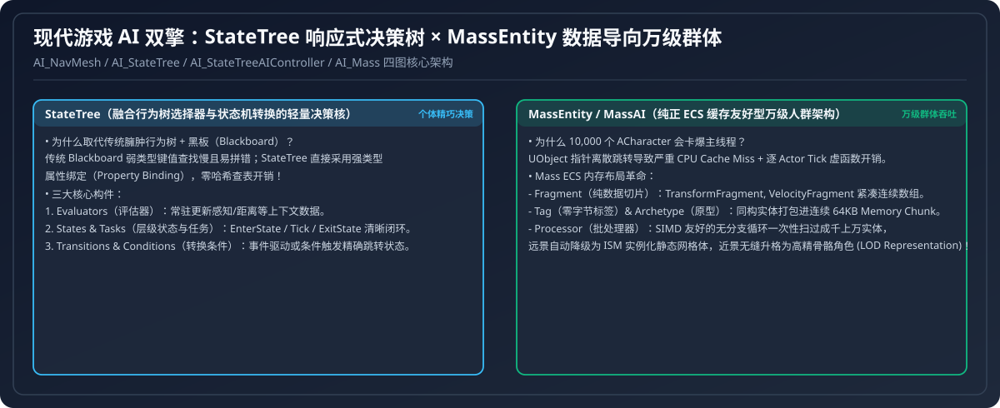
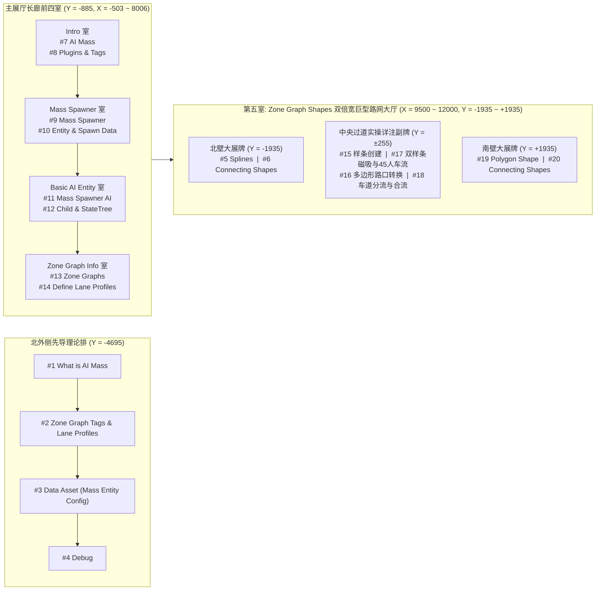
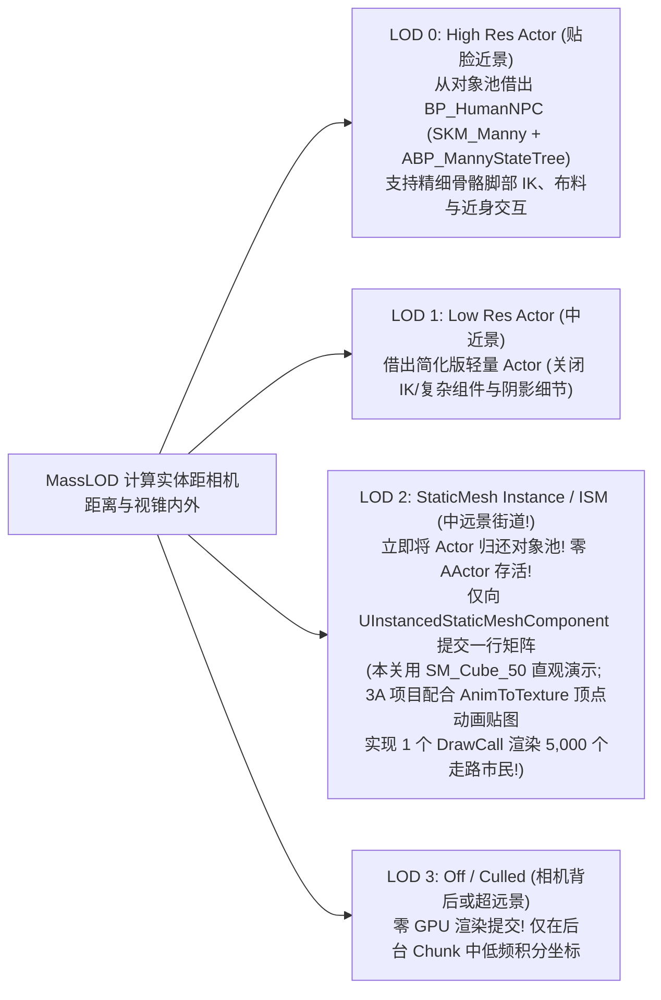

# 04 · 面向数据 ECS 万级群体模拟：Trait、Fragment 与 LOD 避障全解（`AI_Mass`）

> **本篇实测拆解关卡档案**
> - **关卡路径**：`/Game/Maps/AI/AI_Mass`（关卡总 Actor 数：`66` | 展台数：`20` | 示例 Actor 数：`31`）
> - **主展厅五大分区（`BP_DemoRoom0`）+ 北侧先导理论排**：北外侧理论排（#1~#4）+ `Intro`（#7~#8）$\to$ `Mass Spawner Actor`（#9~#10）$\to$ `Basic AI Entity`（#11~#12）$\to$ `Zone Graph Information`（#13~#14）$\to$ `Zone Graph Shapes` 巨型路网厅（#5~#6、#15~#20）
> - **核心插件栈**：`MassEntity`、`MassGameplay`、`MassAI`、`MassCrowd`、`ZoneGraph`、`MassInsights`
> - **核心资产目录**：`/Game/ExampleContent/MassAI/DataAssets/`（`DA_MAssEntity_Intro`、`DA_MassAI_Parent`、`DA_MassCrowdAgent_Child_StateTree`）、`ST_MassBehaviour_CrowdState`、`BP_HumanNPC`

---

## 一、 第一性原理拷问：为什么 10,000 个 `ACharacter` 会让顶级 CPU 彻底崩溃？

在《黑客帝国：觉醒（The Matrix Awakens）》技术演示中，曼哈顿街头同时流淌着超过 **35,000 名独立行走的市民与数千辆汽车**；而在一个常规虚幻工程里，只要你用 `SpawnActor` 往平地上刷出 **800 ~ 1,200 个默认 `ACharacter`** 并让它们各自跑 `AI MoveTo`，哪怕显卡空闲得风扇都不转，CPU 游戏主线程（Game Thread）帧时间也会瞬间飙破 `50 ms`（跌破 20 FPS）！

**为什么现代 16 核 5.0 GHz 的怪兽级 CPU，算不动区区一千个小人的位移加法？**

罪魁祸首根本不是算术运算本身，而是传统**面向对象编程（OOP）与现代 CPU 高速缓存层级（Cache Hierarchy）之间的物理鸿沟——“内存墙（Memory Wall）”**！

### 1.1 定量解剖 OOP（10,000 个 `ACharacter`）的三重硬件灾难

在现代 x86-64 / ARM 处理器上，执行一次浮点向量乘加 $\vec{P} \leftarrow \vec{P} + \vec{V}\cdot\Delta t$ 只需 **`~0.5 ns`（1~2 个时钟周期）**；如果数据就在 L1 高速缓存中，读取耗时仅 **`~1 ns`（4 周期）**；但一旦发生 **L3 Cache Miss（缓存未命中）被迫去主内存 DRAM 抓数据，CPU 核心流水线将原地空转停顿高达 `60 ~ 100 ns`（200 ~ 300 个时钟周期）**！

当我们用传统 `ACharacter` 模拟 10,000 名路人时，每一帧都在精准引爆以下三颗性能核弹：
1. **指针追逐（Pointer Chasing）引发雪崩式 Cache Miss**：
   每个 `ACharacter` 都是堆内存里独立 `malloc` 出来的庞然大物（自身超 `1.5 KB`），其内部又通过指针跳转指向另一块堆内存里的 `UCharacterMovementComponent`（超 `2 KB`）、`UCapsuleComponent`、`USkeletalMeshComponent` 与 `AAIController`。10,000 个角色在虚拟地址空间里像碎玻璃一样随机散布，CPU 硬件预取器（Hardware Prefetcher）完全无法预测下一个地址，几乎每一次 `Actor->Tick()` 都在硬吃 DRAM 延迟！
2. **64 字节缓存行（Cache Line）污染率高达 90%**：
   CPU 从内存往 L1 Cache 搬运数据的最小物理单位是 **64 Bytes（一条缓存行）**。当你只想读 `ACharacter` 里的 `12 Bytes` 速度向量时，顺带被拖进宝贵 L1 Cache 的其余 `52 Bytes` 全是此时毫不相干的 `ActorTag`、网络复制标志、受击回调与物理材质指针——有效带宽利用率惨不忍睹！
3. **万次虚函数（`vtable`）间接跳转与分支预测失败**：
   10,000 个 Actor 各自注册独立的 `FTickFunction` 任务节点，每帧伴随数万次虚函数查表跳转，彻底扼杀了编译器生成 **SIMD（单指令多数据流，如 AVX2 一次并行算 8 个浮点数）** 的一切可能。

---

### 1.2 `MassEntity` 纯正 Archetype-Chunk ECS 架构的降维打击

为彻底打破面向对象内存墙，Epic 打造了完全脱离 `UObject / AActor` 体系的原生数据导向（Data-Oriented Design, DOD）框架——**`MassEntity`**。它的五大核心原语构成了教科书级的 **Archetype-Chunk ECS** 引擎：

| ECS 核心原语 | C++ 基类 / 结构体 | 内存占用与底层硬件职责 |
| :--- | :--- | :--- |
| **1. Entity（实体）** | `FMassEntityHandle` | **仅 8 字节纯整数（`int32 Index` + `int32 SerialNumber`）**！不是指针，不是 `UObject`，仅作为定位表格行号的轻量身份证（序列号防止槽位复用后的悬空句柄访问）。 |
| **2. Fragment（数据片段）** | `FMassFragment` 子类 | **纯数据结构体（POD / `UScriptStruct`）**，严禁包含任何虚函数或业务逻辑！按职责拆到极致细粒度：如 `FTransformFragment`（仅存矩阵）、`FMassVelocityFragment`（仅存速度）、`FAgentRadiusFragment`（仅存半径 `float`）。 |
| **3. Tag（零字节分流标签）** | `FMassTag` 子类 | **实例内存占用 `0 Bytes`！** 标签本身不存进实体数组，而是作为**原型分流器**——贴了 `FMassOffLODTag` 的远景实体会自动归入独立内存池，Processor 在查询级直接跳过整块池，内层循环零 `if` 分支！ |
| **4. Shared Fragment（共享只读配置）** | `FMassConstSharedFragment` | 10,000 个同类市民**共用内存中唯一一份**移动最大速度、转向加速度与模型资产配置，将单实体独占内存压缩到极致的百字节级！ |
| **5. Archetype & Chunk（同构连续内存页 + SoA）** | `FMassArchetypeData` | 拥有完全相同 Fragment + Tag 组合的所有实体被归入同一个 **Archetype（原型）**，底层按固定大小（如 `128 KB`）的连续内存页 **Chunk** 存储，并在页内采用 **SoA（Structure of Arrays，数组结构）** 紧密排布： `[Pos_0, Pos_1, ..., Pos_N]` 紧接着 `[Vel_0, Vel_1, ..., Vel_N]`！ |
| **6. Processor & Trait（批处理器与配方积木）** | `UMassProcessor` / `UMassEntityTraitBase` | **Trait** 是设计师在编辑器里搭积木的“声明式配方”（声明本类实体需要哪些 Fragment 与 Tag）；**Processor** 则是每帧**全局只调用 1 次 `Execute()`** 的无状态流水线算子——通过 `FMassEntityQuery` 顺序横扫所有匹配 Chunk，**L1 Cache 命中率逼近 100%，满血跑满多核 TaskGraph 并行线程与 SIMD 向量单元**！ |

---

## 二、 `AI_Mass` 展厅三维空间导览：看懂全部 20 座展台的空间布局

在对本关执行全量空间扫描时，一共捕获到 **20 座 `BP_DemoDisplay` 展台（`#1 ~ #20`）**。为了让读者在编辑器中漫游时绝不迷路，先揭秘这张地图独特的“**双走廊 + 巨型十字路网大厅**”三维坐标布局：

下面严格按照档案编号 **`#1 ~ #20`**，逐台完整拆解每一座展台的官方展牌、陈列 Actor、核心资产与底层 ECS 算子！

---

## 三、 `AI_Mass` 逐展台（#1 ~ #20）100% 零遗漏深度拆解

### 展台 #1：`What is AI Mass` — Mass 群体模拟概念先导台

- **空间元数据**：展牌 Label `BP_DemoDisplay2` | 坐标 `(1507, -4695, 0)` | 陈列 Actor：`0` 个（纯概念导览展牌）
- **核心架构定位**：位于北外侧先导理论排首端，引出 Mass 框架的核心设计哲学——将传统紧耦合在单个 `AActor` 身上的“空间变换（Transform）”、“运动避障（Movement & Avoidance）”、“行为决策（StateTree）”与“视觉渲染（Representation）”彻底解耦为面向连续内存块的纯数据流管线。

---

### 展台 #2：`Zone Graph Tags & Lane Profiles` — 双向行人车道标签与方向箭头图解

- **空间元数据**：展牌 Label `BP_DemoDisplay4` | 坐标 `(3507, -4695, 0)`

- **官方展牌原文**：
  > *Zone shape uses the Hunmans Tag. Arrows show this Zone is set for Forwards and Backwards.* *(注：保留官方展牌原文拼写 `Hunmans`)*
- **深度原理解析**：
  在数万人的城市人行道模拟中，如果让 10,000 个行人每秒去跑多边形 `RecastNavMesh` 的 A* 搜索，CPU 依然吃不消。因此 Epic 专为大规模交通流设计了超轻量级有向车道拓扑系统——**`ZoneGraph`**！
  如实拍图所示，一条 `ZoneShape` 样条带内部可并排切分出多条带箭头的子车道（Lanes）：一去一回相反的箭头代表该 `Lane Profile` 配置为 **`Forward`（正向去程）+ `Backward`（反向归程）双向通行**，并打上了 `Humans` 专属准入标签（防止汽车开上人行道，或防止行人走到高速机动车道中央）。

---

### 展台 #3：`Data Asset (Mass Entity Config)` — 实体配方资产与 Actor-Entity 双向同步六大基石

- **空间元数据**：展牌 Label `BP_DemoDisplay6` | 坐标 `(4507, -4695, 0)`
- **官方展牌原文**：
  > *DA_HumanMass includes traits for movement, visualization, and optional Actor syncing. Key features:*
  > *- Mass Actor Fragment to optionally associate with a traditional Actor.*
  > *- Transform Fragment for world positioning.*
  > *- Agent Radius Fragment with a value of 40.0, defining the entity’s collision size.*
  > *- Mass Viewer Info Fragment for debug visibility.*
  > *- Agent Capsule Collision Sync to ensure proper collision behavior.*
  > *- Sync settings for keeping the Actor and Entity in sync.*

#### 3.1 逐条深拆官方点名的 6 大核心底层 Fragment / Trait 机制
这块展牌堪称理解 **Mass 实体如何与传统 Unreal Actor 世界共存交互** 的金钥匙：
1. **`FMassActorFragment`（可选 Actor 关联槽）**：平时远景实体在内存里没有对应的 `AActor`（该指针为空）；唯有当玩家走近触发高模 LOD 升级时，才将对象池借出的 `ACharacter` 指针填入此 Fragment。
2. **`FTransformFragment`（世界变换片段）**：封装单个 `FTransform`（旋转四元数 + 平移向量 + 缩放），是一切空间运动与实例化渲染的唯一坐标真源。
3. **`FAgentRadiusFragment`（智能体碰撞半径 = `40.0 cm`）**：注意！Mass 实体默认甚至不需要创建昂贵的 Chaos 物理刚体，仅靠这一个 `float Radius = 40.0f`，避障处理器就能在二维平面以圆盘粒子高速推算人际排斥力！
4. **`FMassViewerInfoFragment`（观察者视距信息）**：缓存当前实体到玩家摄像机（Viewer）的距离平方与视锥可见性，驱动 LOD 分级与更新频率降频（Variable Tick Rate）。
5. **`UMassAgentCapsuleCollisionSyncTrait`（胶囊体碰撞参数同步）** 与 **双向同步方向（`EMassTranslationDirection`）**：
   当近景实体附身了真正的 `ACharacter` 时，到底谁听谁的？引擎提供四种同步契约：
   - `MassToActor`（默认人群模式）：Mass 处理器算好避障速度和坐标，单向把 `ACharacter` 推着走；
   - `ActorToMass`（玩家角色或受 Root Motion 蒙太奇接管的 NPC）：由 `ACharacter` 自己移动，反过来把最新坐标写回 `FTransformFragment`，以便周围上百个纯数据 Mass 路人能实时感知并主动避让玩家！

---

### 展台 #4：`Debug` — Mass 专属剖析工具链概览

- **空间元数据**：展牌 Label `BP_DemoDisplay5` | 坐标 `(5507, -4695, 0)`
- **核心调试武器库**：由于 Mass 实体不显示在编辑器的 World Outliner（世界大纲视图）里，排查问题依靠两大神器：
  1. **视口内实时透视——Gameplay Debugger（`'` 键）**：切换 `Mass` 分类实时查看每个实体的 Archetype、当前激活的 StateTree 状态、速度矢量箭头与避障力场圆环；
  2. **帧级时间轴显微镜——`Mass Insights`（集成于 Unreal Insights）**：追踪每一个 `UMassProcessor` 在哪些 Worker 线程并行执行、每次横扫了多少个 Chunk 与多少万个 Entity！

---

### 展台 #5：`Splines` — 巨型路网厅北壁：曲线样条车道总览

- **空间元数据**：展牌 Label `BP_DemoDisplay13` | 坐标 `(9876, -1935, 0)` | 展台尺寸：`14.22m × 16.52m`（北壁巨幅标题牌）
- **陈列 Actor（1 个）**：**`ZoneShape3`**（`/Script/ZoneGraph.ZoneShape`，坐标 `(10056, -1195, 10)`，挂载 `ZoneShapeComponent`）
- **实测解析**：位于第五展室左北象限（其正前方中央过道的详注说明对应 **展台 #15**）。`ZoneShape3` 将形状模式设为 **`Spline`（连续样条带）**，沿着控制点曲率平滑生成弯曲的双侧车道线，适用于蜿蜒的公园步道、公路弯道与走廊通道。

---

### 展台 #6：`Connecting Shapes` — 巨型路网厅北壁：多段样条线首尾桥接

- **空间元数据**：展牌 Label `BP_DemoDisplay18` | 坐标 `(11556, -1935, 0)` | 展台尺寸：`14.22m × 16.52m`（北壁巨幅标题牌）
- **陈列 Actor（1 个）**：**`ZoneShape4`**（`/Script/ZoneGraph.ZoneShape`，坐标 `(11180, -1250, 25.12)`）
- **实测解析**：位于第五展室右北象限（其正前方中央过道的详注说明与 45 人群体实测对应 **展台 #17**）。展示独立的 `ZoneShape4` 如何与相邻样条（`ZoneShape5`）在端点处精确对齐车流方向与 `Lane Profile`，经 `ZoneGraphData` 烘焙后焊接为无断点的连续通行走廊。

---

### 展台 #7：`AI Mass` — 主展厅迎宾入口与 Gameplay Debugger 快捷键指南

- **空间元数据**：展牌 Label `BP_DemoDisplay` | 坐标 `(-503, -885, 0)`（主走廊玩家出生点正前方首座展台）
- **官方展牌原文**：
  > *To view entity debug data, enable the Gameplay Debugger Tool (GDT) by pressing the apostrophe key ( ' ). You can then toggle debug elements like Traits and EQS using the corresponding numpad keys or shortcuts.*
- **陈列 Actor（1 个）**：**`DocumentationActor`**（坐标 `(-518.29, -666.57, 58.17)`）。
- **实操贴士**：进入 PIE 运行后按下键盘单引号/撇号键 **`'`**（或在控制台输入 `EnableGDT`），屏幕左上角即弹出分类菜单：按小键盘数字键开关 `NavMesh`、`AI`、`EQS`、`Mass` 图层，配合 `Shift + [` / `]` 切换观察焦点实体，甚至能看清单个远景方块内部正在执行哪一行 StateTree 任务！

---

### 展台 #8：`Plugins and Zone Graph Tags` — 四大必开插件与全局烘焙中枢 `ZoneGraphData0`

- **空间元数据**：展牌 Label `BP_DemoDisplay3` | 坐标 `(490, -885, 0)`

#### 8.1 官方展牌说明与四大插件分工矩阵
> *To access Mass AI features, enable the following plugins:*
> *- Mass Insights / - MassAI / - MassCrowd / - MassGameplay*
> *Mass Entities and Zone Graphs use Tags to control spawn and roam areas. Configure Tags via Project Settings > Engine – Zone Graph, or use 'Edit Tags…' in the Zone Graph’s Details panel.*

- **`MassGameplay`**（依赖底层 `MassEntity`）：提供基础空间变换 `Transform`、运动积分 `MassMovement`、视距分级 `MassLOD`、四级视觉表现 `MassRepresentation` 与生成器 `MassSpawner`。
- **`MassAI`**：提供 `ZoneGraph` 导航桥接、力场转向避障 `MassAvoidance` 以及 **`MassAIBehavior`（专为 ECS 定制的无 Actor 版 StateTree 执行器！）**。
- **`MassCrowd`**：提供高密度城市人群车道跟随、路口排队分流与专门的 `MassCrowdVisualizationTrait`。
- **`MassInsights`**：提供 Unreal Insights 高级并发追踪视图。

#### 8.2 展台 6 个全局陈列 Actor 与 `ZoneGraphData0` 深度拆解
除 `DirectionalLight`（`Intensity = 3`）、`SkyLight`（`Intensity = 3`）、`SkyAtmosphere2`、`ExponentialHeightFog2` 与 `Actor`（`ChaosDebugDrawComponent_0`）外，这里驻扎着整张地图最关键的幕后大脑——**`ZoneGraphData0`**（`/Script/ZoneGraph.ZoneGraphData`，挂载 `ZoneGraphRenderingComp`）：
- 关卡里摆放的所有 `ZoneShape` 都只是编辑器辅助样条；点击 `Build -> Build ZoneGraph`（或编辑时自动构建）后，所有样条被离散化采样为高速只读连续数组，统一序列化进这唯一的 **`ZoneGraphData0`** 中！
- **为什么 ZoneGraph Tags 不用 `GameplayTag` 而用专属 32 位位掩码（`FZoneGraphTagMask`）？**
  在 `Project Settings -> Engine -> Zone Graph` 中最多可定义 32 个标签（Bit `0 ~ 31`）。这意味着判断“这条车道是否允许行人（`AnyTags`）且未处于施工封路状态（`NotTags`）”在 Processor 内层循环里仅仅是一条 **单时钟周期的位与运算 `(LaneMask & FilterMask) != 0`**！这就是 DOD 架构对每一纳秒算力的极致压榨。

---

### 展台 #9：`Mass Spawner` — 脱离 `SpawnActor` 的批量原型生成器基座

- **空间元数据**：展牌 Label `BP_DemoDisplay10` | 坐标 `(2020, -885, 0)`
- **官方展牌原文**：
  > *Mass Spawner can populate the world with a large numbers of lightweight Mass Entities. Instead of using traditional Actors, it spawns data-driven entities managed by the Mass framework for logic, movement, and visualization. The MassSpawner Actor allows you to control how many entities are created, where they spawn, and which Mass Entity Config they use. This is an empty Mass Spawner Actor.*
- **陈列 Actor（1 个）**：**`MassSpawner4`**（`/Script/MassSpawner.MassSpawner`，坐标 `(2020.50, -540.90, 140.08)`）
  - **MCP 实测空白对照属性**：`count = 0`，`entityTypes = []`，`spawnDataGenerators = []`，`spawningCountScale = 1.0`。
- **底层批生成优势**：传统循环调用 1,000 次 `SpawnActor` 会执行 1,000 次组件树构造与场景注册；而 `AMassSpawner` 调用 `FMassEntityManager::BatchCreateEntities`，**一次性在目标 Archetype 的连续 Chunk 中划出 1,000 个紧凑槽位**，瞬间完成万级初始化！

---

### 展台 #10：`Entity and Spawn Data` — 3×3 EQS 点阵生成与 750cm 视距剔除实测

- **空间元数据**：展牌 Label `BP_DemoDisplay8` | 坐标 `(3000, -885, 0)`
- **官方展牌原文**：
  > *Mass Spawner uses a MassEntityConfigAsset to define its entities and can use either EQS or Zone Graphs as the Spawn Data Generator. In this setup, the Data Asset spawns six entities with a Debug Visualization trait using an EQS Spawn Generator arranged in a 3×3 grid. You can adjust the number of entities spawned. The DA_MassEntity_Intro asset includes only the Debug Visualization trait, which sets each entity to cull at 750 units based on its trait properties.*

#### 10.1 展台陈列 Actor 与最小实体配方 `DA_MAssEntity_Intro` 深拆
- **陈列 Actor（2 个）**：地板静态网格 **`Nav`** 与生成器 **`MassSpawner`**（实测 `count = 9`，按比例 `proportion = 1` 引用实体配置 `/Game/ExampleContent/MassAI/DataAssets/DA_MAssEntity_Intro`，出生点生成器采用 **`MassEntityEQSSpawnPointsGenerator_0`** 运行查询资产 `/Game/ExampleContent/MassAI/EQS/EQS_SpawnIntro` 生成整齐的 `3 × 3` 九宫格坐标！）。
- **资产深拆 `DA_MAssEntity_Intro`**：
  - `parent = None`，`traits` 数组仅包含 **1 个特征积木**：**`MassDebugVisualizationTrait_4`**！
  - 引用网格体 `/Game/ExampleContent/MassAI/Meshes/SM_Cube_50` 与无光照自发光翠绿材质 `/Game/ExampleContent/MassAI/Materials/M_MassDebug`（实测 `Constant3Vector = (0, 0.6146, 0.2145)`）。
  - **亲自验证剔除魔法**：在视口中操控角色向后退开超过 **`750 cm`（7.5 米）**，这排绿色小方块会瞬间从渲染列表剔除消失（零 GPU 开销），但它们的实体句柄依然活在后台内存块里；一旦走近 `7.5 米` 以内，方块瞬间原地重现！

---

### 展台 #11：`Mass Spawner AI` — 深度解剖父级人群配方 `DA_MassAI_Parent` 全部 12 大 Traits 与 LOD 双模切换

- **空间元数据**：展牌 Label `BP_DemoDisplay9` | 坐标 `(4506, -885, 0)`
- **官方展牌原文**：
  > *This MassSpawner uses an Entity Config with recommended traits for effective crowd behavior. The next example has a Child Entity with State Tree added, sharing the parent Data setup. Spawn Data Generator is set to EQS. The Crowd Visualization trait lets you set High and Low res Actors. This example shows the actor at High res and the Cube at Low res.*

#### 11.1 陈列 Actor（2 个）
- **`MassSpawner3`**：`count = 5`，生成配方指向核心母版资产 **`DA_MassAI_Parent`**，由 `MassEntityEQSSpawnPointsGenerator_1` 提供出生阵列。
- **`ZoneShape`**：铺设在展台前方的局部车道参考样条。

#### 11.2 镇馆之宝：`DA_MassAI_Parent` 内部全部 12 个 Traits 全景解剖表！
通过 MCP 深度提取 `/Game/ExampleContent/MassAI/DataAssets/DA_MassAI_Parent`，我们拿到了构建一套工业级城市人群所需的**完整 12 块黄金 Trait 积木清单**。请务必收藏这张底层映射表：

| 序号 | `DA_MassAI_Parent` 实测挂载 Trait | 所属模块 | 注入核心 Fragments / Tags 与驱动的底层 Processor 职责 |
| :---: | :--- | :--- | :--- |
| **1** | `MassAssortedFragmentsTrait` | `MassGameplay` | 自定义补充挂载基础变换 `FTransformFragment`、碰撞半径 `FAgentRadiusFragment` 等零散必需数据片段。 |
| **2** | **`MassCrowdVisualizationTrait`** | `MassCrowd` | **核心四级视觉表现器！** 配置近景高模 `HighResTemplateActor = BP_HumanNPC`（完整骨骼动画 Manny），远景低模/ISM 静态网格 `SM_Cube_50`（演示中故意用绿方块让你一眼看清近景变人、远景变方块的无缝切换瞬间！）。 |
| **3** | `MassCrowdMemberTrait` | `MassCrowd` | 注入 `FMassCrowdTag` 与车道密度追踪片段，登记成为城市人群子系统成员以参与车道拥堵统计。 |
| **4** | `MassNavMeshNavigationTrait` | `MassNavMeshNavigation` | 提供短距 NavMesh 走廊边界查询与路径跟随能力。 |
| **5** | **`MassNavigationObstacleTrait`** | `MassNavigation` | 将自身注册进二维空间哈希网格 **`FMassNavigationObstacleGrid`**，让周围其他实体能以 $O(1)$ 邻域查询感知到自己！ |
| **6** | **`MassObstacleAvoidanceTrait`** | `MassNavigation` | **预测碰撞时间（TTC）柔和力场避障算子！** 提前外推与邻近行人及车道边缘的最近接近点（CPA），叠加平滑侧向避让力（Steering Force），迎面相遇自然侧身擦肩绝不硬撞卡死！ |
| **7** | `MassMovementTrait` | `MassMovement` | 注入 `FMassVelocityFragment`、`FMassForceFragment` 与共享移动参数（最大速度、加速度），每帧积分外力更新坐标。 |
| **8** | `MassSteeringTrait` | `MassNavigation` | 根据期望移动目标计算基础牵引转向力（Desired Velocity -> Steering Force）。 |
| **9** | `MassSmoothOrientationTrait` | `MassNavigation` | 平滑插值实体的朝向四元数，消除急转弯时僵硬的瞬间扭头。 |
| **10** | **`MassLODCollectorTrait`** | `MassLOD` | 收集所有玩家摄像机（Viewer）视锥与距离信息，驱动模拟频率与渲染 LOD 分档计算。 |
| **11** | `MassDebugVisualizationTrait` | `MassGameplayDebug` | 提供编辑器/GDT 调试模式下的辅助网格体可视化支持。 |
| **12** | **`MassZoneGraphNavigationTrait`** | `MassZoneGraphNavigation` | 注入 `FMassZoneGraphLaneLocationFragment`（记录当前所在车道句柄 `LaneHandle` 与沿线推进距离 `DistanceAlongLane`），使实体能贴着 `ZoneGraph` 样条顺畅滑行！ |

#### 11.3 深入骨髓：`MassRepresentation` 四级表现层升降级魔术是怎样同时拯救 CPU 和 GPU 的？

留意本关 `BP_HumanNPC` 的实测属性：**`bCanAffectNavigationGeneration = false`**！这是一个至关重要的工程细节——如果近景生成的几百个 `BP_HumanNPC` 胶囊体误开启了影响导航网格，它们每走一步都会触发第一章讲过的动态 NavMesh 瓦片重烘，当场拖垮帧率！

---

### 展台 #12：`Mass Entity Child & State Tree` — 配方派生继承与无 Actor 版 `MassStateTree` 万级异步决策

- **空间元数据**：展牌 Label `BP_DemoDisplay7` | 坐标 `(5476, -885, 0)`
- **官方展牌原文**：
  > *This Mass Entity uses a child Entity Config, building on the parent from the previous demo. The child adds a State Tree, enabling location selection on a Zone Graph, movement, and idle behavior. Entities are spawned via a Spawn Data Generator using a Zone Graph. Additional Zone Graph info is available in the next room.*

#### 12.1 展台 4 个陈列 Actor 与配置继承链深拆
- **陈列 Actor**：环形闭合车道 **`ZoneShape2`** `(5240, -350, 20)`、局部 **`NavMeshBoundsVolume`**、一键开启调试器的压力踏板 **`BP_Visulizer_PressureButton`**（实测 `enterCommand = "enablegdt"`），以及生成器 **`MassSpawner2`**（`count = 6`，改用 **`MassEntityZoneGraphSpawnPointsGenerator_0`** 直接在 `ZoneShape2` 车道线上均匀撒点出生！）。
- **配方资产继承链**：`DA_MassCrowdAgent_Child_StateTree` 将 **`parent` 指向展台 #11 的 `DA_MassAI_Parent`**（零冗余自动继承全部 12 个移动/避障/LOD Trait），自身仅仅增量追加了 **1 个新积木**：**`MassStateTreeTrait_0`**，绑定状态树 **`/Game/ExampleContent/MassAI/StateTrees/ST_MassBehaviour_CrowdState`**！

#### 12.2 状态树 `ST_MassBehaviour_CrowdState` 内部节点与“信号唤醒（MassSignal）”黑科技
在展台 #11 中，因为没有挂载大脑，5 个小人只是原地站立展示 LOD 切换；而在展台 #12 挂上 `ST_MassBehaviour_CrowdState`（采用专属 `UMassStateTreeSchema`）后，6 名行人立刻沿着车道开启了生动的漫步与驻足循环：
- **`Root`** (`TrySelectChildrenInOrder`)
  - $\hookrightarrow$ **状态 1 `Wander`**：运行 C++ 原生任务 **`/Script/MassCrowd.MassZoneGraphFindWanderTarget`**（实测 `allowedAnnotationTags.anyTags.mask = 2`，沿当前允许通行的 `ZoneGraph` 车道向前搜索漫游目标点并推入车道导航请求），到达目标后 `OnStateCompleted -> GotoState: Idle`（若失败 `OnStateFailed` 自动重选）；
  - $\hookrightarrow$ **状态 2 `Idle`**：运行 C++ 原生任务 **`/Script/MassAIBehavior.MassZoneGraphStandTask`**（实测参数 **`duration = 2.0s`**），在车道上自然驻足停留 2 秒后完成状态，自动回退 `Root` 开启下一段 `Wander`！

> [!IMPORTANT]
> **为什么 10,000 个实体同时跑 `ST_MassBehaviour_CrowdState`，CPU 却几乎不费电？**
> 因为 `UMassStateTreeProcessor` **绝不会每帧去 Tick 一万棵状态树**！它深度绑定了 **`UMassSignalSubsystem`（Mass 信号子系统）**：当一个行人进入 `Wander` 开始沿路走，或者进入 `Idle` 站定 2 秒时，他的状态树立刻进入**零开销休眠态**；直到运动处理器抵达终点抛出 `LanePathFinished` 信号，或 2 秒定时器到期向该 EntityHandle 投递 `DelayedWakeup` 信号，`UMassStateTreeProcessor` 才只把这一帧真正收到信号的几十个实体捞出来执行一次状态跃迁！

---

### 展台 #13：`Zone Graphs` — 车道网语义标签体系与视口可视化开关

- **空间元数据**：展牌 Label `BP_DemoDisplay11` | 坐标 `(6986, -885, 0)` | 陈列 Actor：`DocumentationActor2`
- **官方展牌原文**：
  > *The Zone Graph system defines navigable zones and lanes for AI in the Mass framework. Lanes use Zone Graph Tags (e.g., Road, Path, Escape Route, Animals ) to control agent access. View Zone Graphs in the viewport via View > Developer > Zone Graphs, or use the command: 'showflag.zonegraph 1'*
- **实战要点**：在编辑器中若看不见地面上的彩色车道带与方向箭头，只需打开视口左上角菜单 **`View -> Developer -> Zone Graphs`**，或直接在控制台敲入 **`showflag.zonegraph 1`**，所有烘焙进 `ZoneGraphData` 的车道宽度带、中轴线与连接箭头便会一览无余。

---

### 展台 #14：`Define Lane Profiles` — 项目级车道横截面模板定义规范

- **空间元数据**：展牌 Label `BP_DemoDisplay12` | 坐标 `(8006, -885, 0)` | 陈列 Actor：`0` 个（配置规范说明台）
- **官方展牌原文**：
  > *Define Lane Profiles to control crowd flow, including one- or two-way lanes. You can assign default width and direction based on tags. Create Lane Profiles in Project Settings > Zone Graph.*
- **工程配置解析**：`FZoneLaneProfile` 就像道路横截面的“预制模具”（例如定义一个宽 `300 cm` 的双向人行道模具：左半幅 `Width = 150, Direction = Backward, Tags = Humans`，右半幅 `Width = 150, Direction = Forward, Tags = Humans`；或者一条四车道双向城市主干道）。一旦在 `Project Settings -> Engine -> Zone Graph` 注册好模板，全关卡成百上千条 `ZoneShape` 只需下拉引用该模板即可统一规格，日后调整全城人行道宽度只需改一处数值！

---

### 展台 #15：`Zone Shape Splines（实操详注）` — 创建与编辑曲线样条车道

- **空间元数据**：展牌 Label `BP_DemoDisplay17`（过道详注副牌，对应北壁 **展台 #5 `Splines`**） | 坐标 `(9876, -255, 0)`

- **官方展牌原文**：
  > *Create a Zone Shape via Add > All > Zone Shape. You can then edit its spline, including curve settings, Shape Profile, Lane Type, and Tags.*
- **陈列 Actor**：基础承载块 `Nav2`（配合北侧紧邻的 `ZoneShape3` 进行对照观察）。
- **控制点切线类型指南**：选中 `ZoneShape` 上的样条控制点，可在细节面板切换四种点类型：`Sharp`（折角直线连接）、`Bezier`（手动拖拽前后切线柄精调弯道弧度）、`AutoBezier`（自动平滑曲率，最适合自然弯曲林间小道）与连接多边形专用的 `Lane Profile`。

---

### 展台 #16：`Polygon Intersections（实操详注）` — 多边形十字路口构建与 `Lane Segment` 点转换

- **空间元数据**：展牌 Label `BP_DemoDisplay20`（过道朝南详注副牌） | 坐标 `(9876, 255, 0)` | 朝向 `Yaw = -90°`
- **官方展牌原文**：
  > *You can also create polygon shapes and connect their verts to other Zone Graphs. This intersection was made by right-clicking a polygon spline point and converting it to a Lane Segment.*
- **陈列 Actor（4 个拼接路网组件）**：
  - 中央多边形路口枢纽 **`ZoneShape10`** `(9900, 1060, 20)`；
  - 三条接入路口的支路样条：西侧 **`ZoneShape7`** `(9500, 1060, 20)`、北侧 **`ZoneShape9`** `(9880, 680, 20)`、东侧 **`ZoneShape6`** `(10260, 1060, 20)`！
- **构建十字路口的核心秘诀**：普通的 `Spline` 只能一进一出走单线，没法做三岔口或十字路口！要做路口，必须放置一个 `Shape Type = Polygon` 的多边形（`ZoneShape10`），然后**在视口中右键点击朝向东西南北四个路口的顶点，将其 Point Type 切换为 `Lane Profile`（即展牌所说的 Lane Segment 车道端口段）**——ZoneGraph 构建器会自动根据端口进出方向，在多边形肚子内部用平滑贝塞尔曲线自动生成“直行、左转、右转”全互通交叉路由网！

---

### 展台 #17：`Manual Spline Snapping & 45-Agent Crowd（实操详注）` — 按住 `C` 键磁吸焊接与 45 人动态车流实测

- **空间元数据**：展牌 Label `BP_DemoDisplay14`（过道详注副牌，对应北壁 **展台 #6 `Connecting Shapes`**） | 坐标 `(11576, -265, 0)`
- **官方展牌原文**：
  > *This setup uses two spline shapes that are manually connected. Hold C while moving a spline point to snap it to another Zone Graph point.*
- **陈列 Actor（2 个，含全场最高密度人群生成器！）**：
  1. **`ZoneShape5`** `(11990, -580, 25.12)`（旋转 `Yaw = 180°`）：与展台 #6 的 `ZoneShape4` 首尾手动磁吸拼接。在编辑器中拖动样条端点时**按住键盘 `C` 键**，端点会自动精准吸附到邻近 `ZoneShape` 端口的坐标与法线切线上！*(注意：两端必须拥有兼容的 `Lane Profile` 宽度与匹配的方向，否则车道线不会亮起连通白线！)*
  2. **`MassSpawner5`** `(10754.09, -502.85, 113.15)`：**实测生成数量 `count = 45`！** 采用完整带状态树的 `DA_MassCrowdAgent_Child_StateTree` 与 `MassEntityZoneGraphSpawnPointsGenerator_0`。
     运行时站在此展台前，你将亲眼目睹 **45 名智能体** 在两条手动焊接的弯曲长廊上双向穿梭、迎面柔和侧身礼让避障；离你近的十几个人是动作流畅的 `BP_HumanNPC` 真人，远处拐角外的三十个人则自动退化为单 DrawCall 的绿色 `SM_Cube_50` 实例方块，随着你前后走动如潮水般丝滑变身！

---

### 展台 #18：`Polygon Lane Splitting & Merging（实操详注）` — 车道分流与合流漏斗控制

- **空间元数据**：展牌 Label `BP_DemoDisplay15`（过道朝南详注副牌） | 坐标 `(11576, 245, 0)` | 朝向 `Yaw = -90°`
- **官方展牌原文**：
  > *Using a polygon shape, you can also split or merge lanes—ideal for creating intersections or adjusting flow within a Zone Graph.*
- **陈列 Actor（1 个）**：**`ZoneShape11`** `(11550, 470, 20)`。
- **拓扑原理解析**：当宽阔广场收窄进入狭窄城门（四车道合流为双车道 Merge），或主干道分叉出辅路匝道（单车道一分为二 Split）时，只需创建一个 `Polygon` 多边形，一侧端口挂载“四车道 `Lane Profile`”，对侧端口挂载“双车道 `Lane Profile`”（或挂载两个独立的双车道端口），ZoneGraph 的多边形内部路由算法（Polygon Routing Rules）便会自动生成平滑收束/分叉的过渡引导线！

---

### 展台 #19：`Polygon Shape` — 巨型路网厅南壁：独立多边形广场区域原语

- **空间元数据**：展牌 Label `BP_DemoDisplay19` | 坐标 `(9876, 1935, 0)` | 朝向 `Yaw = -90°` | 尺寸：`14.22m × 16.52m`（南壁巨幅标题牌）
- **陈列 Actor（1 个）**：**`ZoneShape8`**（坐标 `(9880, 1440, 20)`）。
- **实测解析**：位于第五展室左南象限（与过道侧 **展台 #16** 前后呼应），纯粹展示单个 `Shape Type = Polygon` 的基础闭合多边形几何结构，帮助开发者直观对比 `Spline`（沿中心线挤出恒定宽度条带）与 `Polygon`（由外边界顶点围合而成的二维路口转换腔体）两种底层图元的本质差异。

---

### 展台 #20：`Connecting Shapes` — 巨型路网厅南壁：多形态复合路网模块化总装

- **空间元数据**：展牌 Label `BP_DemoDisplay21` | 坐标 `(11556, 1935, 0)` | 朝向 `Yaw = -90°` | 尺寸：`14.22m × 16.52m`（南壁压轴巨幅标题牌）
- **陈列 Actor（3 个复合拼接组件）**：
  - **`ZoneShape13`** `(11400, 1310, 20)`（`Yaw = +90°`）
  - **`ZoneShape14`** `(11560, 1110, 20)`（`Yaw = -90°`）
  - **`ZoneShape12`** `(11900, 1720, 20)`（`Yaw = -90°`）
- **城市级路网工程总装启示**：作为全展厅第 20 号压轴展台，这里将多边形枢纽与多条不同朝向的样条支路按住 `C` 键严丝合缝地拼装成一套完整的局部街区微缩路网。在《黑客帝国：觉醒》或大型开放世界都市研发中，你甚至无需手工按 `C` 键摆全城一万个路口——只需把这套 `ZoneShape` 预制进道路/十字路口的蓝图预制件或 **PCG（程序化内容生成）** 管线中，道路铺到哪里，全城十万市民的 `ZoneGraph` 高速车道网就自动焊接贯通到哪里！

---

## 四、 `08_AI_智能体与群体模拟` 全四章终极选型总纲

至此，我们已经完整穿越了虚幻引擎人工智能体系从空间几何寻路、个体响应式层级决策到面向数据万级群体模拟的三代架构演进。在实际立项与架构选型时，请牢记以下黄金铁律：

| 游戏业务场景 | 推荐技术栈组合 | 性能量级与核心优势 |
| :--- | :--- | :--- |
| **地形连通、高低台翻越、火海毒圈动态绕路** | **`RecastNavMesh` (`Dynamic Modifiers Only` / Invokers) + `NavLinkProxy` (`SmartLink`) + 自定义 `UNavArea` (`TravelCost` + `EnteringCost`)** | 微秒级 A* + Funnel 拉直寻路；无需重烘体素即可实现异质单位的差异化战术选路。 |
| **复杂机关平台、分支剧情对话、并行任务管理** | **`UStateTreeComponent` + 强类型属性绑定 + `OnEvent` (GameplayTag) + `RunParallelStateTreeTask`** | 彻底告别面条式蓝图 `Tick` 布尔判断与弱类型黑板，一套任务资产参数化复用全场。 |
| **主角队友、战术小队精英怪、竞技场 Boss** | **`AAIController` + `UStateTreeAIComponent` + `AI Perception` (`OnDelegate`) + `EQS` + `SmartObjects`** | 肉体与灵魂解耦；视听刺激与超时遗忘零轮询唤醒；环境选位与交互槽位原子锁定一步到位。 |
| **开放世界万人都市行人、尸潮虫海、百团大战** | **`MassEntity` (Archetype-Chunk SoA ECS) + `ZoneGraph` + `MassAvoidance` + `MassStateTree` + `MassRepresentation` (Actor 池 + ISM 顶点动画)** | 消除 OOP 指针追逐与 Cache Miss，压榨多核 SIMD 吞吐与单 DrawCall 实例化渲染，同屏万级个体稳跑 60 FPS！ |
