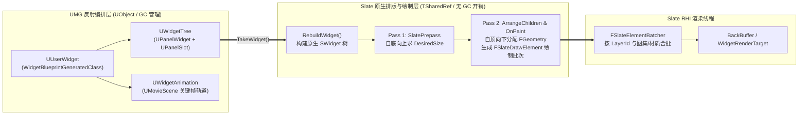
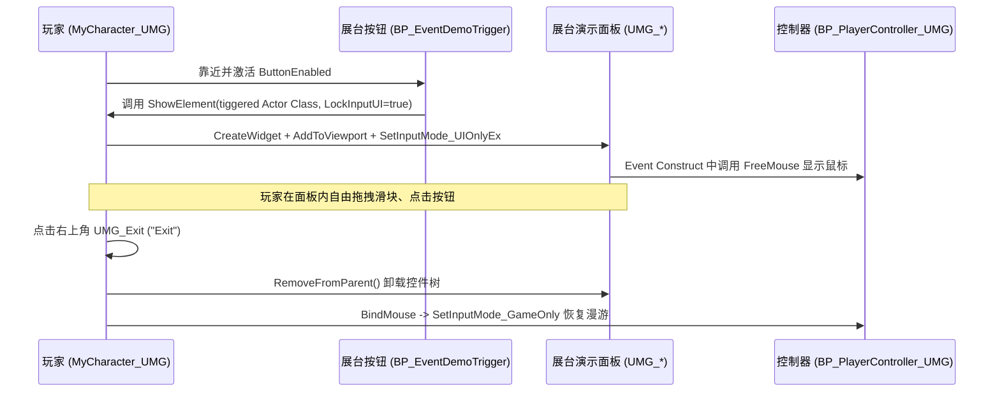
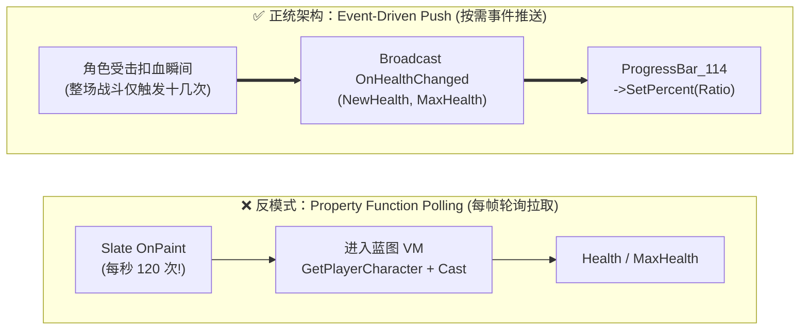
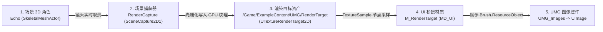

# 第 01 章 · `UI_UMG`：虚幻运动图形界面、布局锚点、富文本、材质 UI 与 3D 空间交互全解

> **关卡资产路径**：`/Game/Maps/UI/UI_UMG`  
> **示例资产目录**：`/Game/ExampleContent/UMG/`（及子目录 `HUD_Elements/`、`MSDFText/`）  
> **关卡实测规模**：总计 `55` 个 Actor | `17` 座编号展台 | `24` 个场景示例 Actor | `54` 个独立 UMG/材质/蓝图支撑资产  

---

## 一、 展厅总览：从 Slate 底层绘制原语到 UMG 可视化运动图形架构


许多刚接触虚幻引擎 UI 系统的开发者，常常把 **UMG（Unreal Motion Graphics）** 当成一套孤立的拖拽式画布工具，却在项目进入中后期时接连踩中三大工程深坑：
1. **多分辨率排版崩塌**：在 1920×1080 开发机上严丝合缝的界面，一放到 21:9 超宽带鱼屏、Steam Deck（1280×800）或 4K 电视上，血条飞到屏幕中央、字体糊成锯齿马赛克；
2. **主线程 CPU 帧率雪崩**：明明画面里只有几十个 HUD 图标，打开 `Unreal Insights` 一看，`Slate::TickAndDrawWidgets` 竟然每帧吞掉 3~5 ms 的 Game Thread 时间——罪魁祸首正是滥用了属性面板里的 **`Bind`（每帧轮询函数绑定）**；
3. **2D 与 3D 空间割裂**：想做《死亡空间》式的全息背包、角色检视窗里的实时 3D 纸娃娃、或者火焰/霓虹动态标题字，却只会堆叠静态 PNG 序列帧，导致内存暴涨且毫无交互质感。

要真正驯服虚幻 UI，首先必须看清它的双层内核：**UMG 并不是渲染器本身，而是架设在虚幻底层跨平台 C++ 界面框架 `Slate` 之上的 `UObject` 反射与可视化编排包装层**。

### 1.1 `UWidget`（UMG）与 `SWidget`（Slate）的双生生命周期与双趟排版管线

当你在蓝图中调用 `CreateWidget` 并执行 `AddToViewport` 时，引擎底层经历了从 `UObject` 控件树向原生 C++ `TSharedRef<SWidget>` 智能指针树的编译与装配。每一帧渲染 UI 时，Slate 严格执行**两趟（Two-Pass）几何求值与图元批处理管线**：



- **第一趟 `SlatePrepass`（自底向上测量尺寸）**：叶子节点（如 `STextBlock`、`SImage`）先根据字号、文本内容或笔刷像素计算自身的期望大小 `ComputeDesiredSize()`，逐层向上汇总给父容器（如 `SHorizontalBox`）；
- **第二趟 `OnPaint`（自顶向下分配空间与录制绘制指令）**：根视口结合当前窗口像素分辨率与 **DPI 缩放系数**，通过每个子控件挂载的**插槽（`UPanelSlot`）**规则计算最终屏幕几何体 `FGeometry`（绝对坐标、缩放与裁剪框），并将矩形、字符图集 UV 或 `MD_UI` 材质着色器参数写入 `FSlateWindowElementList`。

### 1.2 本工程实测 DPI 缩放曲线与 MSDF 控制台基座（`DefaultEngine.ini`）

在进入 17 座展台之前，先翻开本工程 `Config/DefaultEngine.ini` 第 77~91 行与第 284~285 行，这里藏着决定整座展厅视觉精度的全局配置底座：

```ini
[/Script/Engine.UserInterfaceSettings]
RenderFocusRule=NavigationOnly
ApplicationScale=1.000000
UIScaleRule=ShortestSide
UIScaleCurve=(EditorCurveData=(Keys=(
    (Time=480.000000,Value=0.444000),
    (Time=720.000000,Value=0.666000),
    (Time=1080.000000,Value=1.000000),
    (Time=8640.000000,Value=8.000000))))
bEnableDistanceFieldFontRasterization=True

[ConsoleVariables]
SlateSdfText.Enable=1
```

- **`UIScaleRule = ShortestSide`（最短边缩放法则）**：以屏幕高度（横屏下的最短边）作为采样横轴 `Time` 查询曲线。以 **1080p（`Value = 1.0`）** 为 1:1 基准设计分辨率：在 720p 掌机上自动按 `720 / 1080 ≈ 0.666` 等比缩小；在 4K（2160p）显示器上线性插值放大 `2.0` 倍；直至 8K（8640p）放大 `8.0` 倍！配合锚点（Anchors），无论屏幕长宽比如何拉伸，UI 既不会挤成一团，也不会在超宽屏上横向变形。
- **`bEnableDistanceFieldFontRasterization = True` + `SlateSdfText.Enable = 1`**：开启引擎级 **MSDF（多通道有向距离场）** 矢量字体光栅化管线，为本馆后半程（展台 `#14 ~ #17`）惊艳的无损缩放与程序化文字特效奠定基础。

---

## 二、 逐展台 100% 零遗漏深度拆解（#1 ~ #17）

`UI_UMG` 全馆沿 X 轴从 `X = 500` 延伸至 `X = 18500`，共设 **17 座展台**，清晰划分为四大知识阶梯：
1. **交互架构与核心输入控件（#1 ~ #5）**：展厅交互底座、滑块、多态按钮、复合表单输入、嵌套子控件与动态列表；
2. **数据通信、空间投影与动画采样（#6 ~ #10）**：内部/外部进度条与性能铁律、3D 世界空间控件、MovieScene 关键帧动画、`SceneCapture2D` 实时渲染纹理；
3. **响应式排版与加载反馈（#11 ~ #13）**：`CanvasPanelSlot` 动态锚点切换、三种异步加载指示器、三大弹性布局容器与对齐矩阵；
4. **次世代 MSDF 距离场矢量字体工程（#14 ~ #17）**：位图 vs MSDF 精度对决、DPI 自适应描边与内外发光、火焰/热浪/霓虹动态文字材质、视力表极限缩放实测。

---

### 展台 #1：`UMG`（展厅环境基座与全馆交互触发框架）
- **展牌标识**：`BP_DemoDisplay` | **空间坐标**：`(500, -900, 0)`
- **官方展牌原文**：
  > *Examples using UMG to create in-game UI*

#### 1. 展台陈列环境 Actor 清单
作为展厅入口首站，展台 #1 部署了全馆共享的光照大气与调试基座（共 5 个环境 Actor），关卡蓝图 `UI_UMG_C` 保持零冗余逻辑的纯净状态：
- `DirectionalLight`（`LightComponent0`：强度 `10.0`，纯白光，`Movable` 动态阴影）
- `SkyLight`（`SkyLightComponent0`：强度 `3.0`，`Movable`）
- `SkyAtmosphere` 与 `ExponentialHeightFog`（物理天空大气与高度雾）
- 挂载 `ChaosDebugDrawComponent_0` 的辅助调试 `Actor`

#### 2. 全馆通用的“走近/交互弹出 UI — 点击 Exit 归还控制权”四大核心资产深拆
在后续展台 `#2 ~ #17` 中，玩家每走到一座展台前按下交互按钮，屏幕就会弹出对应的 UMG 演示面板并解锁鼠标光标。这套贯穿全馆的交互底座由 `/Game/ExampleContent/UMG/` 下的 5 个基础资产协同驱动：

| 核心基座资产 | 类继承关系 | 核心变量 / 函数 / 职责深拆 |
| :--- | :--- | :--- |
| `GameMode_UMG` | `AGameMode` | 指定本关默认 Pawn 为 `MyCharacter_UMG_C`，默认控制器为 `BP_PlayerController_UMG_C` |
| `BP_PlayerController_UMG` | `APlayerController` | 封装自定义事件 `FreeMouse`（显示鼠标光标释放视角控制）与 `BindMouse`（调用 `SetInputMode_GameOnly` 隐藏光标重返第一人称漫游） |
| `BPI_HUD_Interface_Events` | `UInterface` | 定义标准 HUD 解耦通信蓝图接口：`Get player health`（返回血量）、`Set objective`、`Toggle menu` |
| `MyCharacter_UMG` | `PlayerCharacter_C` | 维护 `Health` / `Max Health` 变量及增减函数 `Increase Health` / `Decrease Health`；封装 `ShowElement`（调用 `CreateWidget` 实例化目标 UMG 与右上角退出按钮 `UMG_Exit`、`AddToViewport`，当 `LockInputUI=true` 时调用 `SetInputMode_UIOnlyEx`）与 `HideElement`（调用 `RemoveFromParent` 销毁当前面板） |
| `BP_EventDemoTrigger` | `BP_Button_Parent_Toggle_C` | 各展台前的立式交互台（含 `ButtonMesh`、`ButtonCollision` 球体触发器、预置 `3dWidget` 组件）。公开实例参数 `tiggered Actor Class`（指定当前展台要打开的 `UUserWidget` 子类）与 `lockInputToUI`（默认 `true`） |
| `UMG_Exit` | `UUserWidget` | 控件树为 `CanvasPanel_64 -> Button_606 -> TextBlock_58 ("Exit")`。点击 `Button_606` 时获取 `MyCharacter_UMG` 关闭当前演示面板，并通知 `BP_PlayerController_UMG` 执行 `BindMouse` 恢复角色移动 |



---

### 展台 #2：`Sliders`（标量滑块输入、动态颜色合成与 UI 遮罩材质）
- **展牌标识**：`BP_DemoDisplay2` | **空间坐标**：`(2000, -900, 0)`
- **核心陈列资产**：`BP_EventDemoTrigger`（挂载目标控件类：`/Game/ExampleContent/UMG/UMG_Sliders`）
- **官方展牌原文**：
  > *Sliders are great for allowing the user to input scalar values*


#### 1. `UMG_Sliders` 完整控件层级树（Widget Tree）还原
打开 `UMG_Sliders`，其控件树由双层 `CanvasPanel` 承载三组 RGB 调色滑块、实时数值读数文本与预览虚幻引擎 Logo 图像：

```text
WidgetTree (UMG_Sliders)
└── CanvasPanel_118 [根画布]
    ├── Image_228 [半透明底板背景框]
    ├── Image_185 [右侧预览图像：挂载 UI 材质 M_UElogo_Alpha，绑定动态颜色函数 GetColorAndOpacity_0]
    └── CanvasPanel_209 [左侧控制区子画布，共 9 个 CanvasPanelSlot]
        ├── TextBlock_162 ("Red")   + Slider_66 [红色通道滑块 0.0~1.0] + TextBlock_139 [绑定 GetText_2 显示 R 值]
        ├── TextBlock_165 ("Green") + Slider_74 [绿色通道滑块 0.0~1.0] + TextBlock_160 [绑定 GetText_0 显示 G 值]
        └── TextBlock_265 ("Blue")  + Slider_81 [蓝色通道滑块 0.0~1.0] + TextBlock_212 [绑定 GetText_1 显示 B 值]
```

#### 2. 关联 UI 材质 `M_UElogo_Alpha`（`/Game/ExampleContent/UMG/HUD_Elements/M_UElogo_Alpha`）深拆
为什么右侧的 UE Logo 边缘镂空且能被滑块任意染色？实测拆解其材质节点：
- **核心材质属性**：`MaterialDomain = MD_UI`（用户界面域，无光照计算开销，自动跳过延迟渲染 GBuffer），`BlendMode = BLEND_Masked`（二值遮罩裁剪，阈值 `OpacityMaskClipValue = 0.3333`），`TwoSided = true`；
- **表达式连线**：仅含 1 个线性采样节点 `MaterialExpressionTextureSample_0`（采样贴图 `/Game/ExampleContent/Decals/Textures/T_UE_Logo_Simple_M`），将其 `RGB` 同时连入 `Emissive Color`（UI 主色引脚）与 `Opacity Mask`。当 UMG 的 `Image_185` 输出 `Color and Opacity` 顶点色时，Slate 着色器会自动将材质输出色与控件顶点色相乘，从而实现零动态材质实例（Zero-MID）的高效纯色混合！

#### 3. 蓝图图表逻辑拆解
- **`EventGraph`**：在 `Event Construct` 时获取 `GetPlayerController(0)`，向下转型为 `BP_PlayerController_UMG` 释放鼠标输入；
- **属性求值函数 `GetColorAndOpacity_0`**：分别读取 `Slider_66->GetValue()`、`Slider_74->GetValue()`、`Slider_81->GetValue()`，送入 `Make LinearColor (R, G, B, A=1.0)` 返回给 `Image_185`；
- **数值格式化函数 `GetText_0 / 1 / 2`**：读取对应 `Slider->GetValue()`，经 `Conv_DoubleToText`（`HalfToEven` 银行家舍入法格式化小数位）实时刷新滑块旁的数值标签。

> [!TIP]
> **实战优化建议**：`UMG_Sliders` 为了教学直观使用了 `GetColorAndOpacity_0` 属性函数绑定。在量产商业项目中（如捏脸调色盘或音量设置页），更推荐直接绑定 `Slider` 的 **`OnValueChanged (float Value)`** 事件，仅在玩家真正拖动滑块的那几帧调用 `Image_185->SetColorAndOpacity(...)`，静止时 CPU 开销立降为 0！

---

### 展台 #3：`Buttons`（按钮三态样式反馈、悬停提示与点击事件分发）
- **展牌标识**：`BP_DemoDisplay3` | **空间坐标**：`(3005, -900, 0)`
- **核心陈列资产**：`BP_EventDemoTrigger2`（挂载目标控件类：`/Game/ExampleContent/UMG/UMG_ButtonStates`）
- **官方展牌原文**：
  > *Buttons allow the user to select options and trigger events*

#### 1. `UMG_ButtonStates` 控件树与三态 UI 材质拆解
```text
WidgetTree (UMG_ButtonStates)
└── CanvasPanel_227
    ├── Image_0 [面板背景底框]
    └── CanvasPanel_275
        ├── VerticalBox_0 -> TextBlock_420 ("Hover over the button below.\n\nThe button has different styles...")
        ├── TextBlock_283 ("Buttons can fire off events when clicked...") [点击后切换状态说明 / ThankYouVis]
        └── Button_286 [ToolTipText = "Tool tips are great for explaining the details of a button's function."]
            └── ButtonSlot_35 -> TextBlock_104 ("Click Me!")
```
- **按钮多态视觉材质（`Normal` / `Hovered` / `Pressed` / `Disabled`）**：`UButton` 的 `WidgetStyle`（`FButtonStyle`）为不同交互态挂载了专属 `MD_UI` + `BLEND_Masked` 材质——默认态使用 `Button_Unclicked_Mat`（采样 `Button_Unclicked` 贴图），鼠标移入时底层 `SButton` 立即无感切换为高光材质 `Button_Hover_Mat`（采样 `Button_Hover` 贴图），同时在悬停停留片刻后自动弹出 `ToolTipText` 悬浮提示框。

#### 2. `EventGraph` 点击状态翻转逻辑
- 在 `Event Construct` 中显式设置 `Set bIsFocusable = true` 并解锁控制器鼠标；
- 绑定组件委托 **`BndEvt__Button_286_..._OnButtonClickedEvent`**（即 `OnClicked`）：使用布尔翻转逻辑（`Thank You Text Visible` / `Text State` 分支判断 `K2Node_IfThenElse_206`），在点击瞬间切换说明文案的可见性状态（`Visible` <-> `Hidden`）。

---

### 展台 #4：`Input`（复合表单控件家族与 `FormatText` 安全字符串拼装）
- **展牌标识**：`BP_DemoDisplay4` | **空间坐标**：`(4010, -900, 0)`
- **核心陈列资产**：`BP_EventDemoTrigger4`（挂载目标控件类：`/Game/ExampleContent/UMG/UMG_Input`）
- **官方展牌原文**：
  > *There are a variety of ways to allow the user to input data.*

#### 1. `UMG_Input` 四大表单输入控件树拆解
本展台在一个横向弹性容器 `HorizontalBox_200` 中集成了游戏设置页、聊天框与编辑器工具最常用的 4 种异构数据采集控件：

```text
WidgetTree (UMG_Input)
└── CanvasPanel_201
    ├── Image_14 [背景板]
    ├── TextBlock_662 [顶部结果展示区，默认文案："Use the input boxes below to change the shown text."]
    ├── HorizontalBox_200 [中部表单输入栏，5 个 HorizontalBoxSlot，由 Spacer_150 / Spacer_152 分隔]
    │   ├── EditableTextBox_2     [自由单行文本输入框，采集玩家键入的动词/前缀]
    │   ├── SpinBox_158           [可左右拖拽亦可直接键入数字的微调框，采集数量]
    │   └── ComboBoxString_139    [字符串下拉菜单，预置 4 个选项："Apples", "Bananas", "Oranges", "Tacos"]
    ├── CheckBox_74 + TextBlock_562 ("Show Result") [复选框开关：控制是否允许回显结果]
    └── Button_512 -> TextBlock_824 ("Update")      [提交校验按钮]
```

#### 2. 表单校验与本地化友好的 `FormatText` 执行链还原
当玩家点击 **Update（`Button_512`）** 时，`EventGraph` 执行了一套教科书级的三级输入合法性校验（3 个串联的 `Branch` 节点）：

```mermaid
flowchart TD
    CLK["🔴 Button_512 OnClicked"] ==> C1{"1. CheckBox_74<br/>GetCheckedState == Checked?"}
    C1 -->|"False"| E1["写入提示：<br/>\"'Show Results' is not checked\""]
    C1 -->|"True"| C2{"2. EditableTextBox_2 文本非空<br/>且 ComboBoxString_139 已选?"}
    C2 -->|"False"| E2["写入提示：<br/>\"Please enter a value for all fields.\""]
    C2 -->|"True"| FMT["3. FormatText (\"{0} {1} {2}.\")<br/>{0}: EditableTextBox->GetText()<br/>{1}: SpinBox->GetValue() 转文本<br/>{2}: ComboBox->GetSelectedOption() 转文本"]
    FMT ==> OUT["更新 FormatedDisplayText 变量<br/>刷新顶部 TextBlock_662"]
```

> [!IMPORTANT]
> **本地化铁律——永远用 `Format Text`（`{0} {1} {2}`）代替 `Append String` 拼接 UI 句子！**  
> 英语语序是 `"Eat 5 Apples."`（`{0} {1} {2}.`），而日语语序可能是 `"リンゴを 5 個食べる"`（`{2} {1} {0}`）。使用 `K2Node_FormatText` 时，多语言翻译人员只需在 `.po` 翻译表里调整占位符 `{0}/{1}/{2}` 的顺序，无需改动任何一行蓝图代码即可完美适配全球语种语法！

---

### 展台 #5：`Nested widgets`（组件化复用思想：结构体驱动子控件动态挂载）
- **展牌标识**：`BP_DemoDisplay5` | **空间坐标**：`(4995, -900, 0)`
- **核心陈列资产**：`BP_EventDemoTrigger3`（挂载目标控件类：`/Game/ExampleContent/UMG/Widget_NestedWidgets`）
- **官方展牌原文**：
  > *Widgets can host other widgets, allowing complex systems to be made from smaller, simpler elements*

#### 1. 三剑客资产协同架构（结构体 + 枚举 + 子条目控件 + 宿主滚动框）
大型 RPG 背包、排行榜或小队列表绝不可能在一个巨无霸 Widget 里手摆几百个文本框。展台 #5 展示了标准的**“数据契约 + 单行模板控件 + 动态容器挂载”**范式：
1. **枚举资产 `Races`（`/Game/ExampleContent/UMG/Races`）**：定义 5 个种族枚举项 `Human`、`Elf`、`Dwarf`、`Gnome`、`Cat`；
2. **自定义结构体 `PlayerData`（`/Game/ExampleContent/UMG/PlayerData`）**：包含 4 个强类型字段——`Name` (`Text`)、`Height` (`Float`)、`Weight` (`Int`)、`Race` (`Races Enum`)；
3. **单行子控件模板 `Widget_PlayerEntry`**：暴露 **`Instance Editable` + `Expose on Spawn`（生成时暴露引脚）** 的成员变量 `PlayerData`。其控件树用 `VerticalBox` 嵌套 `HorizontalBox` 排列姓名、身高、体重、种族（通过 `GetEnumeratorUserFriendlyName` 将枚举转为可读文本）；
4. **主面板 `Widget_NestedWidgets`**：
   - 左侧为 `VerticalBox_361` 角色编辑器（标题 `"Character Info"`，含 `Name:` `EditableTextBox_36`、`Height:` `Slider_12` 映射 `120~220`、`Weight:` `Slider_13` 映射 `120~500`、`Race:` `ComboBoxString_5`）；
   - 右侧为 **`PlayerList`（`UScrollBox` 滚动列表容器）**。

#### 2. `EventGraph` 动态实例化与实时联动机制
- **生成与挂载**：调用 `K2Node_CreateWidget` 构造 `Widget_PlayerEntry` 实例（直接向生成节点的 `Player Data` 暴露引脚传入默认结构体 `Name="Frank"`），随后调用 **`PlayerList->AddChild(CreatedWidget)`** 将子控件塞入 `ScrollBox` 并缓存引用至 `Created Widget` 变量；
- **实时双向同步**：左侧任意修改 `EditableTextBox_36`（`OnTextChanged`）、拖动 `Slider_12 / Slider_13`（`OnValueChanged`，经 `Lerp` + `FFloor` 映射物理身高体重区间）或切换 `ComboBoxString_5`（`OnSelectionChanged` 匹配字符串转换 `Races` 枚举），都会直接更新 `Created Widget` 内部的 `PlayerData` 字段，子控件立即响应刷新！

> [!WARNING]
> **`ScrollBox + AddChild` vs `ListView / TileView` 的选型分水岭**：  
> 当列表项在 **30 条以内**（如 4 人小队面板、5 个图形设置项）时，`ScrollBox + AddChild` 简单直观；一旦列表项达到 **几百上千条**（如全服排行榜、2000 格仓库），`ScrollBox` 会一次性实例化全部 2000 个 `UUserWidget`，造成严重卡顿！此时必须改用 **`UListView` / `UTileView`（虚拟化列表）**——无论数据有 10,000 条还是 100,000 条，屏幕上永远只实例化可见区域的 **10~15 个池化 Entry Widget**，滚动时通过 `IUserObjectListEntry::OnListItemObjectSet` 循环复用！

---

### 展台 #6：`Progress Bars`（归一化标量进度条与内部状态钳制）
- **展牌标识**：`BP_DemoDisplay6` | **空间坐标**：`(6505, -900, 0)`
- **核心陈列资产**：`BP_EventDemoTrigger5`（挂载目标控件类：`/Game/ExampleContent/UMG/UMG_ProgressBars`）及环境烘焙体积 `LightmassImportanceVolume`
- **官方展牌原文**：
  > *Progress bars read a scalar (0.0 - 1.0) variable and display that variable as a percentage.*

#### 1. `UMG_ProgressBars` 控件树与边界保护逻辑
```text
WidgetTree (UMG_ProgressBars)
└── CanvasPanel_20
    ├── Image_12 [底板背景]
    ├── TextBlock_1 ("This progress bar reads from an internal variable in the UMG blueprint...")
    ├── CanvasPanel_159 -> ProgressBar_114 [核心进度条控件，绑定 GetPercent_0]
    └── HorizontalBox_141 [底部双按钮操作栏]
        ├── Button_191 -> TextBlock_27 ("Increase Progress")
        ├── Spacer_2   [固定间距撑开器]
        └── Button_192 -> TextBlock_28 ("Decrease Progress")
```
- **归一化契约（`0.0 ~ 1.0`）**：注意 `UProgressBar` 接收的**永远不是 `0 ~ 100` 的整数，而是归一化浮点数 `[0.0, 1.0]`**！
- **步进与越界钳制**：点击 `Button_191`（Increase）时，检查内部浮点变量 `Progress Bar Percent < 1.0`，成立则 `+ 0.1`；点击 `Button_192`（Decrease）时，检查 `Progress Bar Percent > 0.0`，成立则 `- 0.1`（在实际项目中也可直接用 `FMath::Clamp(Val ± 0.1f, 0.0f, 1.0f)` 一步到位）。

---

### 展台 #7：`Progress Bars`（外部角色数据读取，以及“属性轮询 vs 事件驱动”性能生死线！）
- **展牌标识**：`BP_DemoDisplay7` | **空间坐标**：`(7500, -900, 0)`
- **核心陈列资产**：`BP_EventDemoTrigger6`（挂载目标控件类：`/Game/ExampleContent/UMG/UMG_ProgressBars_External`）
- **官方展牌原文**：
  > *Progress bars can read variables that exist outside of UMG such as a character's health or energy.*


#### 1. `UMG_ProgressBars_External` 控件树与跨蓝图通信拆解
控件树结构与展台 #6 完全对称（`ProgressBar_114` + 增减双按钮 `Button_191 / Button_192` + 说明文本 `TextBlock_158`: *"This progress bar is following a variable on the character blueprint called 'Health'..."*），但数据源彻底移出了 UI 自身：
- **写操作（UI -> Character）**：点击增减按钮时，调用 `GetPlayerCharacter(0)` -> `Cast To MyCharacter_UMG` -> 调用角色身上的 `Increase Health` 或 `Decrease Health` 函数；
- **读操作（Character -> UI，`GetPercent_0`）**：在 `GetPercent_0` 绑定函数中，执行 `GetPlayerCharacter(0)` -> `Cast To MyCharacter_UMG` -> 读取 `Health / Max Health`（`Divide_DoubleDouble`）返回 `[0.0, 1.0]` 百分比。

#### 2. 架构师深度红线剖析：为什么 `GetPercent_0` 里的写法在大型项目中是绝对禁忌？
请仔细审视上面 `GetPercent_0` 干了什么：由于它被绑定到了 `ProgressBar_114` 的 `Percent` 属性函数槽（`EBindingKind::Function`），只要这个 HUD 显示在屏幕上，**在 120 FPS 下，引擎每秒钟要执行 120 次 `GetPlayerCharacter` + 120 次 `DynamicCast` + 120 次蓝图虚拟机栈帧调用**——哪怕玩家站着挂机半小时一滴血都没掉，它也已经白白空转了 **216,000 次**！

下面这张全维度性能对照表，是虚幻 UI 架构师面试与性能审查（Profiling）的第一铁律：

| 更新机制 | 底层执行路径 | 120 FPS 静止时每帧 CPU 开销 | 工程评级与适用场景 |
| :--- | :--- | :--- | :--- |
| **蓝图函数绑定 (`EBindingKind::Function`)**<br/>如 `GetPercent_0` 内部含 `Cast` 与除法 | 每帧 `OnPaint` 跨越 C++ -> 蓝图 VM 栈帧执行完整图表 | **极高（性能杀手！）** | ❌ **严禁在量产 HUD 中使用**（仅限编辑器一次性调试工具） |
| **纯属性路径绑定 (`EBindingKind::Property`)**<br/>直接绑定成员变量或 `Struct.Field` | Slate 内部走 C++ 反射指针缓存（Fast Path），不进蓝图 VM | 中低（仍有每帧属性拷贝） | ⚠️ 仅允许少量高频变化字段过渡使用 |
| **事件驱动推送（Event-Driven / ViewModel）**<br/>接口 `BPI_HUD_Interface_Events` / 事件分发器 `OnHealthChanged` | 仅在角色 `SetHealth` 真正发生数值变化的**那一帧**触发一次 `ProgressBar->SetPercent()` | **严格为 0.00 ms！** | ✅ **商业 3A 项目唯一黄金标准**（配合 UE5 `UMG Viewmodel (MVVM)` 插件更佳） |



---

### 展台 #8：`3D Widgets`（`WidgetComponent` 世界/屏幕双空间渲染与 `WidgetInteractionComponent` 射线交互全解）
- **展牌标识**：`BP_DemoDisplay8` | **空间坐标**：`(8505, -900, 0)`
- **核心陈列资产**：`BP_EventDemoTrigger_3D`（类：`BP_EventDemoTrigger_3D_C`，路径：`/Game/ExampleContent/UMG/BP_EventDemoTrigger_3D`）
- **官方展牌原文**：
  > *UMG widgets can be displayed in 3d space as a Blueprint component.*

#### 1. `BP_EventDemoTrigger_3D` 与 `Widget_3DWidgets` 组件拆解
与其它弹出 2D 全屏视口 UI 的展台不同，展台 #8 的实例参数显式配置为 **`show3DWidget = true`**，挂载了三维控件组件 **`3dWidget`（`UWidgetComponent`）**：
- **`3dWidget` 实测组件参数**：`WidgetClass = Widget_3DWidgets_C`，`Space = EWidgetSpace::World`（三维世界空间），离屏画布分辨率 `DrawSize = (X=1400, Y=1024)`；
- **`Widget_3DWidgets` 控件树**：`CanvasPanel_36 -> CanvasPanelSlot_95 -> Image_86`（赋有 `M_UElogo_Alpha` 镂空材质），并声明了委托 `HideHud` 与父按钮引用 `Parent Button`；
- **`EventGraph` 显隐联动**：当玩家触发按钮激活事件 `ButtonEnabled` 时，调用 `3dWidget->SetVisibility(true)` 让一块实打实存在于三维世界坐标中的全息悬浮面板亮起在展台半空；再次按下 `ButtonDisabled` 时调用 `SetVisibility(false)` 熄灭。

#### 2. `EWidgetSpace::World` vs `EWidgetSpace::Screen` 深度选型指南
`UWidgetComponent` 支持两种截然不同的渲染空间，理解它们的底层管线差异至关重要：

| 对比维度 | `World`（世界空间，本展台实测模式） | `Screen`（屏幕空间） |
| :--- | :--- | :--- |
| **底层渲染管线** | 先将 UMG 绘制到一张 `DrawSize`（如 `1400×1024`）的 `UTextureRenderTarget2D` 上，再贴到一个 3D 矩形网格体上走主场景 3D 渲染管线 | **不创建 RenderTarget！** 每帧计算组件的 3D 世界坐标并投影到 2D 屏幕像素坐标，直接交由主视口 Slate 渲染管线绘制 |
| **3D 遮挡与透视关系** | ✅ **真实参与 3D 深度缓冲遮挡**（会被墙壁挡住）、支持透视近大远小畸变、可受场景光照/雾效/后处理（Bloom/景深）影响 | ❌ 永远浮动在全部 3D 场景最上层（无自动墙壁遮挡，需手动做射线检测控制显隐），但永远正对摄像机、像素 100% 锐利无模糊 |
| **显存与 GPU 开销** | 较高（每个实例独占一张 `DrawSize` 大小的 RenderTarget 显存；静止面板请务必把 `RedrawTime` 调高或设 `bManuallyRedraw = true`！） | 极低（零额外 RenderTarget 显存，与普通 2D HUD 合批） |
| **典型商业场景** | 科幻头盔/枪械侧屏计数器、场景内电梯密码面板、VR 空间操作台 | 大世界怪物头顶血条、NPC 名字牌、可拾取掉落物按键提示标 |

#### 3. 如何在 3D 世界里真正“点击/拖拽”这块悬浮面板？——`UWidgetInteractionComponent` 原理
当 `WidgetComponent` 处于 `World` 模式时，系统的 2D 操作系统鼠标是无法直接命中三维网格体的。虚幻为此提供了配套的 **`UWidgetInteractionComponent`（控件交互射线组件）**：
1. 将 `WidgetInteractionComponent` 挂载到玩家角色的摄像机（第一人称准星交互）或 VR 手柄控制器（激光笔交互）下；
2. 该组件每帧沿自身 `+X` 朝向发射一条长度为 `InteractionDistance` 的物理射线（碰撞通道默认检测 `Visibility`，对应 `DefaultEngine.ini` 第 168 行的 `UI` 碰撞预设）；
3. 一旦射线击中 `UWidgetComponent` 的三维四边形碰撞体，引擎利用击中点的 **UV 坐标 `(u, v)` 乘以 `DrawSize (1400, 1024)`** 逆向还原出虚拟 2D 光标位置，向该 `SWidget` 注入合成的 `FPointerEvent`（自动触发按钮悬停 `Hovered` 变色！）；
4. 在角色开火键或交互键按下/松开时，调用 `WidgetInteraction->PressPointerKey(EKeys::LeftMouseButton)` 与 `ReleasePointerKey(EKeys::LeftMouseButton)`，即可在 3D 空间里丝滑点击按钮、拖动滑块甚至敲击虚拟键盘！

---

### 展台 #9：`Widget Animation`（基于 Sequencer 内核的 UI 关键帧动画与状态机防重入）
- **展牌标识**：`BP_DemoDisplay9` | **空间坐标**：`(9500, -900, 0)`
- **核心陈列资产**：`BP_EventDemoTrigger8`（挂载目标控件类：`/Game/ExampleContent/UMG/UMG_WidgetAnimation`）
- **官方展牌原文**：
  > *Most widget properties can be animated with keyframes.*

#### 1. `UMG_WidgetAnimation` 控件树与三条 `MovieScene` 动画轨道深拆
UMG 动画编辑器并非独立造轮子，而是**直接复用了虚幻电影级非线性动画系统 Sequencer（`UMovieScene`）内核**！实测拆解 `UMG_WidgetAnimation`：
- **控件树结构**：
  ```text
  WidgetTree (UMG_WidgetAnimation)
  └── CanvasPanel_348
      ├── Background [Image 底板]
      ├── UELogo     [Image 被驱动的动画主角，赋有 M_UElogo_Alpha 材质]
      └── HorizontalBox_253 [底部双按钮控制栏]
          ├── ScaleButton  -> TextBlock_177 ("Scale!" / 缩放切换)
          └── BounceButton -> TextBlock_178 ("Move!")
  ```
- **内嵌的 3 个 `UWidgetAnimation` 资产**：
  1. **`Scale!`**：包含 `MovieScene2DTransformTrack_4`（驱动 `RenderTransform.Scale` 二维渲染缩放，含内置缓入缓出曲线 `EaseInFunction` / `EaseOutFunction`）；
  2. **`Bounce!`**：包含 `MovieScene2DTransformTrack_7`（驱动 `RenderTransform.Translation` 弹跳位移曲线）；
  3. **`ResolutionIndependent`**：演示基于锚点/归一化变换的分辨率无关动画模板。

> [!TIP]
> **为什么 UI 动画一定要改 `RenderTransform`（渲染变换），而不要改 `Slot Padding / Size`（布局尺寸）？**  
> 修改 `RenderTransform`（平移、缩放、旋转、错切 Shear）**仅在 GPU 顶点变换阶段生效，完全不会污染父容器的布局脏标记（Layout Invalidation）**；而如果用关键帧去改 `Margin` 或 `WidthOverride`，每一帧都会迫使整棵父子 `SWidget` 树重跑昂贵的 `SlatePrepass` 重新排版！

#### 2. `EventGraph` 动画互斥与循环播放控制逻辑
通过 `Is Scaling`、`Is Bouncing`、`Is Reset` 三个布尔状态位配合 `IsAnimationPlaying`、异步 `Delay` 节点与自定义重播事件（`ReplayScaleAnim` / `ReplayBounceAnim`）：点击 `ScaleButton` 时若动画未在播放，则调用 `PlayAnimation(Scale!, StartAtTime=0.0, PlayMode=Forward, PlaybackSpeed=1.0)` 启动缩放循环；再次点击则调用 `StopAnimation` 复位，防止快速连点导致多轨叠加抽搐。

---

### 展台 #10：`Images`（纹理、材质与 `SceneCapture2D` 实时三维角色投影进 UI）
- **展牌标识**：`BP_DemoDisplay10` | **空间坐标**：`(11005, -900, 0)`
- **核心陈列资产（共 3 个协同 Actor）**：
  1. `Echo`（`SkeletalMeshActor`，网格体：`/Game/Characters/Echo/Meshes/Echo`）
  2. `RenderCapture`（`RenderCapture_C`，含 `SceneCapture2D1` 与 `Camera1` 预览相机代理模型）
  3. `BP_EventDemoTrigger9`（挂载目标控件类：`/Game/ExampleContent/UMG/UMG_Images`）
- **官方展牌原文**：
  > *Images can display materials and textures, including scene capture actors*

#### 1. “3D 角色实时装进 2D UI 窗口”全链路四步管线还原
这是商业 RPG 装备栏“3D 角色换装预览”、FPS“小地图俯视雷达”与“监控摄像头画面”的标准工业解法：



- **为什么不能把 `RenderTarget` 直接塞给 `UImage`，而要包一层 `M_RenderTarget` UI 材质？**
  1. **Alpha 通道反转修正**：`SceneCaptureComponent2D` 在默认 `SCS_SceneColorHDR`（RGB 存场景色，A 存 **Scene Opacity 反转值**，即有物体的地方 Alpha=0，天空背景 Alpha=1！）模式下，若直接显示会出现角色透明而背景不透明的反相现象；在 `MD_UI` 材质中通过 `OneMinus(Alpha)` 即可精准抠出 3D 角色轮廓，让角色完美悬浮在 UI 背景框之上！
  2. **色彩空间校准**：可按需开启 `SCS_FinalColorLDR`（含 ToneCurve 色调映射）或在 UI 材质内执行 sRGB -> Linear 转换，确保 UI 里的角色肤色与大世界完全一致。

> [!WARNING]
> **`SceneCapture2D` 性能军规**：  
> 开启 `bCaptureEveryFrame = true` 相当于在主摄像机之外**额外多渲染了一遍整个场景**！在量产项目中：
> 1. 务必将 `PrimitiveRenderMode` 设为 **`PRM_UseShowOnlyList`（仅渲染白名单 `ShowOnlyActors`）**，只把主角 `Echo` 一个模型加进去，剔除整个大世界地形与建筑；
> 2. 当玩家关闭背包界面（`UMG_Images` 销毁或隐藏）时，务必同步将 `SceneCapture2D1->SetComponentTickEnabled(false)` 且关闭 `bCaptureEveryFrame`！

---

### 展台 #11：`Widget Slots`（`UPanelSlot` 契约与运行期动态切换九宫格锚点 `FAnchors`）
- **展牌标识**：`BP_DemoDisplay11` | **空间坐标**：`(12000, -900, 0)`
- **核心陈列资产**：`BP_EventDemoTrigger10`（挂载目标控件类：`/Game/ExampleContent/UMG/Widget_Slots`）
- **官方展牌原文**：
  > *Widget slots control the positioning of different widgets, allowing elements to be aligned consistently.*

#### 1. 深刻理解 UMG 的灵魂设计：为什么位置属性不在 `UWidget` 上，而在 `Widget->Slot` 上？
初学者写蓝图移动一个 `Image` 时，常困惑为什么在 `AnchorImage` 节点上搜不到 `SetAnchors` 或 `SetPosition`——因为**同一个 `UImage` 放到 `CanvasPanel` 里需要锚点与绝对坐标（`UCanvasPanelSlot`），放到 `HorizontalBox` 里却需要填充占比（`UHorizontalBoxSlot`）**！因此虚幻采用了极度优雅的**桥接容器槽模式**：子控件只管内容，父容器为每个塞进来的子控件自动包裹一个专属的 `UPanelSlot` 子类对象。

#### 2. `Widget_Slots` 控件树与运行期锚点切换蓝图全还原
```text
WidgetTree (Widget_Slots)
└── CanvasPanel_602
    ├── Image_102 / Image_191 [外围展示画框，挂载 UI 材质 M_Frame]
    ├── CanvasPanel_722 [内部演示子画布]
    │   └── CanvasPanelSlot_4695 -> AnchorImage [Image，挂载 M_UElogo_Alpha]
    └── HorizontalBox_1011 [底部控制栏]
        ├── TopLeft   [Button] -> TextBlock_7548 ("Anchor left")
        ├── Spacer_709
        └── TopRight  [Button] -> TextBlock_7549 ("Anchor right")
```
- **点击 `TopLeft ("Anchor left")` 与 `TopRight ("Anchor right")` 的执行链**：
  1. 读取 `AnchorImage` 的 `Slot` 属性（或调用便捷纯函数 **`WidgetLayoutLibrary::SlotAsCanvasSlot(AnchorImage)`** 向下转型为 `UCanvasPanelSlot`）；
  2. 通过 `Make Anchors` 构造结构体 `FAnchors(Minimum, Maximum)`：
     - **左中锚定**：`Minimum = (X=0.0, Y=0.5)`，`Maximum = (X=0.0, Y=0.5)`；
     - **右中锚定**：`Minimum = (X=1.0, Y=0.5)`，`Maximum = (X=1.0, Y=0.5)`；
  3. 调用 `CanvasPanelSlot->SetAnchors(...)`，图标瞬间贴合子画布左侧或右侧边缘！

#### 3. 九宫格锚点（`FAnchors`）数学本质速查
`FAnchors` 由归一化父容器uv坐标 `Minimum (Left, Top)` 与 `Maximum (Right, Bottom)` 组成（取值范围 `[0, 1]`）：
- **当 `Min == Max`（聚点锚，如小地图固定在右上角 `(1,0)~(1,0)`）**：父容器尺寸变化时，子控件**保持自身像素宽高不变**，`Offsets.X / Y` 代表相对锚点的像素偏移量，`Offsets.Right / Bottom` 代表固定宽高 `SizeX / SizeY`；
- **当 `Min != Max`（拉伸锚，如全屏遮罩 `(0,0)~(1,1)` 或底部横跨血条 `(0.2, 1.0)~(0.8, 1.0)`）**：父容器尺寸变化时，子控件随父容器按比例拉伸，`Offsets` 此时退化为距离四条锚点边界的**内边距像素留白（Margin Left/Top/Right/Bottom）**！

---

### 展台 #12：`Loading Icons`（三种异步等待加载指示器的选型与可见性切换）
- **展牌标识**：`BP_DemoDisplay12` | **空间坐标**：`(13005, -900, 0)`
- **核心陈列资产**：`BP_EventDemoTrigger11`（挂载目标控件类：`/Game/ExampleContent/UMG/UMG_LoadingIcons`）
- **官方展牌原文**：
  > *UMG contains a collection of options that can indicate that the game is processing something.*

#### 1. `UMG_LoadingIcons` 控件树与三类内置加载控件对比
```text
WidgetTree (UMG_LoadingIcons)
└── CanvasPanel_12
    ├── Image_244 [背景底框]
    ├── Throbber_20          [1. 水平波浪脉冲点加载器，绑定 GetVisiblity_1 (Thobber Vis)]
    ├── CircularThrobber_5   [2. 环形旋转追逐点加载器，绑定 GetVisiblity_0 (Circular Throbber Vis)]
    ├── ProgressBar_24       [3. 开启 bIsMarquee = true 的不确定进度跑马灯条，绑定 GetVisiblity_2 (Marquee Vis)]
    └── HorizontalBox_181    [底部三颗切换按钮：Button_139 / Button_140 / Button_141]
        ├── Button_139 -> TextBlock_33 ("Throbber")
        ├── Button_140 -> TextBlock_34 ("Circular Throbber")
        └── Button_141 -> TextBlock_35 ("Marquee Progress Bar")
```

| 控件类名 | 核心可调参数 | 视觉动态特征与适用场景 |
| :--- | :--- | :--- |
| `UThrobber` | `NumberOfPieces`（分片数）、`bAnimateHorizontally / Vertically / Opacity` | 一排横向排列的小方块依次上下跳动并淡入淡出，适合聊天“对方正在输入...”或轻量级存档提示 |
| `UCircularThrobber` | `NumberOfPieces`、`Period`（旋转周期秒数）、`Radius`（圆周半径） | 经典的环形旋转菊花加载图标，最适合联网匹配、着色器预编译与关卡流送角标 |
| `UProgressBar` (`bIsMarquee = true`) | `MarqueeImage`（扫光笔刷） | 当后台任务无法预估精确百分比（如等待 HTTP 响应）时，勾选 `Is Marquee` 即可让进度条变为无限循环扫光带；一旦拿到精确字节数，取消勾选即可无缝切回 `0~100%` 进度条！ |

---

### 展台 #13：`Alignment Options`（三大弹性布局容器与水平/垂直对齐、填充规则沙盒）
- **展牌标识**：`BP_DemoDisplay13` | **空间坐标**：`(14000, -900, 0)`
- **核心陈列资产**：`BP_EventDemoTrigger12`（挂载目标控件类：`/Game/ExampleContent/UMG/Widget_Alignment`）
- **官方展牌原文**：
  > *UMG widgets can be aligned and organized with several alignment tools.*


#### 1. `Widget_Alignment` 33 按钮交互实验室拆解
为了直观展示各种弹性容器与子槽位对齐组合的效果，`Widget_Alignment` 构建了一个包含 **33 个点击事件按钮** 与 **3 套可切换容器视图**（通过 `HorizVis`、`VertVis`、`GridVis` 三个 `ESlateVisibility` 枚举变量切换显隐，顶部 `TextBlock_882` 同步解释当前选中槽位的对齐行为）的交互沙盒：
1. **`HorizontalBox_173`（水平弹性盒）**：子元素从左向右顺序排列。每个 `HorizontalBoxSlot` 决定两件事：
   - **尺寸规则 `SizeRule`**：`Auto`（包裹子控件自身的 `DesiredSize`） vs **`Fill`（按权重瓜分父容器剩余宽度！例如三个槽分别设 Fill `1.0 : 2.0 : 1.0`，则严格占宽 `25% : 50% : 25%`）**；
   - **对齐方式 `HAlign / VAlign`**：`Fill`（铺满槽位）、`Left / Top`、`Center`、`Right / Bottom`。
2. **`VerticalBox_117`（垂直弹性盒）**：子元素从上向下顺序堆叠，适合菜单按钮列、任务追踪栏。
3. **`UniformGridPanel_187`（等宽等高均匀网格面板）**：所有单元格自动对齐到**最大那个子控件的宽高**（可通过 `SlotPadding`、`MinDesiredSlotWidth / Height` 约束），无需手动计算像素坐标即可排出整整齐齐的背包格子、技能九宫格与表情轮盘！

> [!IMPORTANT]
> **可见性枚举的性能微妙差异：`Hidden` vs `Collapsed` vs `HitTestInvisible`！**  
> 在 `Widget_Alignment` 及后续 `UI_SlatePostBuffer` 中频繁出现这几个枚举，选错会引发排版错位或射线穿透 Bug：
> - **`Collapsed`（折叠）**：不渲染，且 **`DesiredSize = (0, 0)` 不占任何排版空间**（`VerticalBox` 下方兄弟控件会自动往上顶补空缺），且**跳过子树的 `SlatePrepass` 求值（最省性能！）**；
> - **`Hidden`（隐藏）**：不渲染，但**依然参与排版并保留原尺寸占位坑**（适合保持表格对齐不跳动）；
> - **`SelfHitTestInvisible`（自身穿透、子控件可点）**：**所有根 `CanvasPanel` 与 `Overlay` 的标准配置！** 如果根画布误设为 `Visible`，它会像一块透明玻璃一样拦截掉所有空白处的鼠标点击，导致下层 HUD 或 3D 视口无法收到鼠标事件！

---

### 展台 #14：`MSDF Fonts`（告别放大马赛克：传统位图字库 vs 多通道有向距离场字体）
- **展牌标识**：`BP_DemoDisplay17` | **空间坐标**：`(15500, -900, 0)`
- **核心陈列资产**：`BP_EventDemoTrigger16`（挂载目标控件类：`/Game/ExampleContent/UMG/MSDFText/EUW_SDF_vs_Bitmap`）
- **官方展牌原文**：
  > *Bitmap rendering is used on the Left while MSDF is used on the Right*

#### 1. 字体资产链（`RobotoRegular_MSDF` -> `Roboto_MSDF`）与控件树拆解
从展台 #14 开始，我们进入 UE 5.3+ 引入的次世代文本渲染技术区。拆解 `/Game/ExampleContent/UMG/MSDFText/` 下的核心字体资产：
- **底层字形面 `RobotoRegular_MSDF`（`UFontFace`）**：源文件指向 `Roboto-Regular.ttf`，关键属性 **`bEnableDistanceFieldRendering = true`**，三级多通道距离场光栅化精度配置为 `minMultiDistanceFieldPpem = 32`、`midMultiDistanceFieldPpem = 40`、`maxMultiDistanceFieldPpem = 56`；
- **复合字体族 `Roboto_MSDF`（`UFont`）**：默认字形绑定 `RobotoRegular_MSDF`，回退字形（Fallback）绑定 `/Engine/EngineFonts/Faces/DroidSansFallback`；
- **`EUW_SDF_vs_Bitmap` 控件树**：
  ```text
  WidgetTree (EUW_SDF_vs_Bitmap)
  └── CanvasPanel_19
      ├── Background [Image]
      └── HorizontalBox_175 [左右分屏同尺寸放大对比]
          ├── VerticalBox    -> TextBlock_BitmapFont ("The quick brown fox\njumps over the lazy dog") [左：传统位图光栅化]
          └── VerticalBox_63 -> TextBlock_SDFFont    ("The quick brown fox\njumps over the lazy dog") [右：MSDF 多通道距离场]
  ```

#### 2. 硬核图形学原理：为什么单通道 SDF 会把字母尖角磨圆，而 MSDF 刀锋般锐利？
- **传统位图字体（Bitmap Atlas）**：将字形按固定字号烤死成灰度像素贴图。一旦通过 `RenderTransform.Scale` 放大或放在 4K 大屏/近景 3D Widget 上，双线性插值会让笔画边缘糊成灰阶锯齿；若烤超大字号，一张中文字库图集动辄吃掉几十 MB 显存。
- **单通道 SDF（Signed Distance Field）**：每个纹素记录到最近轮廓边的有向距离（轮廓上为 `0.5`，内部 `> 0.5`，外部 `< 0.5`）。放大时用 `smoothstep` 重建边缘虽然平滑，但在两个笔画相交的**锐角拐点（如字母 `A`、`W`、`M` 的尖顶）**处，双线性插值会把等值线磨成圆弧角！
- **MSDF（Multi-channel Signed Distance Field，Viktor Chlumský 算法）**：将字形轮廓边按方向着色分解到贴图的 **R、G、B 三个独立通道**中，拐角由两条不同通道的半平面距离场相交定义。像素着色器只需执行一句极低开销的**三通道中位数算子**：
  $$d = \operatorname{median}(R, G, B) = \max(\min(R, G), \min(\max(R, G), B))$$
  再用屏幕空间偏导数 `fwidth(d)` 做抗锯齿 `smoothstep`，就能在极低分辨率图集下，100% 还原出直角与尖角的锐利几何交点！

---

### 展台 #15：`MSDF Outline and Glow`（距离场自定义材质：DPI 自适应描边与内外辉光）
- **展牌标识**：`BP_DemoDisplay14` | **空间坐标**：`(16500, -900, 0)`
- **核心陈列资产**：`BP_EventDemoTrigger13`（挂载目标控件类：`/Game/ExampleContent/UMG/MSDFText/EUW_SDF_Font`）
- **官方展牌原文**：
  > *Distance Field Fonts allow for different outline possibilities through custom materials*

#### 1. `EUW_SDF_Font` 四宫格控件树与 4 套字体材质全拆解
`EUW_SDF_Font` 用 `HorizontalBox_175` 嵌套两个 `VerticalBox`，并排展示了 4 个全部基于 **`MaterialExpressionFontSignedDistance`（字体有向距离采样节点）** 编写的自定义字体材质（挂载于 `TextBlock -> Font -> Font Material`）：

| 控件节点名 | 绑定字体材质 / 实例 | 内部材质表达式链与核心算法深拆 |
| :--- | :--- | :--- |
| `TextBlock_UVDistanceStroke` | `M_FontSDF_UVDistanceStroke`<br/>(共 17 个节点) | **注释框**：`"Stroke based on UV distance with AA"`。<br/>读取 `FontSignedDistance` 后，直接在 UV 距离场空间做偏移减法与 `Abs` 取绝对值带状区间，经 `Saturate` 插值 `Color` 与 `StrokeColor`。当字体缩放时，**描边粗细会随字号等比变粗或变细**。 |
| `TextBlock_PixelDPISpacingStroke` | `MI_FontSDF_PixelDPISpacingStroke`<br/>(母材质 18 个节点) | **注释框**：`"Stroke with pixel DPI zoom spacing"`。<br/>引入屏幕像素偏导/DPI 间距补偿参数 `PixelStroke`、`Pixel Spacing` 与 `SmoothDistance`。无论文字被放大多少倍，都能精准维持恒定或受控的屏幕像素级描边锐度！ |
| `TextBlock_Glow` | `M_FontSDF_Glow`<br/>(共 19 个节点，`ShapeOnTop = false`) | **核心注释**：`"The SDF is at 1 so inverting the SDF gives the glow from 0-1"`。<br/>通过 `OneMinus` 反转有向距离，在 `[GlowMin = -0.05, GlowMax = 0.07]` 宽区间上执行 `SmoothStep` 生成柔和的洋红色外发光晕 `(R=1.0, G=0.0, B=0.715)`。 |
| `TextBlock_GlowWithCharacterOnTop` | `MI_FontSDF_GlowOnTop`<br/>(母材质 `M_FontSDF_Glow`，开启静态开关 `ShapeOnTop = true`) | 通过 `StaticSwitchParameter("ShapeOnTop")` 启用 `"Glow ontop"` 分支：先铺底层宽范围洋红柔光，再在顶层叠加纯白色 `(1,1,1)` 锐利字芯轮廓，消除发光字常见的“字芯发虚看不清”痛点！ |

---

### 展台 #16：`Animated MSDF Fonts`（动态距离场材质：燃烧火焰字、热浪扭曲、圆环布尔融合与霓虹闪烁）
- **展牌标识**：`BP_DemoDisplay15` | **空间坐标**：`(17500, -900, 0)`
- **核心陈列资产**：`BP_EventDemoTrigger14`（挂载目标控件类：`/Game/ExampleContent/UMG/MSDFText/EUW_SDF_Font_Animated`）
- **官方展牌原文**：
  > *Distance Field Fonts can be animated with Custom Materials to spice up your texts*

#### 1. 四大惊艳程序化动态文字着色器源码级拆解
无需任何序列帧贴图或第三方插件，`EUW_SDF_Font_Animated` 里的 4 个 `TextBlock` 纯靠距离场数学算子在 GPU 上实时合成了四种商业级标题特效：

1. **烈焰升腾文字 `MI_FontSDF_Flame`（母材质 `M_FontSDF_FlamesNoDistance`，32 个节点）**：
   - 使用双层 `Panner`（速度 `FlameSpeed_Y = 0.5`）配合 `ScreenAlignedUVs` 与 `ScaleUVsByCenter`（`FlameUVScale = 0.25`）反向滚动采样灰度扰动噪波贴图 `RefractionNoise`；
   - 将双层流动噪波叠加到 `FontSignedDistance` 的距离阈值上（扰动强度 `DisplacementStrength&Blend = 0.2`），并用字形纵向 UV（`ComponentMask G`）做顶部火苗衰减遮罩，在深红火根 `Flame Base Color (1.0, 0.141, 0.0)` 与金橙火尖 `Flame Tip Color (1.0, 0.480, 0.0)` 之间执行 `Lerp` 插值，字形边缘实时跃动出逼真的火舌！
2. **高温热浪扭曲文字 `MI_FontSDF_HeatHaze`（母材质 `M_FontSDF_HeatHaze`，29 个节点）**：
   - 将滚动的 `RefractionNoise` 除以 `Distance Factor = 5000` 生成高频微幅 UV 偏移，扭曲距离场采样坐标，并在纯白底色 `(1,1,1)` 与纯黑尖端 `(0,0,0)` 间过渡，营造出沙漠烈日下字迹微微蒸腾晃动的热霾质感。
3. **SDF 平滑布尔并集文字 `M_FontSDF_CircleBlend`（15 个节点 + 材质函数 `MF_UI_SDF_Union`）**：
   - 在材质内部用 `Distance(UV, Center)` 构造一个随 `Time` 周期性移动/缩放的解析圆距离场 `SDF A`，与文字本身的 `FontSignedDistance`（`SDF B`）共同输入自定义材质函数 **`MF_UI_SDF_Union`**；
   - 拆解 `MF_UI_SDF_Union`（26 个表达式节点）：同时提供了精确并集 `Exact = min(SDF_A, SDF_B)` 与**平滑代谢球融合（Smooth Minimum / Metaball Union）**输出引脚 `Smooth`：
     $$h = \operatorname{saturate}\left(0.5 + 0.5 \cdot \frac{d_B - d_A}{k}\right), \quad d_{\text{smooth}} = \operatorname{lerp}(d_B, d_A, h) - k \cdot h \cdot (1 - h)$$
   - 再配合颜色曲线图集 `CurveAtlas_MSDF`（采样 `Curve_MSDF`），当圆球扫过字母时，圆球与笔画之间会像液态水银一样拉丝粘连融合！
4. **赛博朋克故障霓虹灯文字 `M_FontSDF_NeonFlicker`（20 个节点）**：
   - 内含三个清晰的注释区块：`Neon Blur`（反转 SDF 构造柔和灯管外辉光）、`Neon Color`（内外灯芯双色插值）与 `Neon Flicker`（将 `Time` 输入程序化 `Noise` 节点产生随机电压不稳的频闪明暗跳变），瞬间拉满科幻夜市招牌氛围！

---

### 展台 #17：`Font Precision Demo`（视力表百倍无损缩放实测：MSDF 性能与精度的终极验证）
- **展牌标识**：`BP_DemoDisplay16` | **空间坐标**：`(18500, -900, 0)`
- **核心陈列资产**：`BP_EventDemoTrigger15`（挂载目标控件类：`/Game/ExampleContent/UMG/MSDFText/EUW_SDF_EyeChart_ABC`）
- **官方展牌原文**：
  > *Distance Field characters can be scaled without quality or performance loss*

#### 1. `EUW_SDF_EyeChart_ABC` 视力表控件树与 `ZoomIn` 极限推镜动画拆解
- **双列对照视力表控件树**：在纯白底板 `WhiteBackground` 之上，`CanvasPanel_527` 并排承载了两个 9 层 `VerticalBox`（`VerticalBox` 与 `VerticalBox_65`），从上到下依次排列字号逐级缩小的标准视力表字符行：`ABC` -> `DEF` -> `GHIJ` -> `KLMN` -> `OPQRS` -> `TUVXYZ` -> `1234567`（左侧采用传统位图渲染，右侧采用 `Roboto_MSDF` 距离场渲染）；
- **`EventGraph` 与 `ZoomIn` 轨道**：在 `Event Construct` 时直接调用 `PlayAnimation(ZoomIn, NumLoopsToPlay=100, PlayMode=Forward)`。`ZoomIn` 动画的 `MovieScene2DTransformTrack_2` 持续将 `CanvasPanel_527` 的 `RenderTransform.Scale` 成倍推近放大到视力表最底部的微米级小字上：
  - **左侧传统位图字**：由于初始按小字号光栅化进纹理缓存，放大十余倍后彻底糊成无法辨认的灰色马赛克方块；
  - **右侧 MSDF 矢量字**：不仅在放大数十倍的全过程中**笔画边缘始终如激光雕刻般笔直锐利**，而且**不会触发 Slate 字体缓存（`FSlateFontCache`）因字号动态变化而反复重新光栅化 TTF 字形导致的卡顿与图集爆仓（Atlas Thrashing）**——真正做到了官方展牌所说的 *“without quality or performance loss”*！

---

## 三、 商业 3A 项目 UMG 四大进阶工程补完（展厅之外的生产级必修课）

掌握了上述 17 座展台的原理解析后，在实际大型商业项目落地 UMG 时，还有四块必须补齐的高阶拼图：

### 3.1 `URetainerBox`（保留盒）：降频相位渲染缓存与 UI 级离屏特效材质
当你的小地图、复杂背包格子或带大量半透明层叠的技能栏每帧都在重绘数百个图元，却并不需要 120 Hz 逐帧刷新时，在子树外层套一个 **`URetainerBox`**：
1. **降频分摊合批（`RenderOnPhase` + `Phase` / `PhaseCount`）**：内部维护一张专属的离屏 `UTextureRenderTarget2D`。设 `PhaseCount = 4` 时，每 4 帧才重绘一次内部复杂的数十个子控件，其余 3 帧直接把缓存好的单张纹理当成 **1 个 DrawCall** 贴上屏幕！若有 4 个不同的面板分别设 `Phase = 0, 1, 2, 3`、`PhaseCount = 4`，即可完美将 UI 峰值耗时错峰削平；
2. **子树整体特效材质（`EffectMaterial` + `TextureParameter`）**：将 `MD_UI` 材质赋给 `EffectMaterial`，并将 `TextureParameter` 填为材质里采样离屏纹理的参数名（如 `"UI_RT"`），即可对整块面板（含内部所有文字与图标）统一施加**全息曲面弯曲（HUD 弧形头盔畸变）、故障扫描错位或软边缘羽化遮罩**！

### 3.2 `URichTextBlock`（富文本块）：数据表样式驱动与内联图标图文混排
传统 `TextBlock` 整段话只能有一种字号和颜色；而在剧情对话或技能描述（如 *“消耗 `<Blue>50 法力</>`，按 `` 造成 `<Crit>250%</>` 火焰伤害”*）中，标准解法是使用 **`URichTextBlock`**：
1. **文本样式数据表（`TextStyleSet`）**：新建行结构为 **`FRichTextStyleRow`** 的 `DataTable`，添加 `Default`、`Blue`、`Crit` 等行，配置各自的字体、字号、颜色与阴影。在文案中直接写 `<Crit>250%</>` 即可在同一行文字内无缝切换样式；
2. **装饰器（`DecoratorClasses` -> `URichTextBlockImageDecorator`）**：新建行结构为 **`FRichImageRow`** 的图标数据表并绑定到 `RichTextBlockImageDecorator` 子类，挂入 `RichTextBlock` 的 `DecoratorClasses` 数组。文案中敲入 ``，Slate 排版引擎就会自动测量图片宽高与文字基线（Baseline），实现丝滑的图文混排与自动换行！

### 3.3 原生拖拽交互管线（UMG Drag & Drop 五步闭环）
在实现背包物品换格或技能拖入快捷栏时，切勿在 `Tick` 里自己算鼠标坐标移动图标，应走 Slate 原生五步拖拽协议：
1. **按下侦测（源格子 `OnMouseButtonDown`）**：调用 `DetectDragIfPressed(MouseEvent, this, EKeys::LeftMouseButton)` 并返回；
2. **生成载荷（源格子覆写 `OnDragDetected`）**：创建继承自 `UDragDropOperation` 的载荷对象（挂载被拖动物品 ID 与数量），并指定跟随鼠标半透明移动的视觉虚影控件 `DefaultDragVisual`；
3. **悬停校验（目标格子覆写 `OnDragEnter` / `OnDragLeave`）**：检查 `Operation` 里的物品类型是否匹配当前装备槽（如双手剑能否放进副手槽），动态高亮绿框或红框；
4. **松手落槽（目标格子覆写 `OnDrop`）**：提取 `Operation` 载荷执行交换数据逻辑，返回 `true` 表示成功接管；
5. **异常回退（`OnDragCancelled`）**：若玩家把物品拖到背包外空白处松手，自动触发取消回调（例如弹出“是否丢弃到地面”确认框）。

---

## 四、 本章核心资产与工程核查清单

| 维度 | 核心结论与工程核查项 |
| :--- | :--- |
| **分辨率自适应** | 检查 `Project Settings -> User Interface -> DPI Scaling` 曲线；`CanvasPanel` 内杜绝把所有控件留在默认的左上角 `(0,0)` 锚点而不设正确对齐点 |
| **GameThread 性能** | 全局搜索 Widget 蓝图中的 `PropertyBindings` / `GetText_0` / `GetPercent_0`；凡包含 `Cast`、`GetAllActors` 或复杂运算的绑定一律重构为事件驱动推送 |
| **DrawCall 与合批** | 同一层级图素合并进同一张 UI 图集（Sprite Sheet / Texture Atlas）；避免同级 `Overlay` 交错穿插不同材质与图集导致 Slate 批次（LayerId）频繁打断；低频复杂面板套用 `URetainerBox` |
| **字体渲染品质** | 大标题、可缩放 UI 与 3D 空间文字优先开启 **MSDF 距离场渲染**（`bEnableDistanceFieldRendering = true`），利用 `FontSignedDistance` 材质实现零糊边描边与动态特效 |
| **跨平台与多层栈** | 当界面开始涉及“多级弹窗嵌套焦点回退”与“键鼠/手柄秒级切换”时，纯手写原生 UMG 将面临指数级状态爆炸——请立即翻开下一章 **`02_UI_CommonUI`**，接入虚幻官方跨平台工业级 UI 路由框架！ |
