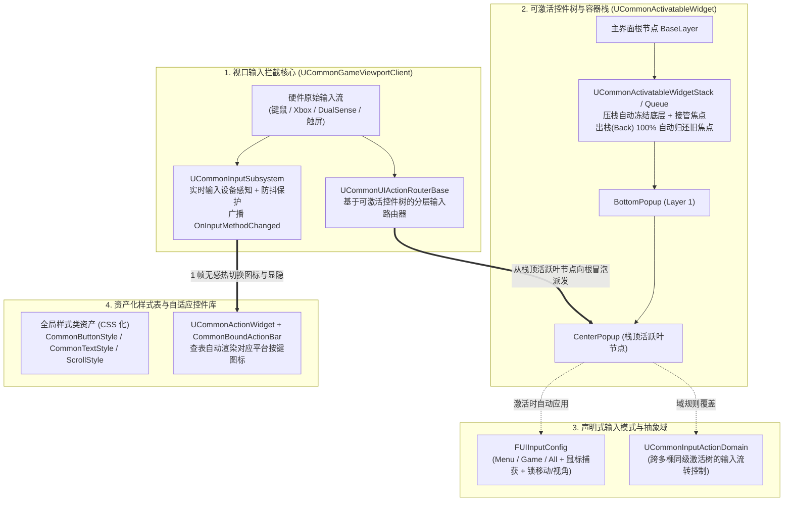
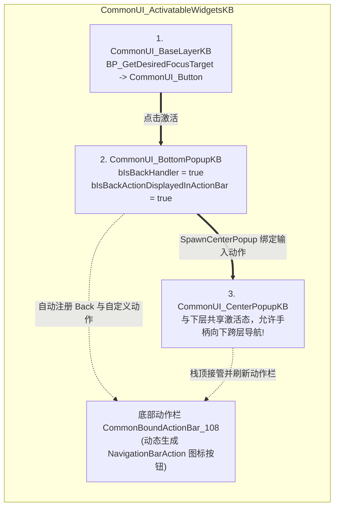
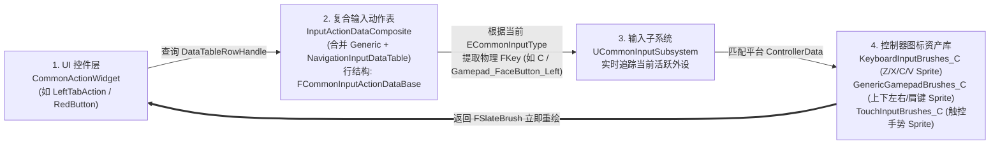
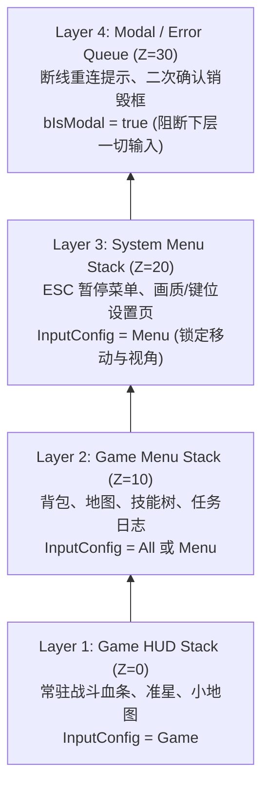

# 第 02 章 · `UI_CommonUI`：跨平台手柄/键鼠自适应路由、激活栈与模块化 UI 架构全解

> **关卡资产路径**：`/Game/Maps/UI/UI_CommonUI`  
> **示例资产目录**：`/Game/ExampleContent/UMG/CommonUI/`（含 `ActivatableWidgets/`、`ActivatableWidgetsKB/`、`ActionWidgets/`、`UtilityWidgets/`、`InputConfigs/`、`ActionDomains/`、`EnhancedInput/`、`ControllerBrushes/`、`InputActions/`）  
> **关卡实测规模**：总计 `34` 个 Actor | `8` 座编号展台 | `12` 个场景示例 Actor | `70` 个独立 CommonUI 控件、样式与输入数据资产  

---

## 一、 展厅总览：为什么原生 UMG 一遇上“多级弹窗 + 手柄跨平台”就会彻底失控？


如果只开发一款纯 PC 键鼠点击的单层小游戏，上一章的原生 UMG 完全够用；但只要你的项目需要**同时登陆 PC、PS5、Xbox、Switch、Steam Deck 或移动端触屏**，并且包含哪怕只有三层深的常规菜单（例如：`游戏 HUD -> 打开背包 -> 选中传说武器弹出详情对比页 -> 点击分解弹出二次确认框`），纯原生 UMG 就会立刻把 UI 程序员拖入著名的**“焦点与输入路由地狱（Focus & Input Hell）”**：

1. **`SetFocus` 丢失与野指针噩梦**：用手柄在背包第 14 格按下 `X` 弹出确认框，必须手动写变量记住“之前聚焦在第 14 格”；按 `B` 键关闭确认框时，一旦背包恰好刷新或慢了一帧，焦点瞬间掉进虚空，手柄十字键彻底失灵，玩家只能被迫伸手去摸鼠标救场！
2. **返回键（`ESC` / 手柄 `B`）的 `if-else` 泥石流**：玩家按下一次 `ESC`，到底该关闭确认框、关闭详情页、关闭背包，还是弹出暂停主菜单？每新增一个弹窗，全局按键监听函数就要多套一层状态判断。
3. **跨设备按键提示硬编码**：键鼠显示 `[C]`，插上 Xbox 手柄要秒变 `(X)`，换成 PS5 DualSense 要秒变 `(□)`，切回触屏又要隐藏按键角标。如果在每个界面手写设备检测分支，200 个界面就是 200 份维护灾难。
4. **视觉样式散落各处**：全游戏 500 颗按钮的字号、圆角、悬停音效全拷死在各自的 `WidgetBlueprint` 里；美术总监想微调一次主色调，全组策划要挨个打开 100 个 `.uasset` 手工改参数。

为了彻底终结这些行业通病，Epic 将《堡垒之夜（Fortnite）》久经全球数亿全平台玩家考验的底层 UI 框架提炼为引擎内置插件 —— **`CommonUI` + `CommonInput`**。

### 1.1 CommonUI 四大核心架构支柱全景图



### 1.2 本工程实测四大 `.ini` 全局接入配置（从零启用 CommonUI 的标准清单）

很多开发者新建工程启用 CommonUI 插件后，发现**手柄焦点不自动跳转、按返回键没反应、图标显示空白**——99% 都是漏掉了项目配置！我们在本工程 `Config/` 目录下实测提取出了完整的四处核心配置，这是任何新项目接入 CommonUI 的标准答案：

1. **替换引擎默认视口客户端（`Config/DefaultEngine.ini` 第 9 行）——最关键一步！**
   ```ini
   [/Script/Engine.Engine]
   GameViewportClientClassName=/Script/CommonUI.CommonGameViewportClient
   ```
   > 只有把视口客户端替换为 `UCommonGameViewportClient`，CommonUI 的 `ActionRouter` 才能接管所有硬件按键与手柄四向导航路由！
2. **绑定全局导航动作与防抖保护（`Config/DefaultGame.ini` 第 6~13 行）**
   ```ini
   [/Script/CommonInput.CommonInputSettings]
   InputData=/Game/ExampleContent/UMG/CommonUI/InputActions/NavigationInputDataExample.NavigationInputDataExample_C
   bEnableInputMethodThrashingProtection=True
   InputMethodThrashingLimit=30
   InputMethodThrashingWindowInSeconds=3.000000
   InputMethodThrashingCooldownInSeconds=1.000000
   ActionDomainTable=/Game/ExampleContent/UMG/CommonUI/ActionDomains/SampleActionDomainTable.SampleActionDomainTable
   ```
   - `InputData`：指定全游戏统一的“确认（Accept）”与“返回（Back）”动作资产（`NavigationInputDataExample`）；
   - **`bEnableInputMethodThrashingProtection = True`（输入设备频繁跳变防抖保护）**：试想玩家用手柄玩 PC 版时，桌面微震让高 DPI 鼠标轻轻抖了 1 像素——若无防抖，全屏图标会在键鼠和手柄之间疯狂闪烁！开启该保护后，若 3 秒窗口内发生超过 30 次跨设备争抢，系统自动进入 1 秒冷却锁定，体验稳如磐石。
3. **注册各平台控制器按键图集（`Config/DefaultGame.ini` 第 15~23 行）**
   ```ini
   [CommonInputPlatformSettings_Windows CommonInputPlatformSettings]
   DefaultInputType=MouseAndKeyboard
   bSupportsMouseAndKeyboard=True
   bSupportsGamepad=True
   DefaultGamepadName=Generic
   +ControllerData=/Game/ExampleContent/UMG/CommonUI/ControllerBrushes/KeyboardInputBrushes.KeyboardInputBrushes_C
   +ControllerData=/Game/ExampleContent/UMG/CommonUI/ControllerBrushes/GenericGamepadBrushes.GenericGamepadBrushes_C
   ```
4. **虚拟摇杆模拟光标与焦点跟随（`Config/DefaultInput.ini` 第 169~172 行）**
   ```ini
   [/Script/CommonUI.CommonUIInputSettings]
   bLinkCursorToGamepadFocus=True
   UIActionProcessingPriority=10000
   AnalogCursorSettings=(PreprocessorPriority=2,bEnableCursorAcceleration=True,CursorAcceleration=1500.000000,CursorMaxSpeed=2200.000000,CursorDeadZone=0.250000,HoverSlowdownFactor=0.400000,ScrollDeadZone=0.200000,ScrollMultiplier=2.500000)
   ```
   > 注意 `HoverSlowdownFactor = 0.4`（像《命运 2》一样，手柄模拟光标滑过按钮上方时自动减速 60% 产生磁吸阻尼感）以及 `bLinkCursorToGamepadFocus = True`！

---

## 二、 逐展台 100% 零遗漏深度拆解（#1 ~ #8）

---

### 展台 #1：`CommonUI`（展厅环境基座与公共样式资产体系）
- **展牌标识**：`BP_DemoDisplay4` | **空间坐标**：`(510, -900, 0)`
- **官方展牌原文**：
  > *Examples using CommonUI to create layered & multiplatform UI's*

#### 1. 展台环境 Actor 与全馆共享样式资产（CSS 化设计系统）
展台 #1 包含 5 个标准环境 Actor（`DirectionalLight` 强度 `10`、`SkyLight` 强度 `3`、`SkyAtmosphere`、`ExponentialHeightFog` 与调试辅助 `Actor`）。在深入各交互展台前，先拆解 `/Game/ExampleContent/UMG/CommonUI/` 根目录下被全馆复用的**数据驱动样式类资产**与**通用封装按钮**：

| 公共基础资产 | 继承父类 | 实测关键参数与架构定位 |
| :--- | :--- | :--- |
| `CommonUI_TextStyle` | `UCommonTextStyle` | 全局字体样式类：`Roboto Regular`，字号 `24`，纯白字色，统一行高比例 `1.0` |
| `CommonUI_ScrollStyle` | `UCommonTextScrollStyle` | 超长文本自动跑马灯滚动样式：`Speed = 150`，首尾停顿 `startDelay / endDelay = 1.0s`，淡入淡出延迟 `1.0s`，`Clipping = OnDemand` |
| `CommonUI_SelectableButtonStyle`<br/>`CommonTabStyle` / `NavigationBarActionStyle` | `UCommonButtonStyle` | 将按钮的 `Normal / Hovered / Pressed / Selected / Disabled` 笔刷（`RoundedBox` 半高圆角）、内边距（`left/right = 16`）、文本样式与点击/悬停音效完全抽离为独立蓝图类资产 |
| `CommonUI_Button` | `UCommonButtonBase` | 全馆标准按钮预制件！控件树：`HorizontalBox_0 -> [InputActionWidget (CommonActionWidget) + CommonTextBlock_35]`。天然内置**左侧自动显示快捷键图标 + 右侧显示按钮文字**的双栏结构！ |

---

### 展台 #2：`Activatable Widgets`（可激活控件生命周期、可见性绑定与多层弹窗栈）
- **展牌标识**：`BP_DemoDisplay` | **空间坐标**：`(2000, -900, 0)`
- **核心陈列资产**：`BP_EventDemoTrigger`（挂载目标控件类：`/Game/ExampleContent/UMG/CommonUI/ActivatableWidgets/CommonUI_ActivatableWidgets`）
- **官方展牌原文**：
  > *ActivatableWidgets allow for easy creation & mangement of layered UI's*


#### 1. 三层嵌套控件树全还原（`BaseLayer` -> `BottomPopup` -> `CenterPopup`）
在传统 UMG 中，`UUserWidget` 只有“在视口中（Construct）”与“被销毁（Destruct）”两种粗暴状态；而 **`UCommonActivatableWidget`** 引入了核心的 **`Activated`（激活）与 `Deactivated`（停用）** 状态机！拆解展台 #2 的四份关联资产：

```text
WidgetTree (CommonUI_ActivatableWidgets) [super = UCommonActivatableWidget, bAutoActivate = true, bAutoRestoreFocus = true]
└── CanvasPanel_227
    ├── CommonUI_BaseLayer_291 [底层主菜单 CommonUI_BaseLayer_C，默认自动激活]
    │   └── HorizontalBox_155 -> 3 颗 "Click Me!" 按钮 + TextBlock_283 ("Widget Activation allows for multiple widgets to become relevant or not at once.")
    ├── CommonUI_BottomPopup   [第一级子弹窗 CommonUI_BottomPopup_C，bIsBackHandler = true]
    │   ├── BackgroundBlur_304 [背景模糊遮罩，随动画渐变 BlurStrength]
    │   └── PopupCanvasPanel   -> TextBlock_3 ("The buttons above are no longer clickable!...") + Button ("Spawn Center Popup") + Button_2 ("Close Popup")
    └── CommonUI_CenterPopup   [第二级顶层弹窗 CommonUI_CenterPopup_C，bIsBackHandler = true, bSetVisibilityOnActivated/Deactivated = true]
        └── PopupCanvasPanel   -> TextBlock_3 ("You can keep stacking activatable widgets.\nAlso they don't have to disable lower layers.") + Button_2 ("Close Popup")
```

#### 2. 核心蓝图机制深拆：一句话自动冻结底层点击与丝滑进退场动画
1. **声明式可见性联动（`BindVisibilityToActivation`）**：
   打开 `CommonUI_BaseLayer` 的 `EventGraph`，注释明确写道：*`"Disable our widget from clicks while the popup is active"`*。它没有在弹窗打开/关闭时手动去改底层按钮的 `SetIsEnabled`，而是直接调用了一次 **`BindVisibilityToActivation(OtherWidget = BottomPopupWidget, OnActivatedVisibility = HitTestInvisible, OnDeactivatedVisibility = Visible)`**！
   - 当 `BottomPopup` 调用 `ActivateWidget()` 激活瞬间，底层 `BaseLayer` **自动变为 `HitTestInvisible`（画面依然可见，但鼠标无法穿透误点底层三颗按钮！）**；
   - 当 `BottomPopup` 调用 `DeactivateWidget()` 停用瞬间，底层 `BaseLayer` **自动恢复 `Visible` 可点击状态**！
2. **生命周期钩子驱动进出场动画（`BP_OnActivated` / `BP_OnDeactivated` + `PanFromBottom`）**：
   在 `CommonUI_BottomPopup` 中，动画 `PanFromBottom` 同时包含两条 `MovieScene` 轨道：`MovieScene2DTransformTrack_0`（弹窗自屏幕底部向上滑入的 `Translation` 位移）与 `MovieSceneFloatTrack_0`（背景毛玻璃 `BackgroundBlur_304.BlurStrength` 从 0 渐强）。
   - 覆写 `BP_OnActivated`：置可见并正向播放 `PlayAnimation(PanFromBottom, Forward)`；
   - 覆写 `BP_OnDeactivated`：**反向播放 `PlayAnimation(PanFromBottom, Reverse)`**，通过 `GetEndTime()` + `Delay` 等待滑出动画播完后再切换为 `Hidden`！
3. **内置返回键拦截（`bIsBackHandler = true`）**：`BottomPopup` 与 `CenterPopup` 均勾选了 `Is Back Handler`。当三层同时打开时，按一次返回键只会自动停用最顶层的 `CenterPopup`；再按一次才停用 `BottomPopup`！

> [!TIP]
> **量产进阶：在商业项目中优先使用 `UCommonActivatableWidgetStack` 与 `UCommonActivatableWidgetQueue`！**  
> 本展台为了教学直观，将三个弹窗静态摆放在同一个 `CanvasPanel` 下手动调用 `ActivateWidget`。而在真实大型项目（如 Lyra Starter Game 的四层主布局 `HUD / GameMenu / Menu / Modal`）中，强烈推荐使用 **`CommonActivatableWidgetStack`** 容器，通过 `PushWidget(WidgetClass)` 动态异步加载压栈：
> - **`CommonActivatableWidgetStack`（后进先出栈）**：用于菜单逐层深入（`设置 -> 画面 -> 高级光追设置`），压入新页时旧页自动 `Deactivate` 休眠，出栈自动唤醒旧页；
> - **`CommonActivatableWidgetQueue`（先进先出队列）**：专治“升级弹窗、赛季通行证奖励、活动公告一进主城同时糊一脸”的设计灾难！将 5 个奖励弹窗全部丢进 `Queue`，系统会自动一次只弹 1 个，玩家点关闭后下一个自动优雅滑出！

---

### 展台 #3：`Gamepad Navigation`（手柄自动焦点路由、跨层方向键导航与底部动作栏联动）
- **展牌标识**：`BP_DemoDisplay1` | **空间坐标**：`(3000, -900, 0)`
- **核心陈列资产**：`BP_EventDemoTrigger2`（挂载目标控件类：`/Game/ExampleContent/UMG/CommonUI/ActivatableWidgetsKB/CommonUI_ActivatableWidgetsKB`）
- **官方展牌原文**：
  > *Input routing and automatic focusing helps build complex gamepad navigation.*

#### 1. 与展台 #2 的核心升级对比（全面换装 `CommonUI_Button` + `CommonBoundActionBar`）
打开 `CommonUI_ActivatableWidgetsKB`，其三层架构升级为 `CommonUI_BaseLayerKB`、`CommonUI_BottomPopupKB`、`CommonUI_CenterPopupKB`，并在根画布底部新增了全自动动作提示栏 **`CommonBoundActionBar_108`**（指定按钮模板 `ActionButtonClass = NavigationBarAction_C`）：



#### 2. 彻底消灭手动 `SetFocus` 的三大黑科技源码拆解
1. **虚函数契约 `BP_GetDesiredFocusTarget`（默认落焦目标）**：
   在原生 UMG 里打开界面必须在 `Event Construct` 延迟一帧调 `SetKeyboardFocus`，极其脆弱。而在 `BaseLayerKB`、`BottomPopupKB`、`CenterPopupKB` 中，每个 `CommonActivatableWidget` 只需覆写纯虚函数 **`BP_GetDesiredFocusTarget`**，直接返回默认想聚焦的那颗按钮（如 `CommonUI_Button` 或 `ClosePopup`）：
   - 压入弹窗时，路由器自动调用弹窗的 `BP_GetDesiredFocusTarget()` 将手柄高亮框精准吸附过去；
   - 关闭弹窗时，由于开启了 **`bAutoRestoreFocus = true`**，路由器**自动从内部历史快照中找回压栈前玩家停留在 `BaseLayerKB` 的是第 2 颗还是第 3 颗按钮，100% 原路奉还焦点**！
2. **动作绑定替代方向键寻路（`BottomPopupKB` 的非导航触发按钮）**：
   观察 `CommonUI_BottomPopupKB` 的提示文本：*`"The bottom button can no longer be navigated to! Use the bound input action to trigger it."`*。它的 `ClosePopup` 按钮通过 `WidgetNavigation` 锁定了上下左右导航，使手柄方向键无法移到 `SpawnCenterPopup` 上；但 `SpawnCenterPopup`（`CommonUI_Button`）配置了 **`TriggeringInputAction`**（关联数据表中的 `NavigateSpawnCenterPopup` 行）——玩家无需移动焦点，直接按按钮左侧提示的快捷键（键盘 `X` 或手柄左功能键），立刻隔空触发点击事件弹出中心框！
3. **跨激活层四向寻路（Cardinal Navigation Across Active Widgets）**：
   当 `CommonUI_CenterPopupKB` 弹出时，下方的 `CommonUI_BottomPopupKB` **并未被停用（依然处于 `Activated` 状态）**。正如 `CenterPopupKB` 文本所言：*`"Since the previous widget below is still active, you can navigate down to it cardinally."`* —— CommonUI 的路由树会将所有同时处于激活态且未被模态阻断（`bIsModal = false`）的节点纳入统一空间寻路图，推一下手柄摇杆向下，焦点就能丝滑地从中心弹窗跨组件跳到下方的底部弹窗按钮上！
4. **全自动底部动作栏 `CommonBoundActionBar`**：
   无需写任何一行增删按钮代码！只要当前激活树上的任意控件勾选了 `bDisplayInActionBar = true` 或 `bIsBackActionDisplayedInActionBar = true`，底部的 `CommonBoundActionBar_108` 就会实时监听路由栈变化，自动实例化 `NavigationBarAction` 显示 `[ESC / (B)] Back` 等当前上下文合法的全部操作提示！

---

### 展台 #4：`Input Actions`（跨平台按键图标秒级热切换、复合输入表与联动分页器）
- **展牌标识**：`BP_DemoDisplay3` | **空间坐标**：`(3970, -900, 0)`
- **核心陈列资产**：`BP_EventDemoTrigger4`（挂载目标控件类：`/Game/ExampleContent/UMG/CommonUI/ActionWidgets/CommonUI_ActionWidgets`）
- **官方展牌原文**：
  > *Use CommonActionWidgets w/ Input Actions to display platform-specific UI elements*


#### 1. “同一逻辑动作 -> 多平台物理按键 -> 多设备图标笔刷”三级查表管线
为什么动一下鼠标按钮上显示键盘 `[Z] / [X] / [C]`，拨一下手柄摇杆瞬间变成手柄肩键 `[LB] / [RB]` 与面键图标？我们把 `/Game/ExampleContent/UMG/CommonUI/` 下的整条数据链彻底扒开：



- **复合数据表 `InputActionDataComposite`（`UCompositeDataTable`）**：这是一种极具工程智慧的设计——它没有直接复制引擎内置表，而是通过 `ParentTables` 数组**无损继承并叠加**了 `/CommonUI/GenericInputActionDataTable` 与本示例自定义扩展表 `NavigationInputDataTable`（行结构 `CommonInputActionDataBase`，每行同时填好 `KeyboardInputTypeInfo`、`DefaultGamepadInputTypeInfo` 与 `TouchInputTypeInfo` 的映射键位）；
- **三套外设笔刷库（`UCommonInputBaseControllerData` 子类）**：
  - `KeyboardInputBrushes`：将键盘 `Z`、`X`、`C`、`V` 映射至 `PaperSprite` 精灵切片（切自大图集 `Keyboard_Icons`）；
  - `GenericGamepadBrushes`：将 `Gamepad_FaceButton_Bottom / Right / Left / Top` 与左右肩键映射至 `Generic_Icons` / `Shoulder_Icons` 精灵；
  - `TouchInputBrushes`：将 `Touch1` 映射至 `Touch_Icon_Sprite`。

#### 2. `CommonUI_ActionWidgets`、`CommonUI_TabList` 与 `CommonActivatableWidgetSwitcher` 联动拆解
拆解展台 #4 的控件树：
```text
WidgetTree (CommonUI_ActionWidgets)
└── CanvasPanel_227
    ├── Image_0 [底板]
    └── CanvasPanel_275 -> VerticalBox_123
        ├── CommonUI_TabList [顶部页签栏，继承自 UCommonTabListWidgetBase]
        │   └── HorizontalBox_232 -> [LeftTabAction (LB/Q) + TabButtonBox (动态生成 4 个 CommonTabButton) + RightTabAction (RB/E)]
        └── Border_256 -> CommonActivatableWidgetSwitcher_125 [四页可激活切换容器]
            ├── CommonUI_ActionWidgetContent   [Tab 0：内含 RedButton / GreenButton / BlueButton，点击将 Border_1 染成红/绿/蓝]
            ├── CommonUI_ActionWidgetContent_1 [Tab 1]
            ├── CommonUI_ActionWidgetContent_2 [Tab 2]
            └── CommonUI_ActionWidgetContent_3 [Tab 3]
```
- **页签栏与内容切换器的零胶水自动绑定**：在 `CommonUI_TabList` 的 `EventGraph` 中，遍历 `Tab Entries` 调用 `RegisterTab` 动态生成 `CommonTabButton` 塞入 `TabButtonBox`（设 `Fill = 1.0` 等分宽度），随后仅需调用一句 **`SetLinkedSwitcher(CommonActivatableWidgetSwitcher_125)`**！从此以后：
  1. 玩家点击页签或按手柄左右肩键（`PreviousTabInputActionData` / `NextTabInputActionData`），`Switcher` 自动切换到对应索引页面；
  2. 更绝的是，因为它叫 **`CommonActivatableWidgetSwitcher`**（而非普通 UMG `WidgetSwitcher`），被切走的旧 Tab 页会自动触发 `Deactivate` 注销其内部 `Red/Green/BlueButton` 的快捷键监听，新切入的当前 Tab 页自动触发 `Activate` 接管快捷键——**绝不会出现“在 Tab 1 按快捷键误触了隐藏在 Tab 0 里的按钮”这种经典 Bug**！

---

### 展台 #5：`Utility Widgets`（官方六大神仙实用工具控件博物馆全拆解）
- **展牌标识**：`BP_DemoDisplay2` | **空间坐标**：`(5000, -900, 0)`
- **核心陈列资产**：`BP_EventDemoTrigger3`（挂载目标控件类：`/Game/ExampleContent/UMG/CommonUI/UtilityWidgets/CommonUI_UtilityWidgets`）
- **官方展牌原文**：
  > *CommonUI includes multiple utility widgets Here is a gallery of a select few of them.*

#### 1. 画廊容器架构（`CommonUI_UtilityWidgets` + `CommonUI_UtilityBase`）
根面板 `CommonUI_UtilityWidgets` 在画布下挂载了导航目录层 `CommonUI_UtilityBase`（遍历 `Utility Widget Map` 字典动态创建入口按钮并绑定点击委托 `Activate Utility Sample`）以及 **6 个独立的 `CommonActivatableWidget` 子演示弹窗**。我们逐一把这 6 件日常开发提效利器拆透：

| 序号 | 子演示蓝图资产 | 核心主角 C++ 控件类 | 控件树与核心功能痛点破局深拆 |
| :---: | :--- | :--- | :--- |
| **1** | `CommonUI_AnalogSlider` | **`UAnalogSlider`** | 原生 UMG 的 `USlider` 在手柄聚焦时推摇杆往往直接把焦点移走到隔壁按钮，很难微调数值。`AnalogSlider_110` 原生捕获手柄摇杆模拟量输入（Analog Stick），推摇杆丝滑连续调参！ |
| **2** | `CommonUI_UtilityAttachment` | **`UCommonVisualAttachment`** | **小红点/角标救星**！做按钮右上角“新邮件红点”或文字旁的小图标时，传统做法放进 `HorizontalBox` 会把居中的文字往左挤歪。`CommonVisualAttachment_129` 继承自 `USizeBox`，在布局排版时宣称自身 **`DesiredSize = (0, 0)`（零布局体积！）**，却能通过锚点把 `Image_139` 挂在父控件任意角落，完全不影响父控件原有的居中排版！ |
| **3** | `CommonUI_UtilityButtonGroup` | **`UCommonButtonGroupBase`** | **单选/多选按钮组管家**！在 `EventGraph` 中通过 `Construct Object from Class` 创建 `CommonButtonGroupBase`（设 `bSelectionRequired = false`），把 `Opt1`、`Opt2` 调用 `AddWidget` 注册进组。组对象自动维护互斥选中态（配合 `CommonUI_SelectableButtonStyle` 高亮选中样式），并提供统一的 `OnButtonBaseClicked(AssociatedButton, ButtonIndex)` 批量事件监听与 `DeselectAll`（对应 `ResetEnabled` 按钮）一键清空！ |
| **4** | `CommonUI_UtilityCarousel` | **`UCommonWidgetCarousel`** +<br/>**`UCommonWidgetCarouselNavBar`** | **商城轮播广告横幅**！`CarouselSample` 内含 3 页内容（`Content 1 / 2 / 3`），支持平滑翻页过渡动画与自动轮播计时；下方的 `CarouselNavBar` 一键绑定 `CarouselSample` 后自动生成对应页数的小圆点分页指示器并双向同步点击跳转！ |
| **5** | `CommonUI_UtilityTextBlocks` | **`UCommonTextBlock`**<br/>**`UCommonNumericTextBlock`**<br/>**`UCommonRichTextBlock`** | **三大增强文本三剑客**：<br/>① `CommonTextBlock`：挂载 `CommonUI_TextStyle` 与 `CommonUI_ScrollStyle`，文字超出框宽时自动平滑跑马灯滚动（多语言德语/俄语爆框救星！）；<br/>② `CommonNumericTextBlock`（4 个实例展示秒数、大距离、小距离、百分比单位自动转换）：在 `LerpTimeText` 定时器函数中调用 **`InterpolateToValue(TargetValue, MaxInterpolationDuration=2.0)`**——金币增加、战力飙升或倒计时跳字全由底层 Slate 自动平滑插值滚动并格式化千分位/百分比，告别手写 Tick 跳字！<br/>③ `CommonRichTextBlock_97`：深度融合输入动作图标与全局文本样式的增强富文本。 |
| **6** | `CommonUI_UtilityVisibility` | **`UCommonHardwareVisibilityBorder`** | **零蓝图代码外设/平台显隐容器**！控件树包含两个硬件可见性边框：<br/>- `GamepadOnlyVisible`：配置 GameplayTag 查询表达式 `ANY( Input.Gamepad )`，内含文本 *"This text is only visible with gamepad."*；<br/>- `MouseOnlyVisible`：配置 `ANY( Input.MouseAndKeyboard )`，内含文本 *"This text is only visible with mouse."*。<br/>玩家晃一下鼠标或按一下手柄，两块 UI 区域瞬间自动交替隐藏/显示，甚至支持按 `Platform.Console` / `Platform.Mobile` 隐藏 PC 专属画质选项（如“窗口全屏模式”）！ |

---

### 展台 #6：`Input Configs`（用 UI 树激活态声明式接管游戏移动、视角与鼠标捕获流）
- **展牌标识**：`BP_DemoDisplay5` | **空间坐标**：`(6500, -900, 0)`
- **核心陈列资产**：`BP_EventDemoTrigger5`（挂载目标控件类：`/Game/ExampleContent/UMG/CommonUI/InputConfigs/CommonUI_InputConfigs`）
- **官方展牌原文**：
  > *Control the input flow of your game through the presence of UI Elements. Make input UI Game only, change mouse capture, and more on widget activation using input configs.*

#### 1. 为什么本展台的触发器特意设置了 `lockInputToUI = false`？
细看实测档案第 64 行，展台 #2~#5 的 `BP_EventDemoTrigger` 实例参数均为 `"lockInputToUI": true`，唯独展台 #6 的 `BP_EventDemoTrigger5` 设为 **`"lockInputToUI": false`**！因为从这一站开始，不再由外部粗糙地强调 `SetInputMode_UIOnly`，而是**完全交由当前栈顶激活的 `CommonActivatableWidget` 通过覆写 `BP_GetDesiredInputConfig()` 声明式决定整个游戏的输入流向**！

#### 2. 四套 `FUIInputConfig` 子界面对照表与源码级拆解
每当任意 `CommonActivatableWidget` 成为当前活跃叶节点时，`ActionRouter` 都会调用其 `BP_GetDesiredInputConfig` 获取结构体 **`FUIInputConfig`** 并立即施加给 `PlayerController`。对比展台 #6 中四份蓝图的实测配置：

| 控件蓝图资产 | `InputMode`<br/>(`ECommonInputMode`) | `bIgnoreMoveInput`<br/>(锁角色移动) | `bIgnoreLookInput`<br/>(锁镜头旋转) | 鼠标捕获与交互实测效果（典型商业场景） |
| :--- | :---: | :---: | :---: | :--- |
| **根层默认锁定**<br/>`CommonUI_InputConfigs` | **`Menu`** | `true` | `true` | 纯菜单态：WASD 无法走动，鼠标自由游走点击按钮，镜头完全冻结（**适合全屏主菜单 / 暂停页**） |
| **按钮 1 子弹窗**<br/>`CommonUI_InputConfig_GameInput` | **`All`**<br/>(UI + Game 双通) | `false` | `false` | 弹窗开着的同时，玩家依然可以用 WASD 边跑边用鼠标点 UI，手柄也能同时推摇杆走位与转向（**适合 MMO 边跑路边整理半屏背包 / RTS 建造栏**） |
| **按钮 2 子弹窗**<br/>`CommonUI_InputConfig_LookAround` | **`All`** | **`true`** | **`false`** | 锁死角色双脚不准乱跑，但放开右摇杆/视角旋转！（**适合角色换装试衣间旋转观察角色、篝火休息环顾四周菜单**） |
| **按钮 3 子弹窗**<br/>`CommonUI_InputConfig_MouseCapture` | **`All`** | `true` / 可配 | `false` | 配置鼠标点击空白背景时捕获进视口：点按钮触发 UI，点背景按住拖动即可旋转 3D 摄像机视角（**适合 3D 战利品检视台 / 战术沙盘地图**） |

#### 3. 架构师避坑重点：根 Widget 退栈时的“输入配置遗留清理”！
请特别留意 `CommonUI_InputConfigs` 事件图中的官方注释节点 `EdGraphNode_Comment_1`：
> *`"Need reset input configuration, since this is the last widget and an input config was applied / will be left after deactivation otherwise"`*

当整个 UI 栈里的**最后一个** `CommonActivatableWidget` 被停用销毁、屏幕上没有任何其它带 `InputConfig` 的激活控件接盘时，之前设置的 `bIgnoreMoveInput` 等标志位会残留在 `PlayerController` 上！因此在根容器 `CommonUI_InputConfigs` 的 **`BP_OnDeactivated`** 事件中，标准做法是显式执行收尾清理：
1. `PlayerController->ResetIgnoreMoveInput()` + `ResetIgnoreLookInput()`；
2. `PlayerController->SetShowMouseCursor(false)`；
3. `WidgetBlueprintLibrary::SetInputMode_GameOnly(PlayerController)`。
（或者在持续常驻的游戏根 HUD 层配置一个默认的 `Game` 输入配置永不销毁，这样弹窗退栈回 HUD 层时就会全自动切回 `Game` 模式，连手动清理都省了！）

---

### 展台 #7：`Action Domains`（高级多树并行输入域：打破单焦点吞噬的抽象输入层）
- **展牌标识**：`BP_DemoDisplay6` | **空间坐标**：`(7500, -900, 0)`
- **核心陈列资产**：`BP_EventDemoTrigger6`（挂载目标控件类：`/Game/ExampleContent/UMG/CommonUI/ActionDomains/CommonUI_ActionDomains`）
- **官方展牌原文**：
  > *Action Domains are an advanced feature that lets you create abstract layers of input. Use these to allow for input to passed across multiple activatable widget trees regardless of handling. Or to have multiple activatable widgets at the same level handle input.*


#### 1. 什么场景下默认单栈路由不够用？
在默认的 CommonUI 路由规则下，同一个按键事件（比如按下 `B` 键关闭）遵循严格的**“一旦被某个活跃叶节点处理（Handled）就立即终止冒泡消耗掉”**原则。但假设你的屏幕上有**左、中、右三块并列独立的小面板**（例如：双人同屏合作各自的准备面板，或者同时展开的“左装备栏 + 中合成台 + 右材料箱”），你希望按下一次“全部收起”快捷键时，**三块同级独立激活面板能同时收到这同一个按键事件并一起关闭**，互不吞噬！这就是 **Action Domains（动作输入域）** 诞生的原因。

#### 2. 四份核心资产完整链路拆解
1. **动作域资产 `AD_MultiHandleLayer`（`UCommonInputActionDomain`）**：
   实测核心属性：
   - **`Behavior = ECommonInputEventFlowBehavior::NeverBlock`**（跨动作域之间绝不阻断事件向下流转）；
   - **`InnerBehavior = ECommonInputEventFlowBehavior::NeverBlock`**（**最核心参数！同一动作域内的多棵兄弟 `ActivatableWidget` 子树之间，即使前一棵树已经处理了该按键并返回 `Handled`，路由器也绝不停止，继续把该按键广播给域内其余所有兄弟子树！**）。
2. **全局动作域顺序表 `SampleActionDomainTable`（`UCommonInputActionDomainTable`）**：
   挂载在 `DefaultGame.ini` 的 `CommonInputSettings` 中，按数组顺序定义输入事件流经各个 `ActionDomain` 的优先级管线。
3. **域根面板 `CommonUI_BaseActionDomain`**：
   勾选 **`bOverrideActionDomain = true`**，指定 **`ActionDomainOverride = AD_MultiHandleLayer`**。内部包含 `LeftMenuBtn`、`MiddleMenuBtn`、`RightMenuBtn` 三颗按钮，分别单独重新激活左、中、右子菜单。
4. **宿主页 `CommonUI_ActionDomains` 与三胞胎子菜单 `CommonUI_DomainMenu`**：
   ```text
   WidgetTree (CommonUI_ActionDomains)
   └── CanvasPanel_227
       ├── Overlay_57
       │   ├── CommonUI_BaseActionDomain [底层控制板，指定 AD_MultiHandleLayer 域]
       │   └── HorizontalBox_28 [并列承载三个同级独立激活子菜单!]
       │       ├── LeftMenu   [CommonUI_DomainMenu_C -> Close Menu 绑定返回/关闭动作]
       │       ├── MiddleMenu [CommonUI_DomainMenu_C -> Close Menu 绑定同一关闭动作]
       │       └── RightMenu  [CommonUI_DomainMenu_C -> Close Menu 绑定同一关闭动作]
       └── CommonBoundActionBar_108 [底部动作栏]
   ```
   - **实测惊艳效果**：当左、中、右三个子菜单同时打开时，如果你用鼠标单独点 `LeftMenu` 的 `"Close Menu"`，只有左菜单关闭；但如果你直接按下键盘/手柄上的绑定快捷键，得益于 `AD_MultiHandleLayer` 的 `InnerBehavior = NeverBlock`，这**一次按键会横扫左、中、右三棵子树，让三个子菜单在同一帧齐刷刷全部关闭**！

---

### 展台 #8：`Enhanced Input`（告别单体巨表：CommonUI 与增强输入系统的次世代融合）
- **展牌标识**：`BP_DemoDisplay7` | **空间坐标**：`(8500, -900, 0)`
- **核心陈列资产**：`BP_EventDemoTrigger7`（挂载目标控件类：`/Game/ExampleContent/UMG/CommonUI/EnhancedInput/AW_EnhancedInput`）
- **官方展牌原文**：
  > *CommonUI supports EnhancedInput for input action specification. This feature is still experimental. So it requires toggling: Game -> Common Input Settings -> Enable Enhanced Input Support. But with it you no longer need to have a monolithic input action table & can explore other Enhanced Input features like key remapping.*

#### 1. 为什么大型项目终将从传统 DataTable 迈向 Enhanced Input + CommonUI？
在展台 #4 中，传统 CommonUI 依赖一张全局单体数据表（`InputActionDataComposite`），这会导致两个痛点：**① 游戏的 3D 战斗移动走一套 `EnhancedInput`（`IA_*` + `IMC_*`），UI 却走另一套 `DataTable`，玩家在设置里改键（Key Remapping）时两套系统割裂；② 团队多人协作修改同一张巨型 DataTable 极易引发二进制资产合并冲突。**

开启 `Project Settings -> Game -> Common Input Settings -> Enable Enhanced Input Support` 后，CommonUI 可以直接消费标准的 `UInputAction` 与 `UInputMappingContext`！

#### 2. 展台 #8 全套 10 个增强输入资产与两种绑定范式深拆
拆解 `/Game/ExampleContent/UMG/CommonUI/InputActions/` 与 `EnhancedInput/` 下的完整资产矩阵：

1. **元数据桥梁 `UCommonMappingContextMetadata`（连接 IMC 与 CommonUI 的灵魂纽带！）**：
   为什么普通的 `IA_Jump` 不会出现在底部 UI 动作栏里，而 UI 专用的 `IA_UI_GenericAccept` 却能被 CommonUI 识别？秘密就在每个 `IA_*` 引用的元数据资产中：
   - **`UI_GenericMetadataIMC`**：被 `IA_UI_GenericAccept`（确认）、`IA_UI_GenericBack`（返回）、`IA_UI_GenericFaceButtonLeft` 引用，标记为通用导航 UI 动作（`bIsGenericInputAction = true`）；
   - **`UI_SpecificMetadataIMC`**：被 `IA_UI_SpecificWidgetAction` 引用，标记为特定业务界面专属动作（`bIsGenericInputAction = false`）。
2. **两级 `InputMappingContext` 按需挂载**：
   - **`IMC_UI_Generic`**：绑定全局通用 UI 键位（手柄 `Bottom` -> Accept、`Right` -> Back、`Left` -> FaceButtonLeft 等），在基础层 `AW_EnhancedInputBase` 中挂载（正如其界面文案温馨提醒：*真实项目中建议在 PlayerController 初始化其它角色 IMC 的地方统一挂载通用 `IMC_UI_Generic`，而不是塞在单个 Widget 里*）；
   - **`IMC_UI_Specific`**：将手柄 `FaceButton_Top (Y / △)` 等映射给 `IA_UI_SpecificWidgetAction`，**直接配置在子弹窗 `AW_EnhancedInputBottomPopup` 的 `InputMapping` 属性槽上**——弹窗激活时引擎自动向 `EnhancedInputLocalPlayerSubsystem` 注入该 IMC，弹窗关闭退栈时自动卸载该 IMC，零手动管理泄漏！
3. **两种截然不同的事件响应范式对比（`BottomPopup` vs `CenterPopup`）**：
   - **范式 A：纯 Enhanced Input 事件直连（`AW_EnhancedInputBottomPopup`）**：
     看其注释框 `EdGraphNode_Comment_1`：*`"The action is handled directly by enhanced input, not even the button click is bound"`*！在它的事件图中，`SpawnCenterPopup` 按钮连 `OnClicked` 都没绑，而是直接拖出了蓝图节点 **`K2Node_EnhancedInputAction (IA_UI_SpecificWidgetAction)`**，在 `Triggered` 引脚直接调用 `CenterPopup->ActivateWidget()`，按钮仅负责自动读取 `IA_UI_SpecificWidgetAction` 在当前 IMC 里的键位显示对应图标！
   - **范式 B：通用按钮 `OnClick` 桥接（`AW_EnhancedInputCenterPopup`）**：
     在 `ClosePopup`（`CommonUI_Button`）的属性面板上将 **`TriggeringEnhancedInputAction`** 设为 `IA_UI_GenericFaceButtonLeft`。当玩家按下该增强输入动作时，按钮自动代理触发自身的 `OnButtonBaseClicked`（`OnClick`）委托——无论是鼠标点按钮还是按手柄快捷键，全都汇入同一条 `DeactivateWidget` 逻辑线！

---

## 三、 生产级跨平台 UI 架构落地黄金规范（Lyra 级分层最佳实践）

将本章 8 座展台融会贯通后，当你为一款全新跨平台商业游戏搭建 UI 根骨架时，请直接采用这套久经验证的**四层栈式主布局（Primary Game Layout）**：



1. **绝不在业务代码里裸调 `AddToViewport`**：整款游戏只有 1 个根布局 Widget（包含上述 4 个 `UCommonActivatableWidgetStack`）在角色初始化时挂上视口；其余所有界面一律通过按 Layer Tag 压入对应 Stack 进行管控。
2. **全面拥抱样式表继承**：建立 `Style_Text_Title`、`Style_Text_Body`、`Style_Btn_Primary`、`Style_Btn_Danger` 等标准 `CommonStyle` 资产库，彻底禁绝在单个 Widget 里手调散装字号与 RGB 色值。
3. **每一块 `CommonActivatableWidget` 必检三件事**：① 是否覆写了 `BP_GetDesiredFocusTarget` 确保手柄永不丢焦？② 是否配置了正确的 `BP_GetDesiredInputConfig`？③ 是否勾选了 `bIsBackHandler` 支持一键优雅退栈？

解决了 UI 的“骨架、排版与跨平台神经系统”后，你可能会注意到展台 #2 和 #5 的弹窗背后都用了一个简单的 `BackgroundBlur` 毛玻璃——如果美术总监提出：**“我不仅要弹窗背后实时模糊 3D 场景，还要在这个毛玻璃上叠加液态水波折射、边缘色散、局部旋转反相 Logo、甚至残血呼吸故障滤镜！”** 传统 `BackgroundBlur` 当场就会败下阵来。翻开下一章 **`03_UI_SlatePostBuffer`**，让我们解锁 UE 5.4+ 最惊艳的实时屏幕后处理 UI 黑科技！
