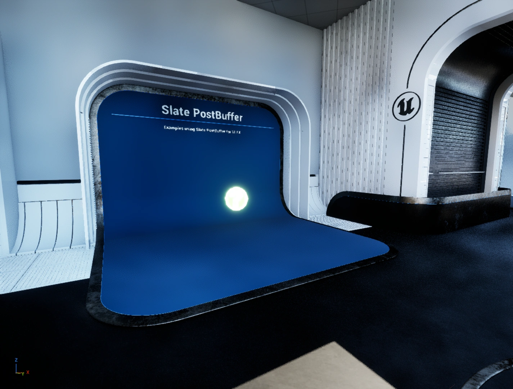
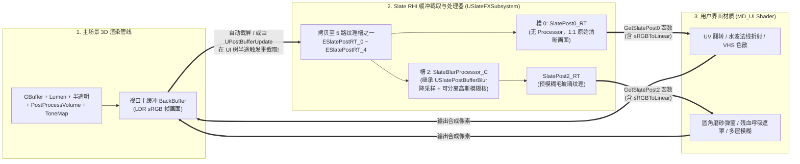
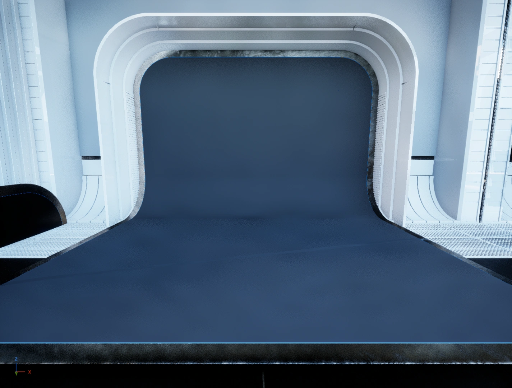
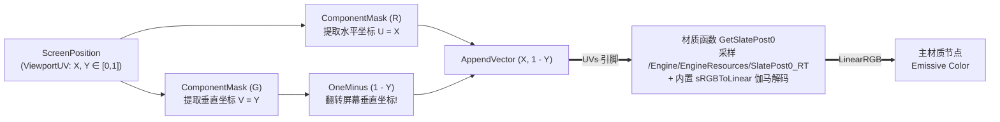
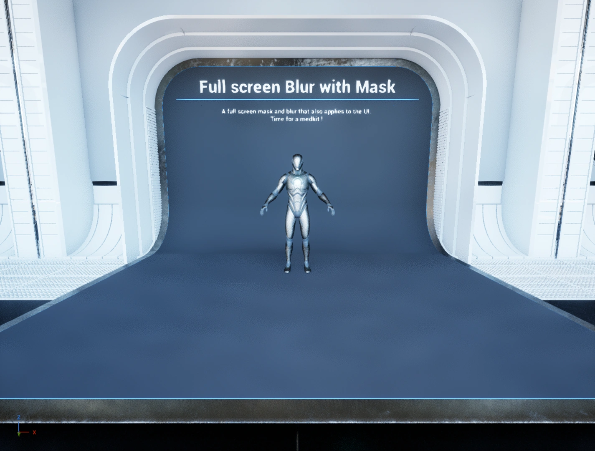
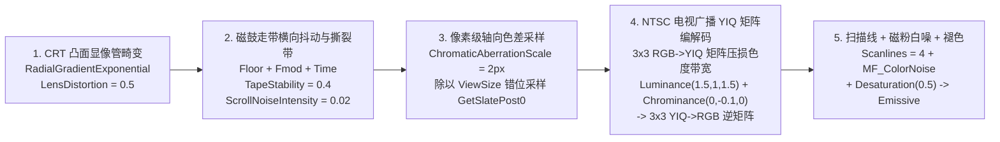
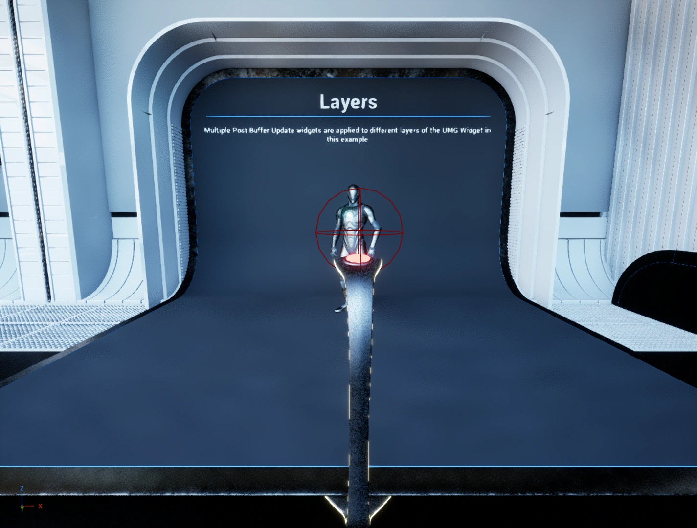
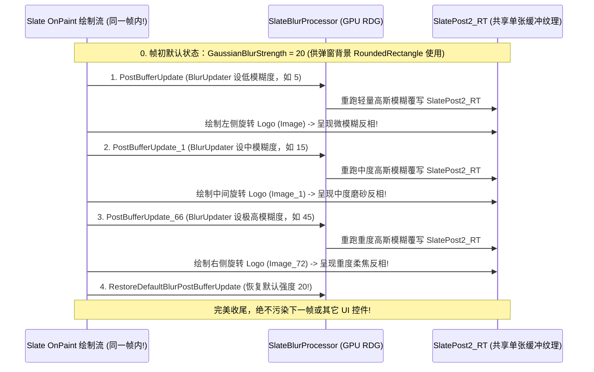

# 第 03 章 · `UI_SlatePostBuffer`：Slate 后备缓冲、实时背景毛玻璃模糊与 UI 级动态折射特效

> **关卡资产路径**：`/Game/Maps/UI/UI_SlatePostBuffer`  
> **示例资产目录**：`/Game/ExampleContent/SlatePostBuffer/`（含 `SimpleInversion_Effect/`、`Blur_Effect/`、`LowHealth_Effect/`、`Waves_Effect/`、`VHS_Effect/`、`MenuLayers_Effect/`、`Updating_Processors/`、`Fonts/`、`Meshes/`）  
> **关卡实测规模**：总计 `52` 个 Actor | `8` 座编号展台 | `30` 个场景示例 Actor | `30` 个独立 SlatePostBuffer 控件、处理器与 UI 着色器资产  

---

## 一、 展厅总览：打破 3D 场景缓冲与 2D Slate 材质之间长达十年的“次元壁”



在 UE 5.4 推出 **Slate Post Buffer（Slate 后备帧缓冲）** 之前，虚幻引擎的 UI 技术美术（UI TA）一直苦于一道横亘在渲染管线底层的“铁幕”：

- **为什么在 `Material Domain = User Interface (MD_UI)` 的材质里，拖不出 `SceneTexture:PostProcessInput0`？**  
  因为虚幻的主场景延迟/前向渲染管线（`FDeferredShadingSceneRenderer`）在完成色调映射（Tone Mapping）将画面写入视口后备缓冲（BackBuffer）之后，3D 渲染管线就已经收工了；紧接着登场的 `FSlateRHIRenderer` 是直接在同一个 BackBuffer 上叠加绘制 2D UI 三角形的。由于现代图形 API（DX12 / Vulkan / Metal）严禁在向一张 RenderTarget 写入像素的同时去采样它自身（Read-Write Hazard 读写竞争死锁），因此 **UI 材质过去根本拿不到脚下实时渲染的 3D 场景画面**！
- **为什么传统的 `UBackgroundBlur`（背景模糊控件）满足不了次世代视觉设计？**  
  原生 `BackgroundBlur` 只是一个封闭的黑盒矩形高斯模糊：你既不能给它加上**液态水波 UV 扭曲**，也不能做**苹果 VisionOS 式的边缘棱镜色散（Chromatic Aberration）与高光折射**，更无法做出**径向呼吸残血晕影**或**复古 VHS 录像带磁头错位滤镜**。

**Slate Post Buffer 的诞生，彻底击碎了这道次元壁！**


### 1.1 Slate Post Buffer 底层 RHI 渲染管线与 `USlateFXSubsystem` 全景拆解

当项目启用 Slate Post Buffer 后，渲染线程在 **“3D 场景渲染完毕（Post-ToneMapping）”** 与 **“Slate 开始绘制 UI（或遇到 `UPostBufferUpdate` 栅栏控件）”** 的交界点，插入了一套轻量级拷贝与可编程预处理管线：



### 1.2 本工程实测 `.ini` 双通道配置与 `SlateBlurProcessor` 资产深拆

翻开本工程 `Config/DefaultEngine.ini`（第 282 行）与 `Config/DefaultGame.ini`（第 25~26 行），我们可以看到整座展厅得以运转的精确配置源码：

```ini
; Config/DefaultEngine.ini
[ConsoleVariables]
Slate.CopyBackbufferToSlatePostRenderTargets=1

; Config/DefaultGame.ini
[/Script/SlateRHIRenderer.SlateRHIRendererSettings]
SlatePostSettings=(
    (ESlatePostRT_0, (bEnabled=True, PathToSlatePostRT="/Engine/EngineResources/SlatePost0_RT.SlatePost0_RT")),
    (ESlatePostRT_1, (PathToSlatePostRT="/Engine/EngineResources/SlatePost1_RT.SlatePost1_RT")),
    (ESlatePostRT_2, (bEnabled=True, PostProcessorClass="/Script/Engine.BlueprintGeneratedClass'/Game/ExampleContent/SlatePostBuffer/SlateBlurProcessor.SlateBlurProcessor_C'", PathToSlatePostRT="/Engine/EngineResources/SlatePost2_RT.SlatePost2_RT")),
    (ESlatePostRT_3, (PathToSlatePostRT="/Engine/EngineResources/SlatePost3_RT.SlatePost3_RT")),
    (ESlatePostRT_4, (PathToSlatePostRT="/Engine/EngineResources/SlatePost4_RT.SlatePost4_RT"))
)
```

请牢记本工程开启的这**一清一糊双通道黄金组合**（引擎最多支持 `0 ~ 4` 共 5 路独立缓冲槽，由引擎子系统 `USlateFXSubsystem` 统一调度）：
1. **通道 0（`ESlatePostRT_0` -> `/Engine/EngineResources/SlatePost0_RT`）**：`bEnabled = True`，**不挂载任何 `PostProcessorClass`**。它保存的是未经模糊的 **100% 锐利原始屏幕拷贝**——专供展台 `#2（Y 轴镜像翻转）`、`#5（水波折射）`、`#6（VHS 录像带畸变）` 在 UI 材质中自由扭曲 UV 采样！
2. **通道 2（`ESlatePostRT_2` -> `/Engine/EngineResources/SlatePost2_RT`）**：`bEnabled = True`，挂载了自定义后处理器蓝图 **`/Game/ExampleContent/SlatePostBuffer/SlateBlurProcessor`**（继承自 C++ 原生类 `USlatePostBufferBlur`，实测默认属性 **`GaussianBlurStrength = 20`**）。它在 GPU 上先执行硬件双线性降采样（Downsample）再跑水平+垂直两趟可分离高斯模糊（Separable Gaussian Blur），以极低的毫秒级开销生成丝滑磨砂纹理——专供展台 `#3`、`#4`、`#7`、`#8` 直接采样！

> [!TIP]
> **进阶路线补充：除了拷贝主视口 BackBuffer，还能把自定义 3D 后处理材质单独导进 Slate 吗？**  
> 完全可以！在 UE 5.4+ 的 **Post Process Material（`MD_PostProcess`）** 主材质属性中，你可以将 **`Output Target`（或 Blendable Location）指向 `Slate Post Buffer`**，或者自定义继承自 `USlatePostBufferProcessor` 的 C++ 渲染图（RDG）处理器——这意味着你甚至可以把 **SceneDepth（场景深度）、CustomStencil（角色自定义描边模板）或法线缓冲** 编码塞进 `SlatePost1_RT`，让 2D UI 材质感知 3D 景深远近实现“近景清晰、远景动态虚化”的空间计算级 HUD！

---

## 二、 逐展台 100% 零遗漏深度拆解（#1 ~ #8）

---

### 展台 #1：`Slate PostBuffer`（展厅环境基座与压力踏板实时挂载机制）
- **展牌标识**：`BP_DemoDisplay` | **空间坐标**：`(500, -900, 0)`
- **官方展牌原文**：
  > *Examples using Slate PostBuffer for UI FX*

#### 1. 展台环境基座 Actor（共 7 个）与踏板交互器拆解
- **环境基座**：包含 `DirectionalLight`（强度 `10.0`）、`SkyLight`（强度 `3.0`）、`SkyAtmosphere`、`ExponentialHeightFog`、`ChaosDebugDrawComponent_0` 调试器、`DocumentationActor`，以及一座覆盖全馆的无边界后期处理体积 **`PostProcessVolume`（`bEnabled = true, bUnbound = true, BlendWeight = 1.0`）**；
- **踏板式 UI 触发器 `BP_PressureButton_WIdgetSpawn`（`/Game/ExampleContent/UMG/BP_PressureButton_WIdgetSpawn`，继承自 `BP_PressureButton_Parent_C`）**：
  为什么本馆（除展台 #7 需要鼠标点击多级菜单外）全都改用了**脚踩压力踏板**而不是上一馆的锁定鼠标按钮？因为 **Slate Post Buffer 最大的魅力就是“实时动态”**！站在压力踏板上，玩家依然可以自由转动摄像机视角、左右走位观察身后的 `SKM_Manny` 人偶与棕榈树在毛玻璃/水波/VHS 滤镜背后**实时流动折射**的震撼效果！
  - **踏板 `EventGraph` 逻辑**：暴露实例变量 `widgetToShow`（指定当前展台的 `UUserWidget` 类）。玩家踩上 `Trigger` 盒体触发 `ButtonEnabled` -> 校验 `IsValidClass(widgetToShow)` -> `CreateWidget` 并存入 `currentWidget` -> `AddToViewport()`；玩家走下踏板触发 `ButtonDisabled` -> 校验 `IsValid(currentWidget)` -> 调用 `RemoveFromParent()` 立即撤除滤镜。

---

### 展台 #2：`Simple Effect`（零处理器直采 `SlatePost0`：屏幕局部 Y 轴倒置透镜）
- **展牌标识**：`BP_DemoDisplay_1.1_SimpleEffect` | **空间坐标**：`(1995, -900, 0)`
- **核心陈列资产（共 3 个）**：
  1. `Plane2`（贴有彩色 UV 棋盘格材质 `M_UVMaterial` -> `T_UVvistexture` 的背景参照平面，方便肉眼识别上下颠倒）
  2. `SKM_Manny7`（虚幻标准银色机械人偶 `SKM_Manny`）
  3. `BP_PressureButton_WIdgetSpawn`（挂载控件：`/Game/ExampleContent/SlatePostBuffer/Widget_SimpleInversion`）
- **官方展牌原文**：
  > *Applying some screen effects without the use of Processors. In this example we are inverting the screen's Y axis.*



#### 1. `Widget_SimpleInversion` 控件树与材质 `M_SimpleInversion` 全节点还原
- **极简控件树**：`CanvasPanel_29 -> CanvasPanelSlot_0 -> InversionEffect [UImage]`（居中摆放一块矩形透镜区域，笔刷材质指向 `MI_SimpleInversion` -> 母材质 `M_SimpleInversion`）；
- **`M_SimpleInversion` 材质属性与 6 节点数学链路深拆**：
  - **材质属性**：`MaterialDomain = MD_UI`，**`BlendMode = BLEND_Opaque`（不透明直接覆写像素，无需混合开销！）**；
  - **完整表达式连线图**：



> [!IMPORTANT]
> **UI 采样 PostBuffer 的两大铁律（初学必踩坑！）**：
> 1. **必须用 `ScreenPosition`（视口归一化屏幕坐标），而不是 `TextureCoordinate`（控件自身局部 0~1 UV）！** 如果你误连了 `TexCoord[0]`，那块小小的矩形 `Image` 里显示的就不是它“脚下正对着的那块局部场景”，而是把整张全屏 16:9 画面强行压扁塞进小方块里的“画中画监控器”！只有基于 `ScreenPosition` 做偏移/翻转，透镜边缘才能与外部真实 3D 世界严丝合缝对齐；
> 2. **色彩空间陷阱——为什么引擎内置 `GetSlatePost0 / GetSlatePost2` 函数里藏着一个 `sRGBToLinear` 节点？** 因为拷贝进 `SlatePost0_RT` 的视口后备缓冲已经是编码过 sRGB 伽马曲线的数据，而 `MD_UI` 着色器输出后 Slate 渲染管线还会做一次线性到 sRGB 的最终转换。如果裸采样贴图不经 `sRGBToLinear`，画面就会被双重伽马提亮得发白发灰！直接调用引擎提供的 `/Engine/Functions/UserInterface/GetSlatePost0`（或 `GetSlatePost2`）函数即可一键拿到精准的 `LinearRGB`。

---

### 展台 #3：`Blur`（高颜值局部磨砂毛玻璃弹窗：双层圆角嵌套与色调提亮合成）
- **展牌标识**：`BP_DemoDisplay_1.2_Blur` | **空间坐标**：`(2995, -900, 0)`
- **核心陈列资产（共 4 个）**：`Plane`（砖墙材质 `M_StandardMaterial`，含 `T_Bricks_D` 与高频凹凸法线 `T_Bricks_N` 专门检验高频纹理模糊柔化品质）、`Plane3`（`M_UVMaterial`）、`SKM_Manny6`，以及挂载 `/Game/ExampleContent/SlatePostBuffer/Widget_Blur_Effect` 的压力踏板
- **官方展牌原文**：
  > *This is an example of a localized blurred viewport behind a text popup window.*

#### 1. `Widget_Blur_Effect` 双层圆角边框控件树（VisionOS / Win11 亚克力质感秘诀！）
为什么大厂做的毛玻璃弹窗看起来晶莹剔透有厚度感，而新手做的毛玻璃像一块脏塑料？打开 `Widget_Blur_Effect` 的控件树，你会看到标准的**内外双圆角叠层法**：

```text
WidgetTree (Widget_Blur_Effect)
└── CanvasPanel_29 -> CanvasPanel_92 -> Overlay_55 [三层叠放容器]
    ├── OverlaySlot_0:  RoundedRectangle_Ext [外层大圆角矩形：挂载 MI_PopupBlurEffect_Ext，充当浅灰半透玻璃高光外沿/倒角边框]
    ├── OverlaySlot_2:  RoundedRectangle_Int [内层缩进圆角矩形：挂载不同色调/透明度的毛玻璃实例，形成清晰的玻璃内外双层折射阶梯!]
    └── OverlaySlot_10: TextBlock_201        [顶层清晰锐利文字："The scene rendered behind this message popup is blurred !"]
```
> 注意 UMG 的 `Image` 笔刷原生支持 `DrawAs = RoundedBox`（硬件抗锯齿 SDF 圆角矩形），无需切九宫格圆角贴图即可与 `MD_UI` 毛玻璃材质完美相乘裁出丝滑圆角！

#### 2. 材质 `M_PopupBlurEffect` 与实例 `MI_PopupBlurEffect_Ext` 表达式拆解
- **`M_PopupBlurEffect`（8 个表达式节点，`MD_UI`，`BLEND_Translucent`）**：
  - 调用 **`GetSlatePost2`** 直接读取已由 `SlateBlurProcessor`（`GaussianBlurStrength = 20`）预模糊好的 `SlatePost2_RT`；
  - 将模糊后的场景色与三维向量参数 `BackgroundColor`（实例覆写为中性灰 `(0.5, 0.5, 0.5, 1.0)`）相乘压暗对比度（防止背后遇到纯白高亮天空时，弹窗上的白色字体看不清！），再叠加标量提亮参数 `ColorAdd`（默认 `0.5`，实例设为 `0.0`），最后由 `Opacity`（实例设为 `1.0`）控制整体混合不透明度。

---

### 展台 #4：`Full screen Blur with Mask`（残血呼吸晕影：用 `PostBufferUpdate` 连底层 HUD 一起模糊！）
- **展牌标识**：`BP_DemoDisplay2` | **空间坐标**：`(4000, -900, 0)`
- **核心陈列资产（共 2 个）**：`SKM_Manny2` + 压力踏板 `BP_PressureButton_WIdgetSpawn3`（挂载控件：`/Game/ExampleContent/SlatePostBuffer/Widget_LowHealth`）
- **官方展牌原文**：
  > *A full screen mask and blur that also applies to the UI. Time for a medkit !*



#### 1. 颠覆性突破：3D 后处理做不到的事 ——“让屏幕特效同时作用于上层 UI 本身”！
在传统 FPS 游戏里，濒死残血红屏通常做在 3D `PostProcessVolume` 里：结果 3D 世界模糊发红了，左下角的血条和准星却依然像贴在显示器玻璃外面的剪纸一样干干净净，瞬间出戏！  
展台 #4 的 `Widget_LowHealth` 用**三明治插槽架构**展示了 **`UPostBufferUpdate`（后备缓冲实时刷新栅栏控件）** 的真正威力：

```text
WidgetTree (Widget_LowHealth)
└── CanvasPanel_29 -> Overlay_55 [严格按从上到下的子槽顺序依次提交 GPU 绘制!]
    ├── Slot 0 (最底层): Widget_FakeGameHUD_LowHealth [先在屏幕上画出动态闪烁的游戏血条 HealthBar 与五格能量条 EnergyBar]
    ├── Slot 1 (中间层): PostBufferUpdate_LowHealth   [🔥 渲染栅栏！暂停 Slate 批处理，将当前“3D画面 + 刚画上去的血条 UI”重新截取并跑一遍高斯模糊写入 SlatePost2_RT!]
    └── Slot 2 (最顶层): LowHealth_Effect [Image: MI_LowHealth -> 采样刚更新的 SlatePost2_RT，把 3D 世界连同底下的血条边缘一起模糊染红!]
```

#### 2. `M_LowHealth`（21 个表达式节点）生理级濒死呼吸着色器全还原
打开 `M_LowHealth` 及其实例 `MI_LowHealth`，它的数学构造堪称教科书级的程序化动画范本：
1. **主呼吸节律（正弦重映射）**：将 `Time * BreathingSpeed (0.4)` 送入材质函数 `Sine_Remapped`，让遮罩半径在 `MaskMinSize (0.75)` 与 `MaskMaxSize (0.90)` 之间平缓收缩扩张，模拟角色大口喘息时视野一收一放的生理压迫感；
2. **微幅肾上腺素颤抖（程序化噪波叠加）**：单独一路 `Time * BreathingNoiseSpeed (0.25)` 输入 `MaterialExpressionNoise`，乘以微幅强度 `BreathingNoiseIntensity (0.02)` 叠加到呼吸半径上，打破纯正弦波的机械死板感；
3. **指数径向边缘羽化遮罩**：送入 `RadialGradientExponential` 生成中心通透（保持屏幕正中央准星视野清晰可瞄准！）、四周渐浓的环形权重 `OneMinus`，将 `GetSlatePost2` 模糊采样结果与暗红血色 `MaskColor (R=0.417, G=0, B=0)` 合成输出至 `Emissive Color` 与 `Opacity`！

---

### 展台 #5：`Wavy screen`（海市蜃楼与水下折射：法线贴图实时扭曲 3D 场景与 HUD）
- **展牌标识**：`BP_DemoDisplay4` | **空间坐标**：`(5010, -900, 0)`
- **核心陈列资产（共 5 个）**：微缩沙漠绿洲造景——两棵棕榈树 `Palm` / `Palm2`、带有世界位置偏移起伏沙丘材质 `Desert`（23 个节点，混合 `T_SandDunes_N` 与 `T_Sand_D`）的沙滩圆盘 `Disc`（`Beach_Disk`）、`SKM_Manny3`，以及挂载 `/Game/ExampleContent/SlatePostBuffer/Widget_Waves_Effect` 的压力踏板
- **官方展牌原文**：
  > *Using UV Deformation with a texture to simulate waves on the screen*

#### 1. `Widget_Waves_Effect` 三明治结构与 `M_WavesEffect`（18 节点）UV 折射算子
- **控件树**：与展台 #4 同构，`Overlay_55` 依次排列：`Widget_FakeGameHUD`（底层带动画的血条与能量格） -> `PostBufferUpdate_Waves`（中层截取含 HUD 的完整帧写入 `SlatePost0_RT`） -> `Waves_Effect`（顶层全屏 `Image`，赋 `MI_WavesEffect`）；
- **`M_WavesEffect` 折射数学链路还原**：
  1. 以 `Speed X = -0.2, Speed Y = -0.2` 驱动 `Panner` 沿对角线匀速滚动采样引擎水体法线贴图 `/Game/ExampleContent/Effects/Textures/T_WaterNormal`；
  2. 用 `ComponentMask (R, G)` 提取法线切线空间的水平/垂直偏折分量 $\Delta u, \Delta v$，乘以折射幅度标量 `Intensity = 0.01`；
  3. 与当前像素的 `ScreenPosition` 相加得到扰动后的屏幕坐标 $\text{UV}' = \text{ScreenPos} + 0.01 \cdot N_{xy}$，直接采样 **`SlatePost0`（清晰原始缓冲）** 并对 R、G、B 三通道分别执行 `sRGBToLinear` 输出！
  - **视觉奇观**：不仅远处的棕榈树和沙滩像浸在水底一样柔美摇曳，连屏幕左上角的 UI 血条框线也同步泛起阵阵水波涟漪！这在水下关卡潜泳 HUD、沙漠中暑眩晕、或空间传送门开启瞬间极具表现力。

---

### 展台 #6：`VHS Distortion`（109 节点核弹级复古录像带模拟恐怖滤镜：鱼眼、走带撕裂与 NTSC YIQ 矩阵！）
- **展牌标识**：`BP_DemoDisplay3` | **空间坐标**：`(6005, -900, 0)`
- **核心陈列资产（共 3 个）**：`SKM_Manny4`、`LightmassImportanceVolume`、压力踏板 `BP_PressureButton_WIdgetSpawn5`（挂载控件：`/Game/ExampleContent/SlatePostBuffer/Widget_VHS_Effect`）
- **官方展牌原文**：
  > *A VHS effect using complex UV distortion — Analog Horror anyone ?*

#### 1. 像素字体实时系统时钟 OSD + 帧缓冲连体畸变（`Widget_VHS_Effect`）
为什么许多独立恐怖游戏做的 VHS 录像机界面一眼假？因为它们把 `PLAY ▶` 和右上角跳动的日期时间戳叠在了滤镜**最上面**，字幕干净得像现代液晶屏！看 `Widget_VHS_Effect` 是如何做出纯正 90 年代磁带味的：
- **控件树顺序**：
  ```text
  WidgetTree (Widget_VHS_Effect)
  └── CanvasPanel_29 -> Overlay_55
      ├── Slot 0~2 (底层先画摄像机 OSD 像素字幕，使用复古街机像素字体 PressStart2P-Regular_Font):
      │   ├── TextBlock_Play          ("PLAY ▶")
      │   ├── TextBlock_Timecode_Date ("JAN. 00 0000")
      │   └── TextBlock_Timecode_Time ("AM   00:00:00:00")
      ├── Slot 3 (中层截屏栅栏): PostBufferUpdate_VHS [将 3D 场景连同上面的白色像素字幕一并烤进 SlatePost0_RT!]
      └── Slot 4 (顶层磁带信号解调): VHS_Effect [Image: MI_VHSEffect]
  ```
- **`Event Tick` 真实系统时间驱动**：在 `Widget_VHS_Effect` 的 `EventGraph` 中，读取本机 `DateTime::Now()`，提取 `IsMorning`（切分 `AM / PM`）、`GetHour12`、`GetMinute`、`GetSecond`、`GetMillisecond`，实时拼接刷新右下角毫秒级跳动的录像机时码！因为这些文字画在 `PostBufferUpdate_VHS` **之前**，所以白色像素字本身也会跟着磁带抖动发生横向撕裂与红青重影色散！

#### 2. 源码级硬核拆解：`M_VHSEffect`（整整 109 个材质节点！）五重模拟电路管线
`M_VHSEffect`（配合自定义噪波函数 `MF_ColorNoise`）是整座 `ContentExamples` 工程中最精妙的 UI 材质之一，它完整复刻了模拟磁带录像机（VCR）在 CRT 电视上的五重物理失真：



特别值得收藏的是材质第 1562~1633 行实测提取出的**标准 NTSC 彩色电视 `RGB <-> YIQ` 正逆 3×3 变换矩阵常量**（通过 `Transform3x3Matrix` 材质函数执行）：
- **正向编码 `RGB -> YIQ`**（基向量 `(0.299, 0.596, 0.211)`、`(0.587, -0.274, -0.523)`、`(0.114, -0.322, 0.312)`）：模拟 VHS 磁带亮度信号 `Y` 带宽较高、而色度信号 `I / Q` 带宽极窄易串色偏绿/偏品的物理特性（乘上 `Luminance = (1.5, 1.0, 1.5)` 过曝高光并偏移 `Chrominance = (0, -0.1, 0)`）；
- **逆向解码 `YIQ -> RGB`**（基向量 `(1.0, 1.0, 1.0)`、`(0.956, -0.272, -1.110)`、`(0.621, -0.647, 1.700)`）：还原回 RGB 后再叠加上 `MF_ColorNoise`（利用 `frac(sin(dot(UV, Seed)) * K)` 生成高频雪花噪点）与 `50%` 去饱和度，瞬间呈现出令人毛骨悚然的《后室（Backrooms）》级模拟恐怖录像质感！

---

### 展台 #7：`Layers`（多级菜单逐层累加模糊与 `Collapsed` 零开销动态剪枝）
- **展牌标识**：`BP_DemoDisplay5` | **空间坐标**：`(6995, -900, 0)`
- **核心陈列资产（共 2 个）**：`SKM_Manny5` + 立式交互台 `BP_EventDemoTrigger`（挂载控件：`/Game/ExampleContent/SlatePostBuffer/Widget_MenuLayers_Effect`，需解锁鼠标点击多级菜单）
- **官方展牌原文**：
  > *Multiple Post Buffer Update widgets are applied to different layers of the UMG Widget in this example*



#### 1. 同一张 Widget 内嵌两道 `PostBufferUpdate` 栅栏的“景深递进层次感”
当游戏主菜单上再弹出一层二级子菜单时，如何让**二级子菜单不仅模糊 3D 场景，还把底下一级主菜单的按钮和科技感扫描线一起虚化推远**，形成极具空间纵深的视觉焦点层次？拆解 `Widget_MenuLayers_Effect` 的 6 层 `Overlay_55` 架构：

```text
WidgetTree (Widget_MenuLayers_Effect)
└── CanvasPanel_29 -> Overlay_55 [六层递进渲染栈]
    ├── Layer 1: Gradient_Background (M_Gradient) + Scanlines_Background (M_Scanlines: 旋转平移采样 ScanDistort 扫描纹理)
    ├── Layer 2: 🔥 PostBufferUpdate_Menu_Blur    [第 1 道截屏模糊栅栏：将 3D 场景 + 渐变扫描底纹模糊进 SlatePost2_RT]
    ├── Layer 3: EffectOverlay_Menu               [SimpleBlur_Effect_Menu (MI_SimpleBlurEffect 线性渐变毛玻璃) + VerticalBox_Menu -> Button_Menu_0 ("Open Submenu")]
    ├── Layer 4: 🔥 PostBufferUpdate_SubMenu_Blur [第 2 道截屏模糊栅栏（初始 Collapsed!）：展开子菜单时激活，将 Layer 1~3 的主菜单按钮再模糊一遍!]
    └── Layer 5: EffectOverlay_SubMenu            [SimpleBlur_Effect_SubMenu + VerticalBox_SubMenu -> Button_SubMenu_0 ("Close Submenu")]
```

#### 2. `EventGraph` 性能教科书：不用时务必将 `PostBufferUpdate` 设为 `Collapsed`！
仔细阅读 `Widget_MenuLayers_Effect` 事件图中的按钮交互逻辑：
- **点击 `Button_Menu_0 ("Open Submenu")` 时**：将主菜单按钮 `SetIsEnabled(false)` 变灰防误触，同时将 `PostBufferUpdate_SubMenu_Blur` 设为 `HitTestInvisible`（激活第 2 道模糊截屏！），并将 `EffectOverlay_SubMenu` 设为 `Visible`；
- **点击 `Button_SubMenu_0 ("Close Submenu")` 时**：重新启用主菜单按钮，并将 `EffectOverlay_SubMenu` 与 **`PostBufferUpdate_SubMenu_Blur` 同步设回 `Collapsed`**！
- **底层性能原理**：每一道处于可见态（哪怕是 `HitTestInvisible`！）的 `UPostBufferUpdate` 都会在当前帧打断一次 Slate 合批并触发一次全屏 BackBuffer 拷贝与高斯模糊 Pass。一旦将其设为 **`Collapsed`（折叠）**，Slate 在 `OnPaint` 遍历时会彻底跳过该节点，GPU 立刻恢复为每帧仅执行 1 次模糊拷贝！

---

### 展台 #8：`Updating Processors`（同帧内动态改写模糊核强度：单缓冲槽渲染多档磨砂梯度！）
- **展牌标识**：`BP_DemoDisplay6` | **空间坐标**：`(8505, -900, 0)`
- **核心陈列资产（共 4 个）**：`Plane4`（砖墙 `M_StandardMaterial`）、`Plane5`（UV 棋盘格 `M_UVMaterial`）、`SKM_Manny8`、压力踏板 `BP_PressureButton_WIdgetSpawn7`（挂载控件：`/Game/ExampleContent/SlatePostBuffer/Widget_Updating_Processors`）
- **官方展牌原文**：
  > *It's possible to update processors within the same frame. While we don't suggest doing this multiple times in a single widget. It can be useful over the lifespan of a game's UI.*

#### 1. 终极灵魂拷问：总共只有 5 个缓冲槽，如果界面需要 10 种不同的模糊半径怎么办？
踩上展台 #8 的踏板，弹窗中央写着一句令人拍案叫绝的话：
> *`"Each of these logos have a different blur value, yet sample from the same post buffer."`*（这三个旋转的虚幻 Logo 各自拥有完全不同的模糊强度，但它们采样的居然是同一个 `SlatePost2` 缓冲槽！）

拆解其背后的 `M_LogoBlurSpinInverted` 材质与 `Widget_Updating_Processors` 四栅栏流水线：
- **旋转反相毛玻璃材质 `M_LogoBlurSpinInverted`（13 个节点）**：
  - 使用 `Time -> Multiply -> Rotator` 实时旋转虚幻 Logo 贴图 `T_UE_Logo_Simple_M` 作为 `Opacity` 轮廓遮罩；
  - 颜色端调用 `GetSlatePost2` 读取 `SlatePost2_RT`，拆出 R、G、B 三通道分别经过 **`OneMinus`（颜色反相）** + `sRGBToLinear` 后合成为 `Float3` 输出。注意：**三个 Logo 用的是完全相同的材质，没有任何区分！**
- **单帧内四次接力改写 `GaussianBlurStrength`（`UPostBufferUpdate` + 内嵌 `UPostBufferBlurUpdater`）**：
  在每个 `PostBufferUpdate` 控件的 `UpdateBufferInfos` 数组中，都可以挂载一个专属的处理器参数修改器子对象 **`PostBufferBlurUpdater_0`（`UPostBufferBlurUpdater`）**，在触发截屏模糊的那一刹那，向渲染线程下发新的 `GaussianBlurStrength` 覆盖值！



> [!CAUTION]
> **性能与工程边界守则（呼应官方展牌警告）**：  
> 1. **为什么展牌明确提醒 *“While we don't suggest doing this multiple times in a single widget”*？**  
>    因为在同一帧内连续放 3~4 个 `PostBufferUpdate`，意味着在同一帧里把全屏画面翻来覆去高斯模糊了 4 遍！这在展台 #8 中是为了极端验证同帧流水线改参能力；而在真实游戏生命周期中，它最黄金的用途是**跨阶段平滑过渡**——例如玩家按下“暂停键”打开菜单的 0.3 秒内，用动画曲线驱动**单个** `PostBufferBlurUpdater` 的 `GaussianBlurStrength` 从 `0 -> 30` 丝滑渐强，让背后的战场画面伴随着镜头虚化优雅退居幕后！
> 2. **状态复原铁律（`RestoreDefaultBlurPostBufferUpdate`）**：  
>    `SlateBlurProcessor` 是全局单例级别的渲染处理器实例！如果你在某个临时界面通过 `PostBufferBlurUpdater` 修改了它的 `GaussianBlurStrength`，**务必在该控件树末尾（或卸载时）放置一个恢复默认值的 `RestoreDefaultBlurPostBufferUpdate`（可勾选 `bSkipBufferUpdate = true` 仅重置参数而不浪费一次额外模糊 Pass）**，否则之后打开的所有普通弹窗模糊度都会错乱！

---

## 三、 次世代 UI 视觉配方进阶：如何在项目中复刻 Apple VisionOS 液态玻璃质感？

结合本章实测拆解的 **`SlatePost0_RT`（清晰原图）+ `SlatePost2_RT`（高斯磨砂图）** 双通道底座，你可以在 5 分钟内搭出一套超越传统平面 UI 的 **VisionOS 级空间毛玻璃主材质 `M_UI_LiquidGlass`**：

1. **中心磨砂主体**：使用 `ScreenPosition` 采样 `GetSlatePost2`（模糊强度 `25`），乘以 `0.85` 压暗系数防止亮背景吞字；
2. **边缘液态曲率折射（Edge Refraction）**：利用 `RoundedBox` UV 离四条边的距离构造一条宽度为 `12px` 的内边缘法线斜坡 $\vec{N}_{\text{bevel}}$，在边缘处将 `ScreenPosition` 向外微推 `0.008` 并混合采样一丝 `GetSlatePost0` 清晰折射高光，使面板边缘呈现出真实的厚水晶倒角折射感；
3. **微色散镶边（Subtle Chromatic Rim）**：在圆角最外圈 `3px` 处，对 R 通道与 B 通道施加 `±1.5px / ViewSize` 的微幅反向偏移采样，立刻浮现出光学玻璃特有的微妙彩虹棱镜边；
4. **鼠标/手柄焦点动态高光跟随**：通过材质参数集（MPC）传入当前光标或聚焦按钮的屏幕坐标 `CursorScreenPos`，用 `Distance(ScreenPosition, CursorScreenPos)` 在玻璃倒角边缘点亮一抹随手指游走的柔光——整套效果仅需 **1 个 `MD_UI` DrawCall**，60~120 FPS 满帧丝滑运行！

---

## 四、 `09_UI_界面框架与Slate后处理` 全三章技术栈总复盘

至此，我们已经将虚幻引擎现代 UI 工程的三座核心展厅（共计 **33 座展台、154 个底层资产**）从二进制控件树、蓝图字节码图表一直拆解到了 RHI 着色器矩阵：

| 架构层级 | 对应关卡专章 | 解决的核心工程命题 | 量产立项选型定论 |
| :--- | :--- | :--- | :--- |
| **排版、文本与交互原语层** | **`01_UI_UMG`** (`17` 座展台) | 多比例屏幕锚点自适应、事件驱动零空转更新、3D 世界/屏幕双空间投射、**MSDF 矢量无损字体** | 全面开启 `MSDF` 字体；严禁滥用属性轮询函数绑定；低频重面板善用 `RetainerBox` 相位缓存 |
| **跨平台路由与焦点栈层** | **`02_UI_CommonUI`** (`8` 座展台) | 多层嵌套菜单焦点自动保存与归还、键鼠/手柄图标 1 帧无感热切换、声明式输入模式与 **Enhanced Input 融合** | 替换 `CommonGameViewportClient`；采用四层 `ActivatableWidgetStack` 根架构与 CSS 化全局 `CommonStyle` |
| **实时屏幕后处理视觉层** | **`03_UI_SlatePostBuffer`** (`8` 座展台) | 打破 3D 场景缓冲与 2D UI 材质隔离，实现局部磨砂玻璃、连同 HUD 一起模糊的 `PostBufferUpdate` 栅栏与动态 UV 折射 | 双开 `SlatePost0`（清晰折射）+ `SlatePost2`（预降采样高斯模糊）；未激活的 `PostBufferUpdate` 严格置 `Collapsed` |
