# 01 · 传统音频体系：空间衰减、混响体积、并发控制、侧链闪避与子混音全解（`Audio`）

> **本篇实测拆解关卡与音频工程档案**
> - **主关卡路径**：`/Game/Maps/Audio/Audio`（关卡总 Actor 数：`88` | 独立展台数：**`20` 座（`#1` ~ `#20` 全覆盖）** | 关卡陈列示例 Actor 数：`54` + 全局辅助 Actor `3` 个）
> - **工程配套资产全集**：`/Game/ExampleContent/Audio/`（涵盖 `Sound_Basics`、`Reverb`、`Surfaces`、`SoundClasses` 15 个声学分类、`SoundMixes/Dialog_Duckall_PSM` 侧链闪避混音器、`Reverb_Effects/Auditorium` 混响器及 4 种物理表面材质，总计 **73 项场景节点与声学资产配置组合**）
> - **关卡脚本类**：`/Game/Maps/Audio/Audio.Audio_C`
> - **核心引擎类族**：`AAmbientSound`、`UAudioComponent`、`USoundWave`、`USoundCue`、`USoundAttenuation`、`AAudioVolume`、`UReverbEffect`、`USoundClass`、`USoundMix`、`USoundConcurrency`、`USoundSubmix`

---

## 一、 空间声学的物理契约：为什么“听得真”比“画得真”更难欺骗大脑？

在电子游戏的感官矩阵中，视觉受限于显示器边框（通常只有水平 $60^\circ \sim 110^\circ$ 的视锥角 FOV），玩家永远看不到身后的世界；而**听觉是人类唯一具备 $360^\circ$ 全向球面感知、可穿透墙壁掩体、且时间分辨率高达亚毫秒级的生存预警雷达**。

在商业 3A 项目评审中，新手关卡设计师最常犯的致命错误就是把音频当成“拖进场景就能响的 MP3 播放器”：
- 把立体声（Stereo）音乐文件直接塞进火把 Actor，结果无论玩家转头还是走远，火焰噼啪声都像贴在脑门正中央一样纹丝不动；
- 为了给一条蜿蜒 50 米的地下暗河配音，沿着河岸硬摆了 30 个球形点声源，不仅瞬间耗尽最大并发声道池（Voice Pool），相邻声源重叠区还产生了诡异的**梳状滤波相位抵消（Comb Filtering）**；
- 隔着三米厚的钢筋混凝土防爆门，门外的枪声竟然只是“清脆地变小声了”，高频泛音丝毫未被吸收，空间隔绝感荡然无存；
- Boss 战高潮时 20 个杂兵同时开火、手雷连环爆炸，总输出电平直接冲破 `0 dBFS` 产生刺耳的数字削波爆音（Digital Clipping），而主角拼死喊出的关键战术台词彻底淹没在噪音汪洋里。

打开 **`/Game/Maps/Audio/Audio`** 展厅，Epic 官方音频团队在一条长达 **105 米** 的受控声学走廊中，用 **20 座递进式实验展台（`#1` ~ `#20`）** 与 `/Game/ExampleContent/Audio/` 目录下完整的混音工程资产，为我们立下了虚幻引擎空间音频管线的全部工业基石。

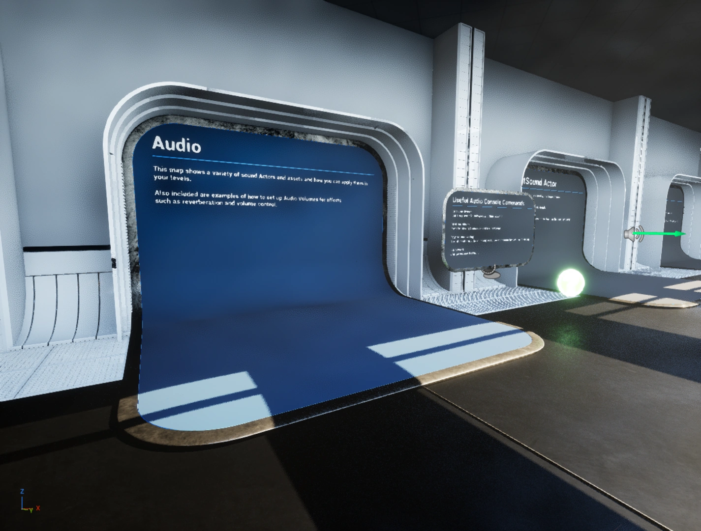

---

## 二、 展厅空间动线与虚幻 Audio Mixer 全局信号流架构

### 2.1 105 米声学长廊空间拓扑鸟瞰

沿着展厅 `+X` 轴正方向（从入口 `X = 500` 延伸至尽头 `X = 10506`），`Audio` 关卡被精密划分为**四大声学实验区**。其中 `#8`（衰减几何形状）、`#15`（混响体积）与 `#18`（室内外环境声场隔离）采用了**“母展牌总纲 + 台面/房间嵌套对比子展台”**的复合空间结构：

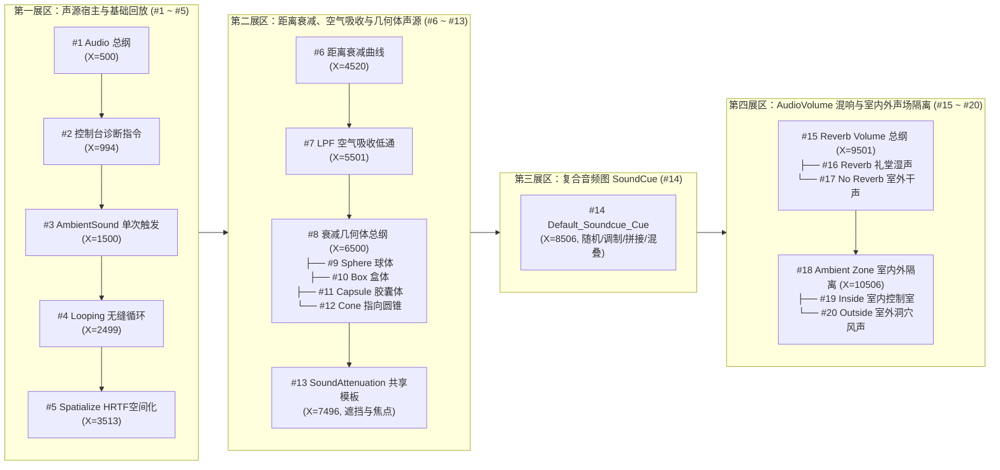

### 2.2 虚幻引擎现代 Audio Mixer 端到端信号管线

在深入每一座展台之前，我们必须先在脑海中建立虚幻引擎音频渲染器（`AudioMixer`）的**单个音频帧（Buffer Callback）信号流全貌**。当一个 `USoundWave` 或 `USoundCue` 被唤醒时，它的数字采样点要经历整整 **8 道精密关卡** 才能抵达玩家的耳机：

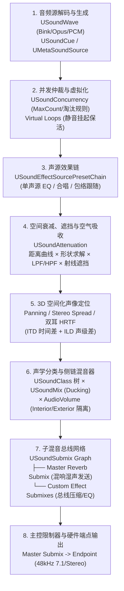

下面，让我们走入这座声学实验室，对 `#1` 至 `#20` 全部 **20 座展台** 展开零遗漏的逐台实测解剖，并在第五节深挖支撑整套商业混音体系的并发淘汰、侧链闪避与子混音总线工程！

---

## 三、 逐展台（`#1` ~ `#20`）100% 实测参数与声学原理全解

### 展台 #1：`Audio` — 关卡导览总纲与世界照明基准

- **空间元数据**：展牌 Label `BP_DemoDisplay10` | 坐标 `(500, -900, 0)`
- **官方展牌原文**：
  > *This map shows a variety of sound Actors and assets and how you can apply them in your levels.*
  > *Also included are examples of how to set up Audio Volumes for effects such as reverberation and volume control.*
  > （本关卡展示了多种声音 Actor 与音频资产及其在关卡中的应用方式；同时也包含了如何配置 `Audio Volume`（音频体积）以实现混响与室内外音量隔离控制的完整示例。）

#### 1.1 展台内陈列 Actor 与底层参数拆解（共 6 个）
与欢迎大厅一脉相承，`#1` 号入口展台集中托管了整座 105 米声学长廊的全局环境照明与视口相机基准：

| Actor 名称 | 类名 (`Class`) | 关键组件与 MCP 实测参数 | 工程职责说明 |
| :--- | :--- | :--- | :--- |
| **`DirectionalLight`** | `/Script/Engine.DirectionalLight` | `LightComponent0`: `Intensity = 3.14` ($\pi$ lux), `LightColor = (1,1,1,1)`, `CastShadows = true`, `Mobility = Movable` | **主平行光**：采用物理单位圆周率基准照度 $\pi$，配合动态阴影勾勒展龛体积层次。 |
| **`SkyLight`** | `/Script/Engine.SkyLight` | `SkyLightComponent0`: `Intensity = 1.0`, `Mobility = Movable` | **实时天光漫反射**：照亮背光区交互按钮与音频画刷边界。 |
| **`SkyAtmosphere`** | `/Script/Engine.SkyAtmosphere` | `SkyAtmosphereComponent` | **物理大气散射层**：为天窗提供自然天空背景。 |
| **`ExponentialHeightFog`** | `/Script/Engine.ExponentialHeightFog` | `HeightFogComponent0` | **指数高度雾**：柔化百米长廊远景纵深。 |
| **`Actor`** | `/Script/Engine.Actor` | `ChaosDebugDrawComponent_0` | **物理与调试线框宿主**：配合音频衰减球/射线检测的辅助线框渲染。 |
| **`CameraActor`** | `/Script/Engine.CameraActor` | `CameraComponent`, `DrawFrustumComponent_0` | **关卡预设取景机位**：定格入口走廊标准构图。 |

---

### 展台 #2：`Useful Audio Console Commands` — 音频工程师的四大听诊器与现代调试栈

- **空间元数据**：展牌 Label `BP_DemoDisplay15` | 坐标 `(994, -710, 75)`
- **陈列示例 Actor（1 个）**：`Audio Content Examples Documentation` [`/Script/Engine.DocumentationActor`]

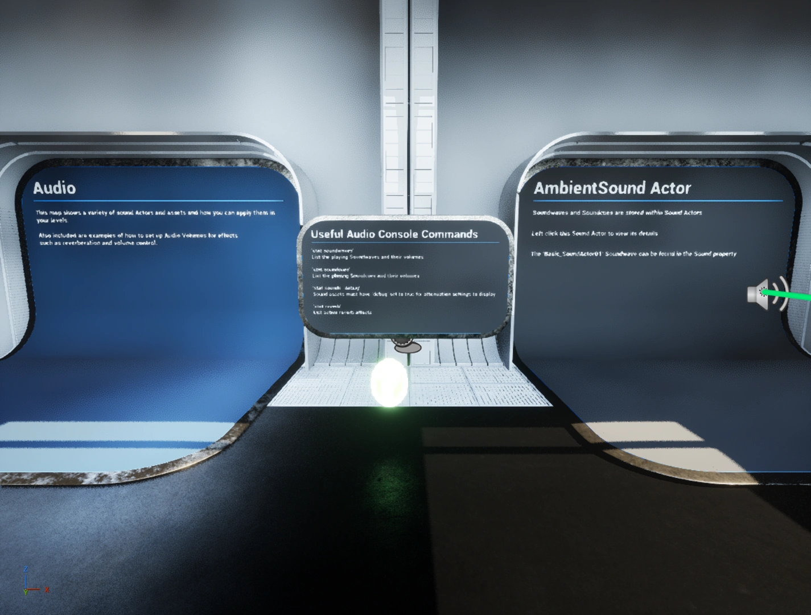

- **官方展牌原文**：
  > - `'stat soundwaves'` — *List the playing Soundwaves and their volumes*
  > - `'stat soundcues'` — *List the playing Soundcues and their volumes*
  > - `'stat sounds -debug'` — *Sound assets must have 'debug' set to true for attenuation settings to display*
  > - `'stat reverb'` — *List active reverb affects*

#### 2.1 为什么音频调试绝对不能只靠“竖起耳朵听”？
人耳具有极强的心理声学掩蔽效应（Psychoacoustic Masking）：当一个低频爆炸声盖过脚步声时，你很难凭听觉判断脚步声是**被并发淘汰杀掉了**、**被遮挡射线错误判定在墙后了**，还是**虚拟声部挂起后没能唤醒**。按下波浪键 `` ` `` 呼出控制台，展牌给出的四条核心指令再加上 UE5 全新的可视化工具，构成了完整的现场排障矩阵：

| 调试指令 / 工具 | 核心观测指标 | 实战排障场景 |
| :--- | :--- | :--- |
| **`stat soundwaves`** | 当前正在物理声道解码回放的所有 `USoundWave` 实例列表、实时线性增益（Volume）、采样率与内存占用 | 排查“某个循环音效忘记关掉导致声道泄漏（Voice Leak）”或验证流式分块解码状态。 |
| **`stat soundcues`** | 当前激活的所有 `USoundCue` 复合实例及其合成距离、最终输出音量与所属包路径 | 核对触发器按钮是否正确拉起了目标 Cue，区分是 Cue 层未触发还是底层 Wave 静音。 |
| **`stat sounds -debug`** | 按优先级排序列出全部活跃音频源、所属 `SoundClass`、距离衰减因子、LPF 频率，并在 3D 视口绘制调试信息（需资产勾选 `bDebug`） | 精准核查多个声源争夺声道时的最终 `Priority × Volume` 权重计算结果。 |
| **`stat reverb`** | 当前听者（Listener / 摄像机）所在位置的激活 `AudioVolume` 名称、`ReverbEffect` 资产及混响干湿过渡插值进度 | 当走进房间却听不到混响时，一秒确认是体积优先级被覆盖还是 `bEnableReverb` 未开启。 |
| **`au.3dVisualize.Enabled 1`** *(UE5 进阶)* | 在运行态 3D 世界中实时渲染所有活跃声源的三维空间位置球、双耳声像连线与衰减包络线框 | 无需打开编辑器选中 Actor，直接在 PIE 跑图时肉眼观测声源跟随骨骼插槽是否偏移！ |
| **`Audio Insights`** *(UE 5.4+ 王牌)* | 独立性能剖析面板：实时绘制所有声部的波形响度表（Loudness Meter）、LPF/HPF 曲线、虚拟声部状态与 CPU DSP 耗时火焰图 | 商业大世界项目压测数百并发声部、定位单个异常 MetaSound 或 Submix 算力尖峰的终极武器。 |

---

### 展台 #3：`AmbientSound Actor` — 关卡声源宿主与 `USoundWave` 编解码内幕

- **空间元数据**：展牌 Label `BP_DemoDisplay` | 坐标 `(1500, -900, 0)`
- **官方展牌原文**：
  > *Soundwaves and Soundcues are stored within Sound Actors. Left click this Sound Actor to view its details. The 'Basic_SoundActor01' Soundwave can be found in the Sound property.*

#### 3.1 展台内陈列 Actor 与交互链路拆解（共 3 个）
1. **`Sound Actor`** [`/Script/Engine.AmbientSound`]：
   - 核心组件 `AudioComponent0`：挂载声源 `Sound = /Game/ExampleContent/Audio/Audio/Sound_Basics/Basic_SoundActor01`（`USoundWave`），`AttenuationSettings = None`（2D 全局无衰减播放）。
2. **`BP_Button_ToggleAudio2`** [`BP_Button_SinglePressAudio_C`]（单次按压交互按钮，继承自 `BP_Button_Parent_SinglePress_C`）：
   - 实例参数：`Sounds = [SoundActor]`，`Effect = 1.1 Emitter`，`DelayTime = 1.0`。玩家走近按下按钮后，蓝图调用目标 `AmbientSound->AudioComponent->Play()` 触发一次回放，同时点亮 `1.1 Emitter` 粒子特效，1 秒后按钮复位。
3. **`1.1 Emitter`** [`/Script/Engine.Emitter`]：发声状态的视觉反馈粒子。

#### 3.2 首席音频师深潜：`AAmbientSound` 壳架构与 `USoundWave` 四大压缩格式选型
从引擎源码视角看，`AAmbientSound` 其实是一个极其轻量的 `AActor` 包装壳——它唯一的核心资产就是一个默认根组件 **`UAudioComponent`**。真正承载音频采样波形数据的，是磁盘上的 **`USoundWave`** 资产（导入自 `.wav` 16-bit / 24-bit PCM 源文件）。

在商业项目中，未压缩的 48kHz 16-bit 立体声 WAV 每分钟高达 **11 MB**！UE5 在导入 `USoundWave` 时提供了完全解耦硬件平台的**现代编解码矩阵（Audio Format）**，选错格式轻则内存爆炸，重则高射速武器延迟半拍：

| 压缩格式 (`SoundAssetCompressionType`) | 压缩率与 CPU 解码开销 | 寻道/起播延迟 | 黄金适用场景 |
| :--- | :--- | :--- | :--- |
| **`Bink Audio`** *(UE5 全局默认首选)* | 压缩比约 `8:1 ~ 12:1`，感知无损，支持 SIMD 极速硬件友好解码，CPU 占用极低 | 极低（微秒级起播） | **全能主力**：90% 以上的武器开火、脚步、技能音效、怪物嘶吼与短语音。 |
| **`ADPCM`** *(自适应差分脉冲编码)* | 固定约 `4:1` 压缩比，无需心理声学逆变换，算术极其简单 | 几乎为零 | 移动端/Switch 算力极其受限场景下的超高并发短促打击音、UI 点击音。 |
| **`Opus`** | 极高压缩比（低码率下人声与音乐还原度冠绝全场），但解码 CPU 开销显著高于 Bink | 较高（不适合高频随机 Seek 与采样级切片循环） | 长篇背景音乐（BGM）、冗长剧情过场语音流（配合 Stream Caching 磁盘流式读取）。 |
| **`PCM`** *(未压缩原始采样)* | `1:1` 零压缩（内存昂贵），CPU 解码开销严格为 **0** | **0 采样延迟** | 极短促（`< 0.2s`）且对相位瞬态要求苛刻的节拍器、MetaSounds 波表采样颗粒源。 |

> [!IMPORTANT]
> **Stream Caching（音频流式缓存）工程红线**：在 UE5 中切勿将 3 分钟的环境底噪或 BGM 设为 `Force Inline` 全量常驻内存！保持默认的 **Stream Caching** 开启，引擎仅将音频开头几百毫秒的 **Zeroth Chunk（零号预热块）** 常驻内存以确保按下 `Play()` 瞬间零延迟出声，后续音频块由后台 I/O 线程从 `.pak` 按需流式换入固定大小的环形缓存池（如 32 MB Pool）。

---

### 展台 #4：`Looping` — 无缝循环声源、过零点防爆音与虚拟声部（Virtualization）

- **空间元数据**：展牌 Label `BP_DemoDisplay1` | 坐标 `(2499, -900, 0)`
- **官方展牌原文**：
  > *Play a Soundwave continuously: Content Browser > Soundwave properties > Looping Sound > True. The 'Basic_LoopingSoundActor01' Soundwave can be found in the Sound property.*

#### 4.1 展台内陈列 Actor 与资产拆解（共 3 个）
- **`Looping Soundcue Sound Actor`** [`AmbientSound`]：`AudioComponent0` 挂载 `/Game/ExampleContent/Audio/Audio/Sound_Basics/Basic_LoopingSoundActor01`（在其 `USoundWave` 资产详情面板中显式勾选了 **`Looping = true`**）。
- **`BP_Button_ToggleAudio`** [`BP_Button_ToggleAudio_C`]（双态切换开关，继承自 `BP_Button_Parent_Toggle_C`）：第一次交互触发 `AudioComponent->Play()` 与 `1.2 Emitter` 持续激活；再次交互调用 `Stop()` 切断循环。

#### 4.2 两大工程生死线：过零点裁切（Zero-Crossing）与虚拟循环保活（Virtualization）
1. **为什么自己剪的循环音效每次重头播都会“啪”地响一声？**
   数字音频波形是连续采样的位移函数 $x[n]$。如果音频文件尾帧采样值停在波峰 $+0.75$，而首帧采样值从 $0.0$ 起跳，循环衔接瞬间就会产生阶跃不连续（Step Discontinuity $\Delta x = -0.75$）。根据傅里叶变换，时域上的阶跃跳变等价于频域上覆盖全频段的宽带脉冲——听感就是一声清脆刺耳的“Click / Pop”爆音！**制作循环 `SoundWave` 铁律**：必须在 DAW（Reaper / Pro Tools / Audition）中将首尾裁切点严格对齐在**过零点（Zero-Crossing，$x[n] = 0$ 且斜率同向）**，或采用首尾交叉淡化（Crossfade Loop）无缝缝合。
2. **玩家跑出火炬衰减半径再跑回来，为什么火炬突然哑火了？（`Virtualization Mode`）**
   为了节省 CPU，当玩家离开一个衰减声源的最大可听半径使音量降为 `0.0` 时，传统引擎会直接销毁（Kill）该声部。对于单次爆炸声这完全合理，但对于展台 `#4` 这种**篝火、瀑布、发电机循环声**，一旦被销毁，玩家折返回来时就会出现诡异的死寂！
   - **解决方案**：在循环类音频资产的 `Voice Management -> Virtualization Mode` 中，务必将其设为 **`Play when Silent`（静音时虚拟播放）**（或 `Restart`）。开启后，当玩家远离火炬时，引擎将其降级为不消耗任何 DSP 算力的**虚拟声部（Virtual Loop，仅在后台以极低开销累加播放时间戳）**；一旦玩家重新踏入可听半径，引擎立即根据当前虚拟时间戳无缝恢复真实物理声道！

---

### 展台 #5：`Spatialize` — 3D 空间化声像定位、单声道铁律与双耳 HRTF 物理模型

- **空间元数据**：展牌 Label `BP_DemoDisplay2` | 坐标 `(3513, -900, 0)`
- **官方展牌原文**：
  > *Play a Sound from the Sound Actors location:*
  > *Place a single channel (Mono) Soundwave into the level. Allow Spatialization property = True, Override Attenuation = True, Attenuate = False, Spatialize = True. The Soundwave will now playback from the location of this Sound Actor.*

#### 5.1 展台陈列 Actor 与反直觉的控制变量设计（共 4 个）
- **`Allow Spatialization Sound Actor`** [`AmbientSound`]：挂载单声道资产 `Basic_ActorLocation01`；配套 `BP_Button_ToggleAudio3`、`1.3 Emitter` 及背景天空球 `BP_Sky_Sphere`。
- **精妙的控制变量设计**：请注意展牌特意将 **`Attenuate = False`（关闭距离音量衰减）** 而单独开启 **`Spatialize = True`（开启三维方位空间化）**！当你按下按钮开启声音，围绕着这座展台原地旋转视角或左右横移时，声音的**响度完全不变**，但你能极其清晰地感受到声音在左耳、正前方、右耳与脑后之间平滑流转——这就是纯粹剥离了距离变量后的 **3D 声像定位（Spatialization）**！

#### 5.2 为什么 3D 空间化声源优先要求单声道（Mono）？立体声会发生什么？
- **单声道（Mono，1.0）点声源**：在三维空间中拥有唯一确定的世界坐标点 $\mathbf{P}_s$，混音器可精确计算它相对于听者头部正前方矢量 $\mathbf{F}_L$ 与右耳矢量 $\mathbf{R}_L$ 的方位角（Azimuth $\theta$）与仰角（Elevation $\phi$）。
- **立体声（Stereo，2.0）折叠陷阱**：如果你把一段自带左右立体声声场的音频设为 3D Spatialize，旧版引擎若不处理会直接按 2D 播放（空间化失效）或强制将 L/R 叠加下混（Downmix）成单声道点声源（丢失立体声宽广感，甚至因左右反相引发相位抵消！）。在现代 UE5 的 `SoundAttenuation` 中（详见 `#13` 实测属性），专门引入了 **`Stereo Spread = 200.0`（立体声展开宽度）**：引擎会在声源左、右两侧相距 `200 cm` 处虚拟出两个独立的左/右三维子声源分别做空间化，既保留近处立体声宽度，又能在远处自然收拢为点声源！

#### 5.3 从等功率声像（Equal-Power Panning）到双耳 HRTF（头相关传输函数）
虚幻引擎提供两代空间化算法（由 `SpatializationAlgorithm` 控制）：
1. **`SPATIALIZATION_Default`（等功率扬声器声像分配）**：
   对于立体声双声道，若采用简单线性分配 $G_L + G_R = 1$，当声源位于正中央（$G_L = G_R = 0.5$）时，总声功率 $P \propto G_L^2 + G_R^2 = 0.25 + 0.25 = 0.5$（即正中间听起来比纯左/纯右凹陷了 `-3 dB`！）。因此引擎采用**正余弦等功率法则（Constant-Power Panning）**：
   $$G_L(\theta) = \cos\left(\frac{\pi}{4} + \frac{\theta}{2}\right), \quad G_R(\theta) = \sin\left(\frac{\pi}{4} + \frac{\theta}{2}\right) \implies G_L^2 + G_R^2 \equiv 1$$
2. **`SPATIALIZATION_HRTF`（双耳三维空间化，Binaural Spatialization）**：
   等功率平移只能区分“左与右”，永远无法让耳机玩家分辨声音在**正前方、正后方还是头顶上方**！开启 HRTF（支持内置双耳渲染器或 Steam Audio / Meta XR Audio 插件）后，引擎模拟真实人类头颅、耳廓（Pinna）与胸腔的声学衍射，同时施加三重物理线索：
   - **ITD（双耳时间差，Interaural Time Difference）**：声源在右侧时，声波比左耳早到达约 $0 \sim 0.65\text{ ms}$（主宰 $< 1.5\text{ kHz}$ 低频定位）；
   - **ILD（双耳声级差，Interaural Level Difference）**：头颅阴影效应阻挡高频声波，使远侧耳高频衰减高达 $15 \sim 20\text{ dB}$（主宰 $> 1.5\text{ kHz}$ 高频定位）；
   - **耳廓频谱陷波（Pinna Spectral Notches）**：外耳廓褶皱随仰角 $\phi$ 产生特定的高频梳状陷波，让大脑精准判断敌人在二楼头顶还是地下室脚底！

> [!TIP]
> **消除“贴脸疯转”眩晕感——`NonSpatializedRadius`（全向过渡半径）**：当玩家与一个开启 3D 空间化的 NPC 重叠到 `5 cm` 以内时，稍微晃一下鼠标，NPC 的声音就会在左耳 `100%` 和右耳 `100%` 之间剧烈跳变！工程上强烈建议将 `NonSpatializedRadiusStart` 设为 `150 cm`、`End` 设为 `50 cm`，让贴身声源平滑过渡为柔和的双耳环绕，彻底根治声像抽搐。

---

### 展台 #6：`Attenuation` — 距离衰减双半径模型与六大数学衰减曲线

- **空间元数据**：展牌 Label `BP_DemoDisplay3` | 坐标 `(4520, -900, 0)`

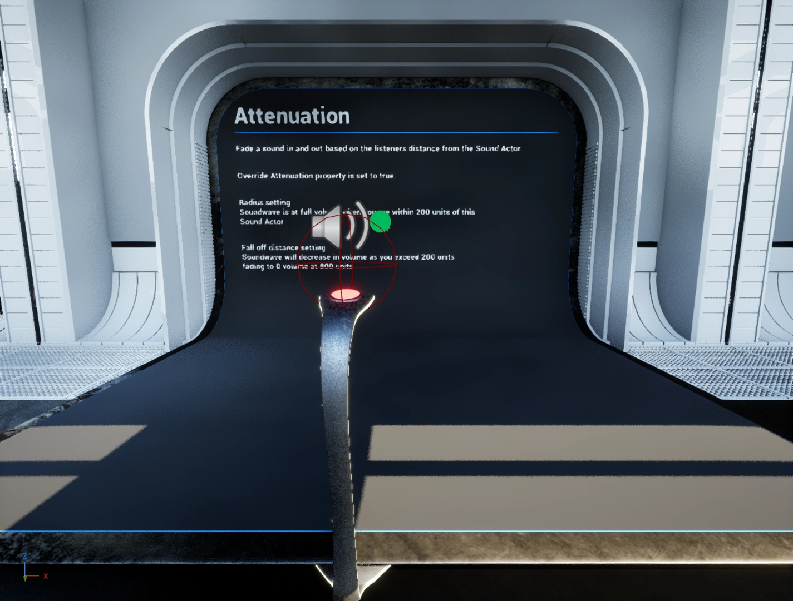

- **官方展牌原文**：
  > *Fade a sound in and out based on the listeners distance from the Sound Actor. Override Attenuation property is set to true.*
  > *Radius setting: Soundwave is at full volume when you are within 200 units of this Sound Actor.*
  > *Fall off distance setting: Soundwave will decrease in volume as you exceed 200 units fading to 0 volume at 800 units.*

#### 6.1 展台陈列资产与“极易踩坑”的半径参数算术！
- **陈列 Actor（3 个）**：`Override Attenuation Sound Actor`（挂载 `Basic_SoundActorAttenuation01`）、`BP_Button_ToggleAudio4`、`1.4 Emitter`。
- **距离算术警示（`InnerRadius` vs `FalloffDistance`）**：
  仔细研读官方展牌的数值说明与 UE 编辑器视口同心双球线框：
  - **内球半径（`Inner Radius`）** $= 200\text{ cm}$（2 米）：只要摄像机（或专门绑定的 Audio Listener）位于内球以内，距离归一化因子 $\alpha = 0$，音频保持 **$100\%$ 满额原始音量（`1.0`）**，防止声源距离 $r \to 0$ 时声压除以零趋于无穷大而炸毁耳膜；
  - **外球过渡跨度（`Falloff Distance`）**：注意在现代 UE 属性面板中，`Falloff Distance` 定义的是**从内球表面向外延伸的过渡厚度**（即外球总截断半径 $R_{\max} = R_{\text{inner}} + D_{\text{falloff}}$；早期文档口语中有时直接称外径终点为 800 单位，对应 `InnerRadius = 200` + `FalloffDistance = 600` 或总跨度 `800`）。当听者距离 $d \ge R_{\max}$ 时，归一化距离 $\alpha = \text{clamp}\left(\frac{d - R_{\text{inner}}}{D_{\text{falloff}}}, 0, 1\right) = 1$，干声增益归零！

#### 6.2 六大距离衰减函数（`Attenuation Function`）声学特性全对比
归一化距离 $\alpha \in [0, 1]$ 如何映射为最终线性振幅增益 $G(\alpha) \in [0, 1]$？虚幻引擎内置了 **6 种数学衰减模型**，绝不能一律偷懒用默认的 `Linear`：

| 衰减函数枚举 (`EAttenuationDistanceModel`) | 数学曲线特征 | 听感走势描述 | 典型游戏声源选型 |
| :--- | :--- | :--- | :--- |
| **`Linear`（线性衰减）** | $G(\alpha) = 1 - \alpha$ | 振幅随米数匀速下降；但由于人耳对响度的感知遵循**韦伯-费希纳对数定律**，线性衰减在前半程听起来几乎没变小，最后两米突然断崖式消失！ | 需要严格可控边界的小范围区域提示音、展厅演示台（如本展台 `#6` 避免串音到隔壁 `#7`！）。 |
| **`Logarithmic`（对数衰减）** | 刚离开内径便迅速大幅跌落，后半程拖着长长的微弱尾巴缓慢归零 | 近处极其响亮清晰，稍微走开几步立刻退居背景，远距离仍隐约可辨 | 近战武器挥砍、角色脚步声、篝火噼啪声、机械齿轮运转声。 |
| **`Inverse`（反比衰减）** | 模拟经典点声源自由场声压反比定律 $p \propto 1/r$（声强平方反比 $I \propto 1/r^2$），每距离翻倍衰减 `-6 dB` | 下降速度比 `Logarithmic` 更陡峭，近处极具冲击力，中远距离迅速衰减 | 写实射击游戏中的近距离手枪/冲锋枪机械抛壳声、室内玻璃碎裂。 |
| **`LogReverse`（反对数衰减）** | 与对数相反：在绝大部分半径内保持高响度，直到贴近外径边缘才急速骤降 | 形成类似“结界/力场”的高原饱满声场 | 头顶盘旋的武装直升机压迫声、Boss 狂暴能量护盾范围音、警报广播区。 |
| **`NaturalSound`（自然声音模型）** ⭐ | 基于分贝阈值（`dB Attenuation At Max`，如 `-60 dB`）结合人耳等响度曲线拟合的物理对数模型 | **最符合真实世界人耳直觉**，远近过渡丝滑无断层，无突兀截断感 | **现代 3A 首选**：狙击步枪远距枪声、旷野雷鸣、开放世界怪物咆哮、载具引擎。 |
| **`Custom`（自定义浮点曲线）** | 采样任意用户绘制的 `FRichCurve` 关键帧曲线 | 完全自由定制（甚至可做“近处小、中距大、远处无”的环形回音壁奇观） | 特殊机关解谜提示、电影化过场特写定制混音。 |

---

### 展台 #7：`Attenuate with LPF` — 空气吸收低通滤波（Air Absorption）：雕刻空间纵深的灵魂！

- **空间元数据**：展牌 Label `BP_DemoDisplay4` | 坐标 `(5501, -900, 0)`
- **官方展牌原文**：
  > *Have a sound get more or less muffled as it attenuates: Override Attenuation set to true > Attenuate with LPF set to true.*
  > *Soundwave is not affected by LPF when the listener is within 300 units of it. LPFRadius Min: Apply the filter only after 200 units from the Sound Actor. LPFRadius Max: Fade in the filter completely at 1000 units from the Sound Actor.*

#### 7.1 展台陈列资产与物理声学第一性原理
- **陈列 Actor（3 个）**：`Attenuate with LPF Sound Actor`（挂载富含高频泛音的测试源 `Basic_SoundActorLPF01`）、`BP_Button_ToggleAudio5`、`1.5 Emitter`。
- **为什么只调音量永远做不出“远方传来的爆炸感”？**
  在真实大气物理学中，声波在空气分子间传播时因粘滞性与热传导产生能量耗散（**Stokes-Kirchhoff 声吸收定律**），其衰减系数 $\alpha_{\text{air}}(f)$ 与**声波频率的平方成正比（$\alpha_{\text{air}} \propto f^2$）**！
  这意味着：
  - $100\text{ Hz}$ 的低频隆隆震动可以轻松穿透数公里大气传到你耳中；
  - 而 $8,000\text{ Hz} \sim 16,000\text{ Hz}$ 的高频嘶嘶瞬态（Air / Crispness）在几百米内就被空气分子彻底吃光了！
  因此在展台 `#7` 中，当你从 `200~300 cm` 向外退到 `1000 cm` 时，引擎实时驱动一个**随距离插值的低通滤波器（Low-Pass Filter, LPF）**，将截止频率 $f_c$ 从全通的 `20,000 Hz` 平滑压低至沉闷的 `1,200 Hz` 甚至 `600 Hz`。哪怕闭上眼睛，你的大脑也会瞬间判断：“这声音不是录音变小声了，而是发声体真的退到了十米开外！”

#### 7.2 现代 UE5 进阶：高低通双滤波（LPF + HPF）与对数频率缩放
在 UE5 最新的 `SoundAttenuation -> Air Absorption` 模块中，这一机制已进化得更加完备：
1. **双滤波器协同（LPF + HPF）**：除了远距离削高频（LPF），你还可以同时配置随距离抬升的**高通滤波器（HPF，`HPFFrequencyAtMin -> HPFFrequencyAtMax`）**——例如小型步话机、昆虫振翅或小口径武器，在远距离不仅高频被空气吸收，超低频能量也无法在远场维持，通过 LPF+HPF 将远场收窄在中频段，彻底杜绝几十个远处声源把游戏低频（Sub-bass）糊成一锅粥！
2. **务必勾选 `Enable Log Frequency Scaling`（对数频率缩放）**：人耳对音高/频率的感知是以**倍频程（Octave：20→40 Hz 与 10,000→20,000 Hz 在听感上跨度相等！）**为单位的。若使用线性频率插值，前 90% 的距离都在 20kHz~2kHz 缓慢移动，最后 10% 才骤降；开启对数频率缩放后，音色变闷的听感在整个距离区间内均匀线性展开！

---

### 展台 #8 ~ #12：`Attenuation Shapes` — 四大三维衰减几何体家族横向对决

走到 `X = 6500` 处，我们迎来了整座展厅最精妙的一组空间对照实验台：母展牌 **`#8 Attenuation Shapes`** 统领全局，台面前方（`Y = -474, Z = 9`）一字排开四座微型子展台（按 X 坐标从左至右依次为 `#9 Sphere`、`#11 Capsule`、`#10 Box`、`#12 Cone`），全部复用同一条测试音源 **`Basic_AttenuationShape01`**，纯粹对比几何体拓扑！

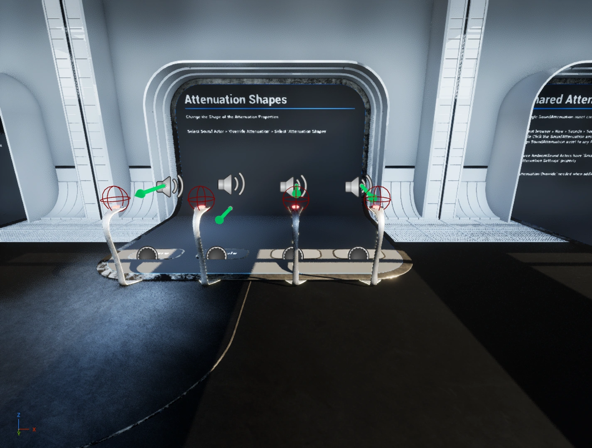

#### 展台 #8：`Attenuation Shapes`（几何体衰减母展台总纲）
- **空间元数据**：展牌 Label `BP_DemoDisplay5` | 坐标 `(6500, -900, 0)`
- **官方展牌原文**：
  > *Change the Shape of the Attenuation Properties: Select Sound Actor > 'Override Attenuation' > Select 'Attenuation Shapes'.*
- **底层距离求解几何学（Signed Distance / Closest Point on Shape）**：
  对于非球体衰减，引擎在每个音频帧并不是计算听者位置 $\mathbf{P}_L$ 到 Actor 原点 $\mathbf{P}_S$ 的欧氏距离，而是先在几何体内表面求解**距离听者最近的表面投影点 $\mathbf{Q} = \arg\min_{\mathbf{x} \in \text{Shape}} \|\mathbf{P}_L - \mathbf{x}\|$**：
  - 若 $\mathbf{P}_L$ 位于内层几何体内部，距离 $d = 0$（满音量 `1.0`）；
  - 若 $\mathbf{P}_L$ 位于内层几何体外部，有效衰减距离 $d = \|\mathbf{P}_L - \mathbf{Q}\|$，再代入 `FalloffDistance` 求衰减增益，同时以最近点 $\mathbf{Q}$ 作为虚拟发声点进行 3D 空间化声像定位！这意味着当你沿着一条胶囊体河流散步时，水声永远精准来自离你最近的那段河岸！

---

#### 展台 #9：`Sphere`（球体衰减子展台）
- **空间元数据**：展牌 Label `BP_DemoDisplay17` | 坐标 `(6300, -474, 9)` | 官方展牌说明：`Sphere`
- **陈列 Actor（3 个）**：`Attenuation Shapes Sound Actor_4`（`Basic_AttenuationShape01`）、`BP_Button_ToggleAudio9`、`1.6 Emitter_2`。
- **数学定义与工程选型**：仅需单个浮点数 `SphereRadius`。最近点求解仅需一次向量模长计算 $d = \max(0, \|\mathbf{P}_L - \mathbf{P}_S\| - R)$，**CPU 算力开销在四种形状中最低**。适用于一切近似各向同性辐射的点声源（枪口爆震、手雷、火盆、碎石落地）。

---

#### 展台 #10：`Box`（盒体衰减子展台）
- **空间元数据**：展牌 Label `BP_DemoDisplay19` | 坐标 `(6576, -474, 9)` | 官方展牌说明：`Box` | 📷 专属实拍图见上方 `Audio_03_stand_10.webp`
- **陈列 Actor（3 个）**：`Attenuation Shapes Sound Actor_2`（`Basic_AttenuationShape01`）、`BP_Button_ToggleAudio6`、`1.6 Emitter_4`。
- **数学定义与工程选型**：由三维半边长向量 `Extents = (X, Y, Z)` 定义的有向包围盒（OBB，随 Actor 旋转变换）。先将听者坐标逆变换至盒体局部空间 $\mathbf{p}_{\text{local}} = \mathbf{R}^T(\mathbf{P}_L - \mathbf{P}_S)$，再对三轴执行分量钳制 $\mathbf{q}_{\text{local}} = \text{clamp}(\mathbf{p}_{\text{local}}, -\mathbf{E}, +\mathbf{E})$ 即可极速求得最近表面点！
- **黄金实战场景**：矩形机房/变电站的嗡鸣底噪、室内空调风幕、方形泳池水面环境音——整间屋子只放 **1 个** Box `AmbientSound`，室内任意角落音量均匀恒定，跨出门槛沿 `FalloffDistance` 自然消退！

---

#### 展台 #11：`Capsule`（胶囊体衰减子展台）
- **空间元数据**：展牌 Label `BP_DemoDisplay18` | 坐标 `(6431, -474, 9)` | 官方展牌说明：`Capsule`
- **陈列 Actor（3 个）**：`Attenuation Shapes Sound Actor_3`（`Basic_AttenuationShape01`）、`BP_Button_ToggleAudio10`、`1.6 Emitter_3`。
- **数学定义与工程选型**：由 `CapsuleHalfHeight`（半高）与 `CapsuleRadius`（截面半径）构成的扫掠线段体，本质是计算听者到空间有限线段 $\overline{AB}$ 的点到线段最短距离。
- **黄金实战场景**：**线状延展声源的救星**——笔直的溪流瀑布、头顶贯穿走廊的蒸汽管道、高压输电线电弧声、荧光灯管电流声、激光栅栏。一个胶囊体直接顶替十几个拼接球体，彻底消灭多声源相位干涉与声道浪费！（注：若是九曲十八弯的盘山长河，可进一步结合蓝图样条线 `USplineComponent` 每帧将单个点声源 `SetWorldLocation` 吸附到样条线最近点 `FindLocationClosestToWorldLocation`，实现任意曲线零开销跟随！）

---

#### 展台 #12：`Cone`（圆锥体指向性衰减子展台）
- **空间元数据**：展牌 Label `BP_DemoDisplay20` | 坐标 `(6700, -474, 9)` | 官方展牌说明：`Cone`
- **陈列 Actor（3 个）**：`Attenuation Shapes Sound Actor`（`Basic_AttenuationShape01`）、`BP_Button_ToggleAudio8`、`1.6 Emitter`。
- **数学定义与工程选型**：真实世界的大多数高频发声体并非全向辐射（例如人嘴说话、电吉他音箱、广播高音大喇叭、警笛号角）。`Cone` 衰减沿着 Actor 的正前方向量（Forward Vector $+X$）投射出一道声束锥体，由以下核心参数共同塑形：
  - `ConeRadius` & `FalloffDistance`：轴向射程与外沿衰减距离；
  - `ConeAngle`（内锥全满角）与 `ConeFalloffAngle`（外锥旁瓣过渡角）：处于内锥角正前方的玩家听到 `100%` 嘹亮直达声；绕到侧面外锥角以外时，音量按 `Falloff At Extents` 衰减（而非完全死寂，可通过 `ConeSphereRadius` 叠加一个微弱的背向近场球体，模拟站在大喇叭背后仍能听见低频箱体共鸣的真实听感！）。

---

### 展台 #13：`Shared Attenuation Settings` — 数据驱动模板 `USoundAttenuation`、遮挡检测与听者聚焦

- **空间元数据**：展牌 Label `BP_DemoDisplay6` | 坐标 `(7496, -900, 0)`

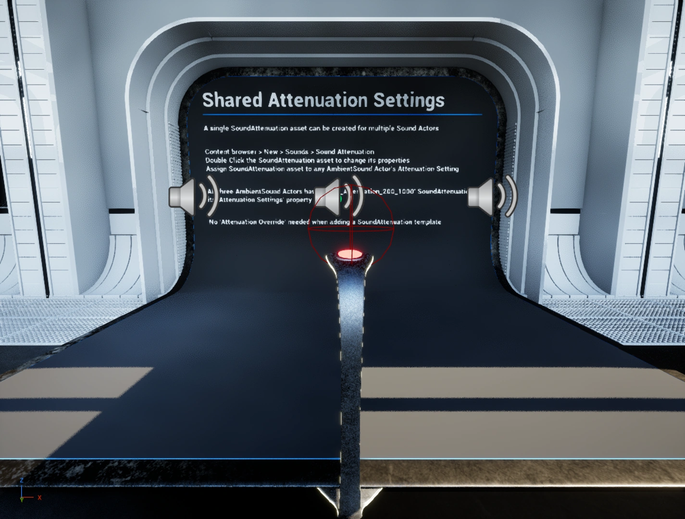

- **官方展牌原文**：
  > *A single SoundAttenuation asset can be created for multiple Sound Actors: Content browser > New > Sounds > Sound Attenuation. Double Click the SoundAttenuation asset to change its properties. Assign SoundAttenuation asset to any AmbientSound Actor's Attenuation Setting.*
  > *All three AmbientSound Actors have 'Small_Attenuation_200_1000' SoundAttenuation in its 'Attenuation Settings' property. No 'Attenuation Override' needed when adding a SoundAttenuation template.*

#### 13.1 展台陈列 Actor：一改全改的架构解耦范式（共 5 个）
在本展台中，单颗按钮 `BP_Button_ToggleAudio7` 同时联动开关 **3 个不同的 `AmbientSound` Actor**（分别播放 `Basic_ActorLocation01`、`Basic_LoopingSoundActor01`、`Basic_SoundActorDistance01`），但它们均未勾选各自繁琐的 `Override Attenuation`，而是将 `AttenuationSettings` 指针统一指向了磁盘上的数据资产 **`/Game/ExampleContent/Audio/Audio/Sound_Basics/Small_Attenuation_200_1000`（`USoundAttenuation`）**！

> [!IMPORTANT]
> **工业级音频项目铁律：严禁在关卡实例上零散勾选 `Override Attenuation`！**
> 在一款拥有 5,000 个声源的开放世界游戏里，应该按声学量级建立一套标准化的 `USoundAttenuation` 资产库（如 `ATT_Weapon_Rifle_Outdoor`、`ATT_Footstep_Human`、`ATT_Foley_Small`、`ATT_Boss_Roar`）。后期混音总监若觉得全游戏所有步枪的传播距离偏短，只需双击修改 1 个 `ATT_Weapon_Rifle_Outdoor` 资产，全图上百把枪瞬间同步生效！

#### 13.2 深度解剖 `Small_Attenuation_200_1000` 实测底层属性：遮挡（Occlusion）与焦点（Listener Focus）
通过 MCP 深度导出 `Small_Attenuation_200_1000` 内部序列化的 `FSoundAttenuationSettings` 结构体，我们可以一举看清 `USoundAttenuation` 除距离和 LPF 之外隐藏的**三大高阶声学子系统**：

1. **实时物理射线遮挡系统（`Occlusion`）**：
   - 实测字段：`bEnableOcclusion`、`OcclusionTraceChannel = ECC_Visibility`（或专用自定义音频碰撞通道）、`bUseComplexCollisionForOcclusion = false`、`OcclusionLowPassFilterFrequency = 20000`（开启遮挡时通常设为 `800 ~ 2500 Hz`）、`OcclusionVolumeAttenuation`（遮挡音量乘数，如 `0.4`）、`OcclusionInterpolationTime = 0.1s`（`100 ms` 平滑渐变，防止玩家探头瞬间声音咔哒突变！）。
   - **工作原理与性能优化**：开启后，音频引擎以异步非阻塞射线检测（Async Raycast）从听者射向声源。一旦命中阻挡几何体，立即在 `0.1 秒` 内切入遮挡 LPF 与音量衰减，模拟隔墙闷响！**切记保持 `bUseComplexCollisionForOcclusion = false`**，使用简化的胶囊/凸包物理碰撞体而非上百万面的高精度渲染三角网做射线求交，确保百个声源异步遮挡耗时低于 `0.1 ms`。
2. **第三人称越肩视角救星——听者聚焦系统（`Listener Focus`）**：
   - 实测字段：`bEnableListenerFocus`、`FocusAzimuth = 30°`、`NonFocusAzimuth = 60°`、`FocusDistanceScale`、`FocusPriorityScale`、`FocusVolumeAttenuation`、`FocusAttackInterpSpeed / ReleaseInterpSpeed`。
   - **解决什么痛点？** 在《战神》或《战争机器》这类第三人称越肩视角游戏中，摄像机吊在主角身后 3 米处：若把 Audio Listener 绑在摄像机上，主角脚边的怪物听起来太远，而摄像机背后擦肩而过的杂兵却震耳欲聋；若绑在主角头上，左右声像又会跟画面视觉错位！开启 **Listener Focus** 后，凡是落在摄像机正前方 `±30°` 准星视锥内的目标声源，可自动获得距离拉近缩放（`FocusDistanceScale < 1`）、并发优先级提权（`FocusPriorityScale > 1`），而视野外 `> 60°` 的背后杂音自动退避衰减，实现“眼之所向，耳之所聚”的电影级听觉对焦！
3. **混响发送与外部中间件桥接（`Reverb Send` & `AudioLink`）**：
   - 实测字段：`bEnableReverbSend = true`、`ReverbSendMethod = Linear`、`bEnableSubmixSends`、`bEnableSendToAudioLink = true`（UE5 原生 `AudioLink` 接口允许将虚幻原生音频流与 MetaSounds 零拷贝直通给 Wwise 等外部商业混音引擎做统一空间化与母带总线处理！）。

---

### 展台 #14：`AmbientSound Actor using SoundCues` — 传统复合声音蓝图 `USoundCue` 节点全书

- **空间元数据**：展牌 Label `BP_DemoDisplay7` | 坐标 `(8506, -900, 0)`
- **官方展牌原文**：
  > *Using SoundCues instead of SoundWaves: SoundCues allow the user to setup more complex sounds and don't require unique settings in each AmbientSound Actor. Content Browser > New > Sounds > Sound Cue. The Soundwave is now placed within a Wave Player Node inside of this newly created SoundCue.*

#### 14.1 展台陈列资产拆解（共 3 个）
- **`Default Soundcue Sound Actor`** [`AmbientSound`]：挂载复合声音资产 **`/Game/ExampleContent/Audio/Audio/Sound_Basics/Default_Soundcue_Cue`（`USoundCue`）**，其内部通过 `USoundNodeWavePlayer` 引用底层波形 `Basic_SoundActor01`；配套 `BP_Button_ToggleAudio11` 与 `1.8 Emitter`。

#### 14.2 `USoundCue` 核心行为节点家族全景速查（防机械重复的经典配方！）
为什么传统游戏音效绝不能直接裸播单一 `SoundWave`？因为人脑对完全一致的波形具有极强的模式识别能力——同一条脚步声原封不动连播三次就会产生强烈的“电子复读机塑料感”（Machine-Gun Effect）！`SoundCue` 通过树状控制流节点在游戏线程（Game Thread / Audio Thread）层面编排多条 `SoundWave`：

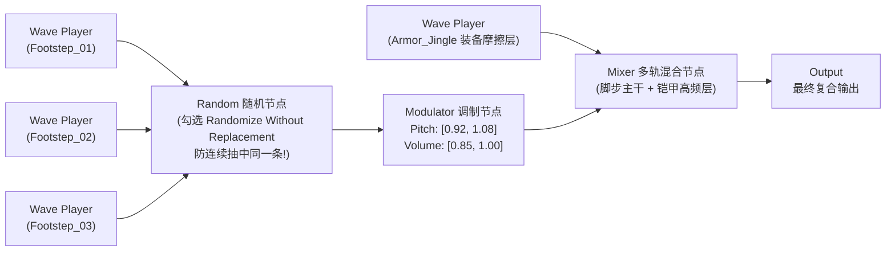

| `SoundCue` 核心节点 | 核心机制与关键属性 | 实战音频设计用法 |
| :--- | :--- | :--- |
| **`Random`（随机选择器）** | 支持为每个输入分支设权重 `Weights`，**必勾 `Randomize Without Replacement`（不放回洗牌随机）** | 从 4 条脚步录音中随机抽取，且保证抽完一轮前绝不连播同一个文件，搭配 `Modulator` 仅用 4 个小文件就能组合出无穷变化！ |
| **`Modulator`（随机音高/音量微扰）** | 每次触发在 `[PitchMin, PitchMax]` 与 `[VolumeMin, VolumeMax]` 区间均匀抽样乘数 | 连射武器、受击闷哼、碎石飞溅去机械感的核心利器（通常微扰 `±5% ~ ±8%` 音高最自然）。 |
| **`Concatenator`（顺序拼接器）** | 按输入引脚顺序首尾相接依次播放多段音频 | 战术军事无线电语音动态拼装：`"小队注意"` + `"十一点钟方向"` + `"发现狙击手"`！ |
| **`Crossfade by Distance` / `by Param`** | 根据听者距离或外部浮点参数，在多条音轨间做平滑淡入淡出混合（`FadeInDistanceStart/End`） | **3A 枪械远近分层标配**：`0~15m` 播放清脆枪机机械声层，`10~80m` 交叉淡入厚重中距冲击波层，`50~400m` 淡入苍凉峡谷长尾回声层！ |
| **`Switch` / `Branch`** | 根据传入的整型参数 `Int Parameter`（如 `SurfaceType` 枚举）或布尔参数切换分支 | 动画通知检测到脚底物理材质（见本工程 `/Game/ExampleContent/Audio/Physical_Materials/` 下的 `Concrete`、`Metal`、`Rubber`、`Wood`）后，同一套脚步 Cue 秒切泥地/铁板/木地板！ |
| **`Delay` / `Looping` / `Enveloper`** | 施加随机起播延迟、局部循环或随时间演化的音量/音高曲线包络 | 营造森林虫鸣鸟叫此起彼伏的异步生态感。 |

> [!NOTE]
> **时代演进坐标：`SoundCue` vs `MetaSounds`**：`SoundCue` 本质上工作在**事件与音频对象控制层（非采样级，受限于帧更新周期，且无法凭空合成波形或编写底层滤波器拓扑）**。在 UE5 新项目中，凡涉及高精度节拍同步、实时连续物理参数平滑驱动或合成器音效，均推荐全面升级至下一篇详解的 **`MetaSounds`**！

---

### 展台 #15 ~ #17：`Reverb Volume` — 空间混响画刷与干湿声场对比实验

来到 `X = 9501` 处，走廊右侧被一圈醒目的黄色线框 BSP 体积画刷（`AAudioVolume`）包围。母展牌 **`#15 Reverb Volume`** 居中指引，内部设有 **`#16 Reverb`**，而一墙之隔的画刷外部设有对照组 **`#17 No Reverb`**！

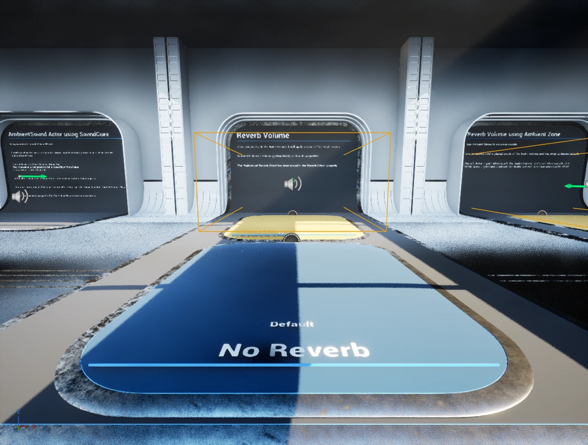

#### 展台 #15：`Reverb Volume`（空间混响体积总纲）
- **空间元数据**：展牌 Label `BP_DemoDisplay8` | 坐标 `(9501, -900, 0)`
- **官方展牌原文**：
  > *When you are inside the Audio Volume it will apply a reverb effect to all sounds. Select this Reverb Volume (yellow brush) to view its properties. The 'Auditorium' Reverb Effect has been added to the 'Reverb Effect' property.*
- **混响声学模型（`UReverbEffect` — `/Game/ExampleContent/Audio/Reverb_Effects/Auditorium`）**：
  为什么我们在空旷大礼堂击掌会听到宏大的空间包裹感，而在铺满吸音棉的录音棚里声音干瘪紧致？真实空间脉冲响应由三阶段构成：
  1. **直达声（Direct Sound）**：沿直线最先抵达双耳，决定声源精准方位；
  2. **早期反射（Early Reflections，`Reflections Delay` / `Gain`，约 `5 ~ 80 ms`）**：经左右墙壁、天花板与地板第一次反弹到达双耳的稀疏回声，让大脑瞬间感知**房间的几何尺寸大小与墙壁材质软硬**；
  3. **晚期漫反射混响尾音（Late Reverb，`Decay Time` $RT_{60}$ / `Density` / `Diffusion` / `Air Absorption GainHF`）**：成千上万次密集反弹汇聚成的指数衰减声能云（$RT_{60}$ 定义为声压级衰减 `60 dB` 所需秒数：小卧室约 `0.3s`，`Auditorium` 大礼堂约 `2.5 ~ 3.5s`，哥特式石砌大教堂可达 `6.0s+`！）。引擎底层的 Master Reverb Submix 采用高性能**反馈延迟网络（Feedback Delay Network, FDN）**全通扩散算法实时合成这片声云。

---

#### 展台 #16：`Reverb`（礼堂混响激活实测区）
- **空间元数据**：展牌 Label `BP_DemoDisplay11` | 坐标 `(9501, -724, 4)`
- **陈列 Actor 与核心资产链（共 3 个）**：
  - **`ReverbVolume_Reverb_Effects`** [`/Script/Engine.AudioVolume`]：基于 `BrushComponent0` 构建的空间触发体，挂载 `Auditorium` 混响资产，设置过渡淡入时间 `Fade Time`。
  - **`Reverb_Dialog_Cue_Sound_Actor`** [`AmbientSound`]：挂载人声朗读资产 **`/Game/ExampleContent/Audio/Audio/Reverb/Dialog_Full_Cue`**（引用干声波形 `Dialog_Full` 与声学分类 `/Game/ExampleContent/Audio/Audio/SoundClasses/Dialog`），空间衰减绑定盒体模板 **`DemoDisplay_Box`**（严格限制声音在展位盒体内，不干扰邻桌，且显式开启 `bEnableReverbSend = true`！）。
  - **`1.9 Emitter`** [`Emitter`]：混响区位置锚点粒子。
- **临界距离（Critical Distance）与干湿发送法则**：当你踏入 `#16` 黄色画刷内部时，**判定触发混响的主体是“听者（摄像机）是否进入 `AudioVolume`”**！同时，声源 `DemoDisplay_Box` 的 `ReverbSendMethod = Linear` 会根据你与发声点的距离动态调整送往 Master Reverb 总线的发送量——离说话人越近，直达干声占比越高（清晰贴耳）；退到礼堂后排时，直达声衰减而混响湿声占比飙升，完美复刻真实礼堂后排的空间遥远感！当多个 `AudioVolume` 嵌套（如大溶洞里套着一间小木屋）时，引擎严格按 `Priority`（优先级数值越大越优先）胜出并按 `Fade Time` 平滑交叉过渡混响参数。

---

#### 展台 #17：`No Reverb`（无混响干声对照区）
- **空间元数据**：展牌 Label `BP_DemoDisplay12` | 坐标 `(9501, -221, 4)` | 官方展牌说明：`Default` | 📷 专属实拍图见上方 `Audio_05_stand_17.webp`
- **对照实测体验**：站在 `#17` 展牌前（位于 `ReverbVolume_Reverb_Effects` 画刷边界之外），摄像机脱离 `AudioVolume` 管辖，Master Reverb 湿声发送按照 `Fade Time` 平滑归零，人声瞬间退回纯净无染的自由场干声（Dry Signal）。反复在 `#16`（`Y = -724`）与 `#17`（`Y = -221`）之间前后迈步，你能亲耳验证房间边界混响切入/切出的丝滑插值过渡！

---

### 展台 #18 ~ #20：`Reverb Volume using Ambient Zone` — 室内外环境声场双向隔离矩阵（Interior Settings）

走到长廊最东端终点（`X = 10506`），压轴登场的第 `#18`、`#19`、`#20` 展台展示了关卡环境音设计中最省性能、效果最立竿见影的工程绝技——**`AudioVolume` 的 `Ambient Zones`（`Interior Settings` 室内外声场双向门控系统）**！

#### 展台 #18：`Reverb Volume using Ambient Zone`（环境声场隔离母展台总纲）
- **空间元数据**：展牌 Label `BP_DemoDisplay9` | 坐标 `(10506, -900, 0)`
- **官方展牌原文**：
  > *Use Ambient Zones to separate sounds: One AmbientSound is placed inside of the Audio Volume and the other is placed outside.*
  > *Outside Actor = quiet when inside the 'Audio Volume' and Loud when outside of it.*
  > *Inside Actor = quiet when outside the 'Audio Volume' and Loud when inside of it.*

#### 18.1 为什么环境底噪不能直接依赖射线遮挡（Occlusion），而必须用 `Ambient Zone`？
设想窗外正刮着漫天暴风雪（面声源），屋内控制室里服务器嗡嗡作响：
- 如果用单点射线遮挡（Occlusion），当玩家站在敞开的窗口斜后方时，射线一旦擦过窗框就会导致整片暴风雪音效忽闷忽亮；
- 而 **`Ambient Zone`（室内外区域设置）** 基于确定性的空间集合拓扑关系——引擎自动检测**每个声源中心点是否在 `AudioVolume` 内**，以及**听者（摄像机）是否在同一个 `AudioVolume` 内**，形成一张严丝合缝的 **$2 \times 2$ 双向隔离状态矩阵**：

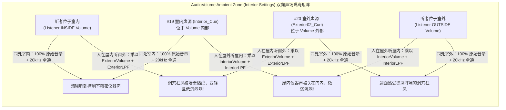

---

#### 展台 #19：`Inside`（室内控制室声场子展台）
- **空间元数据**：展牌 Label `BP_DemoDisplay13` | 坐标 `(10497, -724, 4)`
- **陈列 Actor 与内部资产拆解（共 3 个）**：
  - **`ReverbVolume3`** [`/Script/Engine.AudioVolume`]：配置了 `Ambient Zone (Interior Settings)` 参数的室内房间画刷体积。
  - **`Interior_Cue__Sound_Actor`** [`AmbientSound`]：放置在 `ReverbVolume3` **画刷内部**，播放 `/Game/ExampleContent/Audio/Audio/Reverb/Interior_Cue`（内部组合了室内氛围波形 `Interior05` 与控制室设备音 `Interior_ControlRoom`，并指定声学分类 **`SoundClass = /Game/ExampleContent/Audio/Audio/SoundClasses/Ambient_Inside`**，衰减绑定 `DemoDisplay_Box`）。
  - **`1.10 Emitter_2`** [`Emitter`]：室内声源位置锚点。
- **关键激活开关排坑（99% 新手卡死的地方！）**：
  如果你照着 `#19` 摆好了 `AudioVolume` 却发现走进走出毫无音量/滤波变化，请立刻检查该音效绑定的 **`USoundClass`（此处为 `Ambient_Inside`）**：在 `SoundClass` 详情面板中，有一个名为 **`Apply Ambient Volumes`（应用环境体积）** 的布尔勾选框（默认新建 `SoundClass` 时往往为 `false`，以防止玩家自己的枪声和 UI 提示音也被当成环境风声闷掉！）。**只有勾选了 `bApplyAmbientVolumes = true` 的 `SoundClass`，才会接受 `Ambient Zone` 的室内外音量与 LPF 调制！**
- **参数精解（当玩家站在 `#20` 室外听 `#19` 室内声音时生效）**：
  - `Interior Volume`（室内声外泄音量乘数，如 `0.1`）与 `Interior Time`（淡变秒数，如 `0.5s`）；
  - `Interior LPF`（室内声穿墙低通频率，如 `800 Hz`）与 `Interior LPF Time`（滤波插值秒数）。

---

#### 展台 #20：`Outside`（室外狂风声场子展台）与全局收尾核查
- **空间元数据**：展牌 Label `BP_DemoDisplay14` | 坐标 `(10497, -221, 4)`
- **陈列 Actor 与内部资产拆解（共 2 个）**：
  - **`Reverb_Exterior_Cue_Sound_Actor`** [`AmbientSound`]：放置在 `ReverbVolume3` **画刷外部**，播放 `/Game/ExampleContent/Audio/Audio/Reverb/Exterior02_Cue`（内部混合了凛冽呼啸的洞穴风声 `Ambient_Cave_Wind02` 与 `Ambient_Cave_Wind04`，指定声学分类 **`SoundClass = /Game/ExampleContent/Audio/Audio/SoundClasses/Ambient_Outside`**，同样勾选 `bApplyAmbientVolumes = true`，衰减绑定 `DemoDisplay_Box`）。
  - **`1.10 Emitter`** [`Emitter`]：室外声源位置锚点。
- **参数精解（当玩家走进 `#19` 室内听 `#20` 室外狂风时生效）**：
  - `Exterior Volume`（室外声透入室内的音量乘数，如 `0.15`）与 `Exterior Time`（推门进屋关门隔音渐变秒数，如 `0.5s`）；
  - `Exterior LPF`（室外狂风穿窗低通截止频率，如 `1000 Hz`）与 `Exterior LPF Time`。
  当你从 `#20` 迈入 `#19` 画刷的一刹那，`Exterior02_Cue` 的刺骨高频风啸在半秒内退化为墙外隐约的低频呜咽，与此同时 `Interior_Cue` 的控制室精密仪器声豁然清亮浮现——零行蓝图代码、零射线性能损耗，成就教科书级的室内外无缝声场切换！
- **关卡全局辅助 Actor 完整性核查（3 个）**：
  除上述 20 座展台归属的 54 个示例 Actor 外，关卡持久层还包含 1 个植被实例管理器 `InstancedFoliageActor1` 以及 2 个辅助画刷边界 `ReverbVolume7`、`ReverbVolume12`（`ABrushShape`），共同构成了全图 88 个 Actor 的完整空间闭环。

---

## 四、 商业级混音工程进阶：并发防爆音、侧链闪避（Sidechain Ducking）与子混音总线

逛完 20 座实体展台后，细心的读者在翻阅本关卡依赖的 `/Game/ExampleContent/Audio/` 目录资产清单时，一定会发现一批极具含金量的幕后混音资产：
- **15 个层级化 `USoundClass`**：`Master`、`Music`、`SFX`、`Combat`、`Ambience`、`Ambient_Inside`、`Ambient_Outside`、`Dialog`、`Dialog_PSM`、`Radio_Dialog`、`5_1_LFe_Bleed` 等；
- **被动混音闪避器 `USoundMix`**：`/Game/ExampleContent/Audio/Audio/SoundMixes/Dialog_Duckall_PSM`！

这正是支撑大型商业游戏“千军万马同屏激战却绝不爆音、主角低语依然字字入耳”的**三大混音控制支柱**。让我们将它们一次性彻底讲透！

### 4.1 `USoundConcurrency`：最大并发控制与声部抢占淘汰策略（Voice Stealing）

假设在一场 50v50 的团战中，每把冲锋枪射速为 `900 RPM`（每秒 15 发），单发枪尾音长达 `1.5 秒`。如果不加并发限制，瞬间就会涌出 $100 \times 15 \times 1.5 = 2,250$ 个并发解码声道！这不仅会瞬间击穿平台最大硬件/软件声道上限（通常 `MaxChannels = 32 ~ 128`），更会导致几十个同相低频波形线性叠加，振幅突破 `1.0 (0 dBFS)` 引发灾难性的**数字削波失真（Clipping）**。

通过创建 **`USoundConcurrency`** 资产并赋给同类音效（可按全局共享 `bLimitToOwner = false` 或按单个开火 Actor 独立计数 `bLimitToOwner = true`），我们可以设定硬性并发天花板 `MaxCount`（例如同一把枪最多同时存在 `4` 发尾音，全图手雷爆炸最多同时 `6` 个），并精确指定超额时的**六大裁决淘汰规则（`EMaxConcurrentResolutionRule`）**：

| 并发淘汰策略 (`ResolutionRule`) | 底层裁决逻辑 | 最优适用声源与避坑指南 |
| :--- | :--- | :--- |
| **`StopOldest`（淘汰最老声部）** | 直接淡出停止该并发组里最早起播的那一个实例，腾出槽位播放最新触发的实例 | **连射步枪、玩家自身脚步声、UI 连续点击音**：旧枪声早已进入微弱尾音阶段，让位给最新一发枪口瞬态毫无违和感。 |
| **`StopFarthestThenOldest`（先停最远再停最老）** ⭐ | 优先杀掉距离听者最远的声源；若距离相同（如同一个角色发出），再淘汰最老声部 | **MetaSounds 与多角色战场默认首选**（见下一篇所有 `MSS_*` 默认配置）：绝不允许 100 米外杂兵的流弹抢走玩家贴脸敌人的开火预警！ |
| **`StopQuietest`（动态淘汰最轻声部）** | 每一帧动态重评估组内所有候选声源的实时感知音量（距离衰减×包络），踢掉最微弱者；当曾被压制的重要声源变响时还能重新夺回声道 | 持续性环境物、多载具追逐引擎群、密集怪物群嘶吼。 |
| **`PreventNew`（拒绝新来者）** | 只要当前活跃声部已满 `MaxCount`，后续新触发的播放请求直接静默丢弃 | **切勿用于玩家主武器！** 仅适用于短时间内同时破碎的 50 个木箱（前 5 个响起即可代表整片坍塌，后 45 个无需再挤占算力）。 |
| **`StopLowestPriority` / `ThenPreventNew`** | 严格比较 `SoundPriority × AttenuationPriorityScale`，保高优弃低优 | Boss 关键技能蓄力音与普通杂兵受击音混用同一并发池时的保底防线。 |

> [!TIP]
> **防咔哒声与防电平累加的两大神仙参数**：
> 1. **`VoiceStealReleaseTime`（抢占释放淡出时间，如 `0.02 ~ 0.05s`）**：被淘汰的旧声部绝不能在单采样点硬切断（否则必出咔哒爆音），给它 `20 ms` 极速线性淡出即可丝滑交接！
> 2. **`Volume Scale`（并发音量收敛缩放，如 `0.85`）+ `VolumeScaleMode`**：当组内每多增加 1 个并发声源时，自动将后续叠加声源或旧声源按指数级微降音量（例如第 1 发 `1.0`，第 2 发 `0.85`，第 3 发 `0.72`……），从数学根源上锁死总声能上限，彻底告别同频叠加爆音！

---

### 4.2 `USoundClass` 层级树与 `USoundMix` 被动侧链闪避（Sidechain Ducking）

打开游戏音频设置菜单时，玩家看到的“总音量、音乐音量、音效音量、语音音量”滑条，底层直接对应的就是 **`USoundClass` 有向树**：
在本工程 `/Game/ExampleContent/Audio/Audio/SoundClasses/` 中，`Master` 作为根节点统领全局（改 `Master` 的音量乘数会沿父子边向下级联累乘所有子节点），其下分出 `Music`、`SFX`（含子级 `Combat`、`Anim_Sequence`）、`Ambience`（含 `Ambient_Inside`、`Ambient_Outside`、`Ship_Outside`）、`Dialog`（含 `Dialog_PSM`、`Radio_Dialog`）以及专为 5.1 环绕声低音炮路由设计的 `5_1_LFe_Bleed`（`LFE Bleed` 超低频声道馈送比例）！

那么，**当关键剧情语音（`Dialog_PSM`）响起时，如何让轰鸣的战斗声（`Combat`）和背景交响乐（`Music`）自动乖乖“让路压低”，等台词说完又自动平滑回升？** 这就是本工程资产 **`Dialog_Duckall_PSM`（Passive Sound Mix，被动混音器闪避）** 演示的经典管线：

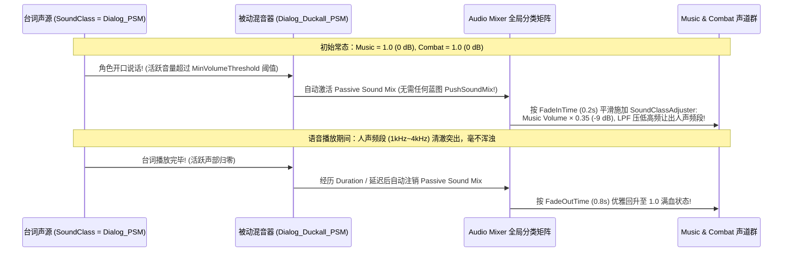

1. **配置步骤复盘**：
   - 第一步：新建 `USoundMix`（如 `Dialog_Duckall_PSM`），在 `Sound Class Effects` 数组中添加受控目标 `Music` 与 `Combat`，设置 `Volume Adjuster = 0.4`（约压低 `-8 dB`），甚至可同步挂载轻微的 `Pitch` 或 `LowPassFilterFrequency` 调节（微切中高频，专门把人类齿音与共振峰所在的 `1.5 kHz ~ 4 kHz` 黄金频段腾给台词！），并设好 `Initial Delay`、`Fade In Time = 0.2s`、`Fade Out Time = 0.8s`。
   - 第二步：打开触发源分类 `Dialog_PSM`（`USoundClass`），在其 **`Passive Sound Mix Modifiers`（被动混音修改器）** 列表中填入 `Dialog_Duckall_PSM`，设定激活门限 `[MinVolumeThreshold = 0.1, MaxVolumeThreshold = 10.0]`。
   - 第三步：**大功告成！** 从此全游戏任何配音员的台词只要挂在 `Dialog_PSM` 分类下，一开口全自动压低全图音乐与炮火，播完或被中途打断时全自动优雅回弹，绝无蓝图手动 `PushSoundMixModifier` 漏调 `Pop` 导致全图永久变哑巴的 Bug！

---

### 4.3 `USoundSubmix` 子混音效果链与硬件级包络侧链压缩（Submix Graph）

如果说 `SoundClass + SoundMix` 是基于“资产分类标签”的宏观音量/滤波矩阵，那么现代 UE Audio Mixer 引入的 **`USoundSubmix`（子混音有向无环图）** 则是真正媲美专业 DAW（Pro Tools / Nuendo）的**真实数字音频总线调音台**！

- **多总线混音与总线效果链（`Submix Effect Chain`）**：
  你可以将所有无线电通讯语音路由进一个名为 `Submix_Radio` 的子混音节点，在该总线上统一挂载 **`Submix Effect Filter`（切掉 `< 400 Hz` 低频与 `> 3200 Hz` 高频）+ `Tap Delay` + 轻度失真**，无需修改任何一条原始干净录音，瞬间赋予全队通讯真实的战术对讲机质感！同理，玩家残血濒死或被闪光弹震慑耳鸣时，只需通过 `Audio Modulation` 或蓝图动态推动 `Master Submix` 上的全局低通滤波器截止频率从 `20,000 Hz` 骤降至 `400 Hz`，全场万籁俱寂只剩心跳轰鸣！
- **真正的信号级动态侧链压缩（`Submix Effect Dynamics Processor` — Audio Sidechain）**：
  被动 `SoundMix` 是只要台词文件还在播放（哪怕配音员在两句台词中间停顿喘气了 2 秒！）就会一直死死压住背景音乐。而在 `Submix` 上挂载 **`Submix Effect Dynamics Processor`**，将 `External Submix` 侧链键入源（Key Source）指向 `Dialog Submix` 后，压缩器会以 **48,000 Hz 采样级精度实时侦测人声波形的真实瞬时分贝包络**——配音员吐字发声的瞬间毫秒级精准下压 BGM（`Attack Time = 10 ms`），两句话中间停顿的空隙 BGM 立即呼吸式微微回涌（`Release Time = 180 ms`），实现好莱坞大片级的呼吸感动态混音！

---

## 五、 `Audio` 传统空间声学展厅全 20 座展台速查总表与结语

为方便在项目实战中随时按图索骥，以下汇总 `/Game/Maps/Audio/Audio` 全部 **20 座展台** 的空间坐标、核心测试资产与工程知识点映射：

| 展台编号 | 官方展牌标题 | 空间坐标 `(X, Y, Z)` | 核心绑定资产 (`Sound` / `Attenuation` / `Volume`) | 核心声学与工程职责 |
| :--- | :--- | :--- | :--- | :--- |
| **`#1`** | `Audio` | `(500, -900, 0)` | 全局光照组 + `CameraActor` | 展厅总纲说明与受控视觉照明环境基准 |
| **`#2`** | `Useful Audio Console Commands` | `(994, -710, 75)` | `DocumentationActor` | `stat soundwaves / soundcues / sounds -debug / reverb` 四大现场排障指令 |
| **`#3`** | `AmbientSound Actor` | `(1500, -900, 0)` | `Basic_SoundActor01` + `BP_Button_SinglePressAudio` | 关卡声源容器 `AAmbientSound` 单次触发与 `USoundWave` 压缩格式选型 |
| **`#4`** | `Looping` | `(2499, -900, 0)` | `Basic_LoopingSoundActor01` + `BP_Button_ToggleAudio` | 持续无缝循环、过零点防爆音裁切与 `Play when Silent` 虚拟声部保活 |
| **`#5`** | `Spatialize` | `(3513, -900, 0)` | `Basic_ActorLocation01` (Mono) | 单声道 3D 方位声像分配、等功率平移与双耳 HRTF（ITD/ILD/耳廓滤波） |
| **`#6`** | `Attenuation` | `(4520, -900, 0)` | `Basic_SoundActorAttenuation01` | 内径满响度球与外径过渡跨度、6 大距离衰减数学曲线选型 |
| **`#7`** | `Attenuate with LPF` | `(5501, -900, 0)` | `Basic_SoundActorLPF01` | 模拟大气高频吸收（Air Absorption）的距离低通滤波，塑造真实纵深感 |
| **`#8`** | `Attenuation Shapes` | `(6500, -900, 0)` | 母展牌总纲 | 非球体最近表面点距离求解（Closest Point），根治多声源相位干涉 |
| **`#9`** | `Sphere` *(子展台)* | `(6300, -474, 9)` | `Basic_AttenuationShape01` | 球体衰减：开销最低的各向同性点声源模型 |
| **`#10`** | `Box` *(子展台)* | `(6576, -474, 9)` | `Basic_AttenuationShape01` | 盒体衰减（OBB）：单声源覆盖整间矩形机房或大厅底噪 |
| **`#11`** | `Capsule` *(子展台)* | `(6431, -474, 9)` | `Basic_AttenuationShape01` | 胶囊体衰减：河流、铁轨、通风管道等线状声源黄金方案 |
| **`#12`** | `Cone` *(子展台)* | `(6700, -474, 9)` | `Basic_AttenuationShape01` | 圆锥体指向性衰减：高音喇叭、人声朝向与号角旁瓣模拟 |
| **`#13`** | `Shared Attenuation Settings` | `(7496, -900, 0)` | `Small_Attenuation_200_1000` (`USoundAttenuation`) | 多 Actor 共享衰减资产模板、异步射线遮挡（Occlusion）与越肩视角听者聚焦 |
| **`#14`** | `AmbientSound Actor using SoundCues` | `(8506, -900, 0)` | `Default_Soundcue_Cue` (`USoundCue`) | 复合声音图谱：不放回随机、音高微扰调制、拼接、距离交叉淡化与材质切换 |
| **`#15`** | `Reverb Volume` | `(9501, -900, 0)` | `Auditorium` (`UReverbEffect`) | 空间混响画刷总纲：早期反射与晚期 FDN 混响尾音 $RT_{60}$ 物理原理 |
| **`#16`** | `Reverb` *(子展台)* | `(9501, -724, 4)` | `ReverbVolume_Reverb_Effects` + `Dialog_Full_Cue` | 踏入 `AudioVolume` 激活礼堂湿声混响与基于距离的干湿发送比 |
| **`#17`** | `No Reverb` *(子展台)* | `(9501, -221, 4)` | 自由场干声对照点 | 跨出 `AudioVolume` 边界时的混响平滑淡出与纯干声基准对比 |
| **`#18`** | `Reverb Volume using Ambient Zone` | `(10506, -900, 0)` | `Interior Settings` 母展牌总纲 | 零射线开销的室内外双向环境声场隔离矩阵原理 |
| **`#19`** | `Inside` *(子展台)* | `(10497, -724, 4)` | `ReverbVolume3` + `Interior_Cue` (`Ambient_Inside`) | 室内控制室声源：人在室外时按 `InteriorVolume / LPF` 自动隔墙闷化 |
| **`#20`** | `Outside` *(子展台)* | `(10497, -221, 4)` | `Exterior02_Cue` (`Ambient_Outside`) | 室外洞穴狂风声源：人进室内时按 `ExteriorVolume / LPF` 自动关窗隔音 |

---

### 迈向采样级程序化音频纪元

至此，我们已经彻底掌握了虚幻引擎空间声学传播、区域混响隔离与宏观混音调度的全套内功。然而，无论是 `USoundWave` 还是 `USoundCue`，它们的本质依然是**“对预先录死在硬盘里的静态音频文件做调度和过滤”**——它们既不能突破游戏主线程 `60 FPS (16.67 ms)` 的帧率时序抖动壁垒，也无法像材质着色器（Material Shader）实时计算像素、像 Niagara 实时模拟粒子那样，在 **48,000 Hz 的每一个音频采样点上从零合成声波**！

请戴稳耳机，翻开下一篇重磅专章 **`02_Audio_Metasounds`**：我们将踏入长达 **645 米**、整整陈列了 **106 座独立 DSP 实验展台** 的次世代音频圣殿，把虚幻引擎采样级可视化数字信号处理（MetaSounds）的每一颗振荡器、滤波器、波表、动态处理器与触发器原语彻底拆骨入髓！
