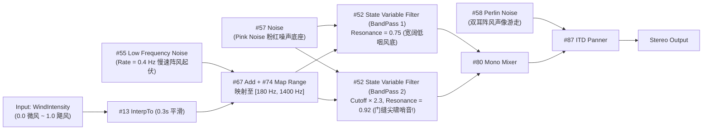
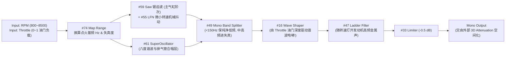
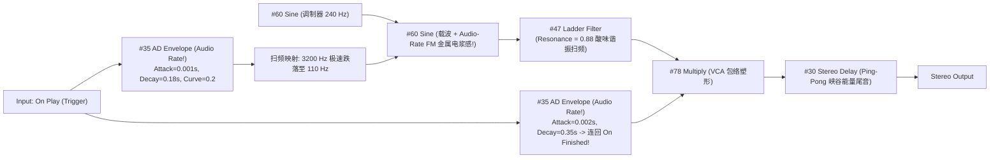

# 02 · 次世代采样级程序化音频图：DSP 振荡器、滤波器、动态处理与触发器 106 展台全解（`Audio_Metasounds`）

> **本篇实测拆解关卡与 DSP 工程档案**
> - **主关卡路径**：`/Game/Maps/Audio/Audio_Metasounds`（关卡总 Actor 数：`545` | 独立展台数：**`106` 座（`#1` ~ `#106` 零遗漏全拆解）** | 陈列示例 Actor 数：`428`）
> - **核心 MetaSound 源资产库**：`/Game/ExampleContent/MetaSounds/MetaSounds/MSS_*`（共 **98 个独立 `UMetaSoundSource` 示例图资产**）
> - **配套波表、总线与交互基座**：波表库 `/Game/ExampleContent/MetaSounds/WaveTables/WTB_MetaSoundsExamples`、跨实例音频总线 `/Game/ExampleContent/MetaSounds/AB_MetaSounds`（`UAudioBus`）、三维实时调参滑条 `BP_Slider_MetaSounds`、触发按钮 `BP_Button_SinglePressMetaSound` / `BP_Button_ToggleMetaSound`、GPU 频谱柱粒子系统 `NS_EQ_Reactive`（全厅共部署 **194 座实时律动频谱台**！）
> - **底层核心模块**：`MetasoundEngine`、`MetasoundFrontend`、`MetasoundGraphCore`、`MetasoundStandardNodes`、`WaveTable`

---

## 一、 音频渲染的“可编程着色器革命”：为什么游戏工业必须迈向 MetaSounds？

回顾计算机图形学的演进史：二十年前的固定管线时代，美术师只能把画死的光影烘焙进静态贴图；直到 **可编程着色器（Programmable Shader / UE Material Graph）** 与 **GPU 粒子模拟（Niagara）** 诞生，开发者才真正拥有了在每一颗像素、每一个微秒上实时演算火焰、水流与物理材质的自由。

然而在很长一段时间里，游戏音频却一直停留在“固定管线时代”——无论是传统的 `USoundCue` 还是早期的中间件事件容器，本质上都是在**游戏逻辑线程（Game Thread，约 `30 ~ 60 Hz`）**上调度预先录死在硬盘里的 `.wav` 录音文件。这种架构在次世代交互面前遭遇了**三大不可逾越的物理死结**：

1. **帧率时序抖动灾难（Frame-Rate Timing Jitter）**：
   当游戏运行在 `60 FPS` 时，两帧之间的间隔高达 **`16.67 ms`**（一旦掉帧到 `30 FPS` 更是暴涨至 **`33.33 ms`**！）。而人类听觉皮层对节奏瞬态相位差的敏感度高達 **`1 ~ 2 ms`**！如果你尝试用蓝图 `Tick` 或 `Timer` 去驱动一把射速 `1,200 RPM`（每 `50 ms` 一发）的加特林机枪，帧率波动会让枪声间隔在 `33 ms` 与 `67 ms` 之间疯狂抽搐，听起来就像卡壳的破拖拉机！
2. **静态录音的包体膨胀与机械重复感（Storage Bloat vs Repetition）**：
   为了录全一辆赛车从 `800 RPM` 怠速到 `9,000 RPM` 断油的平滑轰鸣，或是狂风穿过不同宽度峡谷的呼啸声，传统做法需要录制几十兆甚至上百兆的多层循环 `.wav` 切片；即便如此，玩家待久了依然能听出循环接缝。
3. **声源与 DSP 效果器的黑盒割裂**：
   在旧管线中，振荡器、滤波器、延迟线被锁死在 C++ 硬编码插件内部，音频设计师根本无法像连材质节点一样把“包络跟随器的输出”直接连给“双二阶滤波器的截止频率”或“环形调制器的载波相位”。

**MetaSounds 的横空出世，彻底终结了这一切。** 它将整个虚幻音频源变成了一张运行在独立 **Audio Render Thread（音频渲染线程，标准采样率 `48,000 Hz`）** 上的**有向无环数字信号处理图（DAG DSP Graph）**——在这里，时间精度的最小刻度不再是一帧（`16.67 ms`），而是**单个音频采样点（$1 / 48000 \approx 0.0208\text{ ms}$，精度暴涨 800 倍！）**！


推开 `/Game/Maps/Audio/Audio_Metasounds` 的大门，迎接你的是全 Content Examples 工程中**规模最宏大、跨度最壮观（全长 `645 米`！）、单图展台数量最多（整整 `106 座`！）**的殿堂级实验室。本篇将以首席技术音频师与 DSP 算法专家的双重视角，按展厅空间坐标顺序将 `#1` 至 `#106` 每一座展台的数学方程、引擎实现与音效设计配方悉数拆透！


---

## 二、 核心基石：双速率执行模型、六大数据引脚与展厅交互基座解剖

在沿着 645 米长廊逐台实验之前，我们先花三分钟彻底吃透贯穿全部 106 座展台的底层运行法则与公共交互资产。

### 2.1 采样率（Audio Rate）vs 块速率（Block Rate）与核心引脚类型体系

为了在极致音质与极致 CPU SIMD 吞吐量之间取得完美平衡，MetaSounds 引擎内部采用**双速率混合调度架构**：
- **Audio Rate（采样率级，`48,000 Hz`）**：每一个音频缓冲区回调（例如每次渲染 `480` 个采样点，对应 `10 ms` 块周期）内，对数组中的全部 `480` 个浮点数逐采样点使用 AVX/NEON SIMD 指令集矢量化求值；
- **Block Rate（控制块率级，默认 `100 Hz`，即每 `10 ms` 更新一次）**：对于变化较慢的控制标量（如 UI 滑条推入的音量、BPM 换算出的秒数），每个音频块仅求值 **1 次**，开销不到 Audio Rate 的百分之一！

由此衍生出 MetaSounds 编辑器中色彩分明的**六大核心数据引脚家族**：

| 引脚类型 (`DataType`) | 速率层级与底层 C++ 表示 | 核心语义与使用准则 |
| :--- | :--- | :--- |
| **`Audio`（音频缓冲流）** | **Audio Rate** (`FAudioBuffer`，对齐的 SIMD `float[]` 数组) | 承载 `-1.0 ~ +1.0` 双极性声波采样流，也可直接当作**采样率级高速调制控制信号**（如 Audio-Rate FM 频率调制、高速瞬态 AD 包络）！不可设为构造函数引脚。 |
| **`Trigger`（采样级触发器）** | **Sample-Accurate Event** (`FTrigger`，内部存储当前块内的**精确采样点偏移下标 `SampleIndex`**！) | **MetaSounds 灵魂设计**！即便两个触发事件落在同一个 `10 ms` 音频块内（比如分别在第 `17` 号采样和第 `312` 号采样），下游振荡器与包络也会严格在对应采样点瞬间点火，实现零抖动原子钟精度！ |
| **`Float` / `Int32` / `Bool`** | **Block Rate** (`float` / `int32` / `bool`) | 控制块级标量参数（频率 Hz、分贝 dB、滤波器 Q 值、计数器下标、布尔开关）。支持设为菱形 `Constructor Pin` 常量。 |
| **`Time`（高精度时间）** | **Block Rate** (`FTime`，内部为 `double` 秒数) | 专用于表示延迟长度、包络时长、周期与播放起止时间，避免长时音频下 32 位 `float` 尾数精度丢失，可与 `Float` 秒数互转。 |
| **`String` / `WaveAsset` / `WaveTable`** | **Block / Asset Reference** (`FString` / `FSoundWaveProxyPtr` / `FWaveTable`) | 调试日志字符串、线程安全的底层音频波形代理句柄（`USoundWave`）以及单周期/曲线波表数据块。 |
| **`Array<T>`（泛型数组）** | **Block Rate** (`TArray<T>`) | 支持 `Array<WaveAsset>`（脚步声池）、`Array<Float>`（音阶半音表）等任意可拷贝类型的集合操作。 |

### 2.2 展厅三大公共交互与可视化基座资产深拆

在接下来的展台中，几乎每座展台都由 `4 ~ 6` 个标准化 Actor 协同驱动（MCP 实测提取数据如下）：
1. **单次/切换触发器按钮（`BP_Button_SinglePressMetaSound` & `BP_Button_ToggleMetaSound`）**：
   - 继承自全局交互基类，持有成员变量 `Sound`（指向展台上的 `AmbientSound`）与 `VFX`（指向两侧 `NS_EQ_Reactive`）。玩家按下按钮时，调用 `AudioComponent->Play()` 启动对应的 `MSS_*` 图（自动激活图内默认的 `On Play` 输入触发器），并在 `On Finished` 停止时熄灭按钮指示灯。
2. **三维物理推子实时送参器（`BP_Slider_MetaSounds`）**：
   - 内部持有关键变量 `LinkedMetaSound`（目标 `AmbientSound` 引用）与字符串 `MetaSoundParameter`（如 `"Knob"`、`"DelayTime"`、`"Feedback"`、`"PitchShift"`、`"ATime"`、`"DTime"`）。当玩家拖拽滑块移动时，蓝图将归一化位移实时通过 `IAudioParameterControllerInterface::SetFloatParameter(MetaSoundParameter, Value)` 投递进无锁音频参数队列，在不断音的前提下实时扭曲运行中的 DSP 图！
3. **GPU 实时律动频谱台（`NS_EQ_Reactive`，全图共 194 个实例）**：
   - MCP 拓扑拆解显示，这是一个运行在 **`GPUComputeSim`** 上的 `NiagaraSystem`，包含发射器 `EQ`（挂载 `NiagaraMeshRendererProperties`），暴露用户参数 `User.SpawnCount = 50`、`User.SpawnOffset = 26`、`User.MeshScale = (0.2, 0.05, 1.0)`、`User.ScaleMultiplier = 15.0`——在每座展台左右两侧排开 50 根动态缩放的发光频谱柱，让不可见的声波能量化作肉眼可见的跳动光柱！
4. **98 个 `MSS_*` 资产的统一基线属性**：
   - 实测显示，所有示例 `UMetaSoundSource` 默认采用单声道 `Mono1Dot0`（部分立体声示例除外）、自动并发保护 `MaxCount = 16`、淘汰策略 `StopFarthestThenOldest`、开启 `bEnableBaseSubmix / BusSends / SubmixSends = true`。

### 2.3 645 米 DSP 走廊十二大功能分区空间地图

整座走廊沿 `+X` 轴从 `X = 500` 一直铺设到 `X = 64,500`，北侧墙（`Y = -900`）与南侧墙（`Y = +900`）对称排列：

```mermaid
flowchart TB
    Z1["展区一 (#1~#8, X:500~6000)\nMetaSounds 理念、Source/Patch/Preset\n类型转换、Output Watching 与构造函数引脚"] --> Z2["展区二 (#9~#16, X:7500~10500)\n通用 DSP 模块：BPM换算、包络跟随\n镶边Flanger、波表提取、InterpTo平滑、环形调制、WavePlayer/Shaper"]
    Z2 --> Z3["展区三 (#17~#23, X:12000~15000)\n泛型数组容器：Concatenate、Get、Num\nRandom Get 加权防重、Set、Shuffle 洗牌、Subset"]
    Z3 --> Z4["展区四 (#24~#25, X:16500)\n资产自省与调试：Get Wave Info、Print Log"]
    Z4 --> Z5["展区五 (#26~#30, X:18000~20000)\n延迟与颗粒家族：Delay、多普勒移调 Delay Pitch Shift\n全通扩散 Diffuser、颗粒延迟 Grain Delay、立体声延迟"]
    Z5 --> Z6["展区六 (#31~#34, X:21500~22500)\n动态范围与分贝：Compressor 压缩器\nLimiter 限制器、dB 与 Linear Gain 互转"]
    Z6 --> Z7["展区七 (#35~#39, X:24000~26000)\n包络与曲线：AD / ADSR 包络\nCrossFade 交叉混叠、波表求值与波表包络"]
    Z7 --> Z8["展区八 (#40~#43, X:27350~27650)\n跨实例 I/O：Audio Bus Writer/Reader\n与 Wave Writer 实时落盘录音"]
    Z8 --> Z9["展区九 (#44~#53, X:29000~33000)\n数字滤波器大全：BiQuad、Bitcrusher、Dynamic\nMoog Ladder、一阶高/低通、多频段分频器、Sample&Hold、SVF"]
    Z9 --> Z10["展区十 (#54~#65, X:34500~39500)\n振荡器与声源合成：加法合成、LFN/LFO、白/粉红/柏林噪声\nSaw / Sine / SuperOscillator / Square / Triangle / 波表振荡器"]
    Z10 --> Z11["展区十一 (#66~#89, X:41000~55000)\nDSP 算术与映射 (#66~#79)、单/双声道混音台 (#80~#81)\nMIDI 乐理量化 (#82~#85)、随机种子 (#86)、ITD/Stereo/Mid-Side 声场 (#87~#89)"]
    Z11 --> Z12["展区十二 (#90~#106, X:56500~64500)\n采样级触发器控制流：Accumulate、Any、Compare、Control\nCounter、Delay vs Pipe、Chance、Once、Threshold/Change、Select/Repeat/Route/Sequence/Value/Toggle"]
```



---

## 三、 展区一：MetaSounds 核心架构、资产模型与编译优化（展台 `#1` ~ `#8`）

### 展台 #1：`MetaSounds` — 次世代程序化 DSP 图谱总纲

- **空间元数据**：展牌 Label `BP_DemoDisplay1` | 坐标 `(500, -900, 0)`
- **陈列 Actor（8 个）**：`PostProcessVolume`、`DirectionalLight`、`ExponentialHeightFog`、`SkyAtmosphere`、`SkyLight`、`Actor`（`ChaosDebugDrawComponent_0`）、`DocumentationActor`、`Default Player Start`。
- **官方展牌原文**：
  > *MetaSound is a high-performance audio system that provides audio designers complete control over a Digital Signal Processing (DSP) graph for generating sound sources. MetaSounds offer user customization, third-party extensibility, graph re-use, and a powerful tool for in-editor sound design.*
- **架构精解**：入口 `#1` 展台确立了 MetaSounds 的四大工程基因——**完全开放的底层 DSP 图控制权**、**C++ 插件级自定义节点扩展能力（`MetasoundFrontend` 注册宏）**、**子图模块化复用**以及**全流程不离编辑器的实时声音设计工作台**。

---

### 展台 #2：`Why Use MetaSounds?` — 告别帧率抖动：缓冲级控制与采样级时序革命

- **空间元数据**：展牌 Label `BP_DemoDisplay2` | 坐标 `(1500, -900, 0)`


- **官方展牌原文**：
  > *Unlike Sound Cues, MetaSounds are fundamentally a Digital Signal Processing (DSP) rendering graph. With them, audio designers can construct powerful procedural audio systems that offer sample-accurate timing and control at the audio buffer level. Using MetaSounds, audio designers can generate audio synthetically at runtime and freely mix and match procedurally generated sound with other audio sources. We also designed MetaSounds to easily integrate with game data and player interactions to create immersive experiences triggered by gameplay events.*
- **深度解析**：`SoundCue` 只能决定“播哪个音频资产、乘多少总音量”；而 `MetaSound` 直接运行在音频缓冲区的采样数组之上。你可以用 **50% 真实录制的枪机金属撞击 `.wav`** 混合 **50% 实时合成的粉红噪声火药喷射 + 正弦波低频胸腔共振冲击**，并通过游戏传入的室内狭小度或武器过热度参数实时重塑每一个采样点的谐波构成！

---

### 展台 #3：`More Benefits of MetaSounds` — 实时热预览、图内自激触发与预设继承

- **空间元数据**：展牌 Label `BP_DemoDisplay3` | 坐标 `(2500, -900, 0)`
- **官方展牌原文**：
  > *MetaSounds are created in a new MetaSound Editor where audio designers with no programming experience can create procedural sounds using a node-based interface. The editor enables the live previewing of all audio input parameters and contains several ready-made nodes that provide detailed control options for the entire audio rendering pipeline. MetaSounds support sample-accurate control in several ways. MetaSound triggers execute sample-accurate events within the graph. Triggers can originate from gameplay events, MetaSound nodes, or the graph itself. With MetaSounds, you can reuse and reference their graphs through presets. Presets reference an existing MetaSound graph, and you can override the graph's inputs.*
- **三大工作流飞跃**：
  1. **Audition 实时悬停热调参**：在 MetaSound Editor 按下播放键后，直接拖动任意 `Input` 旋钮，运行中的合成器立即零停顿响应，所调即所得；
  2. **三源合一的采样级 Trigger**：触发器既可来自外部蓝图（`ExecuteTriggerParameter`），也可来自定时节点（如 `#102 Trigger Repeat`），更可来自**音频波形自身的边沿越界（如 `#98 Trigger On Threshold`）**，实现闭环自激生成式音频系统！

---

### 展台 #4：`Asset Types` — `MetaSound Source` vs `MetaSound Patch` 的工程边界

- **空间元数据**：展牌 Label `BP_DemoDisplay5` | 坐标 `(4000, -900, 0)`
- **官方展牌原文**：
  > *MetaSounds have two main asset types: MetaSound Source and MetaSound Patch. These two types are identical in terms of graph manipulation; however, only MetaSound Sources can generate audio on their own. MetaSound Patches are intended to be referenced by other MetaSounds to encapsulate and reuse functionality.*
- **类比材质系统秒懂架构**：
  - **`UMetaSoundSource`（类比 `UMaterial` 材质球）**：继承自引擎声音基类 **`USoundBase`**！它可以像普通 `SoundWave` 或 `SoundCue` 一样直接拖进关卡变成 `AmbientSound`、挂在动画通知 `AnimNotify_PlaySound` 上、绑定 `SoundAttenuation` 与 `SoundClass`，拥有标准声道输出节点（Mono / Stereo / Quad / 5.1 / 7.1 Output）及生命周期引脚 `On Play` / `On Finished`。
  - **`UMetaSoundPatch`（类比 `UMaterialFunction` 材质函数）**：**不继承 `USoundBase`**，不能独立在世界里播放，也没有固定声道输出限制；它专职将复杂的通用子算法（例如“自定义三段式多普勒风声滤波器组”或“不放回防重脚步选择器”）封装成一个黑盒单节点，供全项目上百个 `MetaSound Source` 引用调用，一处升级全局受益！

---

### 展台 #5：`Presets` — 零冗余图复用的 `MetaSound Preset`（音频实例）

- **空间元数据**：展牌 Label `BP_DemoDisplay4` | 坐标 `(4000, 900, 0)`（南墙对称位）
- **官方展牌原文**：
  > *MetaSound Presets are a special type of asset that inherits a read-only graph from a parent MetaSound and provides the ability to override default Input values. This allows you to create multiple versions of the same MetaSound with different sets of Inputs, which can be helpful to decrease graph duplication.*
- **工业化量产范式**：在内容浏览器中右键任意母图（如 `MSS_Weapon_Master`）选择 **`Create MetaSound Preset`**。子预设共享母图编译好的只读拓扑结构（内存与编译开销极低！），仅暴露 `Input` 参数覆写列表——手枪 Preset 覆写 `BodyPitch = 1.3` + 手枪采样数组，重机枪 Preset 覆写 `BodyPitch = 0.75` + 重机枪采样数组，彻底杜绝复制粘贴 50 张相同图表导致后期改一个节点要手动改 50 遍的地狱！

---

### 展台 #6：`Conversion Nodes` — 强类型安全转换与编译期隐式转型

- **空间元数据**：展牌 Label `BP_DemoDisplay106` | 坐标 `(5000, -900, 0)`
- **陈列 Actor 与绑定资产（4 个）**：`MS_ConversionNodes`（挂载 `/Game/ExampleContent/MetaSounds/MetaSounds/MSS_ConversionNodes`）、`BP_Button_SinglePressMetaSound`、两侧 `NS_EQ_Reactive` / `NS_EQ_Reactive2`。
- **官方展牌原文**：*Conversion nodes change one pin type into another supported pin type, similar to Blueprint conversion nodes.*
- **DSP 转型细节与跨速率边界**：
  当你在图中把 `Int32` 连向 `Float`、把 `Float (秒)` 连向 `Time` 时，编辑器自动插入紧凑的圆点转换节点。更强大的是**跨速率转换**：
  - **`Float To Audio`**：将一个每块更新一次的 `Float` 标量广播/填充进整个 `Audio` 采样缓冲区；
  - **`Audio To Float`**：提取音频缓冲区首采样或块级特征转回控制标量。需谨记跨速率下采样会丢失块内高频细节，仅用于低频控制信号桥接！

---

### 展台 #7：`Output Watching` — 音频反哺游戏世界：从 DSP 渲染线程回调蓝图/C++

- **空间元数据**：展牌 Label `BP_DemoDisplay7` | 坐标 `(5000, 900, 0)`
- **官方展牌原文**：
  > *You can watch MetaSound Source Outputs with Blueprint or C++ to drive gameplay systems. When watching an Output, you can do the following: Fire events when the Output value changes. Access the changed Output value.*
- **跨线程无锁观察者机制（`UMetaSoundOutputSubsystem`）**：
  传统音频永远是单向的“游戏通知音频响”；而通过给 `MetaSound Source` 添加自定义 **`Output` 节点**（如输出 `EnvelopeFollower` 的实时浮点能量 `CurrentEnergy`，或输出节拍器的 `OnBeat` 触发器），蓝图只需获取引擎子系统 **`MetaSoundOutputSubsystem -> Watch Output`** 并绑定委托 `OnMetasoundOutputValueChanged`，就能在游戏主线程实时拿到 DSP 图算出的包络峰值或精准节拍点——轻松驱动《Hi-Fi RUSH》式的全场景建筑随鼓点缩放、霓虹灯牌随合成器低音闪烁、NPC 嘴型实时张合！

---

### 展台 #8：`Constructor Pins` — 菱形常量引脚与静态图裁剪优化

- **空间元数据**：展牌 Label `BP_DemoDisplay8` | 坐标 `(6000, -900, 0)`
- **官方展牌原文**：
  > *Constructor pins are indicated by diamond-shaped icons. They have read-only values which can improve the performance of a MetaSound by not dynamically updating at runtime. In this way, they are similar to the const declaration in C++. You can make pins on Input and Output nodes into constructor pins by checking the Is Constructor Pin checkbox in the Details panel. All data types (including array types) that support copy assignment and construction can support constructor pins. However, Trigger and Audio types cannot be constructor pins.*
- **性能优化杀手锏**：
  为什么很多节点的引脚图标不是圆形而是**菱形（Diamond Icon）**？因为在 DSP 算子里，如果一个输入引脚是普通圆形引脚，算子每渲染一个音频块（每秒 100 次）都必须检查该参数是否发生改变、重算滤波器系数或重新分配延迟缓冲区！而勾选 **`Is Constructor Pin`** 后，该值在声音实例 `Play()` 构造瞬间只读取固定一次（等同 C++ `const` 构造函数传参），运行期彻底免除分支检查与重算开销！因为 `Audio` 流每采样都在变、`Trigger` 本身就是运行态瞬时脉冲，二者在语义上天然不可能是构造期常量，因此禁止设为 Constructor Pin。

---

## 四、 展区二：通用 DSP 核心功能模块（展台 `#9` ~ `#16`）

### 展台 #9：`BPM To Seconds` — 音乐节拍速度到物理时间的精确桥梁

- **空间元数据**：展牌 Label `BP_DemoDisplay9` | 坐标 `(7500, -900, 0)`
- **陈列 Actor 与绑定资产（5 个）**：`MS_Example`（挂载 `MSS_BPMToSeconds`）、`BP_Slider_MetaSounds`（实时推入参数 `"Knob"` 改变 BPM）、`BP_Button_SinglePressMetaSound2`、双侧 `NS_EQ_Reactive3/4`。
- **官方展牌原文**：*The BPM To Seconds node calculates a beat time in seconds from the given beats per minute (BPM), beat multiplier, and divisions of a whole note.*
- **DSP 换算方程与实战应用**：
  给定曲速 $\text{BPM}$（每分钟四分音符拍数）、全音符细分分母 $D$（`Divisions of Whole Note`：全音符 $=1$，二分 $=2$，四分 $=4$，八分 $=8$，十六分 $=16$）以及拍数乘子 $M$（`Beat Multiplier`，如附点音符设为 `1.5`，三连音设为 `0.6667`），输出时间 $T$（秒/`Time`）为：
  $$T = \left(\frac{60.0}{\text{BPM}}\right) \times \left(\frac{4.0}{D}\right) \times M$$
  将此节点的输出直接连给 `#26 Delay` 的延迟时间或 `#102 Trigger Repeat` 的重复周期，无论背景音乐 BPM 如何加速，你的回声尾音与自动步枪点射永远严丝合缝卡在八分/十六分音符网格上（Tempo-Synced Delay & Sequencer）！

---

### 展台 #10：`Envelope Follower` — 瞬时包络提取器（音频转控制流转换核心）

- **空间元数据**：展牌 Label `BP_DemoDisplay10` | 坐标 `(7500, 900, 0)`
- **陈列 Actor 与绑定资产（4 个）**：`MS_Example2`（挂载 `MSS_EnvelopeFollower`）、`BP_Button_SinglePressMetaSound3`、`NS_EQ_Reactive5/6`。
- **官方展牌原文**：*The Envelope Follower node outputs an envelope from an input audio signal.*
- **DSP 算法剖析**：
  如何把每秒剧烈正负震荡 48,000 次的交流波形 $x[n]$ 变成平滑跟随响度轮廓的正数包络 $e[n]$？`Envelope Follower` 先对信号取绝对值整流 $|x[n]|$（或均方根 RMS / 峰值 Peak 模式），再送入**非对称起释时间常数的一阶递归平滑器**：
  $$e[n] = \begin{cases} \alpha_A e[n-1] + (1 - \alpha_A)|x[n]|, & |x[n]| > e[n-1] \text{ (Attack 上升段)} \\ \alpha_R e[n-1] + (1 - \alpha_R)|x[n]|, & |x[n]| \le e[n-1] \text{ (Release 回落段)} \end{cases}$$
  其中平滑系数 $\alpha = \exp(-1 / (\tau \cdot f_s))$。它同时输出块率 `Envelope (Float)` 与采样率 `Audio Envelope (Audio)`，既能连给 `#7 Output Watching` 驱动角色说话口型开合，也能在图内直接控制滤波器截止频率制作自动哇音（Auto-Wah）！

---

### 展台 #11：`Flanger` — 镶边调制效果器（喷气式飞机扫频音色的秘密）

- **空间元数据**：展牌 Label `BP_DemoDisplay11` | 坐标 `(8500, -900, 0)`
- **陈列 Actor 与绑定资产（5 个）**：`MS_Example3`（挂载 `MSS_Flanger`）、`BP_Slider_MetaSounds2`（参数 `"Knob"` 调节调制速率/深度）、`BP_Button_SinglePressMetaSound4`、`NS_EQ_Reactive7/8`。
- **官方展牌原文**：*The Flanger node applies a flanger effect to the input audio.*
- **DSP 梳状滤波（Comb Filter）原理**：
  将原始音频复制一份，通过一条受正弦 LFO 周期性微调的**极短分数阶延迟线**（中心延迟极短，仅 `1 ms ~ 5 ms`！），再与原干声相加并带回反馈（`Feedback`）：
  $$y(t) = x(t) + g_{\text{wet}} x\big(t - \tau_0 - \Delta\tau \sin(2\pi f_{\text{mod}} t)\big)$$
  极短的时间差会在频谱上每隔 $1/\tau(t)\text{ Hz}$ 制造一连串等间距的谐波抵消深谷（梳状陷波）！随着 LFO 上下摆动延迟时间，整排陷波在频谱上上下扫掠，产生极具科幻金属感的“嗖——嗖——”喷气机引擎掠过声，非常适合科幻护盾展开、传送门待机与魔法剑刃挥舞！

---

### 展台 #12：`Get WaveTable From Bank` — 波表库动态索引与形态渐变（Morphing）

- **空间元数据**：展牌 Label `BP_DemoDisplay12` | 坐标 `(8500, 900, 0)`
- **陈列 Actor 与绑定资产（4 个）**：`MS_Example4`（挂载 `MSS_GetWaveTableFromBank`，依赖波表库资产 `/Game/ExampleContent/MetaSounds/WaveTables/WTB_MetaSoundsExamples`）、`BP_Button_SinglePressMetaSound5`、`NS_EQ_Reactive9/10`。
- **官方展牌原文**：*The Get WaveTable From Bank node retrieves (or generates an interpolated) WaveTable from a given WaveTable Bank asset.*
- **波表插值黑科技**：一个 `UWaveTableBank`（如 `WTB_MetaSoundsExamples`）内部按顺序存放了多张单周期波形或控制曲线（如第 `0` 号为纯净正弦波，第 `1` 号为三角波，第 `2` 号为尖锐锯齿波）。当传入的 `Table Index` 为小数（例如 `1.35`）时，该节点会自动在 `Table[1]` 与 `Table[2]` 的每一个对应采样点之间执行实时线性混合插值，生成一张独一无二的中间态过渡波表送给下游波表振荡器，实现顺滑无接缝的音色变形（Timbre Morphing）！

---

### 展台 #13：`InterpTo` — 消灭“拉链爆音（Zipper Noise）”的参数平滑守护神

- **空间元数据**：展牌 Label `BP_DemoDisplay13` | 坐标 `(9500, -900, 0)`
- **陈列 Actor 与绑定资产（5 个）**：`MS_Example5`（挂载 `MSS_InterpTo`）、`BP_Slider_MetaSounds3`（参数 `"Knob"`）、`BP_Button_SinglePressMetaSound6`、`NS_EQ_Reactive11/12`。
- **官方展牌原文**：*The InterpTo node interpolates between the current value and a target value over a specified time.*
- **工程必考红线**：当蓝图每帧（60Hz）或网络同步（20Hz）把快速拖动的滑块值直接塞给音量乘法器或振荡器频率时，离散的阶梯状跳变会在波形上切割出密集的“滋啦滋啦”高频毛刺，音频工程界称之为 **Zipper Noise（拉链噪声）**！在外部 `Input` 引脚与内部 DSP 节点之间串联一颗 **`InterpTo`**（设定 `Interp Time = 0.02s ~ 0.1s`），它会在内部以指数/线性斜坡平滑追赶目标值 `Target`，瞬间让粗糙生硬的参数突变变得如德芙般丝滑！

---

### 展台 #14：`RingMod` — 环形调制器：非谐波金属科幻音色锻造炉

- **空间元数据**：展牌 Label `BP_DemoDisplay14` | 坐标 `(9500, 900, 0)`
- **陈列 Actor 与绑定资产（4 个）**：`MS_Example6`（挂载 `MSS_RingMod`）、`BP_Button_SinglePressMetaSound7`、`NS_EQ_Reactive13/14`。
- **官方展牌原文**：*The RingMod node performs ring modulation with a carrier signal and a modulator signal.*
- **三角积化和差定理直击本质**：
  环形调制将载波信号 $c(t) = \cos(2\pi f_c t)$ 与双极性调制信号 $m(t) = \cos(2\pi f_m t)$ 直接逐采样相乘。由余弦积化和差公式：
  $$y(t) = \cos(2\pi f_c t)\cdot\cos(2\pi f_m t) = \frac{1}{2}\cos\big(2\pi(f_c + f_m)t\big) + \frac{1}{2}\cos\big(2\pi|f_c - f_m|t\big)$$
  惊人的现象发生了：**原本的载波基频 $f_c$ 和调制基频 $f_m$ 双双凭空消失，输出频谱里只剩下“和频 $(f_c+f_m)$”与“差频 $|f_c-f_m|$”两条边带（Sidebands）！** 当 $f_c$ 与 $f_m$ 不成简单整数比时，输出泛音彻底脱离自然谐波序列，呈现出冰冷、空洞、金属共振般的非谐波听感——《神秘博士》里外星机器人 Dalek 的标志性机械嗓音、机甲受损漏电语音、铁钟敲击泛音，只需将干声连入 `In Carrier`、一颗 `30 Hz ~ 180 Hz` 的 `Sine` 连入 `In Modulator` 一秒即成！

---

### 展台 #15：`Wave Player` — 全声道采样回放引擎与切片循环控制

- **空间元数据**：展牌 Label `BP_DemoDisplay15` | 坐标 `(10500, -900, 0)`
- **陈列 Actor 与绑定资产（4 个）**：`MS_Example7`（挂载 `MSS_WavePlayer`，依赖波形 `/Game/ExampleContent/Audio/Audio/Sound_Basics/Basic_SoundActor01`）、`BP_Button_SinglePressMetaSound8`、`NS_EQ_Reactive15/16`。
- **官方展牌原文**：*The Wave Player node is used to play a Sound Wave asset. There are multiple versions of this node in order to support several different channel configurations, such as Mono, Stereo, Quad (4.0), 5.1, and 7.1.*
- **远超 SoundCue WavePlayer 的六大杀手级引脚**：
  1. **`Pitch Shift`（半音制移调！）**：注意这里不再是反人类的倍率乘数，而是直观的音乐**半音数（Semitones）**——输入 `+12.0` 精准升高八度，输入 `-12.0` 精准降低八度，输入 `±0.5` 微扰半个半音！
  2. **`Start Time`、`Loop Start` 与 `Loop Duration`**：无需在外部软件把一段“武器蓄力起音 + 持续高能嗡鸣循环 + 射出尾音”切成三个碎文件！直接在同一个 WAV 文件里用 `Loop Start` 和 `Loop Duration` 圈出中间循环段，松开扳机时断开 `Loop` 布尔值自动顺着往下播完收尾段！
  3. **丰富的生命周期输出触发器**：不仅有 `On Play`、`On Finished`，还有 **`On Nearly Finished`（即将播完前提前一个块发出预警，用于完美零缝隙触发下一段拼接音频！）**、**`On Looped`（每次循环回绕瞬间打出一颗脉冲）** 与 **`On Cue Point`（读取 WAV 文件内嵌 Marker 标记点精确触发事件！）**！

---

### 展台 #16：`Wave Shaper` — 非线性波塑形谐波激励与过载失真

- **空间元数据**：展牌 Label `BP_DemoDisplay16` | 坐标 `(10500, 900, 0)`
- **陈列 Actor 与绑定资产（5 个）**：`MS_Example8`（挂载 `MSS_WaveShaper`，依赖 `Basic_SoundActor01`）、`BP_Slider_MetaSounds4`（参数 `"Knob"` 控制失真驱动量 `Amount`）、`BP_Button_SinglePressMetaSound9`、`NS_EQ_Reactive17/18`。
- **官方展牌原文**：*The WaveShaper node applies a non-linear shaping to the input audio signal.*
- **奇偶次谐波生成机制**：
  对输入采样点 $x \in [-1, 1]$ 施加非线性映射函数 $y = f(g \cdot x + b)$（其中 $g$ 为 `Amount` 驱动增益，$b$ 为 `Bias` 直流偏置）：
  - 当直流偏置 `Bias = 0`（奇对称函数 $f(-x) = -f(x)$，如软削波 $\tanh(gx)$）时，仅激发丰富的**奇次谐波（$3f_0, 5f_0, 7f_0\dots$）**，模拟晶体管放大器凶猛硬朗的失真咆哮；
  - 当微调引入非零 `Bias` 破坏上下半波对称性时，立即涌现温暖饱满的**偶次谐波（$2f_0, 4f_0\dots$）**，模拟复古电子管（Vacuum Tube）温暖厚实的磁带饱和感——给干瘪的重低音鼓或合成器枪炮垫上一层轻度 Wave Shaper，小尺寸手机扬声器也能凭借泛音列产生震撼的“虚拟低音”听感！

---

## 五、 展区三：泛型数组容器与防重复随机调度（展台 `#17` ~ `#23`）

在脚步声、弹壳落地、环境鸟鸣与程序化音乐音阶中，我们几乎总是成组管理资产列表。第 `#17` 至 `#23` 展台系统展示了 MetaSounds 强大的运行时泛型数组（`Array<T>`）操控能力（多以木质地板脚步声 `Audio_Footstep_Wood01 ~ 04` 与碎玻璃声 `Audio_Footstep_Glass01` 为实测样本）。

### 展台 #17：`Concatenate` — 双数组动态合并

- **空间元数据**：展牌 Label `BP_DemoDisplay17` | 坐标 `(12000, -900, 0)` | 资产：`MSS_Concatenate`
- **官方展牌原文**：*The Concatenate node concatenates two arrays on a given trigger.*
- **实战用法**：当触发 `In Trigger` 时，将 `Left Array` 与 `Right Array` 首尾拼接输出为一个新数组。例如：平时角色普通奔跑只使用基础脚步池 `[Wood01..04]`；当角色背负重甲进入淋雨状态时，触发拼接额外的水花重踏变体池，动态扩充采样曲库！

---

### 展台 #18：`Get` — 确定性下标检索

- **空间元数据**：展牌 Label `BP_DemoDisplay18` | 坐标 `(12000, 900, 0)` | 资产：`MSS_ArrayGet`（依赖 `Audio_Footstep_Wood01 ~ 04`）
- **官方展牌原文**：*The Get node retrieves an element from an array at the given index.*
- **实战用法**：按整型下标 `Index`（从 `0` 开始）精确提取数组中的指定元素（越界时自动安全取模回绕，绝不崩溃！）。常搭配 `#94 Trigger Counter` 按固定顺序播放连招音效（第一刀、第二刀、第三刀终结技），或从音阶数组中取出主音与五度音。

---

### 展台 #19：`Num` — 数组容量自省

- **空间元数据**：展牌 Label `BP_DemoDisplay19` | 坐标 `(13000, -900, 0)` | 资产：`MSS_ArrayNum`（依赖 `Audio_Footstep_Wood01 ~ 04`）
- **官方展牌原文**：*The Num node returns the number of elements in the given array.*
- **实战用法**：在构建通用 `MetaSound Preset` 母图时，不同子预设覆写传入的波形数组长度可能不同（手枪传了 3 个开火变体，步枪传了 8 个开火变体）。通过 `Num` 动态获取 `Array.Num()` 再喂给 `#75 Modulo` 或随机数上限，母图无需硬编码数字就能完美自适应任意长度的子预设资产池！

---

### 展台 #20：`Random Get` — 加权概率与防连抽记忆队列（3A 脚步/枪声核心节点！）

- **空间元数据**：展牌 Label `BP_DemoDisplay20` | 坐标 `(13000, 900, 0)` | 资产：`MSS_RandomGet`（依赖 `Audio_Footstep_Wood01 ~ 04`）


- **官方展牌原文**：
  > *The Random Get node randomly retrieves elements from an input array. Optionally, an array of weights can be supplied to adjust the randomness.*
- **两大王牌参数深解**：
  1. **`Weights`（浮点权重数组）**：假设你有 3 条常规木板脚步声（权重各设 `1.0`）和 1 条特殊的木板老旧嘎吱声（权重设为 `0.15`）——无需把常规声音复制十份塞进数组，权重数组直接实现“每走大约十步才偶尔踩响一声腐朽木板嘎吱声”的细腻叙事感！
  2. **`No Repeats`（防重复记忆步数 `N`）**：设为 `1` 时保证绝不连续两次抽中同一元素；若数组有 6 个元素、`No Repeats` 设为 `2`，则最近刚播过的 2 个元素在下一抽中被暂时屏蔽——比传统 SoundCue 单纯的 `Without Replacement` 更具弹性，既有真随机的不可预测性，又彻底消灭连抽复读机感！此外还支持 `Seed` 与跨实例共享历史状态（`Enable Shared State`），防止全队 4 个士兵同一帧迈步抽中同一个采样！

---

### 展台 #21：`Set` — 运行态数组元素热替换

- **空间元数据**：展牌 Label `BP_DemoDisplay21` | 坐标 `(14000, -900, 0)` | 资产：`MSS_ArraySet`（依赖 `Audio_Footstep_Wood01 ~ 04` + **`Audio_Footstep_Glass01`**）
- **官方展牌原文**：*The Set node sets the value of a specified index in a given array.*
- **实战巧思**：注意看 MCP 扫描出的依赖列表——`MSS_ArraySet` 在 4 个木板脚步声之外特意引入了一颗玻璃碎裂脚步声 `Audio_Footstep_Glass01`！当触发 `Set` 节点后，原木板脚步数组的某个槽位被动态覆写成了碎玻璃声，生动演示了房间窗户被打碎后，原本干净的木地板脚步池在运行态动态混入踩碎玻璃渣音效的高级互动！

---

### 展台 #22：`Shuffle` — 洗牌遍历器（牌堆抽牌模型）

- **空间元数据**：展牌 Label `BP_DemoDisplay22` | 坐标 `(14000, 900, 0)` | 资产：`MSS_ArrayShuffle`（依赖 `Audio_Footstep_Wood01 ~ 04`）
- **官方展牌原文**：*The Shuffle node outputs elements from a shuffled array.*
- **与 `Random Get` 的本质区别**：`Shuffle` 采用扑克牌洗牌算法（Fisher-Yates Shuffle）：先把全部 4 张牌打乱顺序，每次触发 `Next` 依次发出一张牌；等 4 张牌全部发完一轮后（同步触发 **`On Shuffle` 输出脉冲**！），如果开启了 `Auto Shuffle` 则自动重洗整副牌开启下一轮（且智能防止上一轮最后一张牌与新洗第一张牌撞车）。当你需要保证配音员录制的 8 句闲聊语音“在全部听完一遍之前绝不重复任何一句”时，`Shuffle` 是绝对的不二之选！

---

### 展台 #23：`Subset` — 数组切片子集提取

- **空间元数据**：展牌 Label `BP_DemoDisplay23` | 坐标 `(15000, -900, 0)` | 资产：`MSS_ArraySubset`（依赖 `Audio_Footstep_Wood01 ~ 04`）
- **官方展牌原文**：*The Subset node returns a subset of an input array.*
- **实战用法**：将轻步潜行（下标 `0~2`）、正常慢跑（下标 `3~6`）、全力冲刺（下标 `7~9`）共 10 个采样打包在同一个总数组里，根据角色移动速度动态调节 `Start Index` 与 `End Index` 切出对应强度子数组送入 `Random Get`，一套简洁连线统管全速度段步态！

---

## 六、 展区四：波形资产自省与运行态日志排障（展台 `#24` ~ `#25`）

### 展台 #24：`Get Wave Info` — 运行时获取音频文件精确时长

- **空间元数据**：展牌 Label `BP_DemoDisplay24` | 坐标 `(16500, -900, 0)` | 资产：`MSS_GetWaveInfo`（依赖 `Audio_Footstep_Wood04`）
- **官方展牌原文**：*The Get Wave Info node returns the info from the Wave Asset.*
- **自省闭环威力**：传入任意动态随机抽出的 `WaveAsset`，无需人工查表，直接输出它的精确物理总时长 `Duration (Time / Float)` 以及资产名 `Name`、`Path`。有了精确时长，你就可以算出 `Duration - 0.3s` 传给 `#95 Trigger Delay` 做自动尾音交叉淡化（Auto-Crossfade Looper），或者将 `AD Envelope` 的衰减时长精准绑定为当前随机抽中采样的总长度！

---

### 展台 #25：`Print Log` — DSP 图内探针日志输出

- **空间元数据**：展牌 Label `BP_DemoDisplay25` | 坐标 `(16500, 900, 0)` | 资产：`MSS_PrintLog`（依赖 `Audio_Footstep_Wood01 ~ 04`）
- **官方展牌原文**：*The Print Log node is used to record values to the Output Log on a given trigger for debugging purposes.*
- **排障利器**：由于 MetaSound 运行在独立的音频渲染线程上，不能像蓝图那样随意挂断点暂停整个引擎主线程。在关键触发分支挂载 `Print Log`（设定前缀标签 `Label` 与待打印值 `Value to Print`），按下展台按钮后打开编辑器 `Window -> Output Log`，即可清晰看到每次触发打印出的随机下标、分贝换算值或 MIDI 音符编号（切记正式打包 Shipping 前移除高频触发的日志节点以免刷爆磁盘 I/O）。

---

## 七、 展区五：时域延迟线、多普勒移调、全通扩散与颗粒合成（展台 `#26` ~ `#30`）

从 `X = 18000` 开始，我们踏入时域缓冲区操控（Time-Domain Buffer Manipulation）的高阶领地——几乎所有的回声、合唱、混响乃至实时变声器都脱胎于这 5 座展台！

### 展台 #26：`Delay` — 单声道环形反馈延迟线

- **空间元数据**：展牌 Label `BP_DemoDisplay26` | 坐标 `(18000, -900, 0)`
- **陈列 Actor 与双滑条联动（6 个）**：
  - `MS_Example18`（挂载 `MSS_Delay`，依赖清脆瞬态木板声 `Audio_Footstep_Wood01`）；
  - **`BP_Slider_MetaSounds5`**：绑定参数 **`"DelayTime"`**（实时拉伸回声间隔时间）；
  - **`BP_Slider_MetaSounds6`**：绑定参数 **`"Feedback"`**（实时调节回声重复衰减次数）；
  - `BP_Button_SinglePressMetaSound19` 及 `NS_EQ_Reactive37/38`。
- **官方展牌原文**：*The Delay node provides a mono buffer delay that supports dry level, wet level, and feedback. For multi-channel buffer delay, use the Stereo Delay node.*
- **环形缓冲区（Circular Buffer）差分方程与磁带音高弯曲奇观**：
  设采样率为 $f_s$，延迟秒数 $\tau$ 对应延迟采样跨度 $M = \tau \cdot f_s$，内部反馈状态槽满足：
  $$d[n] = x[n] + g_{\text{fb}} \cdot d[n - M], \quad y[n] = g_{\text{dry}} x[n] + g_{\text{wet}} d[n - M]$$
  - **稳定性红线**：反馈系数必须满足 $|g_{\text{fb}}| < 1.0$（节点内部安全钳制在 `[0, 1]`），否则每次回声能量递增将引发无限自激啸叫！
  - **动手实验彩蛋**：按下按钮让回声持续响起的同时，快速左右拖拽 `DelayTime` 滑条！你会听到回声的音高像老式模拟磁带延迟器（Tape Echo）一样发生迷人的高低弯曲滑音——这是因为读指针为了追赶新延迟位置而加速或减速跨越了采样点，恰好引出了对面 `#27` 展台的变调算法！

---

### 展台 #27：`Delay Pitch Shift` — 变速不变长！多普勒双指针实时移调器

- **空间元数据**：展牌 Label `BP_DemoDisplay27` | 坐标 `(18000, 900, 0)`
- **陈列 Actor 与双滑条联动（6 个）**：
  - `MS_Example19`（挂载 `MSS_DelayPitchShift`，依赖 `Audio_Footstep_Wood01`）；
  - **`BP_Slider_MetaSounds7`**：绑定参数 **`"PitchShift"`**（移调半音数）；
  - **`BP_Slider_MetaSounds8`**：绑定参数 **`"DelayLength"`**（内部颗粒窗口延迟缓冲窗长，`10 ms ~ 100 ms`）；
  - `BP_Button_SinglePressMetaSound20` 及 `NS_EQ_Reactive39/40`。
- **官方展牌原文**：
  > *The Delay Pitch Shift node pitch shifts the audio buffer using a delay-based doppler-shift method. This allows for pitch shifting without changing the length of the audio file by using an internal delay buffer. The pitch will shift but the sound will not speed up or slow down.*
- **DSP 算法揭秘：为什么普通改采样率移调会变成“花栗鼠快放”，而它不会？**
  在 `Wave Player` 里把音高调高一倍（`+12` 半音），播放时长会直接缩水一半（语速翻倍变花栗鼠）。而 `Delay Pitch Shift` 对任意实时流入的连续音频流（甚至麦克风实时语音或合成器流！），在一段长度为 $L$（`DelayLength`）的环形缓冲区上部署了**两个相位相差 $180^\circ$ 的旋转读取头**，以恒定变化率 $\frac{d\tau}{dt} = 1 - 2^{\Delta p / 12}$ 连续滑动延迟时间利用多普勒频移改变音高；每当一个读取头即将撞上写指针边界时，通过汉宁窗（Hann Window）平滑交叉淡化（Crossfade）切换至另一颗处于缓冲区正中央的读取头！
  - **调参秘籍**：调小 `DelayLength`（如 `15 ~ 25 ms`）瞬态响应最敏捷、无重影感（适合打击乐与脚步声）；调大 `DelayLength`（如 `50 ~ 80 ms`）低频音准最扎实饱满（适合持续怪兽低吼变调与人声魔音化）！

---

### 展台 #28：`Diffuser` — 全通相位扩散器（手工打造算法混响的核心积木）

- **空间元数据**：展牌 Label `BP_DemoDisplay28` | 坐标 `(19000, -900, 0)`
- **陈列 Actor 与滑条联动（5 个）**：`MS_Example20`（挂载 `MSS_Diffuser`，依赖清脆短瞬态 `Audio_Footstep_Wood01`）、`BP_Slider_MetaSounds9`（参数 `"Knob"` 控制 `Depth / Feedback`）、`BP_Button_SinglePressMetaSound21`、`NS_EQ_Reactive41/42`。
- **官方展牌原文**：*The Diffuser node applies diffusion to the incoming audio.*
- **全通滤波器级联（Cascaded Schroeder All-Pass Filters）**：
  普通 `#26 Delay` 处理清脆击掌声时，听起来是生硬孤立的“啪—啪—啪—啪”颗粒回声（Flutter Echo）。而 `Diffuser` 内部串联了多级互质长度的**全通延迟网络**——它在频域上保持所有频率的幅频响应严格为 $1.0$（不改变音色明暗），却在时域上将尖锐的单采样脉冲能量打散涂抹成一片绵密柔和的雾状声云！将 `Stereo Delay` 与 `Diffuser`、`One-Pole LPF` 组合进一个 `MetaSound Patch`，你就能亲手捏出一颗专属的科幻冰洞或赛博巨构空间混响器！

---

### 展台 #29：`Grain Delay` — 延迟颗粒合成器（Granular Synthesis 粒子音云）

- **空间元数据**：展牌 Label `BP_DemoDisplay29` | 坐标 `(19000, 900, 0)`
- **陈列 Actor 与滑条联动（5 个）**：`MS_Example21`（挂载 `MSS_GrainDelay`，依赖 `Basic_SoundActor01`）、`BP_Slider_MetaSounds10`（参数 `"Knob"`）、`BP_Button_SinglePressMetaSound22`、`NS_EQ_Reactive43/44`。
- **官方展牌原文**：*The Grain Delay node performs delayed audio granulation on a given audio buffer by sampling it into "grains" and playing them after a set delay.*
- **微观声学颗粒云魔法**：
  颗粒合成将输入音频流切碎成每秒几十个时长仅 `10 ~ 100 ms` 的微小声音微粒（**Grains**），为每一颗微粒独立套上高斯/梯形等包络窗口（`Grain Envelope`），再随机施加微小的延迟抖动（`Grain Delay Range`）、随机半音散射（`Pitch Shift Range`）与最大颗粒密度（`Max Grain Count`）！只需把一段平平无奇的金属敲击声或人声哼唱喂进 `Grain Delay` 并将随机移调推至 `+12` 八度，瞬间就能绽放出宛如星辰碎屑洒落、魔法冰晶凝结或虫群振翅般的梦幻粒子音景（Shimmer / Granular Cloud）！

---

### 展台 #30：`Stereo Delay` — 多拓扑立体声乒乓延迟器

- **空间元数据**：展牌 Label `BP_DemoDisplay30` | 坐标 `(20000, -900, 0)`
- **陈列 Actor 与滑条联动（5 个）**：`MS_Example22`（挂载 `MSS_StereoDelay`，依赖 `Audio_Footstep_Wood01`）、`BP_Slider_MetaSounds11`（参数 `"Knob"`）、`BP_Button_SinglePressMetaSound23`、`NS_EQ_Reactive45/46`。
- **官方展牌原文**：*The Stereo Delay node provides multi-channel buffer delay. Like the Delay node, which provides mono buffer delay, this node supports dry level, wet level, and feedback, but also supports additional delay modes.*
- **三大立体声反馈拓扑模式（`Delay Mode`）**：
  - `Normal`：左进左延迟、右进右延迟（通过设置略微不同的左右延迟比 `Delay Ratio` 借助哈斯效应瞬间撑开立体声大峡谷声场！）；
  - `Cross`：左右输入先交叉互换再进入各自独立反馈环；
  - **`Ping-Pong`（乒乓回声）**：左声道延迟输出交叉馈入右声道延迟输入，右声道延迟输出再折返左声道——戴上耳机按下按钮，清脆的木板敲击声会在你的左耳与右耳之间一来一回弹跳消逝，空间立体感拉满！

---

## 八、 展区六：动态范围控制与分贝增益换算（展台 `#31` ~ `#34`）

### 展台 #31：`Compressor` — 动态范围压缩器与图内侧链塑形

- **空间元数据**：展牌 Label `BP_DemoDisplay31` | 坐标 `(21500, -900, 0)`
- **陈列 Actor 与滑条联动（5 个）**：`MS_Example23`（挂载 `MSS_Compressor`，依赖 `Basic_SoundActor01`）、`BP_Slider_MetaSounds12`（参数 `"Knob"` 调节压缩比/阈值）、`BP_Button_SinglePressMetaSound24`、`NS_EQ_Reactive47/48`。
- **官方展牌原文**：*The Compressor node lowers the dynamic range of an input audio signal.*
- **动态增益衰减方程与打击感瞬态雕刻（Transient Punch）**：
  当输入电平 $L_{\text{in}}\text{ (dB)}$ 超过阈值 $T$（`Threshold dB`）时，压缩器按压缩比 $R$（`Ratio`，如 `4:1`）压制超额部分，目标输出电平满足 $L_{\text{out}} = T + \frac{L_{\text{in}} - T}{R}$：
  - **如何用 Compressor 让枪声或拳击声“更炸、更有拳拳到肉的冲击力”？** 秘诀在于**慢起音（`Attack Time = 20 ~ 35 ms`）+ 快释放（`Release Time = 50 ~ 100 ms`）**！慢起音故意放过前 `25 ms` 的枪口爆破瞬态尖峰不压缩，随后迅速压低紧随其后的枪身共鸣，再整体补足 `Wet Gain`——瞬态冲击头（Punch）被极大凸显！
  - 此外该节点还自带 **`Audio Bus / Sidechain` 外部侧链音频输入引脚**，让你在单个 MetaSound 图内部就能直接实现“合成器主音出现时自动压低铺底环境层”！

---

### 展台 #32：`Decibels to Linear Gain` — 对数分贝到线性振幅乘数的标准换算

- **空间元数据**：展牌 Label `BP_DemoDisplay32` | 坐标 `(21500, 900, 0)` | 资产：`MSS_DecibelsToLinearGain`（依赖 `Basic_SoundActor01`）
- **官方展牌原文**：*The Decibels to Linear Gain node converts a logarithmic (dB) gain value to a linear gain value.*
- **黄金声学公式**：
  在音频设计师的语言里，音量永远用对数分贝（`dB`）交流，而底层波形乘法器（`Multiply`）只认识线性振幅倍率 $G$。转换定律为：
  $$G_{\text{linear}} = 10^{\frac{\text{dB}}{20.0}}$$
  牢记四个关键锚点：`0 dB` $= 1.0$（原音量）；`-6.02 dB` $\approx 0.5$（振幅减半）；`-20 dB` $= 0.1$；当输入低至极小负值（如 `<= -100 dB`）时节点自动截断输出纯静音 `0.0`。在做音量滑条控制时，务必先在 `[-60 dB, 0 dB]` 线性插值分贝，再经此节点转为线性增益去乘音频流，推子手感才自然顺滑！

---

### 展台 #33：`Limiter` — 砖墙峰值限制器（程序化合成器的防爆音保险丝）

- **空间元数据**：展牌 Label `BP_DemoDisplay33` | 坐标 `(22500, -900, 0)`
- **陈列 Actor 与滑条联动（5 个）**：`MS_Example25`（挂载 `MSS_Limiter`，依赖 `Basic_SoundActor01`）、`BP_Slider_MetaSounds13`（参数 `"Knob"` 推高输入增益 `Input Gain dB`）、`BP_Button_SinglePressMetaSound26`、`NS_EQ_Reactive51/52`。
- **官方展牌原文**：*The Limiter node prevents a signal from going above a given threshold.*
- **安全护栏工程铁律**：在制作带有高谐振滤波器（如 `#47 Ladder Filter`、`#44 BiQuad` 高 Q 值）或反馈延迟（`#26 Delay`）的程序化 MetaSound 时，极端参数组合极易导致局部谐振峰值瞬间冲上 `+12 dB`！在连入最终 `Output` 引脚之前串联一颗 **`Limiter`**（设置 `Threshold dB = -0.5 dB`、`Knee = Hard/Soft`、极速超前起音），即可作为绝对可靠的“数字保险丝”，将一切越界洪峰死死按在 `0 dBFS` 红线以内，保卫玩家的耳朵与音响硬件！

---

### 展台 #34：`Linear Gain to Decibels` — 线性振幅转对数分贝

- **空间元数据**：展牌 Label `BP_DemoDisplay34` | 坐标 `(22500, 900, 0)` | 资产：`MSS_LinearGainToDecibels`（依赖 `Basic_SoundActor01`）
- **官方展牌原文**：*The Linear Gain to Decibels node converts a linear gain value to a logarithmic (dB) gain value.*
- **逆运算方程**：与 `#32` 互为严格逆函数：
  $$\text{dB} = 20.0 \cdot \log_{10}\big(\max(G_{\text{linear}}, \epsilon)\big)$$
  常用于将 `#10 Envelope Follower` 提取出的线性振幅 `[0.0, 1.0]` 转换为分贝刻度，送入阈值比较逻辑或外部响度表 UI 显示。

---

## 九、 展区七：包络发生器、交叉混叠与波表曲线塑形（展台 `#35` ~ `#39`）

如果振荡器是合成器的“声带”，那么**包络（Envelope）就是赋予声音生命形态的“呼吸与肌肉”**——同样一颗 440Hz 正弦波，配极快起音与指数短衰减就是清脆的木琴敲击，配慢起音与慢释放就是悠扬的大提琴拉弦！

### 展台 #35：`AD Envelope` — 起音-衰减两段式瞬态包络（打击乐与枪炮灵魂）

- **空间元数据**：展牌 Label `BP_DemoDisplay35` | 坐标 `(24000, -900, 0)`
- **陈列 Actor 与双滑条联动（6 个）**：
  - `MS_Example27`（挂载 `MSS_ADEnvelope`）；
  - **`BP_Slider_MetaSounds14`**：绑定参数 **`"ATime"`**（实时调节 `Attack Time` 起音爬升秒数）；
  - **`BP_Slider_MetaSounds15`**：绑定参数 **`"DTime"`**（实时调节 `Decay Time` 衰减消逝秒数）；
  - `BP_Button_SinglePressMetaSound28` 及 `NS_EQ_Reactive55/56`。
- **官方展牌原文**：*The AD Envelope node generates an attack-decay envelope value output when triggered.*
- **关键架构抉择：`AD Envelope (Audio)` vs `AD Envelope (Float)`**：
  MetaSounds 贴心地提供了两个重载版本：
  - 若用于控制短促底鼓（Kick Drum）、激光扫频或步枪瞬态（起音仅 `1 ~ 3 ms`！），**必须选用 `AD Envelope (Audio)`（采样率级包络）**——因为块率（每 `10 ms` 才更新一次）根本抓不住 `2 ms` 的犀利瞬态尖峰！
  - 同时务必善用 **`Attack Curve` 与 `Decay Curve` 曲率因子**：将 `Decay Curve` 设为 `< 1.0`（如 `0.25` 凹指数曲线），前段极速跌落、尾段悠长消散，一秒模拟真实物理琴弦与鼓皮的自然阻尼衰减！包络跑完瞬间还会自动发射 **`On Done` 触发脉冲**，可直接连入图的 `On Finished` 自动回收销毁该 MetaSound 实例，绝不空跑浪费 CPU！

---

### 展台 #36：`ADSR Envelope` — 起音-衰减-延音-释音四段式门控包络

- **空间元数据**：展牌 Label `BP_DemoDisplay36` | 坐标 `(24000, 900, 0)`
- **陈列 Actor 与滑条联动（5 个）**：`MS_Example28`（挂载 `MSS_ADSREnvelope`）、`BP_Slider_MetaSounds16`（参数 `"Knob"`）、`BP_Button_SinglePressMetaSound29`、`NS_EQ_Reactive57/58`。
- **官方展牌原文**：
  > *The ADSR Envelope node generates an attack-decay-sustain-release envelope value output when triggered. This node is similar to the AD Envelope node, but it requires a separate release trigger for the release phase of the envelope to begin.*
- **双触发门控状态机（Gate On / Gate Off）**：
  与“一按到底自动结束”的 `AD Envelope` 不同，`ADSR` 专为**玩家按住不放、持续时长未知的交互动作**而生（例如：按住左键激光武器持续喷射、按住油门引擎轰鸣、护盾持续展开）：
  1. 玩家按下按键发送 `Trigger Attack`：包络经历 `Attack Time` 冲至峰值 `1.0`，再经 `Decay Time` 回落并**无限悬停保持在 `Sustain Level`（延音平台，如 `0.7`）**；
  2. 直到玩家松开按键发送独立的 **`Trigger Release` 脉冲**，包络才从当前电平历经 `Release Time` 平滑归零并触发 `On Done` 收尾销毁！

---

### 展台 #37：`CrossFade` — 多路信号连续平滑混合器

- **空间元数据**：展牌 Label `BP_DemoDisplay37` | 坐标 `(25000, -900, 0)`


- **陈列 Actor 与滑条联动（5 个）**：`MS_Example29`（挂载 `MSS_CrossFade`）、`BP_Slider_MetaSounds17`（参数 `"Knob"` 驱动 `Crossfade Value`）、`BP_Button_SinglePressMetaSound30`、`NS_EQ_Reactive59/60`。
- **官方展牌原文**：*The Crossfade node blends between inputs linearly using a provided block-rate float parameter.*
- **多档位无缝融合核心**：`CrossFade` 支持 **2 路乃至 8 路输入通道**（既支持混合 `Audio` 流，也支持混合 `Float` 标量！）。当 `Crossfade Value` 从 `0.0` 平滑推向 `1.0 -> 2.0 -> 3.0` 时，它在相邻两路输入之间自动执行线性权重插值（块内采样级斜坡平滑防爆音），而未激活的远端支路权重为 `0`。无论是做“晴天微风 → 阴天强风 → 飓风呼啸”三层风声连续推子，还是在正弦波、锯齿波、方波之间连续变形，一颗 `CrossFade` 干净利落搞定！

---

### 展台 #38：`Evaluate WaveTable` — 将波表化作任意自定义数学函数查找表

- **空间元数据**：展牌 Label `BP_DemoDisplay38` | 坐标 `(25000, 900, 0)` | 资产：`MSS_EvaluateWaveTable`（依赖 `WTB_MetaSoundsExamples`）
- **官方展牌原文**：*The Evaluate WaveTable node outputs the value of a WaveTable at a given input phase, allowing you to use the WaveTable as a curve in the graph.*
- **架构巧思**：在 MetaSound 图中想画一条复杂的非线性映射曲线（比如武器过热到 80% 前音高缓慢爬升、最后 20% 突然剧烈陡升报警）怎么办？无需拼十几个数学幂函数！直接在波表编辑器手绘一条任意曲线存入 `WaveTableBank`，在图中用 `Evaluate WaveTable` 将归一化过热度 `Phase ∈ [0.0, 1.0]` 查表映射为精确输出浮点值，零代码实现可视化曲线驱动！

---

### 展台 #39：`WaveTable Envelope` — 任意手绘多峰形态包络发生器

- **空间元数据**：展牌 Label `BP_DemoDisplay39` | 坐标 `(26000, -900, 0)`
- **陈列 Actor 与滑条联动（5 个）**：`MS_Example31`（挂载 `MSS_WaveTableEnvelope`，依赖 `WTB_MetaSoundsExamples`）、`BP_Slider_MetaSounds18`（参数 `"Knob"` 调节 `Duration` 扫描总时长）、`BP_Button_SinglePressMetaSound32`、`NS_EQ_Reactive63/64`。
- **官方展牌原文**：*The WaveTable Envelope node reads through the given WaveTable over the given duration.*
- **突破折线包络局限**：传统 `AD / ADSR` 只能走出单峰“上山-下山”曲线；如果想做一个“闪电劈落连续三次颤动闪烁”或“科幻飞船曲速引擎阶梯式充能跳跃”的音量/音高轨迹，`WaveTable Envelope` 只需在给定 `Duration` 内从头到尾扫描一遍手绘波表，支持单次触发或循环扫描（LFO 模式），赋予声音设计师无穷的时域雕刻自由！

---

## 十、 展区八：跨实例音频总线通信与实时磁盘录音（展台 `#40` ~ `#43`）

在 `X = 27500` 处，北侧展位采用了母展牌 **`#41 Audio Bus ReaderWriter`** 居中、左右并列子展台 **`#40 Write to Audio Bus`** 与 **`#42 Read from Audio Bus`** 的联动布局，南侧则陈列着 **`#43 Wave Writer`**。

### 展台 #40：`Write to Audio Bus`（子展台）& 展台 #41：`Audio Bus ReaderWriter`（总纲）& 展台 #42：`Read from Audio Bus`（子展台）

- **空间元数据与三台联动拆解**：
  - **展台 #40（左侧发送端）**：Label `BP_DemoDisplay107` | 坐标 `(27350, -668, -5)` | 官方展牌：`Write to Audio Bus` | 陈列：`MS_Example56`（挂载 **`MSS_AudioBusWriter`**，依赖共享总线资产 **`/Game/ExampleContent/MetaSounds/AB_MetaSounds`** 与音源 `Basic_SoundActor01`）、切换开关 `BP_Button_SinglePressMetaSound57`（`BP_Button_ToggleMetaSound_C`）、`NS_EQ_Reactive65`。
  - **展台 #41（中央母展牌）**：Label `BP_DemoDisplay40` | 坐标 `(27500, -900, 0)` | 官方展牌：*The Audio Bus Reader node outputs audio data from an Audio Bus asset. The Audio Bus Writer node inputs audio to an Audio Bus asset.*
  - **展台 #42（右侧接收端）**：Label `BP_DemoDisplay108` | 坐标 `(27650, -668, -5)` | 官方展牌：`Read from Audio Bus` | 陈列：`MS_Example32`（挂载 **`MSS_AudioBusReader`**，只依赖共享总线 **`AB_MetaSounds`**，自身不含任何音频文件！）、切换开关 `BP_Button_SinglePressMetaSound33`（`BP_Button_ToggleMetaSound_C`）、`NS_EQ_Reactive66`。
- **实测交互奇迹与工业应用场景**：
  如果你只按下右侧 `#42 Read` 按钮，它是静默无声的；一旦你同时按下左侧 `#40 Write` 按钮，左侧实例内部的音频信号并不直接输出（或同时输出），而是通过 `Audio Bus Writer` 实时灌入内存中的高速环形混合管道 `AB_MetaSounds`，右侧完全独立的另一个 Actor `MS_Example32` 通过 `Audio Bus Reader` 零延迟捕获这股实时音频流并进行二次滤波/调制播放！
  - **三大神级实战架构**：
    1. **全息投影仪 / 监控大屏实时转播**：BOSS 在远端大厅实时合成的语音写入 `AB_BossVoice`，遍布全城的 20 台全息投影仪 Actor 各自运行 `MSS_HologramSpeaker`（内部 `Audio Bus Reader` 读取 `AB_BossVoice` + 叠加电磁杂音与本地 3D HRTF 衰减）！
    2. **共振水晶与魔法声学反馈**：洞穴里的发光水晶实时监听 `AB_PlayerWeapons` 总线，每当玩家开枪，水晶自动吸取枪声频谱激发空灵的泛音共鸣！
    3. **跨实例精准侧链压缩**：主角语音写入 `AB_SidechainKey`，环境合成器读取该总线喂入 `#31 Compressor` 的侧链端！

---

### 展台 #43：`Wave Writer` — 实时 DSP 输出无损落盘刻录机

- **空间元数据**：展牌 Label `BP_DemoDisplay41` | 坐标 `(27500, 900, 0)` | 资产：`MSS_WaveWriter`（依赖 `Basic_SoundActor01`）
- **官方展牌原文**：*The Wave Writer node writes audio signals to disk.*
- **双栖工程利器**：启用 `Enabled = true` 并设定 `Filename Prefix` 后，流经该节点的一切实时合成音频采样会原封不动直接写入项目 `Saved/AudioCaptures/` 目录下的 `.wav` 文件中！
  1. **编辑器离线烘焙工作流**：用复杂的 `SuperOscillator + Grain Delay` 调出极其满意但较吃算力的 UI 升级音效后，挂一颗 `Wave Writer` 录下 3 秒钟无损 WAV 重新导回给低端移动端直接低开销回放；
  2. **QA 疑难杂症黑匣子**：复现偶发性破音时挂在输出末端直接抓出问题波形在频谱仪里逐采样尸检！

---

## 十一、 展区九：数字滤波器全家族与多频段分频网络（展台 `#44` ~ `#53`）

在减法合成（Subtractive Synthesis）与物理环境模拟中，**滤波器（Filter）是雕刻音色冷暖、远近、软硬的核心刻刀**。第 `#44` 至 `#53` 展台集中陈列了从 1 阶极简滤波器到 4 阶经典模拟合成器梯形滤波器的全套兵器谱！

### 展台 #44：`BiQuad Filter` — 现代 DSP 工业标准二阶双二阶滤波器

- **空间元数据**：展牌 Label `BP_DemoDisplay42` | 坐标 `(29000, -900, 0)`
- **陈列 Actor 与滑条联动（5 个）**：`MS_Example34`（挂载 `MSS_BiQuadFilter`，依赖 `Basic_SoundActor01`）、`BP_Slider_MetaSounds19`（参数 `"Knob"` 实时扫掠截止频率 `Cutoff Frequency`）、`BP_Button_SinglePressMetaSound35`、`NS_EQ_Reactive69/70`。
- **官方展牌原文**：*The Biquad Filter node provides a simple two-pole biquad filter that supports a variety of configurations.*
- **$Z$ 域双零双极点传递函数与六大滤波模式**：
  之所以叫“Bi-Quad（双二次型）”，是因为其 $Z$ 变换传递函数的分子与分母均为 $z^{-1}$ 的二次多项式（2 个零点 + 2 个极点，标准滚降斜率 **`-12 dB / Octave`**）：
  $$H(z) = \frac{b_0 + b_1 z^{-1} + b_2 z^{-2}}{1 + a_1 z^{-1} + a_2 z^{-2}} \iff y[n] = b_0 x[n] + b_1 x[n-1] + b_2 x[n-2] - a_1 y[n-1] - a_2 y[n-2]$$
  仅需更改 5 个系数 $(b_0, b_1, b_2, a_1, a_2)$，同一套底层差分结构即可通过枚举 `Type` 切换六种形态：
  - **`Low Pass` / `High Pass`**：低通闷化 / 高通削低频，配合 `Bandwidth / Q` 在截止频率处隆起清脆的谐振峰（Resonance Peak）；
  - **`Band Pass`（带通）**：只放行中心频率附近窄带——**程序化风声穿过门缝哨音的核心**！
  - **`Butterworth Low Pass / High Pass`**：最大平坦通带巴特沃斯响应（$Q = 1/\sqrt{2} \approx 0.7071$），通带内绝对平坦无波纹；
  - **`Notch`（陷波）/ `Parametric EQ`（参量均衡）/ `All Pass`（全通移相）**：精准挖除刺耳谐振点或提亮特定频段。

---

### 展台 #45：`Bitcrusher` — 降采样混叠与降位深量化失真（Lo-Fi / 赛博故障音）

- **空间元数据**：展牌 Label `BP_DemoDisplay43` | 坐标 `(29000, 900, 0)`
- **陈列 Actor 与滑条联动（5 个）**：`MS_Example35`（挂载 `MSS_BitCrusher`，依赖 `Audio_Footstep_Wood01 ~ 04`）、`BP_Slider_MetaSounds20`（参数 `"Knob"` 压低采样率/位深）、`BP_Button_SinglePressMetaSound36`、`NS_EQ_Reactive71/72`。
- **官方展牌原文**：*The Bitcrusher node downsamples and lowers the bit-depth of an incoming audio signal.*
- **双重数字退化美学**：
  1. **`Sample Rate`（降采样率，如从 `48,000 Hz` 压低至 `4,000 Hz`）**：故意违背奈奎斯特采样定理（Nyquist Limit $f_s/2 = 2,000\text{ Hz}$），使高于 `2 kHz` 的高频成分发生**频谱镜像折叠混叠（Aliasing）**，产生充满数字金属颗粒感的刺耳沙砾音；
  2. **`Bit Depth`（降量化位深，如从 `16-bit` 65,536 级台阶暴降至 `4-bit` 仅 16 级台阶！）**：将平滑波形强行取整为粗糙锯齿阶梯 $y = \frac{\text{round}(x \cdot 2^{B-1})}{2^{B-1}}$，注入强烈的量化底噪——复古 8-bit 像素游戏、黑客入侵数据损毁、AI 机械生命体濒死故障音的一键配方！

---

### 展台 #46：`Dynamic Filter` — 电平自适应动态均衡器

- **空间元数据**：展牌 Label `BP_DemoDisplay44` | 坐标 `(30000, -900, 0)` | 资产：`MSS_DynamicFilter`（依赖 `Basic_SoundActor01`）
- **官方展牌原文**：*The Dynamic Filter node filters a band of audio based on the strength of the input signal.*
- **智能驯服刺耳频段**：传统静态 EQ 一刀切掉 `3 kHz` 会让轻柔声音也变得黯淡无光；`Dynamic Filter` 内部集成了包络侦测器与参量滤波器——只有当某个频段瞬时能量冲过 `Threshold dB` 阈值时才动态压下（或提振）该频段增益，完美消除金属碰撞在重击瞬间的刺耳高频共振而不损伤轻擦时的细腻质感！

---

### 展台 #47：`Ladder Filter` — 致敬传奇 Moog 四极点虚拟模拟梯形滤波器

- **空间元数据**：展牌 Label `BP_DemoDisplay45` | 坐标 `(30000, 900, 0)`
- **陈列 Actor 与滑条联动（5 个）**：`MS_Example37`（挂载 `MSS_LadderFilter`，依赖 `Basic_SoundActor01`）、`BP_Slider_MetaSounds24`（参数 `"Knob"` 扫掠截止频率）、`BP_Button_SinglePressMetaSound38`、`NS_EQ_Reactive75/76`。
- **官方展牌原文**：*The Ladder Filter node provides a virtual analog filter that has a pleasing and classic rolloff and resonance.*
- **为什么电子乐与科幻合成器对 Ladder Filter 情有独钟？**
  它数学建模了 Bob Moog 于 1965 年发明的经典晶体管梯形模拟电路，拥有 **4 个级联极点（4-Pole，滚降斜率高达陡峭的 `-24 dB / Octave`，是 BiQuad 的两倍！）** 以及模拟非线性饱和回路。当你将 `Resonance`（谐振度）推高至 `0.85 ~ 0.98` 并用包络快速向下扫掠 `Cutoff Frequency` 时，截止频率尖峰会发出极具弹性、浓稠汁水感（Juicy / Acid）的“啾——嗡——”经典模拟合成器激光与重低音音色！

---

### 展台 #48：`One-Pole High Pass Filter` — 极简一阶高通滤波器（算力性价比之王）

- **空间元数据**：展牌 Label `BP_DemoDisplay47` | 坐标 `(31000, -900, 0)`
- **陈列 Actor 与滑条联动（5 个）**：`MS_Example39`（挂载 `MSS_OnePoleHighPassFilter`，依赖 `Basic_SoundActor01`）、`BP_Slider_MetaSounds21`（参数 `"Knob"`）、`BP_Button_SinglePressMetaSound40`、`NS_EQ_Reactive79/80`。
- **官方展牌原文**：*The One-Pole High Pass Filter node is a computationally cheap filter useful for a number of simple applications, such as simulating occlusion.*
- **单极点轻量优势（`-6 dB / Octave`）**：仅含单个延迟状态单元，每次采样仅需极少乘加运算且无谐振过冲风险。工程上广泛用于清除非线性失真（如带 Bias 的 WaveShaper）后残留的 `0 ~ 30 Hz` 无用超低频直流偏移（DC Offset Blocker），或为上百个并发远距小声源做极低开销的低频清理！

---

### 展台 #49：`Mono Band Splitter` — 单声道多频段相位对齐分频器

- **空间元数据**：展牌 Label `BP_DemoDisplay46` | 坐标 `(31000, 900, 0)` | 资产：`MSS_MonoBandSplitter`（依赖 `Basic_SoundActor01`）
- **官方展牌原文**：*The Mono Band Splitter node splits incoming audio into separate frequency bands.*
- **多频段独立精修（Multiband Processing）**：
  如果你直接把全频段重低音贝斯或爆炸声塞进失真器，超低频（`< 120 Hz`）失真后会变得松散浑浊丧失拳拳到肉的推力。使用 `Mono Band Splitter`（采用 **Linkwitz-Riley 交叉分频器拓扑**，保证各频段直接相加还原时在分频点处幅频平坦、绝不产生相位凹坑！），你可以将声音一分为三/四：
  - `Band 0 (< 150 Hz)`：保持纯净干净或加压缩器收紧超低频；
  - `Band 1 (150 ~ 2500 Hz)`：单独送入 `Wave Shaper` 猛加谐波咆哮失真；
  - `Band 2 (> 2500 Hz)`：送入 `Stereo Delay` 增加高频空间空气感；
  最后经 `Mono/Stereo Mixer` 合流——这是顶级 3A 武器与怪兽音效设计师压箱底的母带分频塑形秘技！

---

### 展台 #50：`One-Pole Low Pass Filter` — 极简一阶低通滤波器（空气吸收与阻尼首选）

- **空间元数据**：展牌 Label `BP_DemoDisplay48` | 坐标 `(32000, -900, 0)`
- **陈列 Actor 与滑条联动（5 个）**：`MS_Example40`（挂载 `MSS_OnePoleLowPassFilter`，依赖 `Basic_SoundActor01`）、`BP_Slider_MetaSounds22`（参数 `"Knob"`）、`BP_Button_SinglePressMetaSound41`、`NS_EQ_Reactive81/82`。
- **官方展牌原文**：*The One-Pole Low Pass Filter node is a computationally cheap filter useful for a number of simple applications, such as simulating air absorption.*
- **工程黄金定位**：差分方程为极简的一阶指数移动平均 $y[n] = (1 - a)x[n] + a y[n-1]$（斜率 `-6 dB / Octave`）。无论是挂在 `#26 Delay` 反馈环路里模拟墙壁每次反弹吃掉一点高频（Damping），还是模拟大气吸收与柔和遮挡，它都是全图 CPU 开销最低、听感最温润自然的低通滤波器！

---

### 展台 #51：`Sample And Hold` — 采样保持器（复古科幻阶梯随机调制核心）

- **空间元数据**：展牌 Label `BP_DemoDisplay49` | 坐标 `(32000, 900, 0)` | 资产：`MSS_SampleAndHold`（依赖 `Basic_SoundActor01`）
- **官方展牌原文**：*The Sample And Hold node outputs a single value of the input audio signal when triggered.*
- **经典模块化合成器连法**：平时无论输入端 `In` 的音频波形如何上蹿下跳，输出端纹丝不动；唯有在收到 `Sample And Hold` 触发脉冲的**那一个精确采样点瞬间**，它像高速快门一样抓拍冻结当时的输入瞬时采样值并一直保持到下一次触发！将一颗白噪声（`#57 Noise`）连入 `In`，再用一颗 `12 Hz` 的 `#102 Trigger Repeat` 定时抓拍，把输出的随机阶梯信号连给振荡器频率或滤波器截止频率——1970 年代好莱坞科幻电影（如《星球大战》R2-D2 与母舰控制台）标志性的“滴-嘟-哔-啵”电子计算机运算音色跃然耳畔！

---

### 展台 #52：`State Variable Filter` — 状态变量滤波器（高速音频级调制永不炸音的王者！）

- **空间元数据**：展牌 Label `BP_DemoDisplay50` | 坐标 `(33000, -900, 0)`
- **陈列 Actor 与滑条联动（5 个）**：`MS_Example42`（挂载 `MSS_StateVariableFilter`，依赖 `Basic_SoundActor01` 与 `WTB_MetaSoundsExamples`）、`BP_Slider_MetaSounds23`（参数 `"Knob"`）、`BP_Button_SinglePressMetaSound43`、`NS_EQ_Reactive85/86`。
- **官方展牌原文**：*The State Variable Filter node provides a virtual analog filter used in many synthesis applications.*
- **为什么高频扫频调制时必须用 `State Variable Filter (SVF)` 取代 `BiQuad`？**
  1. **零延迟反馈拓扑调制绝对稳定**：传统直接型 `BiQuad` 在用高速 LFO 或包络剧烈扫掠截止频率时，极点迁移过渡态很容易短暂跑出 $Z$ 平面单位圆外引发恐怖的爆音发散；而虚拟模拟双积分器环路构建的 **SVF（State Variable Filter）** 即使在采样率级高速调制 `Cutoff Frequency` 时依然固若金汤、丝滑悦耳！
  2. **一算四得全输出**：单次计算同时并行吐出 **`Low Pass`、`High Pass`、`Band Pass` 与 `Band Stop` 四条独立音频引脚**！无需实例化四个滤波器即可自由混合各种滤波响应！

---

### 展台 #53：`Stereo Band Splitter` — 立体声相位对齐多频段分频器

- **空间元数据**：展牌 Label `BP_DemoDisplay51` | 坐标 `(33000, 900, 0)` | 资产：`MSS_StereoBandSplitter`（依赖 `Basic_SoundActor01` 与 `WTB_MetaSoundsExamples`）
- **官方展牌原文**：*The Stereo Band Splitter node splits incoming audio into separate frequency bands.*
- **立体声母带级空间分层**：与 `#49` 原理相同，但原生支持左右双声道同步 Linkwitz-Riley 分频。常搭配 `#89 Mid-Side Encode/Decode` 实现“将 `200 Hz` 以下超低频侧向声道归零收紧在正中央，将 `2,000 Hz` 以上高频段侧向增益推高 `150%` 营造包裹耳畔的宽广立体声光环”！


---

## 十二、 展区十：声波发生器、基础振荡器、FM/AM 调制与波表合成家族（展台 `#54` ~ `#65`）

跨过 `X = 34500` 大关，我们正式踏入**零磁盘占用、纯数学凭空造声（Pure Synthesis）**的心脏地带！这里陈列的 12 座展台涵盖了人类电子音乐与合成器工业七十年来的五大声源基石：**加法合成、模拟减法振荡器（Sine/Saw/Square/Triangle/SuperSaw）、随机噪声族（White/Pink/LFN/Perlin）、FM/AM 音频级调制以及现代波表合成（WaveTable）**。

### 展台 #54：`Additive Synth` — 傅里叶加法合成器（水晶风铃与金属泛音锻造师）

- **空间元数据**：展牌 Label `BP_DemoDisplay52` | 坐标 `(34500, -900, 0)` | 资产：`MSS_AdditiveSynth`


- **官方展牌原文**：*The Additive Synth node synthesizes audio by adding given sinusoids together.*
- **傅里叶级数合成方程与非谐波钟铃音色**：
  法国数学家傅里叶证明，世间任何复杂音色都可以分解为若干条不同频率、振幅与初相位的纯正弦分音（Partials）之和：
  $$y(t) = \sum_{k=1}^{N} A_k \sin\big(2\pi (f_0 \cdot r_k) t + \phi_k\big)$$
  `Additive Synth` 节点直接接收基频 `Base Frequency` $f_0$、泛音倍数数组 `Harmonic Multipliers` $\{r_k\}$ 与振幅权重数组 `Amplitudes` $\{A_k\}$：
  - 当传入整数倍序列 `[1.0, 2.0, 3.0, 4.0...]` 时，合成出和谐悦耳的管风琴与弦乐音色；
  - 当传入**非整数无理数泛音比**（例如物理刚性圆盘/寺庙铜钟本征模态 `[1.0, 2.756, 5.404, 8.933]`！）再配上一颗长衰减 `AD Envelope` 时，瞬间凭空锻造出晶莹剔透的水晶风铃、魔法符文拾取音与青铜古钟共鸣，占用包体空间严格为 **0 字节**！

---

### 展台 #55：`Low Frequency Noise` — 低频平滑随机游走发生器

- **空间元数据**：展牌 Label `BP_DemoDisplay53` | 坐标 `(34500, 900, 0)`
- **陈列 Actor 与滑条联动（5 个）**：`MS_Example45`（挂载 `MSS_LowFreqNoise`）、`BP_Slider_MetaSounds25`（参数 `"Knob"` 调节随机重采样速率 `Rate Hz`）、`BP_Button_SinglePressMetaSound46`、`NS_EQ_Reactive91/92`。
- **官方展牌原文**：*The Low Frequency Noise node produces random values at a set frequency and smoothly interpolates between them to add periodic variation to a signal.*
- **与 `#56 LFO` 的灵魂差异**：普通 LFO 是死板重复的正弦周期摆动（玩家听十秒就能猜出它的来回规律）；而 `Low Frequency Noise (LFN)` 每隔 $1/f_{\text{rate}}$ 秒抽取一个新的随机目标值并在两点间平滑插值游走！把它连给风声带通滤波器的中心频率或篝火音量的微幅抖动，大自然那种**“永远在变、却从不突兀也不重复”**的呼吸感信手拈来！

---

### 展台 #56：`Low Frequency Oscillator (LFO)` — 低频调制振荡器（颤音、震音与摇摆贝斯之源）

- **空间元数据**：展牌 Label `BP_DemoDisplay54` | 坐标 `(35500, -900, 0)`
- **陈列 Actor 与滑条联动（5 个）**：`MS_Example46`（挂载 `MSS_LowFreqOscillator`）、`BP_Slider_MetaSounds26`（参数 `"Knob"` 调节调制频率）、`BP_Button_SinglePressMetaSound47`、`NS_EQ_Reactive93/94`。
- **官方展牌原文**：*The LFO node provides a low-frequency oscillator which you can use to create a variety of audio effects, such as phasing, vibrato, and tremolo.*
- **三大经典调制连线公式**：
  运行在次声波频段（通常 `0.1 Hz ~ 20 Hz`）的 LFO 本身不直接进扬声器发声，而是通过 `[Min Value, Max Value]` 范围映射去摇晃其他节点的控制旋钮：
  1. **Vibrato（揉弦音高颤音）**：`LFO (5~7 Hz)` $\to$ 振荡器 `Frequency / Pitch Shift`；
  2. **Tremolo（音量震音 / 直升机螺旋桨切风感）**：`LFO (8~15 Hz)` $\to$ `#78 Multiply` 音频增益端；
  3. **Wobble / Auto-Filter（电子乐摇摆滤波）**：`LFO (同步 BPM 八分音符)` $\to$ `#47 Ladder Filter` 截止频率！

---

### 展台 #57：`Noise` — 白噪声与粉红噪声发生器（自然流体与爆破声学的物理底座）

- **空间元数据**：展牌 Label `BP_DemoDisplay55` | 坐标 `(35500, 900, 0)` | 资产：`MSS_Noise`
- **官方展牌原文**：*The Noise node generates either pink or white noise.*
- **为什么做风声、海浪和瀑布绝对要用 `Pink Noise`（粉红噪声）而不是 `White Noise`（白噪声）？**
  - **`White Noise`（白噪声，功率谱密度 $S(f) = \text{Const}$）**：在 `100~200 Hz`（一整个低频八度）与 `10,000~10,100 Hz`（仅仅百分之一高频八度！）里塞入了完全相等的能量！因为人耳按倍频程积分响度，每升高一个八度频带宽度翻倍，白噪声听起来高频能量每八度暴涨 **`+3 dB`**，极其尖锐刺耳，像电视机雪花屏嘶嘶声（适合做军鼓响弦、无线电静电与高压蒸汽喷射）。
  - **`Pink Noise`（粉红噪声，$1/f$ 噪声，功率谱密度 $S(f) \propto 1/f$，每八度滚降 `-3 dB/oct`）**：**每一个倍频程（Octave）内蕴含的总声学能量完全相等！** 听感极其均衡温暖，与自然界湍流流体力学高度同构——它是程序化合成**狂风、海浪拍岸、倾盆大雨、瀑布轰鸣、火箭尾焰喷射与手雷远距轰隆声**不可替代的第一原材料！

---

### 展台 #58：`Perlin noise` — 一维分形柏林梯度噪声

- **空间元数据**：展牌 Label `BP_DemoDisplay56` | 坐标 `(36500, -900, 0)` | 资产：`MSS_PerlinNoise`
- **官方展牌原文**：*The Perlin Noise node evaluates one-dimensional Perlin value noise to add natural roughness to a signal.*
- **图形学跨界声学**：与材质着色器里的 Perlin Noise 同源！通过叠加多层倍频程（`Layers / Octaves`）连续可导梯度噪声，同时提供块率 `Float` 与采样率 `Audio` 版本。当你想模拟石头在粗糙地面滚动摩擦的颗粒纹理，或是给过于纯净光滑的正弦波激光加一层“电弧不稳定滋滋跳动”的有机粗糙度时，用一维 `Perlin Noise` 调制频率或振幅效果惊艳！

---

### 展台 #59：`Saw` — 抗混叠锯齿波振荡器（减法合成之王）

- **空间元数据**：展牌 Label `BP_DemoDisplay57` | 坐标 `(36500, 900, 0)`
- **陈列 Actor 与滑条联动（5 个）**：`MS_Example49`（挂载 `MSS_Saw`）、`BP_Slider_MetaSounds29`（参数 `"Knob"` 调节基频 Hz）、`BP_Button_SinglePressMetaSound50`、`NS_EQ_Reactive99/100`。
- **官方展牌原文**：*The Saw node emits an audio signal of a saw wave with the given properties.*
- **全谐波频谱宝库与 PolyBLEP 抗混叠**：
  理想锯齿波的傅里叶展开包含**自然界全部整数倍奇次与偶次谐波**，且第 $k$ 次谐波振幅按 $1/k$（`-6 dB/oct`）优雅递减：
  $$x_{\text{saw}}(t) = -\frac{2}{\pi}\sum_{k=1}^{\infty} \frac{(-1)^k}{k}\sin(2\pi k f_0 t)$$
  正因为它“什么频段都有”，将它送入 `#47 Ladder Filter` 或 `#52 SVF` 削去多余高频，就能雕刻出恢弘的小提琴群奏、嘹亮的铜管号角、咆哮的跑车内燃机气缸声与重型合成贝斯！注意勾选默认的 **`Band Limited = true`（采用 PolyBLEP 多项式带限阶跃抗混叠算法）**，防止高音区高次谐波冲破 `24 kHz` 奈奎斯特极限折返产生难听的数字混叠杂音！

---

### 展台 #60：`Sine` — 纯正弦波振荡器与 Audio-Rate FM 调频合成秘籍

- **空间元数据**：展牌 Label `BP_DemoDisplay58` | 坐标 `(37500, -900, 0)`
- **陈列 Actor 与滑条联动（5 个）**：`MS_Example50`（挂载 `MSS_Sine`）、`BP_Slider_MetaSounds27`（参数 `"Knob"` 调节频率）、`BP_Button_SinglePressMetaSound51`、`NS_EQ_Reactive101/102`。
- **官方展牌原文**：*The Sine node emits an audio signal of a sinusoid with the given properties.*
- **从单一基频到 Yamaha DX7 级 FM（频率调制）合成器**：
  单颗 `Sine` 只含单一基频 $f_c$（无任何泛音，适合做 808 超低音 Sub-Bass 垫底、闪光弹耳鸣高音 `4,500 Hz` 正弦长音、清澈水滴声）。但请务必留意 `Sine`（以及 `Saw / Square / Triangle`）节点上那个极其强大的 **`Modulation (Audio)` 采样率调频输入引脚**！
  当你用另一颗运行在可听频段（如 $f_m = 300\text{ Hz}$）的振荡器乘以调制深度指数 $I$ 连入载波 `Sine` 的 `Modulation` 引脚时，就构成了经典的 **Audio-Rate FM 频率调制合成**：
  $$y(t) = \sin\Big(2\pi f_c t + I \cdot \sin(2\pi f_m t)\Big) = \sum_{n=-\infty}^{+\infty} J_n(I) \sin\big(2\pi(f_c + n f_m)t\big)$$
  仅仅两颗极轻量的 `Sine` 节点通过贝塞尔函数 $J_n(I)$ 展开，就能瞬间迸发出电钢琴、清脆铁砧敲击、科幻等离子电浆枪充能与怪兽金属咆哮等极其复杂的动态频谱！

---

### 展台 #61：`SuperOscillator` — 多声部齐奏超级振荡器（一键轰出史诗音墙！）

- **空间元数据**：展牌 Label `BP_DemoDisplay60` | 坐标 `(37500, 900, 0)` | 资产：`MSS_SuperOscillator`
- **官方展牌原文**：
  > *The SuperOscillator node generates audio using multiple internal oscillators. You can detune each internal oscillator evenly or randomly using Detune and Entropy. It supports all of the features of basic oscillator nodes, with the addition of a built-in limiter to keep the amplitude in check when there are higher voice counts.*
- **经典 SuperSaw 齐奏合唱效应**：
  单颗锯齿波听起来单薄干涩；而在 `SuperOscillator` 中将 `Voices`（声部数）设为 `7 ~ 16`，调大 `Detune`（微失谐音分展宽）与 `Entropy`（失谐分布随机度），节点内部在单次 SIMD 循环中并行合成十几条频率微差几赫兹的锯齿/方波，并贴心内置了自动振幅归一化与软限幅器防破音——十几条声波相互产生迷人的动态相位旋转，一键轰出《赛博朋克 2077》或 Hans Zimmer 配乐里那种排山倒海的巨型铜管合成器音墙（Reese Bass / Epic Synth Lead）！

---

### 展台 #62：`Square` — 方波与脉宽调制（PWM）振荡器

- **空间元数据**：展牌 Label `BP_DemoDisplay59` | 坐标 `(38500, -900, 0)`
- **陈列 Actor 与滑条联动（5 个）**：`MS_Example51`（挂载 `MSS_Square`）、`BP_Slider_MetaSounds28`（参数 `"Knob"`）、`BP_Button_SinglePressMetaSound52`、`NS_EQ_Reactive103/104`。
- **官方展牌原文**：*The Square node emits an audio signal of a square wave with the given properties.*
- **空灵奇次谐波与 PWM 脉宽调制**：
  当占空比 `Pulse Width = 0.5`（标准对称方波）时，偶次谐波全部抵消归零，**仅保留奇次谐波（$f_0, 3f_0, 5f_0\dots$，振幅按 $1/(2k-1)$ 递减）**，听感呈现独特的木质中空感（单簧管 Clarinet、FC 红白机《超级马里奥》主旋律芯片音 Chiptune）。更妙的是用一颗慢速 `#56 LFO` 持续在 `[0.1, 0.9]` 之间摆动它的 **`Pulse Width` 引脚（PWM，脉冲宽度调制）**，单颗振荡器就能产生类似双人合唱弦乐团般的灵动空间飘逸感！

---

### 展台 #63：`Triangle` — 三角波振荡器

- **空间元数据**：展牌 Label `BP_DemoDisplay61` | 坐标 `(38500, 900, 0)`
- **陈列 Actor 与滑条联动（5 个）**：`MS_Example53`（挂载 `MSS_Triangle`）、`BP_Slider_MetaSounds30`（参数 `"Knob"`）、`BP_Button_SinglePressMetaSound54`、`NS_EQ_Reactive107/108`。
- **官方展牌原文**：*The Triangle node emits an audio signal of a triangle wave with the given properties.*
- **温润泛音特性**：与方波一样只含奇次谐波，但谐波振幅按平方反比 **$1/(2k-1)^2$（`-12 dB/oct`）急速衰减**（三次谐波仅剩基波的 `1/9`，五次谐波仅剩 `1/25`！）。它比纯正弦波多了一丝温暖的泛音穿透力（小喇叭也能听见），却又毫无锯齿波与方波的毛刺感——制作治愈系 UI 确认弹窗音、八音盒、长笛与柔和低音铺底的绝佳选择！

---

### 展台 #64：`WaveTable Oscillator` — 现代单周期波表合成振荡器

- **空间元数据**：展牌 Label `BP_DemoDisplay62` | 坐标 `(39500, -900, 0)` | 资产：`MSS_WaveTableOscillator`（依赖 `WTB_MetaSoundsExamples`）
- **官方展牌原文**：*The WaveTable Oscillator node reads through the given WaveTable at the provided frequency.*
- **现代电子音色心脏**：如果基础的四大家族（Sine/Saw/Square/Triangle）满足不了你对怪兽嘶吼共振峰或金属刮擦波形的苛刻追求，搭配 `#12 Get WaveTable From Bank`，将任意导入音频提取或手绘的自定义波形喂给 `WaveTable Oscillator`，它会以相位累加器 $\phi[n] = (\phi[n-1] + f/f_s) \bmod 1.0$ 高速循环查表插值发声，并同样支持 `Phase Mod` 相位调制与 `Sync` 硬同步！

---

### 展台 #65：`WaveTable Player` — 一体化波表库动态扫描合成器

- **空间元数据**：展牌 Label `BP_DemoDisplay63` | 坐标 `(39500, 900, 0)` | 资产：`MSS_WaveTablePlayer`（依赖 `WTB_MetaSoundsExamples`）
- **官方展牌原文**：*The WaveTable Player node reads through a WaveTable Bank entry at a given index.*
- **高集成度便利节点**：将 `#12 Get WaveTable From Bank` 与 `#64 WaveTable Oscillator` 合二为一——直接挂载 `WaveTableBank` 资产，传入实时变动的浮点 `Index` 与音高偏移，一条节点直接完成多帧波表动态扫描（Wavetable Scanning），制作现代科幻重型 Dubstep 机械变形音效效率翻倍！

---

## 十三、 展区十一：DSP 数学算子、混音矩阵、乐理音阶量化与立体声声场（展台 `#66` ~ `#89`）

在 `X = 41000` 至 `X = 55000` 的 140 米走廊上，整齐排列着驱动信号归一化、参数重映射、多轨混音、音乐十二平均律自动对齐以及双耳/中侧立体声编解码的 **24 座精密运算展台**。

### 13.1 DSP 算术、滤波换算与参数重映射节点群（展台 `#66` ~ `#79`）

#### 展台 #66：`Abs` — 绝对值与全波整流八度倍频器
- **空间元数据**：Label `BP_DemoDisplay64` | 坐标 `(41000, -900, 0)` | 资产：`MSS_Abs`
- **官方展牌原文**：*The Abs node returns the absolute value of a given input. For example, an input value of -2.0 will output 2.0.*
- **DSP 妙用**：除了对 `Float / Int32` 取绝对值外，将一颗双极性正弦波 `Audio` 流送入 **`Abs (Audio)`**，负半周波形被全部翻折到正半周（$|\sin(2\pi f_0 t)|$）——这就是模拟电路中的**全波整流器（Full-Wave Rectifier / Octave Up Fuzz）**，基频瞬间翻倍跃升一个八度（$2f_0$）并产生独特的复古八度法兹吉他谐波！

---

#### 展台 #67：`Add` — 多态加法与信号叠加器
- **空间元数据**：Label `BP_DemoDisplay65` | 坐标 `(41000, 900, 0)` | 资产：`MSS_Add`
- **官方展牌原文**：*The Add node performs addition operations on provided inputs.*
- **DSP 妙用**：对控制参数做基准偏移（如基础频率 `440 Hz + LFO 颤音偏移`），或直接将两条 `Audio` 缓冲流逐采样相加汇流（等效于无推子 `1:1` 单位增益混音）。

---

#### 展台 #68：`Clamp` — 区间安全钳制与硬削波失真（Hard Clipper）
- **空间元数据**：Label `BP_DemoDisplay66` | 坐标 `(42000, -900, 0)` | 资产：`MSS_Clamp`
- **官方展牌原文**：*The Clamp node returns the clamped value of the input within the given value range.*
- **DSP 妙用**：在控制流上将滤波器截止频率严格锁死在安全区间 `[20 Hz, 20000 Hz]` 防止非法数值炸毁 IIR 极点；在音频流 `Clamp (Audio)` 上将放大后的波形强行钳制在 `[-0.5, +0.5]`，瞬间切平波峰制造狂暴硬核的晶体管硬削波失真！

---

#### 展台 #69：`Divide` — 安全除法缩放器
- **空间元数据**：Label `BP_DemoDisplay67` | 坐标 `(42000, 900, 0)` | 资产：`MSS_Divide`
- **官方展牌原文**：*The Divide node performs division operations on provided inputs.*
- **DSP 妙用**：内置除零保护（分母为 `0` 时安全返回 `0` 而非 `NaN / Inf`——在音频管线里哪怕出现**单颗 `NaN` 采样点**都会污染整个 IIR 滤波器历史状态导致全游戏声卡静音崩溃，MetaSounds 原生除零保护至关重要！）。常用于计算周期与频率互逆 $T = 1/f$。

---

#### 展台 #70：`Filter Q To Bandwidth` — 品质因数 $Q$ 到倍频程带宽换算器
- **空间元数据**：Label `BP_DemoDisplay68` | 坐标 `(43000, -900, 0)` | 资产：`MSS_FilterQToBandwidth`
- **官方展牌原文**：*The Filter Q To Bandwidth node converts a given Q (quality-factor) parameter for filter control to a bandwidth value.*
- **DSP 精确声学公式**：部分滤波器参数使用品质因数 $Q = f_0 / \Delta f$（$Q$ 越大谐振峰越窄越尖锐），而部分节点（如特定分频或参量滤波模式）要求输入倍频程带宽 $\text{BW}$。该节点内部执行标准双曲反正弦精确换算，省去手推复杂超越方程之苦。

---

#### 展台 #71：`Log` — 任意底数对数运算器
- **空间元数据**：Label `BP_DemoDisplay70` | 坐标 `(43000, 900, 0)` | 资产：`MSS_Log`
- **官方展牌原文**：*The Log node calculates the float-base logarithm of another float. Check Output Log after pressing button.*
- **DSP 妙用**：计算 $\log_b(x) = \frac{\ln x}{\ln b}$。按下按钮后通过 `Print Log` 在控制台输出计算结果，适用于将指数增长的物理爆炸冲击能量压缩为符合韦伯-费希纳定律的线性听感控制量。

---

#### 展台 #72：`Linear To Log Frequency` — 归一化旋钮到对数频率空间的桥梁！
- **空间元数据**：Label `BP_DemoDisplay69` | 坐标 `(44000, -900, 0)` | 资产：`MSS_LinearToLogFreq`


- **官方展牌原文**：*The Linear To Log Frequency node converts a linear space input value to a log-frequency output.*
- **为什么扫频旋钮不加这个节点就会“前 90% 行程毫无感觉”？**
  假设 UI 滑条 `x` 在 `[0.0, 1.0]` 线性移动，你想控制滤波器在 `[20 Hz, 20,000 Hz]` 扫频：
  - 若用线性映射，滑条推到正中间 `x = 0.5` 时频率已经是 `10,010 Hz`——从 `10 kHz` 到 `20 kHz` 仅仅只有 **1 个八度**，却霸占了整条滑条右半边 50% 的行程，而真正包含 9 个八度音乐核心区的低中频全挤在左端前 5% 的死角里！
  - `Linear To Log Frequency` 采用严格的**等比指数倍频程映射**：
    $$f(x) = f_{\min} \cdot \left(\frac{f_{\max}}{f_{\min}}\right)^{\frac{x - x_{\min}}{x_{\max} - x_{\min}}}$$
    此时滑条推到正中间 `0.5` 恰好落在几何均值 $\sqrt{20 \times 20000} \approx 632.5\text{ Hz}$，每一个八度在物理滑条上占据完全相等的厘米宽度，扫频听感丝滑无比！

---

#### 展台 #73：`Max` — 下限保底算子
- **空间元数据**：Label `BP_DemoDisplay72` | 坐标 `(44000, 900, 0)` | 资产：`MSS_Max`
- **官方展牌原文**：*The Max node returns the higher value (max) of A and B.*
- **DSP 妙用**：$\max(A, B)$。常用于给动态调制后的音量保底（如 `Max(SpeedGain, 0.15)` 确保车辆静止怠速时引擎声不会彻底静音），或对 `Audio` 流执行 `Max(AudioIn, 0.0)` 实现模拟二极管**半波整流失真（Half-Wave Rectification）**！

---

#### 展台 #74：`Map Range` — 游戏物理参数到 DSP 参数域的万能转换枢纽！
- **空间元数据**：Label `BP_DemoDisplay71` | 坐标 `(45000, -900, 0)` | 资产：`MSS_MapRange`
- **官方展牌原文**：*The Map Range node maps an input value in a given input range to a given output range. The results can also be clamped.*
- **连接蓝图与音频的黄金解耦器**：
  **重要工程规范**：千万不要让玩法程序员在 C++/蓝图里去算“车速 180 应该对应滤波器多少赫兹”！玩法层只管原原本本传入真实物理量 `CarSpeedKmh = [0.0, 240.0]`；音频设计师在 MetaSound 图内部摆几颗 `Map Range (Clamped = true)`，一颗把 `[0, 240]` 映射为风噪增益 `[0.0, 0.85]`，另一颗映射为音高偏移 `[-4.0, +10.0]` 半音——职责彻底解耦，混音师调参再也不用求程序员改代码重编引擎！

---

#### 展台 #75：`Modulo` — 整型取模循环算子
- **空间元数据**：Label `BP_DemoDisplay74` | 坐标 `(45000, 900, 0)` | 资产：`MSS_Modulo`
- **官方展牌原文**：*The Modulo node returns the remainder of a division operation of two given Int32 values.*
- **实战用法**：计算 `A % B`。搭配无限递增的 `#94 Trigger Counter` 与 `#19 Array Num`，将计数器值 `0, 1, 2, 3, 4, 5...` 折叠为永不越界的循环数组下标 `0, 1, 2, 3, 0, 1...`！

---

#### 展台 #76：`Min` — 上限封顶算子
- **空间元数据**：Label `BP_DemoDisplay73` | 坐标 `(46000, -900, 0)` | 资产：`MSS_Min`
- **官方展牌原文**：*The Min node returns the lower value (min) of A and B.*
- **实战用法**：$\min(A, B)$。限制多个随机叠加因子之和不超过安全上限，或在多路距离参数中取最近威胁距离驱动心跳警报。

---

#### 展台 #77：`Power` — 幂指数非线性曲线塑形器
- **空间元数据**：Label `BP_DemoDisplay76` | 坐标 `(46000, 900, 0)` | 资产：`MSS_Power`
- **官方展牌原文**：*The Power node raises a given Float to the power of another Float. Check output log after pressing button.*
- **实战用法**：将归一化参数 $x \in [0, 1]$ 送入 $x^\gamma$：当指数 $\gamma = 2.0 \sim 3.0$ 时，前段平缓细腻、尾段陡峭爆发（完美契合汽车油门踏板深度与排气声浪非线性暴涨关系！）；当 $\gamma = 0.5$（开平方根）时，前段迅速抬升！

---

#### 展台 #78：`Multiply` — 数字压控放大器（VCA）与幅度调制（AM）核心！
- **空间元数据**：Label `BP_DemoDisplay75` | 坐标 `(47000, -900, 0)` | 资产：`MSS_Multiply`
- **官方展牌原文**：*The Multiply node performs multiplication operations on provided inputs.*
- **全 MetaSounds 出场率第一的节点**：
  在模块化合成器术语中，音频流乘以包络流（**`Multiply (Audio by Audio)`** 或 **`Multiply (Audio by Float)`**）就是经典的 **VCA（Voltage-Controlled Amplifier，压控放大器）**！因为第十二节的所有振荡器（`Sine / Saw / Noise`）一旦创建就会永不停歇地持续吐出满振幅声波，你**必须**把振荡器输出连入 `Multiply` 的 A 端，把 `#35 AD Envelope` 或 `#36 ADSR` 连入 B 端，才能让声音遵从包络按需响起和归零！若 B 端连入另一颗可听频段单极性信号，则构成经典的 **AM 幅度调制**。

---

#### 展台 #79：`Subtract` — 差值计算与反相抵消算子
- **空间元数据**：Label `BP_DemoDisplay77` | 坐标 `(47000, 900, 0)` | 资产：`MSS_Subtract`
- **官方展牌原文**：*The Subtract node performs subtraction operations on provided inputs.*
- **DSP 妙用**：在标量上计算 `1.0 - x`（互补反向权重）；在音频流 `Subtract (Audio)` 上用全频原声减去低通滤波后的输出 `x[n] - LPF(x[n])`，直接利用互补原理得到一阶高通信号，或用于提取两个处理器之间的纯湿声残差！

---

### 13.2 多轨求和混音矩阵（展台 `#80` ~ `#81`）

#### 展台 #80：`Mono Mixer` — 单声道多轨独立推子混音台
- **空间元数据**：Label `BP_DemoDisplay78` | 坐标 `(48500, -900, 0)` | 资产：`MSS_MonoMixer`
- **架构拆解**：支持 `2 ~ 8` 路单声道 `Audio` 输入，并为每一轨配备独立的线性增益推子 `Gain 0 .. Gain N`（计算 $y[n] = \sum_{i} g_i x_i[n]$）。相比零散堆叠一堆 `Multiply + Add` 节点，单颗 `Mono Mixer` 在底层利用连续 SIMD 乘累加循环（FMA）一次扫过全部声轨，图面清爽且缓存命中率极高！

---

#### 展台 #81：`Stereo Mixer` — 立体声双通道多轨混音台
- **空间元数据**：Label `BP_DemoDisplay79` | 坐标 `(48500, 900, 0)` | 资产：`MSS_StereoMixer`
- **架构拆解**：每轨同时接收一对 `(In N L, In N R)` 立体声信号与统一增益 `Gain N`，汇总输出总立体声总线 `(Out L, Out R)`，是立体声 `MetaSound Source` 汇合干声主干层、立体声颗粒层与乒乓延迟尾音层的收口总站。

---

### 13.3 十二平均律 MIDI 换算与程序化乐理量化（展台 `#82` ~ `#85`）

想让玩家连续踩踏跳板、连捡十颗宝石或连消方块时的提示音不仅步步高升，而且严格贴合背景配乐的 C 大调或中国风宫商角徵羽五声音阶？这 4 座展台就是**生成式游戏音乐（Generative Music）**的魔法棒！

#### 展台 #82：`Frequency To Midi` — 物理赫兹频率反推标准 MIDI 音高
- **空间元数据**：Label `BP_DemoDisplay80` | 坐标 `(50000, -900, 0)` | 资产：`MSS_FreqToMidi`
- **官方展牌原文**：*The Frequency To MIDI node converts a frequency value (in Hz) to a standard MIDI scale note value (where middle C is 60). Check output log after pressing button.*
- **十二平均律对数逆映射方程**：
  以国际标准音 $A_4 = 440.0\text{ Hz}$（对应 MIDI Note `69`）与中央 $C_4 \approx 261.63\text{ Hz}$（对应 MIDI Note `60`）为基准，任意频率 $f$ 对应的连续浮点 MIDI 音符值为：
  $$m = 69.0 + 12.0 \cdot \log_2\left(\frac{f}{440.0}\right)$$

---

#### 展台 #83：`MIDI Note Quantizer` — 调式音阶磁吸量化器（永不跑调神器！）
- **空间元数据**：Label `BP_DemoDisplay81` | 坐标 `(50000, 900, 0)` | 资产：`MSS_MIDINoteQuantizer`
- **官方展牌原文**：*The MIDI Note Quantizer node quantizes a MIDI note to the nearest note that matches the provided criteria. Check output log after pressing button.*
- **乐理量化原理**：传入任意连续变动的浮点 `Note In`（比如由鼠标高度或随机噪声生成的 `63.4`）、指定主音根音 `Root Note` 与调式枚举 `Scale Degrees`（内置大调 Major、自然小调 Minor、大/小调五声音阶 Pentatonic、布鲁斯 Blues、全音阶及全部七种中古教会调式 Dorian/Phrygian/Lydian 等！），节点自动将离调半音磁吸对齐到当前调式内最邻近的合法音符上！无论随机数怎么蹦，送给振荡器弹出来的永远是和谐悦耳的旋律！

---

#### 展台 #84：`MIDI To Frequency` — 标准 MIDI 音符转振荡器赫兹频率
- **空间元数据**：Label `BP_DemoDisplay82` | 坐标 `(51000, -900, 0)` | 资产：`MSS_MIDItoFreq`
- **官方展牌原文**：*The Frequency to MIDI node [MIDI To Frequency] converts a standard MIDI scale note value (where middle C is 60) to a frequency value (in Hz).*
- **十二平均律指数频率合成公式**：
  每升高 `1` 个半音频率乘以 $\sqrt[12]{2} \approx 1.059463$，每升高 `12` 个半音（一个八度）频率严格翻倍：
  $$f(m) = 440.0 \times 2^{\frac{m - 69.0}{12.0}}\text{ (Hz)}$$
  支持浮点输入 `Midi In`（例如输入 `60.5` 即精准发出中央 C 与 C# 之间的四分之一微分音！），输出直接驱动 `#59 ~ #64` 任一振荡器的 `Frequency` 引脚！

---

#### 展台 #85：`Scale to Note Array` — 调式半音阶数组生成器
- **空间元数据**：Label `BP_DemoDisplay83` | 坐标 `(51000, 900, 0)` | 资产：`MSS_ScaletoNoteArray`
- **官方展牌原文**：*The Scale to Note Array node returns an array of floating-point numbers representing notes of the selected scale.*
- **实战连线范式**：选择 `Scale Degrees = Major Pentatonic`（大调五声音阶），直接吐出半音偏移数组 `[0.0, 2.0, 4.0, 7.0, 9.0]`（对应宫、商、角、徵、羽 `Do, Re, Mi, Sol, La`）！将其喂入 `#20 Random Get` 随机抽一个半音偏移，加上主音 `60 (C4)` 再经 `#84 MIDI To Frequency` 送给 `#54 Additive Synth`——仅仅 5 个节点，一座微风吹拂下永远空灵动听的程序化中式庭院风铃就诞生了！

---

### 13.4 类型化随机种子与立体声/中侧（Mid-Side）空间处理（展台 `#86` ~ `#89`）

#### 展台 #86：`Random` — 确定性种子多类型随机发生器族
- **空间元数据**：Label `BP_DemoDisplay84` | 坐标 `(52500, -900, 0)` | 资产：`MSS_Random`
- **官方展牌原文**：*MetaSounds provide several Random nodes categorized by their output value type, including Bool, Float, Int, and Time. These nodes output a random value from their input type and a seed.*
- **可复现随机性（Deterministic Seed）**：涵盖 `Random (Bool)`、`Random (Float)`、`Random (Int)`、`Random (Time)` 四兄弟。默认 `Seed = -1` 使用全局真随机熵；而一旦填入固定正整数 `Seed` 并在合适时机触发 `Reset`，每次过场动画 Sequencer 回放或电子竞技录像回放都能生成 **100% 完全一致的随机音高与时间序列**！

---

#### 展台 #87：`ITD Panner` — 双耳时间差（哈斯效应）自然声像定位器
- **空间元数据**：Label `BP_DemoDisplay85` | 坐标 `(54000, -900, 0)` | 资产：`MSS_ITDPanner`（依赖 `Basic_SoundActor01`）
- **官方展牌原文**：*The ITD Panner node pans an input audio signal using an interaural time delay method.*
- **心理声学哈斯效应（Haas Precedence Effect）**：
  普通 `#88 Stereo Panner` 靠“把右耳音量关小”来把声音推向左边，戴耳机听久了会有强烈的“头内挤压感（In-Head Localization）”；而 `ITD Panner` 保持双耳音色与丰满度，根据 `Angle` 角度与人类头颅宽度 `Distance Factor`（默认约 `0.17 ~ 0.215 m` 头宽）在远侧耳精确插入亚毫秒级分数延迟 $\Delta t = \frac{d_{\text{head}}}{c_{\text{sound}}}\sin\theta$！大脑听觉神经一捕捉到左耳比右耳早到 `0.4 ms`，瞬间就会将声源自然定位在左侧空间外部，耳机听感极其通透宽广！

---

#### 展台 #88：`Stereo Panner` — 线性与等功率立体声声像分配器
- **空间元数据**：Label `BP_DemoDisplay88` | 坐标 `(54000, 900, 0)` | 资产：`MSS_StereoPanner`
- **官方展牌原文**：*The Stereo Panner node pans an input audio signal to left and right outputs.*
- **法则选择指南**：输入 `Pan Amount ∈ [-1.0 (极左), +1.0 (极右)]`，提供 `Panning Law` 枚举：
  - **`Equal Power`（等功率默认推荐）**：正中央 `Pan = 0` 时左右增益各为 $\frac{\sqrt{2}}{2} \approx 0.7071 (-3\text{ dB})$，保证声源从左扫到右全程主观响度恒定不塌陷；
  - **`Linear`（线性法则）**：正中央时左右各为 `0.5 (-6 dB)`，适合单声道兼容要求极严苛的特殊母带场景。

---

#### 展台 #89：`Mid-Side Encode/Decode` — 中侧立体声矩阵编解码器（母带级声场拓宽秘技！）
- **空间元数据**：Label `BP_DemoDisplay87` | 坐标 `(55000, -900, 0)` | 资产：`MSS_MidSideEncodeDecode` + 切换开关 `BP_Button_SinglePressMetaSound81`（依赖 `Basic_SoundActor01`）
- **官方展牌原文**：
  > *The Mid-Side Encode node converts a stereo signal with left and right channels to mid and side channels. The Mid-Side Decode node converts a stereo signal with mid and side channels to left and right channels.*
- **正交哈达玛矩阵（Hadamard Matrix）声场魔术**：
  1. **编码（`Mid-Side Encode`）**：将左右声道 $(L, R)$ 分解为正中央单声道和信号 **`Mid`（中置）** 与左右差异信号 **`Side`（侧向）**：
     $$M = \frac{L + R}{2}, \quad S = \frac{L - R}{2}$$
  2. **中间独立加工**：你可以保持 `Mid` 声道纹丝不动（守住枪声中心冲击力），单独把 `Side` 声道乘以 `1.8` 倍增益或单独给 `Side` 挂高通滤波与合唱效果！
  3. **解码还原（`Mid-Side Decode`）**：
     $$L' = M + S', \quad R' = M - S'$$
  **为什么这招被奉为母带圣经？** 因为当手机外放或电视机将立体声下混为单声道时，$L' + R' = (M + S') + (M - S') = 2M$——侧向通道 $S'$ 无论怎么夸张加宽，在单声道合并时都会 **100% 干净抵消，绝不会对核心干声 $M$ 造成哪怕一丝一毫的梳状相位破坏**！

---

## 十四、 展区十二：采样级触发器控制流与有限状态逻辑（展台 `#90` ~ `#106`）

走到 645 米长廊最后的压轴冲刺段（`X = 56500 ~ 64500`），这 **17 座触发器控制流展台（`#90` ~ `#106`）** 赋予了 MetaSounds 图灵完备级的事件编排、分支裁决、采样级音序器与状态记忆能力！

### 展台 #90：`Trigger Accumulate` — 多路同步汇合栅栏（逻辑 AND 与门）

- **空间元数据**：展牌 Label `BP_DemoDisplay89` | 坐标 `(56500, -900, 0)` | 资产：`MSS_TriggerAccumulate`


- **官方展牌原文**：*The Trigger Accumulate node triggers once all connected input triggers have been triggered at least once.*
- **并发屏障（Barrier Synchronization）机制**：假设机关大门开启需要“左侧蒸汽阀泄压完毕（`In 0`）”且“右侧齿轮锁扣到位（`In 1`）”两个子流程全部完成才触发最终的巨门轰鸣解锁声——`Trigger Accumulate` 会默默记下每一路到达状态，直到**最后一块拼图到齐的那一采样点瞬间**才发射 `Out` 脉冲（勾选 `Auto Reset` 后自动清零等待下一轮）！

---

### 展台 #91：`Trigger Any` — 多路触发器汇流器（逻辑 OR 或门）

- **空间元数据**：展牌 Label `BP_DemoDisplay90` | 坐标 `(56500, 900, 0)` | 资产：`MSS_TriggerAny`
- **官方展牌原文**：*The Trigger Any node triggers once any of the connected input triggers activate.*
- **架构约束必读**：在 MetaSound 图中，一个**输出**引脚可以分叉连给十个下游输入，但一个**输入**触发引脚不允许同时插进两条上游连线！当你需要“无论 `On Play` 初次启动还是定时器 `Trigger Repeat` 循环回绕都触发同一个 `Wave Player`”时，必须用 **`Trigger Any`** 将多路脉冲合并为单根输出线！

---

### 展台 #92：`Trigger Compare` — 条件比较分支路由（DSP 图内的 `if-else`！）

- **空间元数据**：展牌 Label `BP_DemoDisplay91` | 坐标 `(57500, -900, 0)` | 资产：`MSS_TriggerCompare`（依赖 `Audio_Footstep_Wood01 ~ 02`）
- **官方展牌原文**：*The Trigger Compare node triggers either true or false based on comparing connected inputs.*
- **实战用法**：当 `Compare` 触发脉冲到达瞬间，评估 `A` 与 `B`（支持 `Float / Int32 / Bool` 及 `Equals / Not Equals / Greater Than / Less Than` 等全套关系算子）：条件成立走 **`True` 触发引脚**（例如弹匣余弹量 `< 5` 发时额外触发清脆金属空仓预警叮当声！），不成立走 **`False` 触发引脚**！

---

### 展台 #93：`Trigger Control` — 动态触发器闸门（Gate 门控开关）

- **空间元数据**：展牌 Label `BP_DemoDisplay92` | 坐标 `(57500, 900, 0)` | 资产：`MSS_TriggerControl`
- **官方展牌原文**：*The Trigger Control node provides controls to allow or block trigger signals from passing through to the output.*
- **门卫机制**：等同蓝图中的 `Gate` 节点！内部维护开闭状态（可设初始 `Start Open`），由 `Open`、`Close`、`Toggle` 三颗控制触发器动态升降栏杆：栏杆开启时上游密集脉冲畅通无阻；一旦玩家松开扳机激活 `Close`，上游还在跑的 `Trigger Repeat` 脉冲立即被拦截在门外！

---

### 展台 #94：`Trigger Counter` — 步进累加与模数自动回绕计数器

- **空间元数据**：展牌 Label `BP_DemoDisplay93` | 坐标 `(58500, -900, 0)` | 资产：`MSS_TriggerCounter`
- **官方展牌原文**：*The Trigger Counter node counts the connected input trigger activations.*
- **音序器与连击计数神器**：每次 `In` 脉冲到达，按 `Start Value` 与 `Step Size` 递增计数并输出最新 `Count` 与 `On Trigger`；更绝的是设有 **`Reset Count`（自动重置阈值，如设为 `4`）**——每满 4 拍不仅自动归零循环，还会单独在 **`On Reset` 引脚打出一颗强拍重音脉冲**！用 `On Trigger` 敲轻hi-hat 镲片、用 `On Reset` 每四拍敲一记重低音底鼓，四四拍鼓机骨架瞬间成型！

---

### 展台 #95：`Trigger Delay` — 可重置防抖延迟触发器（Retriggerable Timer）

- **空间元数据**：展牌 Label `BP_DemoDisplay94` | 坐标 `(58500, 900, 0)` | 资产：`MSS_TriggerDelay`（依赖 `Audio_Footstep_Wood01`）
- **官方展牌原文**：
  > *The Trigger Delay node executes a trigger after a given delay time from the most recent execution of the input trigger. This node is similar to the Trigger Pipe node, but differs by only considering the most recent trigger execution. This means that additional triggers that happen within the delay time will reset the timer and cause the output trigger to be delayed again.*
- **请务必与 `#100 Trigger Pipe` 对比记忆！**
  `Trigger Delay` 内部只有**唯一一块秒表**（等同前端开发中的防抖函数 **Debounce**）：假设 `Delay Time = 0.5s`，玩家在 `0.0s`、`0.2s`、`0.4s` 连开了三枪，前两次倒计时都会被新开火重置清零，**最终只会在最后一枪停火后的 `0.9s` 响起唯一一次输出触发**！这简直是为**“连射停火后自动播放弹壳散落尾音 / 加特林枪管停止旋转冷却嘶鸣 / 连击中断结算音效”**量身定制的天选节点！

---

### 展台 #96：`Trigger Chance` — 蒙特卡洛概率分支器

- **空间元数据**：展牌 Label `BP_DemoDisplay95` | 坐标 `(59500, -900, 0)` | 资产：`MSS_TriggerChance`（依赖 `Audio_Footstep_Wood01 ~ 02`）
- **官方展牌原文**：*The Trigger Chance node responds to a trigger by randomly activating one of the two output triggers.*
- **实战用法**：设定 `Probability ∈ [0.0, 1.0]`（如 `0.1`），每次触发掷骰子：`10%` 概率走 `On True`（例如环境森林底噪里偶尔惊起一声稀有夜枭啼叫，或旧车打火偶尔卡壳咳嗽一声），`90%` 概率走 `On False` 常规分支，让世界充满生机勃勃的偶发惊喜！

---

### 展台 #97：`Trigger Once` — 单次锁存保险栓（`DoOnce`）

- **空间元数据**：展牌 Label `BP_DemoDisplay98` | 坐标 `(59500, 900, 0)` | 资产：`MSS_TriggerOnce`（依赖 `Audio_Footstep_Wood04`）
- **官方展牌原文**：*The Trigger Once node triggers the first time an input trigger is activated and ignores all other occurrences, unless reset.*
- **实战用法**：保护一次性首帧初始化逻辑或关键阶段转折音效（如护盾跌破临界点首次报警），首颗脉冲通过后立即落锁屏蔽后续重复风暴，直至收到显式 `Reset` 信号重新上膛。

---

### 展台 #98：`Trigger On Threshold` — 采样级音频边沿检测器（连续波形转离散脉冲！）

- **空间元数据**：展牌 Label `BP_DemoDisplay96` | 坐标 `(60500, -900, 0)` | 资产：`MSS_TriggerOnThreshold`（依赖 `Audio_Footstep_Wood03`）
- **官方展牌原文**：*The Trigger On Threshold node operates as an edge detector and triggers when the input audio crosses a given threshold value while moving in the specified direction.*
- **跨维度转换神技**：支持监听连续 `Audio` 流或 `Float` 流，设定阈值 `Threshold` 与穿越方向 `Type`（`Rising Edge` 上升沿、`Falling Edge` 下降沿或 `Abs Threshold`）：
  当一段鼓点录音或玩家麦克风语音波形瞬时冲破 `0.6` 阈值的**那一个精确采样点**，节点瞬间迸发出一颗采样级 `Trigger`！你可以用一段现成打击乐 Loop 的瞬态峰值实时同步触发合成器 Sub-Bass 震动、电火花音效乃至通过 Output Watching 驱动全屏震屏，零人工打点自动卡准每一记重拍！

---

### 展台 #99：`Trigger On Value Change` — 标量状态变更自动侦测器

- **空间元数据**：展牌 Label `BP_DemoDisplay97` | 坐标 `(60500, 900, 0)` | 资产：`MSS_TriggerOnValueChange`（依赖 `Audio_Footstep_Glass07`）
- **官方展牌原文**：*The Trigger On Value Change node triggers when a given value changes.*
- **极简接口设计典范**：赛车蓝图只需要每帧往 MetaSound 推入当前档位整数 `CurrentGear`（1 档、2 档、3 档……），根本不需要额外发什么“换挡事件”！图内的 `Trigger On Value Change (Int32 / Float / Bool)` 一旦侦测到本块传入的新档位值不等于上一块旧值，立刻自动打出一颗 `Trigger` 播放离合器泄压阀“嗤——咔！”的换挡机械声！

---

### 展台 #100：`Trigger Pipe` — 采样级 FIFO 流水线延迟队列

- **空间元数据**：展牌 Label `BP_DemoDisplay99` | 坐标 `(61500, -900, 0)` | 资产：`MSS_TriggerPipe`
- **官方展牌原文**：*The Trigger Pipe node delays execution of all input trigger signals by the given delay.*
- **对比 `#95 Trigger Delay` 彻底厘清语义**：
  如果说 `#95 Trigger Delay` 是“新脉冲踢翻旧秒表”，那么 **`#100 Trigger Pipe` 就是一条严格保序的 FIFO 传送带管道**！哪怕在 `0.5s` 的延迟管道内你高密度连按了 5 次按钮（`t = 0.0, 0.1, 0.2, 0.3, 0.4s`），管道内部会把这 5 颗触发事件的时间戳全部妥善排队缓存，并在 `t = 0.5, 0.6, 0.7, 0.8, 0.9s` **一颗不少、节奏分毫不差地依次吐出 5 颗输出脉冲**！非常适合模拟开火后 `0.35s` 每一颗黄铜弹壳逐粒叮当掉落在水泥地上的真实物理时序！

---

### 展台 #101：`Trigger Select` — 触发器一对多解复用路由器（Demux）

- **空间元数据**：展牌 Label `BP_DemoDisplay102` | 坐标 `(61500, 900, 0)` | 资产：`MSS_TriggerSelect`（依赖木板声 `Audio_Footstep_Wood03` 与玻璃声 `Audio_Footstep_Glass05`）
- **官方展牌原文**：*The Trigger Select node passes triggers through to the currently selected output trigger.*
- **物理材质路由利器**：单路输入脉冲 `In` 根据当前整型引脚 `Index`（如 `0 = 木地板`，`1 = 碎玻璃`）精准导向 `Out 0`（连木板播放器）或 `Out 1`（连玻璃播放器），未被选中的分支完全静默不激活、零解码开销！

---

### 展台 #102：`Trigger Repeat` — 原子钟级采样精度周期节拍器（高射速武器与音序器引擎）

- **空间元数据**：展牌 Label `BP_DemoDisplay100` | 坐标 `(62500, -900, 0)` | 资产：`MSS_TriggerRepeat`（依赖 `Audio_Footstep_Wood01`）
- **官方展牌原文**：*The Trigger Repeat node emits a trigger periodically at a given sample-accurate and arbitrarily-precise rate.*
- **彻底终结连射武器卡顿抖动**：
  为什么在 3A 射击游戏中绝不能让蓝图每发子弹 `SpawnSoundAttached` 播一次单发音效？因为当帧率波动时，每秒 15 发的机枪会严重节奏不均！正确做法是：玩家扣下扳机只启动 **1 个** `MSS_AssaultRifle_AutoLoop` 实例，内部由 **`Trigger Repeat`** 按 `Period = 60 / 900 = 0.066667s`（精确到 `3,200` 个采样点，**误差 0.00 毫秒**！）周而复始驱动单发枪声子图，直到玩家松开扳机向 `Trigger Repeat` 的 `Disable` 引脚发出一颗停止信号！

---

### 展台 #103：`Trigger Route` — 多对一事件伴随数值绑定路由器

- **空间元数据**：展牌 Label `BP_DemoDisplay101` | 坐标 `(62500, 900, 0)` | 资产：`MSS_TriggerRoute`
- **官方展牌原文**：*The Trigger Route node routes different input values to a single output value.*
- **事件与数据原子绑定**：节点提供成对出现的 `(Trigger 0, Value 0)`、`(Trigger 1, Value 1)`、`(Trigger 2, Value 2)`：当 `Trigger 1` 被激活时，节点不仅在总输出 `On Trigger` 转发脉冲，还会在同一采样时刻将 `Value 1` 锁存赋给总数据输出 `Value`！例如“轻攻击触发器绑定音高 `+0` 半音，重攻击触发器绑定音高 `-5` 半音，暴击触发器绑定音高 `+7` 半音”，共用下游同一套合成器管线！

---

### 展台 #104：`Trigger Sequence` — 顺序轮询步进分发器

- **空间元数据**：展牌 Label `BP_DemoDisplay103` | 坐标 `(63500, -900, 0)` | 资产：`MSS_TriggerSequence`（依赖 `Audio_Footstep_Glass01 ~ 04`）
- **官方展牌原文**：*The Trigger Sequence node responds to input triggers by sending the next output trigger in a sequence.*
- **左右脚交替与机械装填序列**：每次收到 `In` 脉冲，按顺序轮流激活 `Out 0` $\to$ `Out 1` $\to$ `Out 2` $\to$ `Out 3`（可勾选 `Loop` 无限循环，或跑完一轮停住直至 `Reset`）。做角色“左脚重音 `Out 0` — 右脚轻音 `Out 1`”交替步态，或是霰弹枪“拉栓退壳 `Out 0` $\to$ 塞弹入仓 `Out 1` $\to$ 推栓上膛 `Out 2`”三段式交互音效最为直观！

---

### 展台 #105：`Value` — 采样级触发锁存变量寄存器（Latch）

- **空间元数据**：展牌 Label `BP_DemoDisplay105` | 坐标 `(63500, 900, 0)` | 资产：`MSS_Value`
- **官方展牌原文**：*The Value node sets a variable value on a trigger.*
- **控制率采样保持（Block-Rate Latch）**：如果说 `#51 Sample And Hold` 是针对 `Audio` 波形的快门，那么 `Value` 就是针对 `Float / Int32 / Bool / WaveAsset` 等任意数据类型的可复位寄存器：在收到 `Set` 触发瞬间将 `Target Value` 写入输出端保存（忽略后续上游数值波动），收到 `Reset` 触发瞬间恢复 `Init Value`——非常适合在每次开枪瞬间锁定当时的随机音高值，避免子弹还在半空飞时尾音音高被下一轮随机数篡改！

---

### 展台 #106：`Trigger Toggle` — 双稳态翻转触发器（T Flip-Flop）

- **空间元数据**：展牌 Label `BP_DemoDisplay104` | 坐标 `(64500, -900, 0)` | 资产：`MSS_TriggerToggle`
- **官方展牌原文**：*The Trigger Toggle node toggles a Bool value on or off. Check output log after pressing button.*
- **645 米殿堂收官之作**：数字逻辑中最经典的 T 型触发器——每次 `Trigger` 输入到达，内部布尔输出 `Out (Bool)` 在 `true` 与 `false` 之间翻转一次，同时触发 `On Out` 脉冲通知下游（可随时用 `Init` 重置初始态）。单颗按键即可在图内优雅实现消音器装卸切换、引擎双模式切换或奇偶拍极性翻转！

---

## 十五、 工业级实战升华：外部参数实时推入协议与三大程序化合成母版配方

走完 106 座展台，我们已经集齐了全部 DSP 原语积木。最后，让我们站在首席技术音频师的架构高度，打通**“C++/蓝图外部实时通信”**与**“零录音程序化合成三大经典场景实例”**的任督二脉！


### 15.1 外部蓝图与 C++ 实时参数推入全协议（`FAudioParameter` & `IAudioParameterControllerInterface`）

在 UE5 中，`UAudioComponent` 原生实现了 **`IAudioParameterControllerInterface`** 接口，所有参数修改均通过无锁环形命令队列安全投递至 Audio Render Thread，绝无多线程数据竞争：

```cpp
// Unreal C++ 实时驱动运行中 MetaSound Source 的标准范式
void AMySciFiWeapon::UpdateWeaponAudio(UAudioComponent* WeaponAudioComp, float OverheatRatio, bool bPullTrigger)
{
    if (!WeaponAudioComp || !WeaponAudioComp->IsPlaying()) return;

    // 1. 单参数高频实时推入（对应 MetaSound 图内的 Float / Int / Bool Input 节点名）
    WeaponAudioComp->SetFloatParameter(FName("Overheat"), FMath::Clamp(OverheatRatio, 0.0f, 1.0f));

    // 2. 触发器脉冲推入（对应 MetaSound 图内的 Trigger Input 节点，下一音频块首采样精确点火！）
    if (bPullTrigger)
    {
        WeaponAudioComp->SetTriggerParameter(FName("FireShot"));
    }

    // 3. 批量原子参数包推入（FAudioParameter 数组一次跨线程派发，减少多次队列锁开销！）
    TArray<FAudioParameter> BatchParams;
    BatchParams.Emplace(FName("RPM"), 6800.0f);
    BatchParams.Emplace(FName("ThrottleLoad"), 0.92f);
    BatchParams.Emplace(FName("GearIndex"), 4);
    WeaponAudioComp->SetParameters(MoveTemp(BatchParams));
}
```

> [!IMPORTANT]
> **音频设计师防坑三铁律**：
> 1. **连续高频物理参数必挂 `#13 InterpTo`**：C++ 每帧 `60 Hz` 推入的 `RPM` 或 `Overheat` 在音频 `48,000 Hz` 视角下是每 `800` 个采样跳变一次的台阶，图内 `Input` 之后串联一颗 `20 ms` 的 `InterpTo` 即可彻底根除拉链杂音；
> 2. **善用 `On Finished` 自毁闭环**：在一次性音效（如枪声、脚步、激光）的 MetaSound 图中，**切记将最后一个尾音节点（如 `Wave Player -> On Finished` 或 `AD Envelope -> On Done`）连回图右侧主输出节点的 `On Finished` 引脚**！如果漏连 `On Finished`，该 MetaSound 实例播完声音后会永远变成“幽灵僵尸声部”赖在内存与并发池里空转！
> 3. **能用 `Constructor Pin` 绝不用普通引脚**：声道数、基础波表引用、固定滤波器阶数全部勾选菱形构造函数引脚，CPU 吞吐量立省 20%~40%。

---

### 15.2 三大零录音程序化声音合成实战蓝图（Procedural Synthesis Master Recipes）

下面给出商业项目中直接可落地的三套纯节点合成拓扑图，它们全部由我们刚刚拆解过的 106 展台原语拼装而成：

#### 配方一：四季动态呼啸狂风合成器（0 KB 波形占用，永不重复！）
- **声学物理拆解**：风本身是无声的空气流动；人耳听到的风声是气流撞击树枝、檐角、门缝产生的**卡门涡街（Kármán Vortex Street）窄带湍流谐振**！风速越快，谐振中心频率越高、频带越亮、双耳阵风游走越剧烈。



---

#### 配方二：实时物理负载驱动的赛车引擎轰鸣合成器
- **声学物理拆解**：四冲程 $N$ 缸内燃机在转速 $\text{RPM}$ 下的点火基频（Cylinder Firing Frequency）严格遵循物理公式 $f_0 = \frac{\text{RPM}}{60} \times \frac{N}{2}$（例如 V8 引擎在 `6,000 RPM` 时基频为 $100 \times 4 = 400\text{ Hz}$），叠加曲轴半阶次抖动、排气管非线性波塑形失真与进气歧管噪声即可合成逼真引擎！



---

#### 配方三：科幻高能等离子激光枪合成器（单次采样级瞬态激发）
- **声学物理拆解**：经典《星球大战》式科幻能量武器由三层瞬态叠加而成——**极速指数下扫频的 FM 调频主激光束（Pew!）** + **高谐振梯形滤波器电浆爆裂层** + **808 正弦波胸腔重击起音（Sub Punch）**！



---

## 十六、 `Audio_Metasounds` 全 106 座展台（`#1` ~ `#106`）空间坐标与资产速查总表

最后，附上全图 **106 座展台** 零遗漏完整检索字典，助你在工程开发与节点查阅时一秒直达目标示例资产：

| 展台号 | 展牌名称 | 坐标 `(X, Y, Z)` | 绑定 MetaSound 资产 (`MSS_*`) | 交互滑条参数 / 关键依赖 | 所属功能域 |
| :--- | :--- | :--- | :--- | :--- | :--- |
| **`#1`** | `MetaSounds` | `(500, -900, 0)` | 全局环境基准组 | `PlayerStart` / 光照组 | 架构与理念 |
| **`#2`** | `Why Use MetaSounds?` | `(1500, -900, 0)` | 理论展板（含实拍图 `01`） | Sample-Accurate DSP 图 | 架构与理念 |
| **`#3`** | `More Benefits of MetaSounds` | `(2500, -900, 0)` | 理论展板 | 实时预览 / 触发源 / Preset | 架构与理念 |
| **`#4`** | `Asset Types` | `(4000, -900, 0)` | 理论展板 | `Source` vs `Patch` | 资产模型 |
| **`#5`** | `Presets` | `(4000, 900, 0)` | 理论展板 | 只读母图继承与输入覆写 | 资产模型 |
| **`#6`** | `Conversion Nodes` | `(5000, -900, 0)` | `MSS_ConversionNodes` | 引脚类型互转 + `NS_EQ_Reactive` | 核心基石 |
| **`#7`** | `Output Watching` | `(5000, 900, 0)` | 理论展板 | `UMetaSoundOutputSubsystem` | 游戏双向通信 |
| **`#8`** | `Constructor Pins` | `(6000, -900, 0)` | 理论展板 | 菱形只读构造期常量优化 | 性能优化 |
| **`#9`** | `BPM To Seconds` | `(7500, -900, 0)` | `MSS_BPMToSeconds` | 滑条:`Knob` | 通用 DSP |
| **`#10`** | `Envelope Follower` | `(7500, 900, 0)` | `MSS_EnvelopeFollower` | 音频瞬时响度包络提取 | 通用 DSP |
| **`#11`** | `Flanger` | `(8500, -900, 0)` | `MSS_Flanger` | 滑条:`Knob`（梳状滤波镶边） | 通用 DSP |
| **`#12`** | `Get WaveTable From Bank` | `(8500, 900, 0)` | `MSS_GetWaveTableFromBank` | `WTB_MetaSoundsExamples` | 波表与通用 |
| **`#13`** | `InterpTo` | `(9500, -900, 0)` | `MSS_InterpTo` | 滑条:`Knob`（消除拉链爆音） | 参数平滑 |
| **`#14`** | `RingMod` | `(9500, 900, 0)` | `MSS_RingMod` | 四象限乘法和差边带调制 | 调制合成 |
| **`#15`** | `Wave Player` | `(10500, -900, 0)` | `MSS_WavePlayer` | `Basic_SoundActor01` 多声道回放 | 采样回放 |
| **`#16`** | `Wave Shaper` | `(10500, 900, 0)` | `MSS_WaveShaper` | 滑条:`Knob`（非线性谐波饱和） | 失真塑形 |
| **`#17`** | `Concatenate` | `(12000, -900, 0)` | `MSS_Concatenate` | 双数组触发拼接 | 泛型数组 |
| **`#18`** | `Get` | `(12000, 900, 0)` | `MSS_ArrayGet` | `Audio_Footstep_Wood01~04` | 泛型数组 |
| **`#19`** | `Num` | `(13000, -900, 0)` | `MSS_ArrayNum` | `Audio_Footstep_Wood01~04` | 泛型数组 |
| **`#20`** | `Random Get` | `(13000, 900, 0)` | `MSS_RandomGet` | 加权随机防重（实拍图 `02`） | 泛型数组 |
| **`#21`** | `Set` | `(14000, -900, 0)` | `MSS_ArraySet` | `Wood01~04` + `Glass01` 热替换 | 泛型数组 |
| **`#22`** | `Shuffle` | `(14000, 900, 0)` | `MSS_ArrayShuffle` | 不放回洗牌遍历器 | 泛型数组 |
| **`#23`** | `Subset` | `(15000, -900, 0)` | `MSS_ArraySubset` | 子区间数组切片 | 泛型数组 |
| **`#24`** | `Get Wave Info` | `(16500, -900, 0)` | `MSS_GetWaveInfo` | `Wood04` 运行时查询精确时长 | 自省与调试 |
| **`#25`** | `Print Log` | `(16500, 900, 0)` | `MSS_PrintLog` | 触发打印至 `Output Log` | 自省与调试 |
| **`#26`** | `Delay` | `(18000, -900, 0)` | `MSS_Delay` | 双滑条:`DelayTime` & `Feedback` | 延迟与颗粒 |
| **`#27`** | `Delay Pitch Shift` | `(18000, 900, 0)` | `MSS_DelayPitchShift` | 双滑条:`PitchShift` & `DelayLength` | 延迟与颗粒 |
| **`#28`** | `Diffuser` | `(19000, -900, 0)` | `MSS_Diffuser` | 滑条:`Knob`（全通相位扩散） | 延迟与颗粒 |
| **`#29`** | `Grain Delay` | `(19000, 900, 0)` | `MSS_GrainDelay` | 滑条:`Knob`（延迟颗粒合成云） | 延迟与颗粒 |
| **`#30`** | `Stereo Delay` | `(20000, -900, 0)` | `MSS_StereoDelay` | 滑条:`Knob`（含 Ping-Pong 模式） | 延迟与颗粒 |
| **`#31`** | `Compressor` | `(21500, -900, 0)` | `MSS_Compressor` | 滑条:`Knob`（动态压缩与侧链） | 动态与分贝 |
| **`#32`** | `Decibels to Linear Gain` | `(21500, 900, 0)` | `MSS_DecibelsToLinearGain` | $10^{\text{dB}/20}$ 对数转线性 | 动态与分贝 |
| **`#33`** | `Limiter` | `(22500, -900, 0)` | `MSS_Limiter` | 滑条:`Knob`（砖墙峰值防破音） | 动态与分贝 |
| **`#34`** | `Linear Gain to Decibels` | `(22500, 900, 0)` | `MSS_LinearGainToDecibels` | $20\log_{10}(G)$ 线性转对数 | 动态与分贝 |
| **`#35`** | `AD Envelope` | `(24000, -900, 0)` | `MSS_ADEnvelope` | 双滑条:`ATime` & `DTime` | 包络与曲线 |
| **`#36`** | `ADSR Envelope` | `(24000, 900, 0)` | `MSS_ADSREnvelope` | 滑条:`Knob`（四段式持续音门控） | 包络与曲线 |
| **`#37`** | `CrossFade` | `(25000, -900, 0)` | `MSS_CrossFade` | 滑条:`Knob`（实拍图 `03`） | 包络与曲线 |
| **`#38`** | `Evaluate WaveTable` | `(25000, 900, 0)` | `MSS_EvaluateWaveTable` | 波表曲线函数查表映射 | 包络与曲线 |
| **`#39`** | `WaveTable Envelope` | `(26000, -900, 0)` | `MSS_WaveTableEnvelope` | 滑条:`Knob`（手绘多峰包络） | 包络与曲线 |
| **`#40`** | `Write to Audio Bus` | `(27350, -668, -5)` | `MSS_AudioBusWriter` | 写入共享总线 `AB_MetaSounds` | 外部总线 I/O |
| **`#41`** | `Audio Bus ReaderWriter` | `(27500, -900, 0)` | 母展台总纲 | 跨实例实时音频流管道架构 | 外部总线 I/O |
| **`#42`** | `Read from Audio Bus` | `(27650, -668, -5)` | `MSS_AudioBusReader` | 从 `AB_MetaSounds` 零延迟读取 | 外部总线 I/O |
| **`#43`** | `Wave Writer` | `(27500, 900, 0)` | `MSS_WaveWriter` | 实时 DSP 输出刻录 `.wav` 落盘 | 外部总线 I/O |
| **`#44`** | `BiQuad Filter` | `(29000, -900, 0)` | `MSS_BiQuadFilter` | 滑条:`Knob`（二阶 LP/HP/BP/EQ） | 数字滤波器 |
| **`#45`** | `Bitcrusher` | `(29000, 900, 0)` | `MSS_BitCrusher` | 滑条:`Knob`（降采样与降位深） | 数字滤波器 |
| **`#46`** | `Dynamic Filter` | `(30000, -900, 0)` | `MSS_DynamicFilter` | 电平自适应动态滤波均衡 | 数字滤波器 |
| **`#47`** | `Ladder Filter` | `(30000, 900, 0)` | `MSS_LadderFilter` | 滑条:`Knob`（Moog 四极点梯形） | 数字滤波器 |
| **`#48`** | `One-Pole High Pass Filter` | `(31000, -900, 0)` | `MSS_OnePoleHighPassFilter` | 滑条:`Knob`（极简 `-6dB/oct` 高通） | 数字滤波器 |
| **`#49`** | `Mono Band Splitter` | `(31000, 900, 0)` | `MSS_MonoBandSplitter` | Linkwitz-Riley 单声道多分频 | 数字滤波器 |
| **`#50`** | `One-Pole Low Pass Filter` | `(32000, -900, 0)` | `MSS_OnePoleLowPassFilter` | 滑条:`Knob`（极简空气吸收低通） | 数字滤波器 |
| **`#51`** | `Sample And Hold` | `(32000, 900, 0)` | `MSS_SampleAndHold` | 触发抓拍冻结瞬时采样电平 | 数字滤波器 |
| **`#52`** | `State Variable Filter` | `(33000, -900, 0)` | `MSS_StateVariableFilter` | 滑条:`Knob`（高速调制稳定 SVF） | 数字滤波器 |
| **`#53`** | `Stereo Band Splitter` | `(33000, 900, 0)` | `MSS_StereoBandSplitter` | 立体声相位对齐多频段分频器 | 数字滤波器 |
| **`#54`** | `Additive Synth` | `(34500, -900, 0)` | `MSS_AdditiveSynth` | 正弦泛音列加法合成（实拍图 `04`） | 声源与振荡器 |
| **`#55`** | `Low Frequency Noise` | `(34500, 900, 0)` | `MSS_LowFreqNoise` | 滑条:`Knob`（平滑随机游走） | 声源与振荡器 |
| **`#56`** | `Low Frequency Oscillator (LFO)` | `(35500, -900, 0)` | `MSS_LowFreqOscillator` | 滑条:`Knob`（颤音/震音调制源） | 声源与振荡器 |
| **`#57`** | `Noise` | `(35500, 900, 0)` | `MSS_Noise` | 白噪声与 `-3dB/oct` 粉红噪声 | 声源与振荡器 |
| **`#58`** | `Perlin noise` | `(36500, -900, 0)` | `MSS_PerlinNoise` | 一维多层分形柏林梯度噪声 | 声源与振荡器 |
| **`#59`** | `Saw` | `(36500, 900, 0)` | `MSS_Saw` | 滑条:`Knob`（全谐波抗混叠锯齿波） | 声源与振荡器 |
| **`#60`** | `Sine` | `(37500, -900, 0)` | `MSS_Sine` | 滑条:`Knob`（纯音与 FM 合成基石） | 声源与振荡器 |
| **`#61`** | `SuperOscillator` | `(37500, 900, 0)` | `MSS_SuperOscillator` | 多声部失谐齐奏 SuperSaw 音墙 | 声源与振荡器 |
| **`#62`** | `Square` | `(38500, -900, 0)` | `MSS_Square` | 滑条:`Knob`（奇次谐波与 PWM） | 声源与振荡器 |
| **`#63`** | `Triangle` | `(38500, 900, 0)` | `MSS_Triangle` | 滑条:`Knob`（柔和三角波） | 声源与振荡器 |
| **`#64`** | `WaveTable Oscillator` | `(39500, -900, 0)` | `MSS_WaveTableOscillator` | `WTB_MetaSoundsExamples` 振荡器 | 声源与振荡器 |
| **`#65`** | `WaveTable Player` | `(39500, 900, 0)` | `MSS_WaveTablePlayer` | 波表库动态索引扫描合成器 | 声源与振荡器 |
| **`#66`** | `Abs` | `(41000, -900, 0)` | `MSS_Abs` | 绝对值与全波整流倍频泛音 | 数学与映射 |
| **`#67`** | `Add` | `(41000, 900, 0)` | `MSS_Add` | 标量偏移与采样级波形叠加 | 数学与映射 |
| **`#68`** | `Clamp` | `(42000, -900, 0)` | `MSS_Clamp` | 边界保护与硬削波失真 | 数学与映射 |
| **`#69`** | `Divide` | `(42000, 900, 0)` | `MSS_Divide` | 带除零保护的安全比例除法 | 数学与映射 |
| **`#70`** | `Filter Q To Bandwidth` | `(43000, -900, 0)` | `MSS_FilterQToBandwidth` | 滤波器 $Q$ 值转倍频程带宽 | 数学与映射 |
| **`#71`** | `Log` | `(43000, 900, 0)` | `MSS_Log` | 任意底数对数运算（Output Log） | 数学与映射 |
| **`#72`** | `Linear To Log Frequency` | `(44000, -900, 0)` | `MSS_LinearToLogFreq` | 对数频率空间映射（实拍图 `05`） | 数学与映射 |
| **`#73`** | `Max` | `(44000, 900, 0)` | `MSS_Max` | 较大值保底与半波整流 | 数学与映射 |
| **`#74`** | `Map Range` | `(45000, -900, 0)` | `MSS_MapRange` | 物理区间线性重映射与钳制 | 数学与映射 |
| **`#75`** | `Modulo` | `(45000, 900, 0)` | `MSS_Modulo` | 整型求余循环下标折叠 | 数学与映射 |
| **`#76`** | `Min` | `(46000, -900, 0)` | `MSS_Min` | 较小值上限封顶 | 数学与映射 |
| **`#77`** | `Power` | `(46000, 900, 0)` | `MSS_Power` | 幂指数响应曲线塑形 $x^\gamma$ | 数学与映射 |
| **`#78`** | `Multiply` | `(47000, -900, 0)` | `MSS_Multiply` | 数字 VCA 放大器与 AM 调制核心 | 数学与映射 |
| **`#79`** | `Subtract` | `(47000, 900, 0)` | `MSS_Subtract` | 差值计算与反相抵消提取 | 数学与映射 |
| **`#80`** | `Mono Mixer` | `(48500, -900, 0)` | `MSS_MonoMixer` | 多路单声道增益求和混音台 | 混音矩阵 |
| **`#81`** | `Stereo Mixer` | `(48500, 900, 0)` | `MSS_StereoMixer` | 多路立体声双通道混音台 | 混音矩阵 |
| **`#82`** | `Frequency To Midi` | `(50000, -900, 0)` | `MSS_FreqToMidi` | Hz 频率转 MIDI 音符号 ($C_4=60$) | 乐理与音阶 |
| **`#83`** | `MIDI Note Quantizer` | `(50000, 900, 0)` | `MSS_MIDINoteQuantizer` | 调式音阶磁吸对齐防跑调 | 乐理与音阶 |
| **`#84`** | `MIDI To Frequency` | `(51000, -900, 0)` | `MSS_MIDItoFreq` | MIDI 音符号转十二平均律 Hz | 乐理与音阶 |
| **`#85`** | `Scale to Note Array` | `(51000, 900, 0)` | `MSS_ScaletoNoteArray` | 生成调式半音数组驱动生成音乐 | 乐理与音阶 |
| **`#86`** | `Random` | `(52500, -900, 0)` | `MSS_Random` | 带确定性种子的多类型随机节点 | 随机与声场 |
| **`#87`** | `ITD Panner` | `(54000, -900, 0)` | `MSS_ITDPanner` | 双耳微秒时间差哈斯效应定位器 | 随机与声场 |
| **`#88`** | `Stereo Panner` | `(54000, 900, 0)` | `MSS_StereoPanner` | 等功率 `-3dB` / 线性立体声平移 | 随机与声场 |
| **`#89`** | `Mid-Side Encode/Decode` | `(55000, -900, 0)` | `MSS_MidSideEncodeDecode` | 中侧正交矩阵声场无损加宽 | 随机与声场 |
| **`#90`** | `Trigger Accumulate` | `(56500, -900, 0)` | `MSS_TriggerAccumulate` | 多路触发与门栅栏（实拍图 `06`） | 触发器控制流 |
| **`#91`** | `Trigger Any` | `(56500, 900, 0)` | `MSS_TriggerAny` | 多路触发或门汇流器 | 触发器控制流 |
| **`#92`** | `Trigger Compare` | `(57500, -900, 0)` | `MSS_TriggerCompare` | 条件分支评估路由 `True / False` | 触发器控制流 |
| **`#93`** | `Trigger Control` | `(57500, 900, 0)` | `MSS_TriggerControl` | 动态开关触发器闸门（Gate） | 触发器控制流 |
| **`#94`** | `Trigger Counter` | `(58500, -900, 0)` | `MSS_TriggerCounter` | 步进计数与节拍自动回绕重置 | 触发器控制流 |
| **`#95`** | `Trigger Delay` | `(58500, 900, 0)` | `MSS_TriggerDelay` | 可重置防抖延迟定时器（Debounce） | 触发器控制流 |
| **`#96`** | `Trigger Chance` | `(59500, -900, 0)` | `MSS_TriggerChance` | 概率掷骰随机分流器 | 触发器控制流 |
| **`#97`** | `Trigger Once` | `(59500, 900, 0)` | `MSS_TriggerOnce` | 单次锁存保险栓（`DoOnce`） | 触发器控制流 |
| **`#98`** | `Trigger On Threshold` | `(60500, -900, 0)` | `MSS_TriggerOnThreshold` | 采样级波形越界边沿检测激发器 | 触发器控制流 |
| **`#99`** | `Trigger On Value Change` | `(60500, 900, 0)` | `MSS_TriggerOnValueChange` | 标量参数变更自动脉冲发生器 | 触发器控制流 |
| **`#100`** | `Trigger Pipe` | `(61500, -900, 0)` | `MSS_TriggerPipe` | 保序不丢事件的 FIFO 延迟管道 | 触发器控制流 |
| **`#101`** | `Trigger Select` | `(61500, 900, 0)` | `MSS_TriggerSelect` | 按下标一对多解复用分流器 | 触发器控制流 |
| **`#102`** | `Trigger Repeat` | `(62500, -900, 0)` | `MSS_TriggerRepeat` | 采样级零抖动周期节拍发生器 | 触发器控制流 |
| **`#103`** | `Trigger Route` | `(62500, 900, 0)` | `MSS_TriggerRoute` | 多对一触发伴随数值锁存路由 | 触发器控制流 |
| **`#104`** | `Trigger Sequence` | `(63500, -900, 0)` | `MSS_TriggerSequence` | 顺序轮询步进序列分发器 | 触发器控制流 |
| **`#105`** | `Value` | `(63500, 900, 0)` | `MSS_Value` | 触发锁存与复位状态寄存器 | 触发器控制流 |
| **`#106`** | `Trigger Toggle` | `(64500, -900, 0)` | `MSS_TriggerToggle` | 双稳态布尔翻转开关（Flip-Flop） | 触发器控制流 |

---

## 十七、 全卷音频双璧结语：当空间声学骨架遇上采样级合成灵魂

回望 `10_Audio_音频系统与MetaSounds` 两篇专章构成的完整虚幻引擎音频版图：
- **`01_Audio`（传统空间声学与混音调度体系）** 为我们铸造了**三维世界的声学物理骨骼**——声音如何在世界坐标中按几何形状衰减、如何被大气吸收高频、如何被墙壁射线遮挡、如何在踏入礼堂与走出房间时无缝切换混响与室内外隔离带，以及如何在百人激战中靠 `SoundConcurrency` 守住声道预算、靠 `SoundClass + SoundMix / Submix` 侧链闪避让每一句关键台词穿透战火；
- **`02_Audio_Metasounds`（48,000 Hz 采样级程序化 DSP 图谱）** 则为每一颗具体的发声单元注入了**永不枯竭、实时演化的数字生命灵魂**——用零帧抖动的采样级触发器、实时响应游戏物理量的滤波器与无中生有的合成器振荡器，彻底击碎静态录音时代的重复枯燥与容量枷锁。

将 **`MetaSound Source / Preset`** 作为微观发声引擎，挂载上 **`USoundAttenuation`** 空间衰减与 HRTF 模板，编入 **`USoundClass / USoundConcurrency`** 治理体系，最终汇入 **`USoundSubmix`** 母带动态总线——这就是当今虚幻引擎 5 工业级 3A 交互声学无懈可击的终极标准答案！
