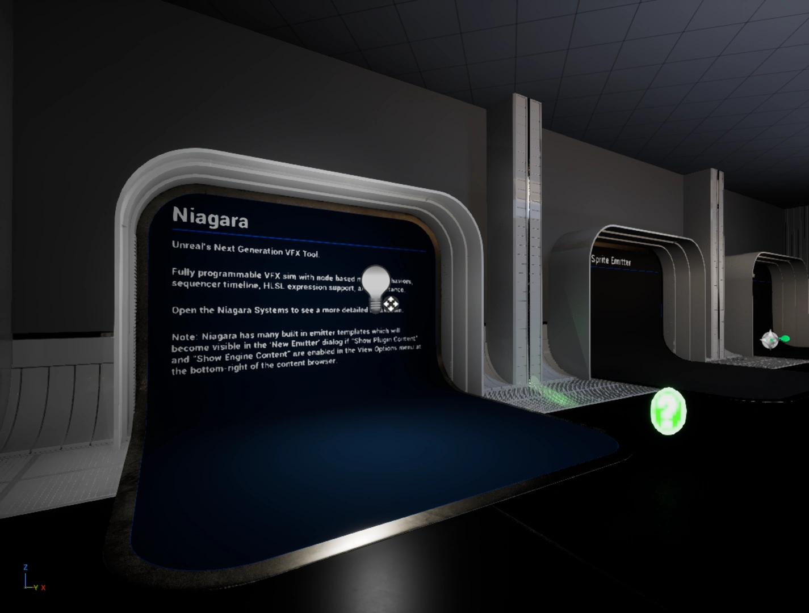
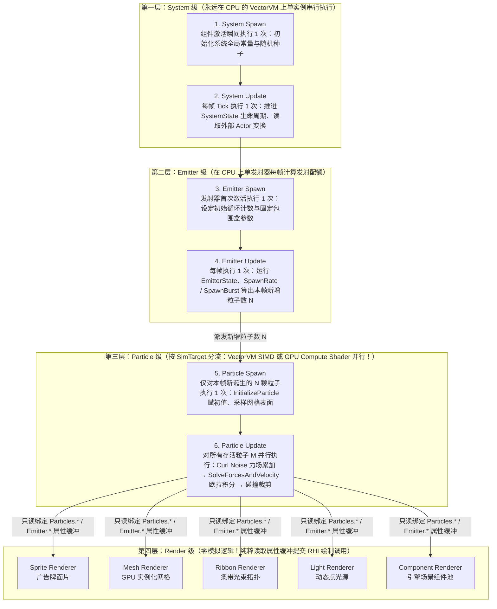
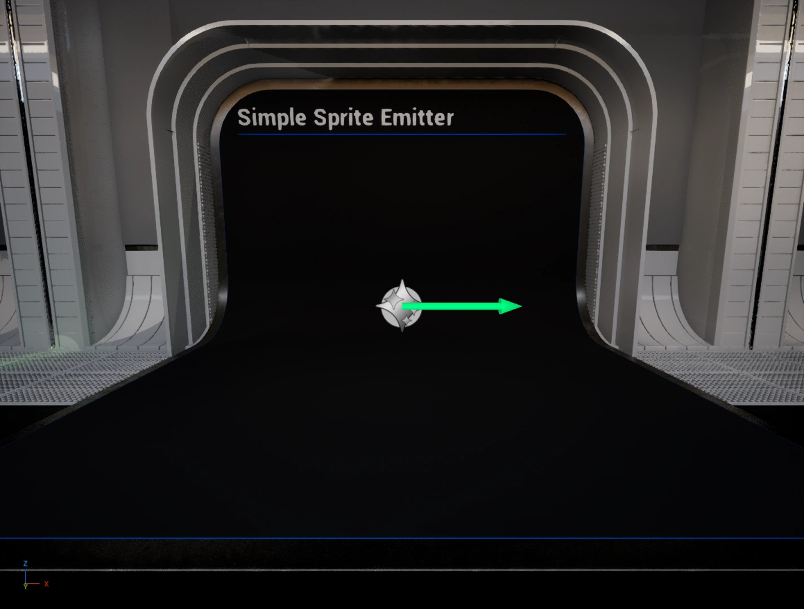
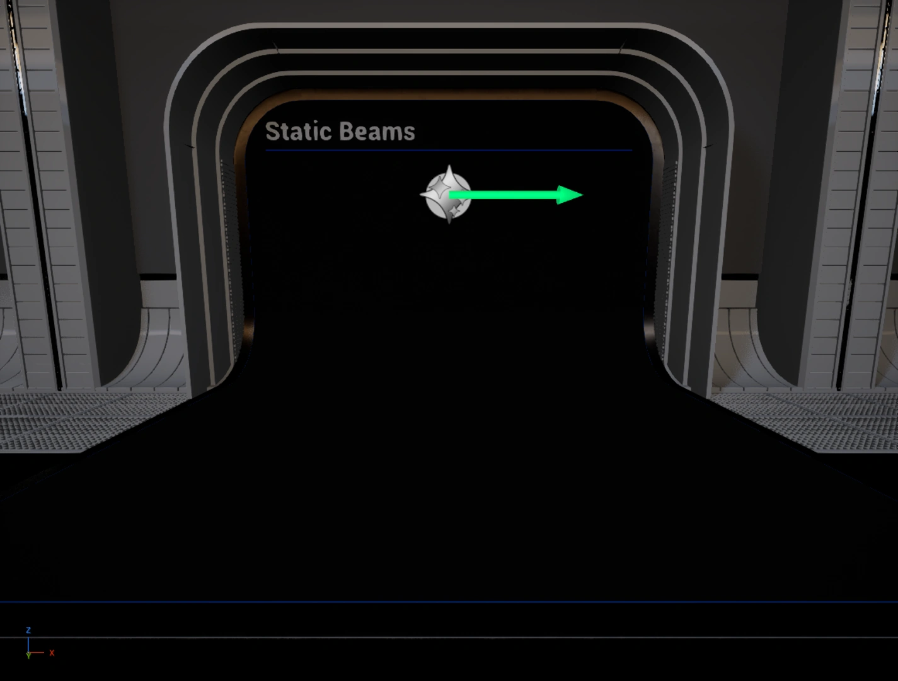
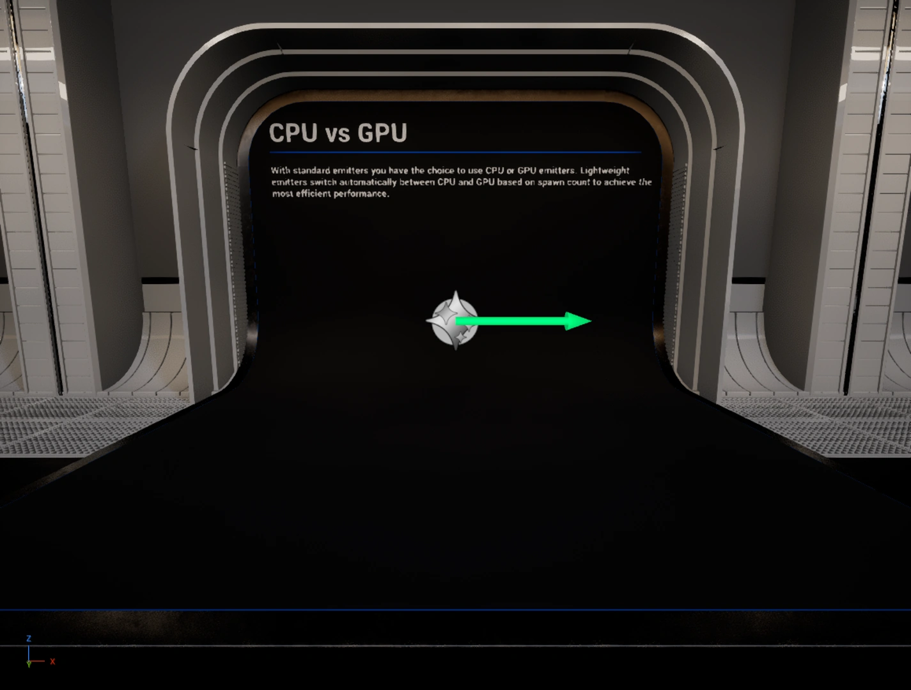
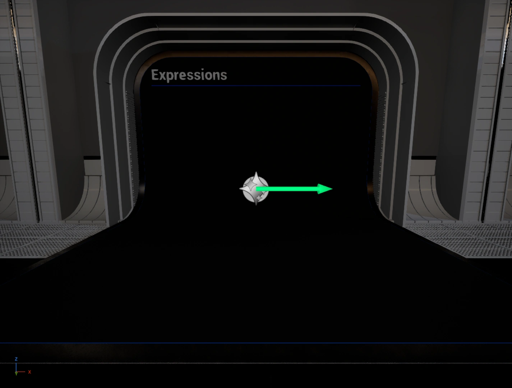
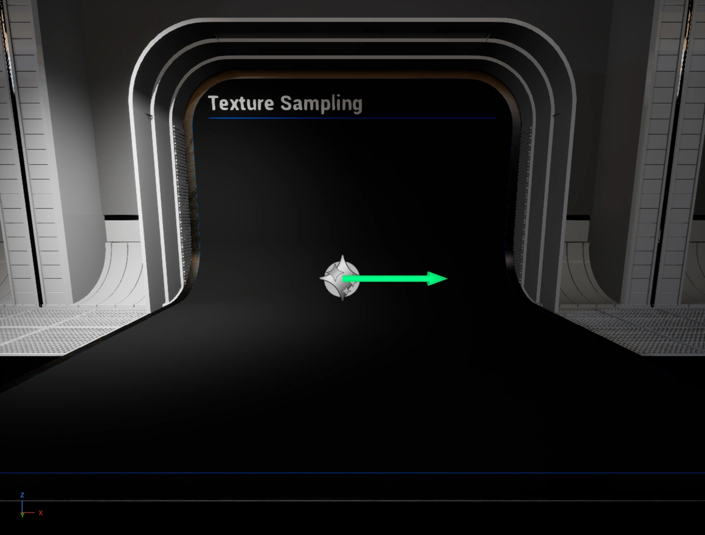

# 01 · 内置粒子基础、五大渲染器、无状态轻量发射器、碰撞力场、光束丝带与事件全解（`Niagara_Particles`）

> **本篇实测拆解关卡档案**
> - **关卡路径**：`/Game/Maps/VFX/Niagara_Particles`（关卡总 Actor 数：`92` | 展台数：**`26`** | 示例 Actor 数：`45`）
> - **关卡脚本类**：`/Game/Maps/VFX/Niagara_Particles.Niagara_Particles_C`
> - **核心资产目录**：`/Game/ExampleContent/Niagara/`（涵盖 `Simple/`、`Meshes/`、`Beams/`、`Lightweight/`、`Events/`、`Expressions/`、`Collision/`、`Renderers/`、`Textures/`、`Audio/` 十大子目录共 28 套内置 `NiagaraSystem`）
> - **导读边界说明**：本目录（`11_VFX_内置Niagara与流体实验室`）完整拆解的是 Content Examples 自带的 `/Game/Maps/VFX/` 四大算法实验室（共 **73 座展牌 / 62+ 项核心特效实验**，本篇聚焦第一馆 `Niagara_Particles` 的全部 **26 座展台**），与第二卷面向实战射击靶场的独立包 `NiagaraExamples` 互为表里——第二卷讲“武器爆炸工业组装”，而本卷这四张实验室地图直击 **Niagara 虚拟机/GPU 计算着色器底层架构与物理仿真第一性原理**！

---

## 一、 为什么说 Niagara 不是“升级版 Cascade”，而是一台可视化数据流超算？

许多从 UE3/UE4 早期转过来的特效师，初见 Niagara 时常觉得它“比 Cascade 啰嗦”：以前勾一个复选框就能改初始速度，为什么在 Niagara 里要理解命名空间（Namespaces）、执行阶段（Execution Stack）、动态输入（Dynamic Inputs）乃至数据接口（Data Interfaces）？

答案藏在一句底层架构格言里：**Cascade 是“写死在 C++ 里的黑盒菜单”，而 Niagara 是“把粒子属性表直接交给美术自由编程的 SIMD / Compute Shader 编译器”**。

在走进长达 **275 米**（`X` 坐标从 `498` 延伸至 `27536`）的 `Niagara_Particles` 展厅之前，我们必须先打通支撑整个 Niagara 帝国的三大根基：**四层六阶段执行栈**、**参数命名空间矩阵**与**五大解耦渲染器**。

### 1.1 Niagara 四层执行栈（Execution Stack）在 CPU 与 GPU 上到底怎么跑？

打开任意一个标准 Niagara 发射器，你会看到从上到下严格排列的四层架构（共六大脚本阶段 + 渲染阶段）。它们绝非UI分类装饰，而是对应着截然不同的**调度频率**与**硬件执行单元**：

理解这张图，你就瞬间顿悟了三个令无数人困惑的工程现象：
1. **为什么 GPU 发射器的 `Spawn Rate` 依然在 CPU 上算？** 因为 GPU 擅长对已知长度的数组并行跑核函数（`DispatchComputeShader`），在标准管线中，CPU 必须先跑完 `Emitter Update` 算出本帧要生多少颗新粒子，才能向 GPU 申请对应槽位并派发线程组（`ThreadGroupCount = ceil(TotalParticles / 64)`）！
2. **CPU 模拟（`CPUSim`）与 GPU 计算模拟（`GPUComputeSim`）的本质分水岭在哪？**
   - **`CPUSim`** 将粒子属性按 **SoA（Structure of Arrays，数组结构体）** 排布在系统内存中，由虚幻自研的 **VectorVM** 利用 SSE/AVX/NEON 寄存器每次 4~8 颗粒子打包执行。优势是能直接调用物理引擎的精确射线检测（Ray Trace）、派发跨发射器 `Location Events`、触发音频播放（展台 `#24`）或挂载 `Component Renderer`；适合 **几十到上千颗** 需要强游戏交互的粒子。
   - **`GPUComputeSim`** 则将整个 `Particle Spawn + Particle Update` 堆栈直接交叉编译成一段原生 **HLSL Compute Shader**，所有 `Particles.*` 属性常驻显存 `RWByteAddressBuffer / RWBuffer`。没有 CPU-GPU PCIe 拷贝延迟，轻松吞吐 **十万乃至百万级粒子**，但因为 GPU 无法直接访问 CPU 端的 Chaos 物理场景树，它的碰撞必须改走 **屏幕空间深度缓冲（Scene Depth）** 或 **有向距离场（Mesh / Global SDF）**！
3. **五大渲染器（Sprite / Mesh / Ribbon / Light / Component）为何能“一鱼多吃”？**
   在 Niagara 中，**粒子本身看不见摸不着，它只是属性表里的一行浮点数（Row of Floats）**！渲染器（Renderer）只是挂载在末尾的“数据翻译官”：只要缓冲里有 `Particles.Position` 和 `Particles.Color`，你可以同时挂上 `SpriteRenderer` 画光晕、`MeshRenderer` 画碎石、`RibbonRenderer` 拉尾迹、`LightRenderer` 照亮地板——**一次物理积分，多路渲染复用（展台 `#9`）**，甚至连一颗粒子都不生成，直接拿 `Emitter.*` 变量去画单张广告牌（展台 `#25`）！

### 1.2 参数命名空间（Parameter Namespaces）生命周期速查表

在后续拆解 MCP 提取的资产摘要时，你会频繁看到带点号前缀的变量名，它们遵循严格的读写权限契约：

| 命名空间前缀 | 存储粒度与内存驻留 | 允许写入阶段 | 典型代表与工程意义 |
| :--- | :--- | :--- | :--- |
| **`Engine.*`** | 引擎级只读常量 | 引擎底层 C++ | `Engine.DeltaTime`、`Engine.Owner.SystemLocalToWorld`，零存储开销。 |
| **`User.*`** | 组件实例级公开参数 | 外部蓝图 / Sequencer / 细节面板 | 如展台 `#13` 的 `User.Burst Amount`、展台 `#19` 的 `User.StaticMeshSampler`。 |
| **`System.*`** | 全系统共享 1 份持久状态 | `System Spawn / Update` | `System.Age`、`System.LoopCount`，跨所有发射器共享。 |
| **`Emitter.*`** | 单发射器共享 1 份持久状态 | `Emitter Spawn / Update` | `Emitter.SpawnRate`、`Emitter.Age`。 |
| **`Particles.*`** | **每颗存活粒子各占 1 份显存/内存** | `Particle Spawn / Update` | `Particles.Position`、`Particles.Velocity`、`Particles.NormalizedAge`（每多加一个 `Vector4`，10 万粒子每帧双缓冲就多吃 `3.2 MB` 带宽！）。 |
| **`Transient.*`** | **仅限当前单帧单阶段栈内寄存器** | 任意阶段内部模块间传递 | 如 `Transient.PhysicsForce`——模块往里累加推力，`SolveForcesAndVelocity` 消费完即刻丢弃，**绝不占用跨帧持久显存**！ |

---

## 二、 第一乐章：粒子原语、朝向矩阵、光束拓扑与多渲染器复用（展台 #1 ~ #9）

### 展台 #1：`Niagara` — 次世代可编程 VFX 实验室总序厅

- **空间元数据**：展牌 Label `BP_DemoDisplay` | 坐标 `(498, -890, 0)`
- **官方展牌原文**：
  > *"Unreal's Next Generation VFX Tool. Fully programmable VFX sim with node based modular behaviors, sequencer timeline, HLSL expression support, and inheritance. Open the Niagara Systems to see a more detailed breakdown. Note: Niagara has many built in emitter templates which will become visible in the 'New Emitter' dialog if 'Show Plugin Content' and 'Show Engine Content' are enabled in the View Options menu at the bottom-right of the content browser."*

#### 1.1 核心提示与展台环境 Actor 拆解（共 3 个）
官方展牌在入口处给出了极其关键的编辑器实操提醒：Niagara 所有的官方模块源码（如 `/Niagara/Modules/`、`/Niagara/DynamicInputs/`）本质上都是白盒资产！只要在内容浏览器右下角 `Settings` 中勾选 **`Show Engine Content`** 与 **`Show Plugin Content`**，你就能双击点进任何一个内置模块查看甚至复制修改它的节点图。
- **`PointLight`**（`/Script/Engine.PointLight`）：`Intensity = 6`，衰减半径 `512`，`CastShadows = false`，`Mobility = Movable`，照亮首座导览牌。
- **`Actor`**（挂载 `ChaosDebugDrawComponent_0`）与 **`1.1 Actor Replication Doc Actor`**（`DocumentationActor`）：展厅通用调试与文档锚点。

---

### 展台 #2：`Simple Sprite Emitter` — 广告牌粒子生命周期与动态输入初探

- **空间元数据**：展牌 Label `BP_DemoDisplay1` | 坐标 `(1500, -900, 0)`

#### 2.1 MCP 实测资产深拆：`Simple_system`
- **陈列 Actor**：`Simple_system`（`NiagaraActor` $\to$ `/Game/ExampleContent/Niagara/Simple/Simple_system`）
- **系统拓扑摘要（`GetSystemSummary`）**：
  - **发射器列表**：单发射器 `Simple_Emitter`（`bEnabled = True`，**`simTarget = CPUSim`**）
  - **挂载渲染器**：`NiagaraSpriteRendererProperties`（采用引擎默认径向渐变软圆材质 `/Niagara/DefaultAssets/DefaultSpriteMaterial`）
  - **核心依赖链**：`ScaleColor`（`/Niagara/Modules/Update/Color/ScaleColor`）+ **`FloatFromCurve`**（`/Niagara/DynamicInputs/ValueFromCurve/FloatFromCurve`）

#### 2.2 技术精讲：什么是动态输入（Dynamic Inputs）？
观察 `Simple_system` 的依赖链：为什么缩放透明度没有专门写一个叫 `ScaleAlphaByCurve` 的死模块，而是由 `ScaleColor` 模块挂载了一个 **`FloatFromCurve`** 动态输入？
这就是 Niagara 模块化设计的灵魂——**组合优于继承（Composition over Inheritance）**！在 `Particle Update` 中：
1. `ParticleState` 模块每帧推进粒子年龄：`Particles.Age += Engine.DeltaTime`，并算出归一化年龄：
   $$\text{NormalizedAge} = \frac{\text{Particles.Age}}{\text{Particles.Lifetime}} \in [0, 1]$$
2. `ScaleColor` 模块的 `Scale Alpha` 引脚插入动态输入 `FloatFromCurve`，默认以 `Particles.NormalizedAge` 为横坐标 $U$ 采样淡入淡出曲线（`0 → 1 → 0`）。你随时可以把这个引脚替换成随机数、正弦波、相机距离甚至粒子速度模长，而无需改动 `ScaleColor` 本身半行代码！

---

### 展台 #3：`Simple Mesh Emitter` — 三维网格体硬件实例化与旋转模式

- **空间元数据**：展牌 Label `BP_DemoDisplay2` | 坐标 `(2510, -900, 0)`

#### 3.1 MCP 实测资产深拆：`MeshRotation_System`
- **陈列 Actor**：`MeshRotation_System`（`/Game/ExampleContent/Niagara/Meshes/MeshRotation_System`）
- **系统拓扑摘要**：
  - **发射器**：`MeshRotation_Emitter`（`simTarget = CPUSim`）
  - **挂载渲染器**：**`NiagaraMeshRendererProperties`**
  - **关键依赖枚举**：`/Niagara/Enums/Transforms/ENiagara_RotationMode`、`/Niagara/Enums/Angles/ENiagara_AngleInput`、`FloatFromCurve`

#### 3.2 技术精讲：四元数姿态 `Particles.MeshOrientation` 与硬件 Instancing
当渲染器从 `Sprite` 换成 `MeshRenderer` 时，每颗粒子不再是永远朝向相机的 2D 纸片，而是真正的 3D 静态网格体。
- **四元数无万向节死锁存储**：Niagara 在底层不使用欧拉角存储三维网格朝向，而是维护一个单位四元数 **`Particles.MeshOrientation`（`Quat4f`）**。即使你在面板上通过 `ENiagara_RotationMode` 选择了易读的 `Yaw / Pitch / Roll` 或 `Axis-Angle`（轴角）输入，模块内部也会立即将其转换为四元数乘法更新，彻底杜绝高速翻滚碎石出现万向节锁（Gimbal Lock）抽搐。
- **合批铁律**：哪怕发射器里有 500 颗旋转角度、缩放大小、顶点颜色各异的网格粒子，只要它们共用同一个网格体与材质，引擎底层都会通过 **GPU Hardware Instancing（`DrawIndexedInstanced`）** 在 **1 个 Draw Call** 内一次性画完，粒子变换矩阵通过 Structured Buffer 按 `SV_InstanceID` 直接在顶点着色器里拉取！

---

### 展台 #4：`Simple GPU Emitter` — 迈入 Compute Shader 并行模拟与固定包围盒铁律

- **空间元数据**：展牌 Label `BP_DemoDisplay5` | 坐标 `(4010, -900, 0)`

#### 4.1 MCP 实测资产深拆：`Simple_GPU_System`
- **陈列 Actor**：`Simple_GPU_Emitter_System`（`/Game/ExampleContent/Niagara/Simple/Simple_GPU_System`）
- **系统拓扑摘要**：
  - **发射器**：`Simple_GPU_Emitter`（**`simTarget = GPUComputeSim`**）
  - **挂载渲染器**：`NiagaraSpriteRendererProperties`（`DefaultSpriteMaterial`）
  - **几何分布依赖**：`ENiagaraShapeTorusMode`、`ENiagaraTorusDistributionMode`、`ENiagaraSphereDistributionMode`（圆环与球体表面均匀随机采样）

#### 4.2 致命避坑指南：为什么切到 `GPUComputeSim` 时必须设 `Fixed Bounds`（固定包围盒）？
新手将发射器从 `CPUSim` 切为 `GPUComputeSim` 时，编辑器会立刻弹出黄色警告要求勾选 **`Fixed Bounds`**。如果忽视它，游戏里只要稍微转一下视角，满屏特效就会突然整片消失闪烁！为什么？
- **渲染管线时序死结**：虚幻引擎的 **视锥剔除（Frustum Culling）与遮挡剔除（Occlusion Culling）发生在 CPU 渲染线程前端**；而 GPU 粒子的最新坐标 `Particles.Position` 此刻还躺在显卡显存里等待 Compute Shader 解算！
- 如果 CPU 想每帧知道 GPU 粒子飞到了多远而强行从显存回读（Readback）包围盒极值，就会引发灾难性的 **CPU-GPU 管线停顿（Pipeline Stall）**，帧率腰斩！
- **工程铁律**：所有包含 `GPUComputeSim` 的发射器或系统，**必须估算粒子最大运动半径并在 System/Emitter 属性中手动设定紧致的 `Fixed Bounds`**（既不能太小导致转头被误剔除，也绝不能偷懒填 `1000000` 导致全图永不剔除白跑 Compute Shader！）。

---

### 展台 #5：`Sprite Facing` — 广告牌朝向（Facing）与对齐（Alignment）正交法则

- **空间元数据**：展牌 Label `BP_DemoDisplay10` | 坐标 `(5001, -900, 0)`

#### 5.1 MCP 实测资产深拆：`SpriteFacing_System`
- **陈列 Actor**：`SpriteFacing_System`（`/Game/ExampleContent/Niagara/Simple/SpriteFacing_System`）
- **系统拓扑摘要**：单发射器 `SpriteFacing`（`CPUSim`，`NiagaraSpriteRendererProperties`）

#### 5.2 空间几何直觉：两根向量才能锁死一张 2D 面片的三维姿态！
在三维空间里放一张矩形卡片，光规定“正面朝哪”（法向量 $\mathbf{N}$，即 **Facing Mode**）是不够的，卡片还可以绕着 $\mathbf{N}$ 自转！还必须规定“卡片的顶边朝哪”（上向量 $\mathbf{U}$，即 **Alignment**）。Niagara 将这两者彻底正交拆开：

| 配置维度 | 核心枚举选项 | 顶点着色器构造基底原理与典型实战场景 |
| :--- | :--- | :--- |
| **Alignment（面片上轴向对齐）** | `Unaligned`（默认） | 跟随相机屏幕上方向旋转，适合烟雾团、柔和光斑。 |
| | **`Velocity Aligned`** | 面片纵轴强行对齐粒子瞬时速度方向 $\hat{\mathbf{v}} = \mathbf{v}/|\mathbf{v}|$！**制作暴雨丝、飞溅火花、激光弹道的必选模式**（配合按速率拉伸长宽比产生天然运动模糊！）。 |
| | `Custom Alignment` | 对齐粒子专属向量 `Particles.SpriteAlignment`（如永远垂直地面向上 `(0,0,1)`，制作立在草地上的远景十字树牌或篝火苗）。 |
| **Facing Mode（面片法线朝向）** | `Face Camera` | 法线平行于相机视线平面法线（防边缘广角透视拉伸变形，烟雾首选）。 |
| | `Face Camera Position` | 法线严格指向相机镜头中心坐标 $\mathbf{P}_{\text{cam}} - \mathbf{P}_{\text{particle}}$。 |
| | **`Custom Facing Vector`** | 无视相机位置，法线锁死为 `Particles.SpriteFacing`！例如设为 `(0,0,1)` 朝天平躺，**零网格开销制作贴地旋转魔法阵、地面水波涟漪圈**！ |

---

### 展台 #6：`Blend Attributes by Value` — 基于驱动标量的多状态平滑插值

- **空间元数据**：展牌 Label `BP_DemoDisplay3` | 坐标 `(5991, -900, 0)`

#### 6.1 MCP 实测资产深拆：`Blend_Attributes_System`
- **陈列 Actor**：`Blend_Attributes_System`（`/Game/ExampleContent/Niagara/Simple/Blend_Attributes_System`）
- **系统拓扑摘要**：`Blend_Attributes`（`CPUSim`，`NiagaraSpriteRendererProperties`）
- **核心机制**：在特效设计中，我们经常希望粒子在“低速时呈冷蓝色小圆点，高速时平滑过渡为炽热橙色长条”。使用 `Lerp` / `Blend Attributes by Value` 动态输入，只需将任意归一化驱动因子 $\alpha \in [0, 1]$（如重映射后的速度模长、高度或受击强度）接入混合权重，即可在两套完备的目标属性之间执行分支无关的硬件 `lerp(A, B, saturate(Alpha))` 插值。

---

### 展台 #7：`Static Beams` — 静态能量光束的两端锚定与丝带细分渲染

- **空间元数据**：展牌 Label `BP_DemoDisplay6` | 坐标 `(7000, -900, 0)`

#### 7.1 MCP 实测资产深拆：`StaticBeam_System`
- **陈列 Actor**：`StaticBeam_System`（`/Game/ExampleContent/Niagara/Beams/StaticBeam_System`）
- **系统拓扑摘要**：
  - **发射器**：`StaticBeam_Emitter`（`CPUSim`）
  - **双渲染器协同**：同时挂载了 **`NiagaraSpriteRendererProperties`**（`DefaultSpriteMaterial`）与 **`NiagaraRibbonRendererProperties`**（`DefaultRIbbonMaterial`）！

#### 7.2 技术精讲：Niagara 是如何用“一串粒子”画出一道激光束的？
Cascade 时代有专门写死的 Beam 类型发射器，而在 Niagara 中，**光束（Beam）本质上就是按 `RibbonLinkOrder` 严格排队的丝带（Ribbon）**！
1. **`Beam Emitter Setup`（发射器级）**：在 `Emitter` 层定义光束起点 `BeamStart` 与终点 `BeamEnd`（可设为绝对世界坐标或绑定外部枪口/靶点 Socket）。
2. **`Spawn Beam`（发射配额级）**：不同于普通烟雾按每秒发射率持续吐粒子，静态光束一次性批量生成固定数量（如 `Tessellation = 16` 颗）的控制点粒子，并为每颗粒子赋予从 `0.0` 到 `1.0` 均匀递增的归一化位置权重 **`Particles.RibbonLinkOrder`**。
3. **`Update Beam` + 双渲染器精妙配合**：每颗粒子按 $\mathbf{P}(u) = \text{lerp}(\mathbf{P}_{\text{start}}, \mathbf{P}_{\text{end}}, u)$ 定位，`RibbonRenderer` 将这串粒子连成连续光滑的发光灯带；而同发射器上并排挂载的 `SpriteRenderer` 则直接在每个分段节点处叠加上耀眼的光斑辉光（见上方实拍图），一份粒子数据同时撑起光芯与节点光晕！

---

### 展台 #8：`Dynamic Beams` — 动态电弧、贝塞尔切线扭曲与螺旋盘绕光束

- **空间元数据**：展牌 Label `BP_DemoDisplay7` | 坐标 `(8000, -900, 0)`

#### 8.1 MCP 实测资产深拆：`DynamicBeam_System`
- **陈列 Actor**：`DynamicBeam_System`（`/Game/ExampleContent/Niagara/Beams/DynamicBeam_System`）
- **系统拓扑摘要**：`DynamicBeam_Spiral`（`CPUSim`，纯 `NiagaraRibbonRendererProperties`）
- **核心算法拆解**：静态直线激光未免呆板，而捉鬼敢死队式的质子光束、闪电链与螺旋能量束，正是在 `StaticBeam` 的线性骨架 $\mathbf{P}_{\text{base}}(u)$（或三次埃尔米特/贝塞尔曲线插值）之上，沿垂直于光束轴向的正交副法线平面 $(\hat{\mathbf{T}}, \hat{\mathbf{B}})$ 叠加随时间滚动的三角螺旋或噪波位移：
  $$\mathbf{P}(u, t) = \mathbf{P}_{\text{base}}(u) + R(u) \Big[ \cos(\omega u - \phi t)\hat{\mathbf{N}} + \sin(\omega u - \phi t)\hat{\mathbf{B}} \Big]$$
  只要将两端衰减包络函数设为 $R(u) = 4u(1 - u)$（或采样曲线 `0 → 1 → 0`），就能保证无论光束中段如何狂野扭动，**起点与终点永远严丝合缝地钉死在角色手掌与受击目标上绝不脱靶**！

---

### 展台 #9：`Multiple Renderers` — 单份模拟驱动 Sprite + Mesh + Ribbon 三重表现

- **空间元数据**：展牌 Label `BP_DemoDisplay8` | 坐标 `(9000, -900, 0)`

#### 9.1 MCP 实测资产深拆：`MultipleRenderers_System` 与关卡序列锚点
- **陈列 Actor（共 2 个）**：
  1. **`MultipleRenderers_System`**（`/Game/ExampleContent/Niagara/Simple/MultipleRenderers_System`）：单发射器 `MultipleRenderers`（`CPUSim`），底部同时挂载了 **三大渲染器**：
     - `NiagaraSpriteRendererProperties`（粒子周围的光晕柔片）
     - `NiagaraMeshRendererProperties`（粒子核心的实体小几何块）
     - `NiagaraRibbonRendererProperties`（将运动轨迹串接起来的拖尾丝带）
  2. **`LS_RotatingCubes`**（`LevelSequenceActor` $\to$ `/Game/ExampleContent/Niagara/Lightweight/RotatingActors/LS_RotatingCubes`）：实测帧率 `30 fps`，帧区间 `[0, 59]` 循环播放，通过 3 条 `MovieScene3DTransformTrack` 持续驱动后方展台 `#15` 的三组旋转方块枢轴（`RotatingCube1/2/3Pivot`）做圆周运动。

#### 9.2 架构启示：为什么“单发射器多渲染器”比“复制三个发射器”快得多？
假设你要做一个“流星拖着尾焰并自带火球内核与外层辉光”的效果：
- **外行做法**：复制 3 个发射器分别画 Mesh、Sprite、Ribbon。不仅要跑 **3 遍一模一样的重力、风阻与碰撞模拟**，更致命的是——一旦加了随机噪声或碰撞反弹，3 个发射器的随机数流一旦稍微错位，**拖尾丝带就会跟火球本体分家脱节**！
- **Niagara 正统做法（本展台范式）**：只保留 **1 个发射器** 算物理轨迹，底下并排挂 3 个 Renderer 绑定同一套 `Particles.Position`！模拟开销立省 **66%**，且尾迹、内核与光晕在亚像素级绝对同步！

---

## 三、 第二乐章：UE5 性能杀手锏——无状态轻量发射器（Lightweight / Stateless Emitters，展台 #10 ~ #15）

从坐标 `X = 10500` 到 `X = 15503`，官方开辟了一整段 **6 连展台专区**，专门剖析虚幻引擎 5 引入的革命性架构——**Lightweight Emitters（轻量级无状态发射器，底层类 `UNiagaraStatelessEmitter`）**！

> [!IMPORTANT]
> **MCP 拓扑摘要的独特信号**：仔细看实测档案第 `#10 ~ #15` 号展台的 `GetSystemSummary` JSON——你会发现它们的 `rendererClasses` 在常规有状态发射器槽位上全部返回空数组 `[]`！这是因为 `Lightweight` 发射器彻底绕过了传统的 `UNiagaraScript` 节点图与 VectorVM 虚拟机字节码，改用固化在引擎 C++ 中的 **闭式解析函数（Closed-Form Analytical Evaluation）** 直接驱动渲染！

---

### 展台 #10：`Simple Lightweight Emitter` — 零编译、零历史状态的解析式粒子

- **空间元数据**：展牌 Label `BP_DemoDisplay20` | 坐标 `(10500, -896, 0)`
- **官方展牌原文**：
  > *"Lightweight emitters are faster, use less memory and require no compilation time. To achieve this Lightweight emitters have a much smaller set of tools to build your effect with. The tools available have been picked because they are the most frequently used and are considered 'stateless' ie: they can be evaluated at any time without run-up. Lightweight emitters are the equivalent of a swiss army knife. They're compact, efficient, but lacking in certain areas. If you are building a self contained, frequently spawned effect, Lightweight emitters can offer the most efficient path forward."*
- **陈列资产**：`NS_Simple_System_Lightweight` $\to$ `/Game/ExampleContent/Niagara/Lightweight/NS_Simple_Lightweight`（发射器 `SimpleEmitter`）。

#### 10.1 核心数学本质：“有状态欧拉积分” vs “无状态闭式解析解”
为什么传统发射器慢、占内存，而且在 Sequencer 里拖动时间轴还要“预热（Warm-up / Run-up）”？
- **传统有状态发射器（Stateful）** 算的是增量微分方程：$\mathbf{P}(t + \Delta t) = \mathbf{P}(t) + \mathbf{V}(t)\Delta t$。如果你不存上一帧的 $\mathbf{P}(t)$ 和 $\mathbf{V}(t)$，你就根本不知道这一帧粒子在哪！每颗粒子必须常驻几十字节显存/内存每帧读写。
- **轻量无状态发射器（Stateless / Lightweight）** 直接用高中物理的**时间解析公式**一步到位！只要知道当前系统时间 $t$、粒子的诞生时刻 $t_0$ 与唯一随机种子 $\text{Seed}_i$，任意时刻 $\tau = t - t_0$ 的精确位置直接算出来：
  $$\mathbf{P}_i(\tau) = \mathbf{P}_0(\text{Seed}_i) + \mathbf{V}_0(\text{Seed}_i)\cdot \tau + \frac{1}{2}\mathbf{g}\cdot \tau^2 + \mathbf{F}_{\text{noise}}(\tau, \text{Seed}_i)$$
  **震撼推论**：
  1. **零持久粒子缓冲（Zero State Buffer）**：不需要跨帧读写 `Particles.Position`！
  2. **零 Shader 编译时间（Zero Compilation）**：修改任何模块瞬间生效，绝不触发后台漫长的 Niagara Shader 编译队列！
  3. **任意时刻随机跳转（Instant Scrubbing）**：在过场动画 Sequencer 里把时间轴直接拖到第 50 秒，无需任何前序帧预跑，第 50 秒的粒子形态毫秒级精准呈现！

---

### 展台 #11：`Lightweight Renderers` — 轻量发射器的三大渲染器全覆盖

- **空间元数据**：展牌 Label `BP_DemoDisplay21` | 坐标 `(11504, -896, 0)`
- **官方展牌原文**：*"Where possible, Lightweight emitter mimic the behavior of standard emitters. Lightweight emitters currently support Sprite, Mesh and Ribbon renderers."*
- **陈列资产深拆**：`NS_MeshRotation_System_Lightweight` $\to$ `/Game/ExampleContent/Niagara/Lightweight/NS_Renderers_Lightweight`
  - 内含 3 个并行的轻量发射器：
    1. **`MeshRotation`**：实例化渲染引擎自带三维坐标轴小雕像 `/Niagara/DefaultAssets/S_Gnomon`；
    2. **`SimpleRibbon`**：使用 `/Niagara/DefaultAssets/DefaultRIbbonMaterial` 绘制无状态解析丝带；
    3. **`SimpleSprite`**：使用 `/Game/ExampleContent/Niagara/Lightweight/Materials/M_UE_Logo` 绘制虚幻标志广告牌。

---

### 展台 #12：`CPU vs GPU` — 基于粒子数阈值的 CPU/GPU 全自动无缝切换与旋度噪声场

- **空间元数据**：展牌 Label `BP_DemoDisplay24` | 坐标 `(12503, -896, 0)`
- **官方展牌原文**：*"With standard emitters you have the choice to use CPU or GPU emitters. Lightweight emitters switch automatically between CPU and GPU based on spawn count to achieve the most efficient performance."*

#### 12.1 MCP 实测资产深拆：`NS_SpawnCountVary_Lightweight`
- **陈列资产**：`/Game/ExampleContent/Niagara/Lightweight/NS_SpawnCountVary_Lightweight`
- **发射器对比**：`LowCount`（少量稀疏粒子） vs `HighCount`（高密度粒子团）
- **核心依赖资产**：三维平铺旋度向量场 **`/Niagara/VectorFields/Assets/TilingCurl32`** + 体积坐标可视化材质 `/Game/ExampleContent/Niagara/Lightweight/Materials/M_UVW`

#### 12.2 两大硬核知识点：自适应硬件分流 + 无散度旋度噪声（Curl Noise）
1. **为什么少量粒子在 GPU 上跑反而不划算？**
   每次向 GPU 提交一个 Compute Shader Dispatch 都有固定的驱动层命令开销（约几微秒），且 1 个 GPU Wavefront / Warp 至少捆绑 32 或 64 个线程。如果一个弹壳火花只有 **5 颗粒子**，派发给 GPU 不仅浪费了 90% 的线程槽位，调度开销甚至超过了 CPU 直接算完这 5 颗粒子的时间！而当粒子涨到 **2000 颗** 时，GPU 的并行吞吐优势才彻底碾压 CPU。`Lightweight` 发射器因为采用统一的解析式求值模型，引擎底层能够**根据当前存活粒子数动态在 CPU 与 GPU 管线间自动无缝切换**！
2. **什么是 `TilingCurl32` 背后的 Curl Noise（无散度旋度噪声）？**
   如果直接拿普通三维 Perlin/Simplex 噪声当风力吹粒子，粒子很快就会聚集卡死在噪声的势能低谷点（因为普通向量场散度 $\nabla \cdot \mathbf{F} \neq 0$，存在源与汇）。
   1997 年至 2007 年 Bridson 等人引入图形学的 **Curl Noise（旋度噪声）** 运用了一条绝妙的矢量微积分恒等式——**任意光滑矢量势场 $\boldsymbol{\Psi} = (\Psi_x, \Psi_y, \Psi_z)$ 的旋度（Curl），其散度恒等于零**！
   $$\mathbf{v}_{\text{curl}} = \nabla \times \boldsymbol{\Psi} = \left( \frac{\partial \Psi_z}{\partial y} - \frac{\partial \Psi_y}{\partial z},\; \frac{\partial \Psi_x}{\partial z} - \frac{\partial \Psi_z}{\partial x},\; \frac{\partial \Psi_y}{\partial x} - \frac{\partial \Psi_x}{\partial y} \right) \implies \nabla \cdot \mathbf{v}_{\text{curl}} \equiv 0$$
   因为处处无散度（$\nabla \cdot \mathbf{v} = 0$），粒子在 `TilingCurl32`（预烘焙的 $32^3$ 周期平铺旋度体纹理）中穿梭时，既能呈现出逼真流体般的丝滑涡旋湍流，又永远不会无故聚成死疙瘩或炸出空洞！

---

### 展台 #13：`User and System Bindings` — 轻量发射器的外部参数绑定

- **空间元数据**：展牌 Label `BP_DemoDisplay22` | 坐标 `(13503, -896, 0)`
- **官方展牌原文**：*"Some of the particle attributes can be controlled via bindings to User or System parameters. Sprite Size and Burst Amount are controlled via User parameters on this system."*
- **MCP 实测资产与用户变量深拆**：`NS_Bindings1_Lightweight`（`/Game/ExampleContent/Niagara/Lightweight/NS_Bindings1_Lightweight`）
  - **`User.Burst Amount`**（`NiagaraInt32`）：默认值 `10`，直接控制单次爆发生成的粒子数量；
  - **`User.Sprite Size`**（`Vector2f`）：默认值 `(25, 25)`，外部蓝图或关卡实例可直接覆写粒子尺寸，验证了无状态架构依然保留灵活的运行时参数化能力。

---

### 展台 #14：`Bindings are Instantaneous` — 无状态绑定的“全员瞬时突变”铁律与避坑

- **空间元数据**：展牌 Label `BP_DemoDisplay23` | 坐标 `(14503, -896, 0)`
- **官方展牌原文**：
  > *"Lightweight particles have a limited ability to store a state. The notion of Spawn vs Update does not apply with Lightweight emitters. When using bindings, be aware that any change made will happen to all particles instantaneously. In this example a system binding is being used by the Initialize Particle module. However, the color updated on every frame, not when the particle seems to be spawned."*
- **MCP 实测资产深拆**：`NS_Bindings2_Lightweight`（包含 `User.Burst Amount = 10`、`User.Sprite Size = (25, 25)`，并在系统栈通过 `RandomRangeLinearColor` 动态刷新绑定颜色）。

#### 14.1 为什么改了 `Initialize Particle` 的颜色，连半秒前已经飞在空中的老粒子也跟着一起变色了？！
这是使用 `Lightweight` 发射器时**最容易踩坑的第一大陷阱**！
- 在传统有状态发射器里，`Initialize Particle` 只在粒子出生那 1 帧写进 `Particles.Color` 缓冲；之后哪怕你把 `User.SpawnColor` 从红色改成绿色，半空中已经出生的老粒子依然是红色，只有新出生的粒子才是绿色。
- 但在 `Lightweight` 发射器里，**根本没有持久缓冲区存每颗粒子的初始颜色**！每帧渲染时，Shader 都是拿**当前这一帧最新的绑定参数值**代入公式现场重算所有存活粒子！因此一旦绑定变量在运行时随帧跳变，全屏幕新老粒子会在同一帧齐刷刷变色！**工程准则：需要保留“出生瞬间历史快照（如移动枪口拖尾的世界残留）”时，请用标准发射器或开启专用快照通道；自包含短生命周期爆发（弹孔碎屑、拾取闪光）则大胆上 Lightweight！**

---

### 展台 #15：`Fast, Faster, Fastest` — 榨干最后一微秒 CPU 开销的三级阶梯

- **空间元数据**：展牌 Label `BP_DemoDisplay25` | 坐标 `(15503, -896, 0)`
- **官方展牌原文**：
  > *"Lightweight emitters can be used in combination with regular emitters. However, they are at peak performance when used without regular emitters as this allows us to avoid system script execution. The red particles are locked to an animated actor. This requires a binding from the System Update stack, ie: a script execution on every frame. The green particles snap to the actor location on spawn. There is only a single system script execution at System Spawn. The blue particles are not bound to the actor at all. All system scripts are deactivated, including System State. This is the fastest path."*

#### 15.1 展台 9 个陈列 Actor 与三级性能阶梯精确对比
由展台 `#9` 的 `LS_RotatingCubes` 驱动 `RotatingCube1`、`RotatingCube2`、`RotatingCube3` 持续旋转，三套独立的 `NiagaraSystem` 分别代表了 CPU 开销从低到极致的三种架构：

| 性能等级与粒子颜色 | Niagara 系统资产名称 | MCP 实测用户变量与依赖 | System Script（VectorVM）执行频次与性能剖析 |
| :--- | :--- | :--- | :--- |
| **Fast（红色粒子）** | `NS_FollowActor_Lightweight` | `User.Actor Component Interface`（`NiagaraDataInterfaceActorComponent`）+ `TransformPosition` | **每帧执行 System Update**：为了实时追踪旋转中的 `RotatingCube1`，系统必须在每帧 Tick 运行一次 CPU VectorVM 脚本读取目标组件矩阵。 |
| **Faster（绿色粒子）** | `NS_SpawnAtActor_Lightweight` | `User.Actor Component Interface` + `TransformPosition` | **仅激活瞬间执行 1 次 System Spawn**：只在组件诞生那 1 帧读取 `RotatingCube2` 的初始位置并锁死，后续存续帧彻底免除 System Update 脚本！ |
| **Fastest（蓝色粒子）** | `NS_SimpleRate_Lightweight` | `userVariables: []`（零外部接口绑定） | **100% 纯 C++ 原生快车道（零虚拟机执行）**：连 `System State` 脚本都被引擎自动旁路停用！同屏生成上千个此类系统（如满地图火把、环境荧光孢子），CPU GameThread / RenderThread 调度耗时几乎趋近于零！ |

---

## 四、 第三乐章：跨发射器事件、内联 HLSL、碰撞双轨制、表面采样与高阶渲染控制（展台 #16 ~ #26）

### 展台 #16：`Location Events` — 跨发射器事件总线与烟花子母弹架构

- **空间元数据**：展牌 Label `BP_DemoDisplay9` | 坐标 `(17000, -900, 0)`

#### 16.1 MCP 实测资产深拆：`LocationEventSystem`
- **陈列 Actor**：`LocationEventSystem`（`/Game/ExampleContent/Niagara/Events/LocationEventSystem`）
- **三发射器事件拓扑（`GetSystemSummary` 全部为 `CPUSim`！）**：
  1. **`LocEventGen`**（母粒子发射器，`NiagaraSpriteRendererProperties`）：向上发射升空主粒子，在其 `Particle Update` 栈中挂载 **`Generate Location Event`** 模块，每帧（或按频率）将自身的 `Position`、`Velocity`、`NormalizedAge` 打包推入事件队列。
  2. **`LocEventReceiveRibbon`**（子丝带接收器，`NiagaraRibbonRendererProperties`）：挂载 `Event Handler`（Execution Mode = `SpawnedParticles`），接收母粒子的位置事件并按母粒子 `RibbonID` 串接出多条分叉拖尾丝带！
  3. **`LocEventReceive`**（子火花接收器，`NiagaraSpriteRendererProperties`）：同样监听该位置事件，在母粒子途经处爆出散落的星火粒子（若是死亡瞬间派发 `Death Event`，即是经典的**烟花升空到最高点炸开漫天礼花**逻辑！）。

> [!WARNING]
> **架构师红线：为什么 `LocationEventSystem` 的三个发射器清一色全是 `CPUSim`？**
> Niagara 传统的 **Event Handler（Location / Death / Collision Event）是纯 CPU VectorVM 特性，不支持 `GPUComputeSim` 发射器**！如果你需要在数十万级 **GPU 粒子**之间实现“子发射器跟随母发射器吐尾迹”，请务必看下一章（`02_Niagara_Advanced_Particles` 展台 `#8 ~ #10`）的 **`Particle Attribute Reader`**，或者第 03 章跨系统的 **`Niagara Data Channels (NDC)`**！

---

### 展台 #17：`Expressions` — 免建脚本资产的内联 HLSL 数学表达式

- **空间元数据**：展牌 Label `BP_DemoDisplay4` | 坐标 `(17990, -900, 0)`

#### 17.1 MCP 实测资产深拆：`ExpressionsExample_System`
- **陈列 Actor**：`ExpressionsExample_System`（`/Game/ExampleContent/Niagara/Expressions/ExpressionsExample_System`）
- **系统拓扑摘要**：单发射器 `ExpressionsExample`（**`simTarget = GPUComputeSim`**，`NiagaraSpriteRendererProperties`）
- **核心依赖链**：`SolveForcesAndVelocity`、`SimulationPosition`、`Vector2DFromFloat`、`Multiply_Vector2`、自定义资产 `/Game/ExampleContent/Niagara/Expressions/ExpressionsExample`

#### 17.2 技术精讲：一行代码省掉十个连线节点
在调整特效运动律动时，如果为了写一个阻尼简谐振动 $\sin(\text{Particles.Age} \times 6.28) \times \exp(-2.0 \times \text{Particles.NormalizedAge})$ 还要专门新建一个 Dynamic Input 资产连七八个乘加节点，迭代效率太低了。
点击任意数值/向量参数右侧下拉小箭头选择 **`Make New Expression`**，你就可以直接在输入框里敲入原生 HLSL 单行表达式（如 `sin(Engine.Time * 3.0 + Particles.UniqueID * 0.2) * 50.0`）！Niagara 编译器会自动解析表达式中引用的命名空间变量，将其无缝内联进最终生成的 VectorVM 字节码或 GPU Compute Shader 中，**零函数调用开销**！

---

### 展台 #18：`Collision` — CPU 精确射线检测 vs GPU 深度缓冲与全局 SDF 碰撞大对决

- **空间元数据**：展牌 Label `BP_DemoDisplay11` | 坐标 `(19000, -900, 0)`

#### 18.1 MCP 实测场景与三发射器混编拓扑深拆
- **展台陈列 Actor（共 5 个）**：
  - `SimpleCollision_System`（`/Game/ExampleContent/Niagara/Collision/SimpleCollision_System`）
  - 两个碰撞靶球 `Sphere` 与 `Sphere2`（`/Engine/BasicShapes/Sphere`）
  - 投影聚光灯 `SpotLight2`（`Intensity = 90.586`，`CastShadows = true`）与 `PostProcessVolume`
- **`SimpleCollision_System` 内部极其经典的 CPU + GPU 混合三发射器架构**：
  1. **`SimpleCollision`**（**`CPUSim`**，`SpriteRenderer`）：演示 CPU 精确几何碰撞反弹，并在撞击球面瞬间派发 `Collision Event`；
  2. **`SimpleCollisionImpactHit`**（**`CPUSim`**，`SpriteRenderer`）：通过 `Event Handler` 接收 `SimpleCollision` 的碰撞事件，在精确撞击点处炸出受击闪光火花；
  3. **`SimpleCollisionStick`**（**`GPUComputeSim`**，`SpriteRenderer`）：演示海量 GPU 粒子撞上球体表面后附着滑落！

#### 18.2 核心技术深潜：Niagara 四种碰撞方案的物理精度与 GPU 成本全对比

为什么同一个系统里既有 `CPUSim` 又有 `GPUComputeSim`？因为 CPU 与 GPU 看到的“物理世界”完全不同：

| 碰撞方案（Collision Mode） | 适用目标 | 几何数据源与碰撞测试数学原理 | 核心优势 | 致命盲区与避坑要点 |
| :--- | :--- | :--- | :--- | :--- |
| **1. CPU Ray Traced（射线检测）** | 仅 `CPUSim` | 调用 Chaos 物理场景树从 $\mathbf{P}_t$ 向 $\mathbf{P}_{t+\Delta t}$ 发射精确线段扫描（Line Sweep）。 | **亚毫米级绝对精准**！支持物理材质摩擦/弹性系数读取、支持移动骨骼胶囊体、**不惧相机移开屏幕外**！ | 单核射线开销随粒子数线性飙升，**严禁超过 ~500 颗粒子**开启每帧射线检测！ |
| **2. GPU Scene Depth Buffer（屏幕深度缓冲）** | `GPUComputeSim` | 将粒子坐标投影到当前主相机屏幕 UV $(u,v)$，对比粒子深度 $Z_p$ 与 `SceneDepth(u,v)`，利用 `GBuffer.WorldNormal` 反弹。 | **极快（几次纹理采样）**！连动态蒙皮角色、地形、复杂碎石表面都能严丝合缝贴合反弹！ | **“掩耳盗铃”屏幕空间盲区**：一旦玩家转头导致碰撞物移出屏幕，或者碰撞物背面被前景柱子挡住，粒子就会直接**穿墙漏下去**！ |
| **3. GPU Distance Fields（全局/网格 SDF）** | `GPUComputeSim` | 采样 3D 体素纹理 `Global Distance Field` 获取有向距离 $\phi(\mathbf{P})$（表面外 $>0$，内部 $<0$）及法线梯度 $\mathbf{n} = \nabla \phi / |\nabla \phi|$。 | **360° 全天候视角无关**！就算背对相机或隔着两堵墙，GPU 粒子依然稳稳在走廊和球面上弹跳！ | 依赖项目设置开启 `Generate Mesh Distance Fields`；薄纸片网格或过细栏杆可能因 SDF 体素分辨率不足发生轻微漏穿或悬浮。 |
| **4. Analytical Planes / Spheres（解析平面/球）** | CPU & GPU 通用 | 直接写入数学方程 $z > Z_{\text{floor}}$ 或 $|\mathbf{P} - \mathbf{C}| > R$。 | **2 条 ALU 指令，零带宽**！ | 仅限平坦地面或简单力场护盾，但能省掉 90% 不必要的复杂碰撞查询！ |

---

### 展台 #19：`Static Mesh Sampling` — 静态网格体表面均匀采样与法线/UV 重构

- **空间元数据**：展牌 Label `BP_DemoDisplay13` | 坐标 `(20000, -900, 0)`

#### 19.1 MCP 实测资产深拆：`SampleStaticMesh_System`
- **陈列 Actor（共 2 个）**：
  - `S_ExampleTwist`（展示用扭曲螺旋柱静态网格体 `/Game/ExampleContent/Niagara/Meshes/S_ExampleTwist`）
  - `SampleStaticMesh_System`（`/Game/ExampleContent/Niagara/Meshes/SampleStaticMesh_System`）
- **用户变量与拓扑摘要**：
  - **`User.StaticMeshSampler`**（类型 `NiagaraDataInterfaceStaticMesh`）：指向场景中的扭曲网格资产；
  - 发射器 `SampleStaticMeshEmitter`（`CPUSim`，挂载 `NiagaraMeshRendererProperties`），在 `S_ExampleTwist` 表面均匀长出朝向与曲面法线严格垂直的小网格粒子！

#### 19.2 底层采样算法与“为什么我的粒子全堆在模型细碎倒角处？”
当你用 `Static Mesh Location`（或下一章展台 `#6` 的 `Skeletal Mesh Location`）在模型表面生成火焰、冰晶或消融粒子时，必须搞懂两件事：
1. **面积加权随机采样（Uniform Area-Weighted Triangle Sampling）**：
   如果随机抽三角形编号 `TriIndex = rand() % NumTriangles`，模型上三角面密集的五官/倒角处会挤满 90% 的粒子，而平坦大胸甲上寥寥无几！因此 Niagara 底层会预先根据每个三角形面积 $A_k = \frac{1}{2}|(\mathbf{v}_1 - \mathbf{v}_0) \times (\mathbf{v}_2 - \mathbf{v}_0)|$ 构建前缀和 **累积分布函数（CDF）**，先通过二分查找按面积概率抽中三角形 $k$，再用均匀重心坐标 $(b_0, b_1, b_2)$ 插值出顶点位置、法线 $\mathbf{N}$、切线 $\mathbf{T}$、顶点色与贴图 UV！
2. **打包崩溃头号杀手：`Allow CPU Access` 开关**！
   编辑器里跑得好好的静态网格采样特效，一打包成 Shipping 客户端就报错不显示？**因为 UE 打包时默认会把静态网格的顶点/索引缓冲区从系统内存剥离只留显存，以节省内存**！凡是被 Niagara `StaticMesh DataInterface` 引用的静态网格（尤其是 `CPUSim` 或需要构建面积 CDF 表时），**必须在 Static Mesh 编辑器中勾选 `Allow CPU Access = true`**！

---

### 展台 #20：`Renderer Overrides` — 渲染器属性绑定覆写（同一粒子不同尺寸/颜色）

- **空间元数据**：展牌 Label `BP_DemoDisplay14` | 坐标 `(21000, -900, 0)`

#### 20.1 MCP 实测资产深拆：`RendererOverrides_System`
- **陈列 Actor**：`RendererOverrides_System`（`/Game/ExampleContent/Niagara/Simple/RendererOverrides_System`）
- **系统拓扑摘要**：单发射器 `RendererOverridesEmitter`（`CPUSim`），同时挂载 `NiagaraSpriteRendererProperties` 与 `NiagaraMeshRendererProperties`。
- **工程痛点完美化解**：在展台 `#9` 中我们学会了单发射器挂多个渲染器，但立刻会遇到一个新问题——如果 `SpriteRenderer` 和 `MeshRenderer` 都默认读取 `Particles.Color`，那我怎么让**内核碎石网格是暗黑色，而外层 Sprite 光晕是亮橙色**？
  打开任意渲染器的 **`Bindings`（属性绑定面板）**！每个渲染器都可以独立把自己的 `Color Binding`、`Scale Binding` 或 `DynamicMaterialParameters` 重定向到你在粒子栈里新建的自定义变量（例如 `Particles.GlowColor`、`Particles.CoreMeshScale`），彻底解耦物理模拟属性与各路渲染器的视觉映射！

---

### 展台 #21：`Visibility Tag` — 零额外发射器分流多形态网格与贴图的标签路由

- **空间元数据**：展牌 Label `BP_DemoDisplay17` | 坐标 `(21996, -900, 0)`

#### 21.1 MCP 实测资产深拆：`RendererVisibilityTag`
- **陈列 Actor（共 2 个）**：`SpotLight`（`Intensity = 90.586`） + `RendererVisibilityTag`（`/Game/ExampleContent/Niagara/Renderers/RendererVisibilityTag`）
- **双发射器拓扑摘要**：
  - `RandomVisibilityTag`（`CPUSim`）：挂载 `MeshRenderer` + `SpriteRenderer`
  - `AnimatedVisibilityTag`（`CPUSim`）：挂载 `MeshRenderer` + `SpriteRenderer`
- **精妙设计**：假设一堵砖墙爆炸飞出 **砖块、木屑、钢筋、纸片** 4 种完全不同材质的物件，难道要建 4 个发射器？不用！
  只需在 1 个发射器里放 4 个渲染器，分别把渲染器的 `Renderer Visibility` 设为整数 `0, 1, 2, 3`。然后在 `Particle Spawn` 给每颗粒子随机赋一个整数 `Particles.VisibilityTag = RandomRangeInt(0, 3)`（如 `RandomVisibilityTag` 所示），甚至在 `Particle Update` 里随生命周期动态改写 `Particles.VisibilityTag` 让一颗火球飞到一半无缝切换成黑烟渲染器（如 `AnimatedVisibilityTag` 所示）！

---

### 展台 #22：`Texture Sampling` — GPU 粒子直接读取 2D 贴图像素构建全息点阵画

- **空间元数据**：展牌 Label `BP_DemoDisplay15` | 坐标 `(23010, -900, 0)`

#### 22.1 MCP 实测资产深拆：`TextureSampling_System`
- **陈列 Actor（共 2 个）**：`SpotLight3`（`Intensity = 90.586`） + `TextureSampling_System`（`/Game/ExampleContent/Niagara/Textures/TextureSampling_System`）
- **系统拓扑摘要**：`TextureSampling_Emitter`（**`simTarget = GPUComputeSim`**，`NiagaraSpriteRendererProperties`）
- **核心原理**：与在材质 Pixel Shader 里采样贴图不同，这里是在 **Niagara GPU Compute 模拟阶段** 通过 `Sample Texture 2D`（`NiagaraDataInterfaceTexture`）采样贴图！
  1. 粒子按二维网格阵列 `Grid Location` 铺开，将自身局部归一化平面坐标 $(X, Y) \in [0, 1]^2$ 作为纹理坐标 `UV`；
  2. 直接在 `Particle Spawn / Update` 中读出对应像素的 `RGBA` 写入 `Particles.Color`，甚至可以用贴图亮度 `Luminance` 驱动粒子的高度起伏 `Z`、尺寸 `SpriteSize` 或被风吹散的先后阈值（暗部先碎裂飞走、亮部留存）——制作赛博朋克无人机编队图案、沙画聚散转场的标准工业解法！

---

### 展台 #23：`Mesh LOD Modes` — GPU 网格粒子的三级 LOD 裁剪策略与间接绘制权衡

- **空间元数据**：展牌 Label `BP_DemoDisplay19` | 坐标 `(24030, -900, 0)`
- **展台内 3D 悬浮文字标签**：`Static Mesh` | `Default Mode` | `Component Bounds` | `Per Particle`
- **官方展牌原文**：
  > *"By default the mesh renderer uses the highes LOD available. Component Bounds adjusts LODs based on the size of the actor bounds. Per Particle bounds are the easiest to use, but the most expensive. Move toward the system to see the custom LODs swap."*

#### 23.1 MCP 实测资产深拆：`NS_MeshLODS`
- **陈列 Actor（共 2 个）**：参照物 `SM_CustomLODs`（具有明显颜色/面数区分的多级 LOD 静态网格） + `NS_MeshLODS`（`/Game/ExampleContent/Niagara/Meshes/LODs/NS_MeshLODS`）
- **三组对照 GPU 发射器（全部 `GPUComputeSim` + `NiagaraMeshRendererProperties`）**：
  1. **`FixedLOD`（对应标签 `Default Mode`）**：死锁使用最高精度 `LOD 0`（或指定固定层级）。无需任何距离重分桶开销，但远处缩成 2 个像素的碎石依然在画几千面的 `LOD 0`，浪费光栅化算力。
  2. **`ComponentBounds`（对应标签 `Component Bounds`）**：在 CPU 端根据整个 `NiagaraComponent` 包围盒在屏幕上的占比（Screen Size），一次性为整群粒子选定同一个 LOD 级别（1 个 Indirect Draw Call 搞定）。**对于聚拢型爆炸碎石，这是性价比最高的黄金默认选项**！
  3. **`PerParticle`（对应标签 `Per Particle`）**：在 GPU Compute Shader 中逐颗计算每颗粒子到相机的距离，将近处粒子塞进 `LOD 0` 间接索引桶、中处塞进 `LOD 1` 桶、远处塞进 `LOD 2` 桶并分别提交多次 `DrawIndexedInstancedIndirect`！仅当单个粒子系统跨越几百米纵深（如漫山遍野飘落的巨石雨或小行星带）时才值得开启。

---

### 展台 #24：`Play Audio Per Particle` — 粒子死亡与碰撞直驱空间音效及并发限流铁律

- **空间元数据**：展牌 Label `BP_DemoDisplay12` | 坐标 `(25515, -900, 0)`

#### 24.1 MCP 实测资产深拆：`PlayAudioExample`
- **陈列 Actor**：`PlayAudioExample`（`/Game/ExampleContent/Niagara/Audio/PlayAudioExample`）
- **五发射器精密声画联动拓扑（全部为 `CPUSim`！）**：
  - `Play_Sound_on_Death`（`SpriteRenderer`） + `Sparklies_On_Death`（`SpriteRenderer`）：粒子寿命终结瞬间，一边爆出闪光星屑，一边在精确死亡三维坐标处通过 `Play Audio`（调用 `/Engine/VREditor/Sounds/UI/Object_PickUp`）触发清脆音效！
  - `Play_Sound_on_Collision`（`SpriteRenderer`） + `Sparklies_On_Collision`（`SpriteRenderer`）：粒子撞击地面弹起瞬间触发碰撞声与受击火花（甚至可将碰撞法向速度模长映射给音高 Pitch 或音量 Volume！）。
  - `Mesh_Rotational_Velocity`（`MeshRenderer`）：配合旋转弹跳的实体网格表现。

> [!CAUTION]
> **音频引擎防爆音铁律**：绝不允许不设上限地对几百颗粒子调用 `Play Audio`！否则一发霰弹弹壳落地瞬间触发 200 个音频通道（Voice Starvation），不仅挤掉背景音乐和BOSS台词，还会引发严重的混合线程卡顿。务必在播放的 `USoundBase` / `MetaSound` 上绑定严格的 **Sound Concurrency（音频并发上限配置，例如同一时刻最多响 4~6 声，超出部分按距离或音量自动合并丢弃）**！

---

### 展台 #25：`Renderers With No Particles` — 零粒子分配！直接渲染发射器级属性

- **空间元数据**：展牌 Label `BP_DemoDisplay16` | 坐标 `(26505, -900, 0)`

#### 25.1 MCP 实测资产深拆：`RendererWithNoParticles`
- **陈列 Actor**：`RendererWithNoParticles`（`/Game/ExampleContent/Niagara/Renderers/RendererWithNoParticles`）
- **系统拓扑摘要**：`EmitterLevelSpriteRenderer`（`CPUSim`），同时挂载 `NiagaraSpriteRendererProperties` 与 `NiagaraMeshRendererProperties`（引用 `/Niagara/DefaultAssets/S_Gnomon`），内部连 `Particle Spawn / Update` 模块都没有！
- **神级黑科技揭秘：不生粒子也能画图？**
  把任意渲染器的 **`Source Mode` 从默认的 `Particles` 切换为 `Emitter`**！
  此时渲染器不再遍历粒子数组，而是把发射器本身当成“唯一的一颗超级粒子”，直接去读 `Emitter.Position`（或 `SimulationPosition`）、`Emitter.Scale`、`Emitter.Color`！
  **这有什么大用？**
  1. 做武器准星激光红点、火炬常驻单张镜头光晕（Lens Flare）或魔法护盾网格球时，根本不需要每秒生灭粒子，直接挂在 `Emitter` 级零粒子内存开销常驻渲染！
  2. 更重要的是——它是下一章 **`Grid2D` 流体与渲染目标可视化** 的标准底座（在展台 `#2` 的 `FIllRenderTarget` 和展台 `#23` 的 `BindCurvesToMaterials` 中，你会再次见到一模一样的 `EmitterLevelSpriteRenderer` 名字！）。

---

### 展台 #26：`Mesh Orientation vs. Rotational Force` — 直接姿态接管 vs 角速度阻尼 vs 物理力矩积分

- **空间元数据**：展牌 Label `BP_DemoDisplay18` | 坐标 `(27536, -900, 0)`（本馆压轴展台）
- **展台内 3D 悬浮文字标签**：`Mesh Orientation` | `Rotational Velocity / Drag` | `Rotational Force`

#### 26.1 MCP 实测资产深拆：`NiagaraMeshOrientationRotation`
- **陈列 Actor**：`NiagaraMeshOrientationRotation`（`/Game/ExampleContent/Niagara/Meshes/Orientation/NiagaraMeshOrientationRotation`）
- **三组平行对照发射器（全部 `CPUSim` + `NiagaraMeshRendererProperties`）**：
  1. **`Mesh_Direct_Orientation`（运动学直接覆写）**：每帧直接通过朝向模块计算目标四元数覆写 `Particles.MeshOrientation`（例如让飞刀尖端永远精准指向瞬时速度矢量，或让向日葵永远扭头盯着玩家）。无惯性，指哪打哪。
  2. **`Mesh_Rotational_Velocity`（一阶角速度积分 + 旋转阻尼）**：赋予初始角速度 $\boldsymbol{\omega}_0$，每帧配合旋转空气阻力 `Rotational Drag` 衰减角速度并积分更新四元数：$\mathbf{q}_{t+\Delta t} = \text{normalize}\big(\mathbf{q}_t + \frac{1}{2}\Delta t (\boldsymbol{\omega}_t, 0)\otimes \mathbf{q}_t\big)$。适合飞溅弹片落地前逐渐减缓的自旋。
  3. **`Mesh_Rotational_Force`（二阶物理力矩与转动惯量动力学）**：往 `Transient.PhysicsRotationalForce` 施加外力矩（Torque $\boldsymbol{\tau}$），由求解器结合粒子的质量 `Particles.Mass` 与网格包围盒推算的转动惯量张量 $I$ 计算角加速度 $\boldsymbol{\alpha} = I^{-1}\boldsymbol{\tau}$！大石头沉稳难转、小树叶遇风狂翻的真实重量感全靠这一层物理模拟！

---

## 五、 本章工程铁律速查与进阶路标

通关 `Niagara_Particles` 全部 26 座展台后，我们已经彻底掌握了“单粒子各自为战”时代的全部兵器谱：

1. **优先评估 `Lightweight (Stateless)`**：凡是不需要碰撞反弹、不需要事件接力、不需要逐帧追踪移动父级历史残影的高频特效（枪口火星、脚印尘土、拾取闪光、环境浮尘），一律优先采用展台 `#10 ~ #15` 的无状态发射器，享受零编译与 `Fastest` 纯 C++ 通道。
2. **渲染合批与解耦思维**：善用**单发射器多渲染器（`#9`）**、**属性绑定覆写（`#20`）**、**`VisibilityTag` 多态分流（`#21`）** 与 **无粒子 `Emitter` 源模式（`#25`）**，用最少的粒子缓冲区跑出最丰富的层次。
3. **跨过传统粒子的最后一道高墙**：在本章中，哪怕有 10 万颗 GPU 粒子，第 `0` 号粒子和第 `1` 号粒子也形同陌路、互不相识。如果我们想让 GPU 粒子**排成柔顺摇摆的物理铁链、像真实的海洋球一样彼此碰撞推挤不穿模、像漫天椋鸟群一样自动列队盘旋、甚至直接读写全屏 GBuffer 和 RenderTarget**，该怎么办？

推开下一扇大门——让我们踏入整个虚幻特效体系含金量最高的 GPU 并行计算圣殿：**`02_Niagara_Advanced_Particles`**！
