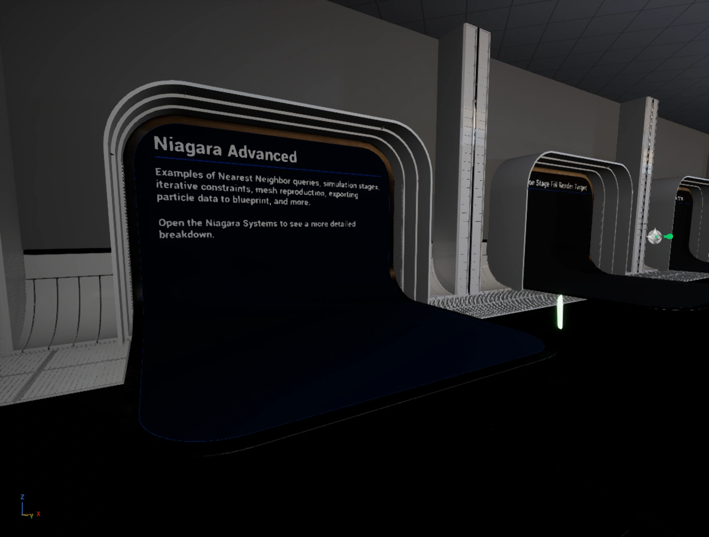
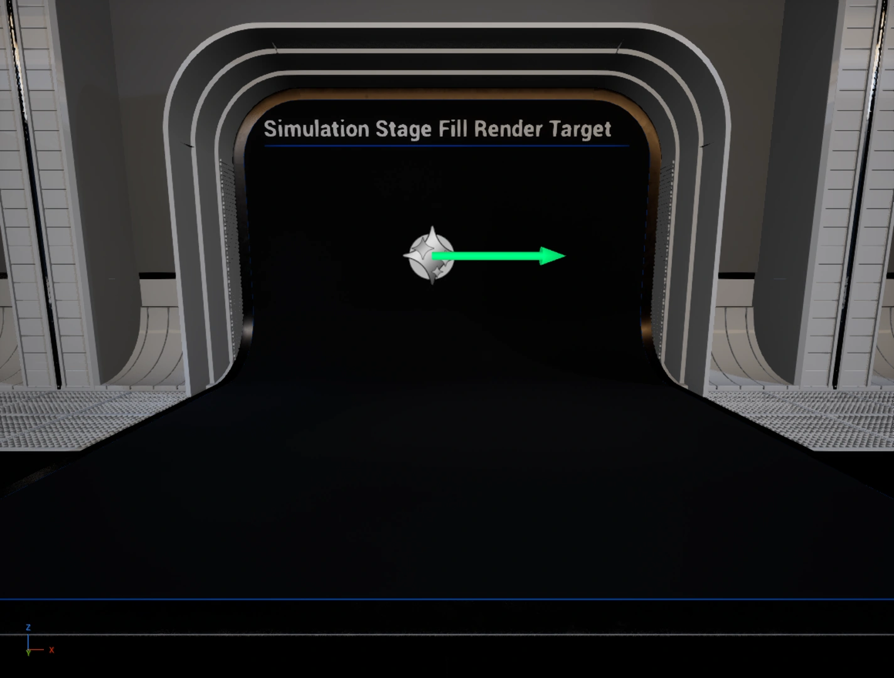
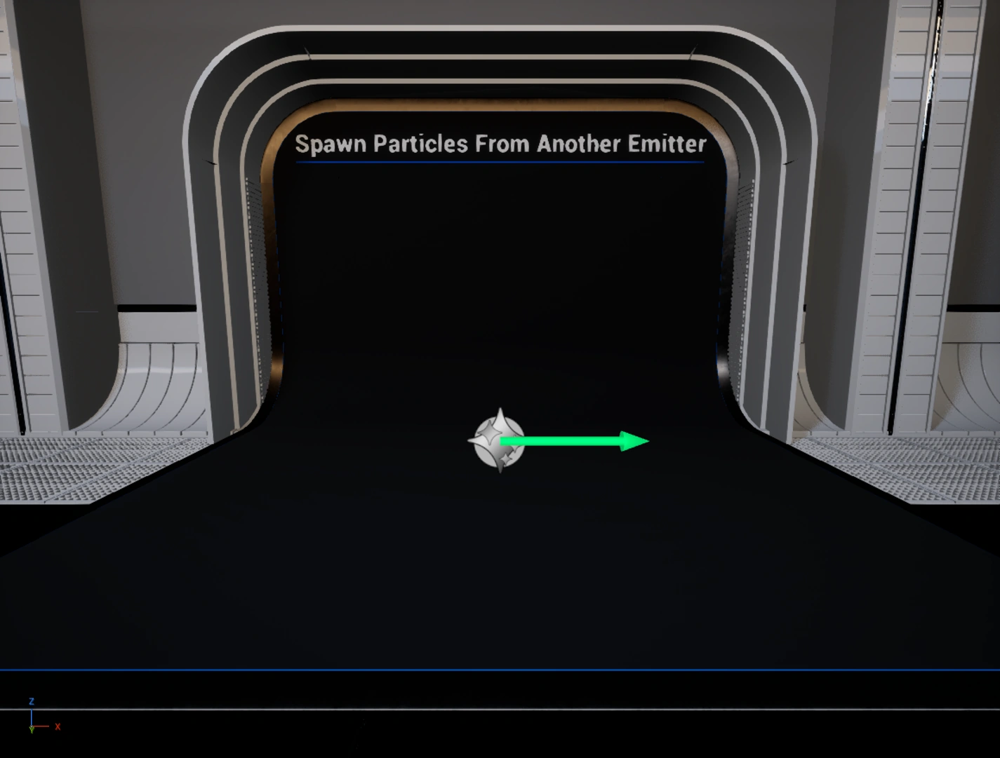
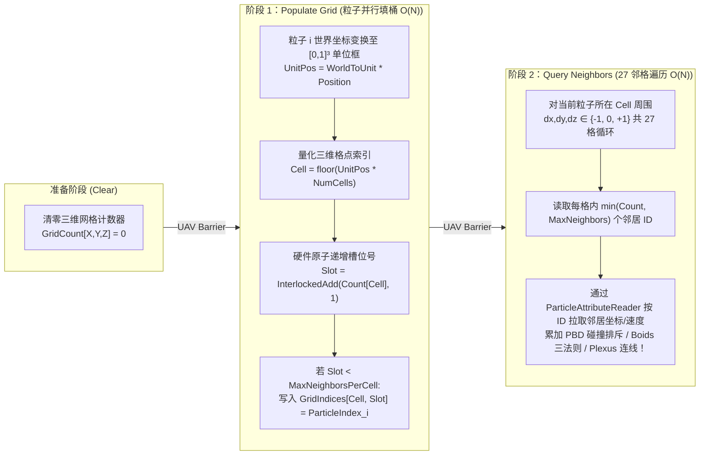
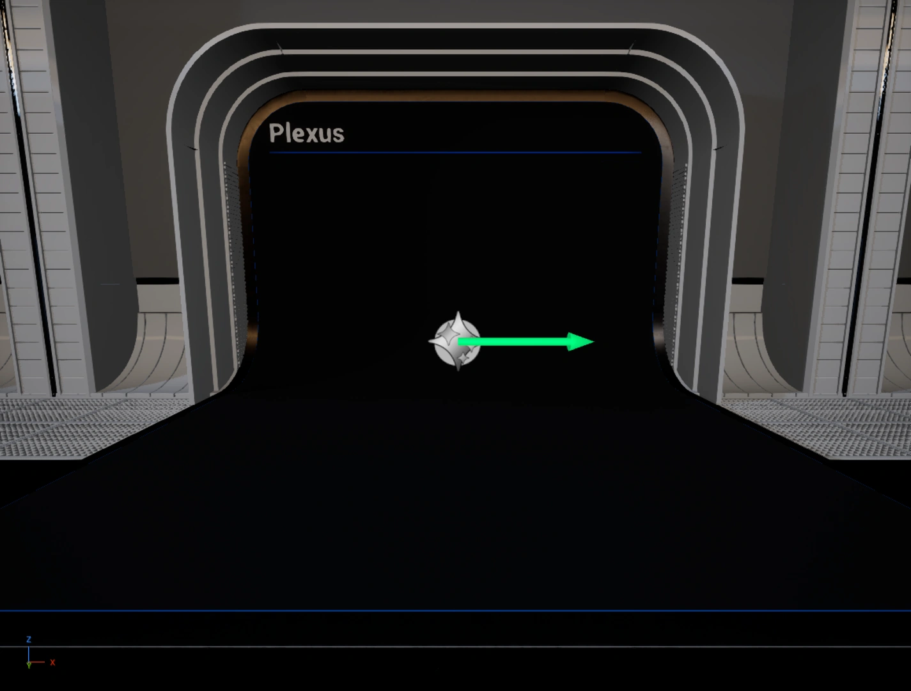

# 02 · 高阶 GPU 计算模拟阶段、`NeighborGrid3D` 邻域哈希网格、PBD 粒子动力学与 Boids 群体全解（`Niagara_Advanced_Particles`）

> **本篇实测拆解关卡档案**
> - **关卡路径**：`/Game/Maps/VFX/Niagara_Advanced_Particles`（关卡总 Actor 数：`117` | 展台数：**`25`** | 示例 Actor 数：`78`）
> - **关卡脚本类**：`/Game/Maps/VFX/Niagara_Advanced_Particles.Niagara_Advanced_Particles_C`
> - **核心资产目录**：`/Game/ExampleContent/Niagara/`（涵盖 `Grid2D/`、`Gbuffer/`、`Meshes/SkeletalMeshes/`、`DistanceField/`、`AttributeReader/`、`NeighborGrid3D/`、`PBD/`、`Renderers/Component/`、`ExportParticleData/`、`Textures/`、`Collision/` 共 28 套高阶计算系统与配套材质/蓝图）

---

## 一、 打破“粒子孤岛”：欢迎来到虚幻引擎的通用 GPU 并行计算圣殿

在上一章 `Niagara_Particles` 的全部 26 座展台中，无论粒子飞得多么绚丽，它们在底层都受困于一条铁律：**粒子与粒子之间是彻底“失明”的孤岛**。在标准的 `Particle Update` Compute Shader 中，第 `i` 号线程只能读写 `Particles[i]` 自己的坐标和速度——假使你想让第 `i` 号粒子去推开旁边的第 `j` 号粒子，立刻就会撞上两座大山：
1. **数据竞争（Data Race）**：如果线程 `i` 正在修改位置，线程 `j` 同时来读它的位置，谁先谁后完全取决于 GPU 硬件调度，结果必定闪烁崩坏；
2. **$O(N^2)$ 复杂度爆炸**：如果有 $N = 10,000$ 颗粒子，每颗粒子都去遍历另外 $9,999$ 颗找邻居，单帧就要跑 **$10^8$（一亿次）** 距离平方根比较，顶级显卡也会当场卡死！

推开 `/Game/Maps/VFX/Niagara_Advanced_Particles` 长达 **260 米**（`X` 从 `500` 延伸至 `25991`）的大门，Epic 的图形程序员给出了破局的三大核武器：
- **`Particle Attribute Reader`（粒子属性读取器）**：允许跨发射器或同发射器按确定性索引（Index）或持久 ID 安全只读上一拍的粒子属性；
- **`Simulation Stages`（模拟阶段 / 多趟 Compute Pass）**：允许在 `Particle Update` 之后插入任意多个独立的 GPU 计算通道，并在通道之间自动插入 **RHI UAV 内存屏障（UAV Barrier）**，支持切换线程派发源（不仅可以“每颗粒子派发 1 个线程”，还能**“二维纹理每个像素派发 1 个线程”**或**“三维体素网格每个格子派发 1 个线程”**！）；
- **`NeighborGrid3D`（三维空间哈希邻域加速网格）**：用“先填桶、再查周围 27 格”的两阶段空间哈希算法，把粒子互查复杂度从令人绝望的 $O(N^2)$ 降维打击成丝滑的 **$O(N)$ 线性复杂度**！从此，**PBD 弹性海洋球碰撞、SPH 光滑粒子流体雏形、Boids 鸟群集群智能、Plexus 神经元连线网、结构承重坍塌**全部在纯可视化节点图中成为现实！

下面，让我们按空间动线逐一深拆全部 **25 座展台** 的每一个算法细节与 MCP 实测拓扑。

---

## 二、 第一乐章：`Simulation Stages` 与 `Grid2D` 渲染目标耦合（展台 #1 ~ #4）

### 展台 #1：`Niagara Advanced` — 高阶实验室总导览与大气光场基座

- **空间元数据**：展牌 Label `BP_DemoDisplay` | 坐标 `(500, -890, 0)`
- **官方展牌原文**：
  > *"Examples of Nearest Neighbor queries, simulation stages, iterative constraints, mesh reproduction, exporting particle data to blueprint, and more. Open the Niagara Systems to see a more detailed breakdown."*
- **展台环境 Actor 清单（共 6 个）**：全动态主平行光 `DirectionalLight`（`Intensity = 10`, `CastShadows = true`, `Movable`）、环境天光 `SkyLight`（`Intensity = 1`, `Movable`）、`SkyAtmosphere`、`ExponentialHeightFog`、`Actor`（挂载 `ChaosDebugDrawComponent_0`）与 `1.1 Actor Replication Doc Actor`（关卡末尾另配有一个全局无界 `PostProcessVolume`）。

---

### 展台 #2：`Simulation Stage Fill Render Target` — 抛弃粒子！把 Niagara 当成像素级图像处理着色器

- **空间元数据**：展牌 Label `BP_DemoDisplay1` | 坐标 `(1500, -900, 0)`

#### 2.1 MCP 实测资产深拆：`FIllRenderTarget`
- **陈列 Actor**：`FIllRenderTarget`（`/Game/ExampleContent/Niagara/Grid2D/FIllRenderTarget`）
- **系统拓扑摘要**：
  - 单发射器 `EmitterLevelSpriteRenderer`（**`simTarget = GPUComputeSim`**，`NiagaraSpriteRendererProperties`）
  - **关键依赖资产**：展示材质 `/Game/ExampleContent/Niagara/Grid2D/M_FillRenderTargetExample`、输入源贴图 `/Game/ExampleContent/Niagara/Textures/UE5_Niagara`、距离裁剪特效类型 `/Game/ExampleContent/Niagara/EffectTypes/SimpleDistanceCull`

#### 2.2 核心范式跃迁：`Iteration Source = Data Interface (Grid2DCollection)`
为什么发射器名字叫 `EmitterLevelSpriteRenderer`（与上一章展台 `#25` 一脉相承的无粒子渲染器）？因为**这个系统里一颗传统粒子都没有**！
1. 我们在发射器中创建一个二维网格数据接口 **`Grid2DCollection`**（本质上是显存里的一张或多张双缓冲 `RWTexture2DArray<float>`），设定分辨率如 $256 \times 256$；
2. 点击发射器加号新增一个 **`Simulation Stage`**，将其 **`Iteration Source`（迭代源）从 `Particles` 改为该 `Grid2DCollection`**！
3. 奇迹发生了：GPU 不再按粒子数派发线程，而是直接启动一个 $256 \times 256$ 的二维 Compute Shader 网格！每个线程拿到自己的整数格点坐标 $(i, j)$ 与归一化 UV $(u, v) \in [0, 1]^2$，采样 `UE5_Niagara` 贴图做数学变换后写入 `Grid2D`，最后把 `Grid2D` 纹理绑定给那张唯一的大号 Sprite（`M_FillRenderTargetExample`）显示出来！

---

### 展台 #3：`Advect Grid 2D Collection` — 二维欧拉网格的半拉格朗日平流（Semi-Lagrangian Advection）

- **空间元数据**：展牌 Label `BP_DemoDisplay2` | 坐标 `(2510, -900, 0)`

#### 3.1 MCP 实测资产深拆：`AdvectGrid`
- **陈列 Actor**：`AdvectGrid`（`/Game/ExampleContent/Niagara/Grid2D/AdvectGrid`）
- **三发射器 GPU 协同拓扑（全部 `GPUComputeSim`）**：
  1. `Fill_Grid_With_Color`：粒子在网格内游走，将彩色墨水注入（Splat）到底层 `Grid2D` 属性通道；
  2. `Fill_Grid_With_Pattern`：将 `UE5_Niagara` 图案与极坐标旋涡速度场（依赖 `PolarToCartesianCoordinates`、`OffsetNoiseDistanceFields_ForNormals`、`HueShiftLinearColor`）写入网格；
  3. `EmitterLevelSpriteRenderer`：挂载模拟阶段执行**平流（Advection）**并将结果显示在面板上。

#### 3.2 流体力学第一课：为什么网格平流必须“往回看（Backward Trace）”？
要让画在网格上的图案顺着速度场 $\mathbf{u}(x, y)$ 流动，直觉想法是把当前像素 $(x, y)$ 的颜色搬到下一帧的 $(x + u\Delta t, y + v\Delta t)$ 去——这叫前向散射（Forward Scatter），在 GPU 上不仅会有多个像素抢写同一个格子的原子冲突，还会留下满屏难看的黑色漏缝！
`AdvectGrid` 演示的是现代实时流体雷打不动的基石——**半拉格朗日逆向回溯法（Semi-Lagrangian Advection，Stam 1999）**：
站在新帧的每个目标格子中心 $\mathbf{x}$，问自己：**“$\Delta t$ 秒之前，是哪里的墨水顺着水流刚好漂到了我这里？”**
$$q^{n+1}(\mathbf{x}) = \text{BilinearSample}\Big( q^n,\; \mathbf{x} - \Delta t \cdot \mathbf{u}(\mathbf{x}) \Big)$$
每个线程只写自己脚下唯一的一个像素（**100% 无写冲突**），去旧缓冲（Previous Buffer）做一次硬件双线性插值读取即可，且**无论时间步长 $\Delta t$ 多大都绝对无条件数值稳定（Unconditionally Stable）**！这正是第 04 章所有 2D/3D 烟火解算器的第一块基石！

---

### 展台 #4：`Communicate with External Render Targets` — 多轮迭代卷积模糊并直写场景材质 RT

- **空间元数据**：展牌 Label `BP_DemoDisplay4` | 坐标 `(3503, -900, 0)`

#### 4.1 MCP 实测资产深拆：`Niagara_ExternalRenderTarget` + `BlurAndSetExternalRT`
- **陈列 Actor**：蓝图封装 Actor `Niagara_ExternalRenderTarget`（`/Game/ExampleContent/Niagara/Grid2D/Niagara_ExternalRenderTarget`），内含两个核心组件：
  1. `NiagaraSystem` 组件：运行 `/Game/ExampleContent/Niagara/Grid2D/BlurAndSetExternalRT`（公开用户变量 **`User.TextureRenderTargetObject`**，类型 `UTextureRenderTarget`）；
  2. `StaticMesh` 组件：一块普通的静态网格平面 `SM_TestPlane`，赋予动态材质实例 `MID_M_UseRenderTargetOnMesh_0`。
- **数据闭环原理**：
  1. 蓝图在 `ConstructionScript / BeginPlay` 动态创建一张外部 `TextureRenderTarget2D`，一边塞给平面网格的动态材质参数，一边赋给 Niagara 的 `User.TextureRenderTargetObject`；
  2. 在 `BlurAndSetExternalRT` 的 Simulation Stage 中，设置迭代次数 `Num Iterations > 1`（利用 `SimulationStageIterationInfo` 追踪迭代轮次），每轮读取周围 $3 \times 3$ 邻域像素求均值写回 Ping-Pong 双缓冲完成高斯/均值模糊；
  3. 最后一步调用 `Copy Grid2D to Render Target` 直接在显存内将计算结果拷入外部 RT！**整个过程零 CPU 介入，任何普通场景建筑、角色护甲或水面材质都能零延迟消费 Niagara 算出来的动态程序化贴图（如雪地脚印融化图、热力灼烧遮罩图）**！

---

## 三、 第二乐章：全场景感知——GBuffer 屏幕采样、蒙皮重构与距离场爬行（展台 #5 ~ #7）

### 展台 #5：`Sample GBuffer Attributes` — 直接从延迟渲染 GBuffer 生长屏幕空间特效

- **空间元数据**：展牌 Label `BP_DemoDisplay14` | 坐标 `(4490, -900, 0)`

#### 5.1 MCP 实测场景与 38 节点特制材质深拆
- **陈列 Actor（共 2 个）**：
  1. **`SK_Mannequin2`**（`SkeletalMeshActor` $\to$ `SK_Mannequin`）：槽位 0 覆写了包含 **38 个材质表达式节点** 的特制分层材质 `/Game/ExampleContent/Niagara/Gbuffer/M_Mannequin_Body_GbufferNiagara`（混合了高光黑乳胶 `ML_GlossyBlack_Latex`、软金属 `ML_SoftMetal`、亮面米白塑料 `ML_Plastic_Shiny_Beige`，并通过 `PreSkinnedLocalBounds` + `PreSkinnedPosition` + `HueShift` + `Floor` 构造出阶梯状色相条纹写入 `BaseColor`！槽位 1 覆写全透裁剪材质 `MaskedZero` 以隐藏胸前冗余片）；
  2. **`SpawnOnGBuffer`**（`NiagaraActor` $\to$ `/Game/ExampleContent/Niagara/Gbuffer/SpawnOnGBuffer`）：`GPUComputeSim`，挂载 `NiagaraMeshRendererProperties`，持有 `User.LevelSkelMesh` 引用。

#### 5.2 技术精讲：GPU 粒子如何“偷看”当前屏幕画了什么？
通过 **`Camera Query` / `SceneTexture (GBuffer)` 数据接口**，GPU 粒子随机投射屏幕 UV $(u, v) \in [0, 1]^2$，直接一次性从延迟管线刚画完的 GBuffer 中捞出：
- **`SceneDepth` & `WorldPosition`**：把二维屏幕 UV 反投影回精确的三维物体表面坐标；
- **`WorldNormal`**：让生成的小网格粒子严格垂直于人体胸甲曲面法线立起；
- **`BaseColor` / `Roughness` / `Metallic` / `ShadingModelID`**：直接吸取 `M_Mannequin_Body_GbufferNiagara` 表面的彩色条纹赋给粒子自身颜色，并且通过深度阈值剔除背景天空像素，确保粒子**100% 只在屏幕可见的角色躯干上破土而出**！

---

### 展台 #6：`Skeletal Mesh Reproduction` — 骨骼网格体粒子化复刻、弹簧归位与旋度消散

- **空间元数据**：展牌 Label `BP_DemoDisplay15` | 坐标 `(5491, -900, 0)`

#### 6.1 MCP 实测资产深拆：`SkeletalMeshReproductionSystem_Demo_GPU`
- **陈列 Actor（共 2 个）**：参照人偶 `SK_Mannequin` + `SkeletalMeshReproductionSystem_Demo`（`/Game/ExampleContent/Niagara/Meshes/SkeletalMeshes/Emitter/SkeletalMeshReproductionSystem_Demo_GPU`）
- **四发射器结构（2 启用 GPU + 2 禁用 CPU 对照备份）**：
  - 启用：**`SkeletalMeshInfluencer`**（`GPUComputeSim`） + **`SkeletalMeshReproduction`**（`GPUComputeSim`）
  - 禁用备份：`SkeletalMeshReproduction001`（`CPUSim`） + `SkeletalMeshInfluencer001`（`CPUSim`）
  - 公开接口：**`User.Mesh`**（`NiagaraDataInterfaceSkeletalMesh`）

#### 6.2 经典“灭霸响指灰飞烟灭 / 粒子聚合成人”的底层数学
怎样让几万颗粒子严丝合缝拼成一个正在奔跑挥剑的角色，被力场撞散后又能自动飞回角色身上对应的手指尖？
1. **诞生时锚定拓扑坐标 `Particles.SampledTriangleCoord`**：在 `Particle Spawn` 时，粒子不仅采了一次表面世界坐标，还把自己的“身份证”——**`(TriangleIndex 三角形编号, BarycentricCoord 重心坐标 u,v,w)`** 永久存进了 `Particles.*` 属性里！
2. **每帧动态蒙皮重算目标锚点**：无论角色下一帧做了什么复杂动画，GPU 粒子在 `Particle Update` 中拿着保存好的 `(TriIndex, u, v, w)` 去查最新的 GPU 蒙皮顶点缓冲（Skinned Vertex Buffer），瞬间算出“这一帧我原本应该待在角色身上的哪个三维坐标 $\mathbf{P}_{\text{target}}$ 以及表面移动速度 $\mathbf{V}_{\text{skinned}}$”！
3. **影响器扰动 + 胡克弹簧归位**：当 `SkeletalMeshInfluencer`（球形力场）扫过身体时，局部粒子被 `Curl Noise` 吹散飞离躯干；一旦力场移开，胡克定律拉力 $\mathbf{F}_{\text{spring}} = k(\mathbf{P}_{\text{target}} - \mathbf{P}) - c\mathbf{V}$ 立刻将飞散的粒子精准拉回各自的三角形原位！（*提醒：对骨骼网格开启 GPU 采样同样必须在资产中勾选 `Enable Per Poly Collision` 或 `Allow CPU Access` 视引擎版本要求开启采样支持！*）

---

### 展台 #7：`Distance Field Traversal` — 手电筒趋光飞虫群紧贴雕像表面的 SDF 切向爬行

- **空间元数据**：展牌 Label `BP_DemoDisplay19` | 坐标 `(6499, -900, 0)`

#### 7.1 MCP 实测资产与 12 项精调参数全拆解
- **陈列 Actor（共 3 个）**：
  1. **`head`**（`StaticMeshActor` $\to$ `/Game/ExampleContent/Skin/Meshes/SM_HeadBust`，石膏金属人头雕像）；
  2. **`1x1x1BoxCenterAligned`**（活动边界参考框）；
  3. **`InsectLight`**（蓝图 `/Game/ExampleContent/Niagara/DistanceField/InsectLight`）：内置一盏亮度高达 `Intensity = 100000` 的手电筒聚光灯 `SpotLight`，以及核心粒子系统 **`TraverseDistanceField`**！
- **MCP 实测捕获 `TraverseDistanceField` 的全部 12 个 `User.*` 控制变量**：
  `User.Acceleration Limit = 10` | `User.Box Size = (500, 500, 500)` | `User.Cone Apex = (0,0,0)` | `User.Cone Axis = (1,0,0)` | `User.CurlNoiseStrength = 50` | `User.CurlNoiseTightness = 1` | `User.Falloff Angle Inner = 15` | `User.Falloff Angle Outer = 15` | `User.Falloff Radius = 6000` | `User.FlashlightMaxIntensity = 322.0` | `User.MaxSpeed = 28.465` | `User.MeshScaleMultiplier = 5`

#### 7.2 矢量几何精髓：如何让几千只甲虫顺滑爬过鼻梁和眼窝，既不悬空也不钻进肉里？
如果用普通射线碰撞做蜘蛛/虫群爬墙，遇到凹陷眼窝或锐利鼻尖就会疯狂卡死弹飞。而有向距离场（Global SDF）把整个三维空间变成了一个光滑标量场 $\phi(\mathbf{x})$（表面上 $\phi = 0$，梯度 $\mathbf{n} = \nabla \phi / |\nabla \phi|$ 就是精确表面外法线！）。只需两步极简向量投影：
1. **法向吸附归零（Snap to Iso-Surface $\phi = 0$）**：若虫子偏离表面（$\phi(\mathbf{x}) \neq 0$），直接沿法线反推修正位置：
   $$\mathbf{x}_{\text{snapped}} = \mathbf{x} - \phi(\mathbf{x}) \cdot \mathbf{n}$$
2. **速度切平面正交投影（Tangent Plane Projection）**：虫子原本受手电筒光锥趋光吸引力（或畏光驱离力）与 `CurlNoise` 影响产生三维期望速度 $\mathbf{v}$，剔除其法向分量，只保留紧贴曲面的切向滑行分量：
   $$\mathbf{v}_{\text{tangent}} = \mathbf{v} - (\mathbf{v} \cdot \mathbf{n})\mathbf{n}$$
虫群瞬间如同长了复眼一般，顺着人头雕像的鼻翼、耳廓与下颌沟壑丝滑绕流，毫米不差！

---

## 四、 第三乐章：`Particle Attribute Reader` 与多轮迭代链条约束（展台 #8 ~ #11）

### 展台 #8：`Particle Attribute Reader` — 打通粒子间只读点对点通信

- **空间元数据**：展牌 Label `BP_DemoDisplay5` | 坐标 `(8040, -900, 0)`

#### 8.1 MCP 实测双系统深拆：`AttributeReaderSimple` & `AttributeReaderRing`
展台上并排放置了两套由浅入深的示范系统：
1. **`AttributeReaderSimple`**（CPU 双发射器：`Source` [`CPUSim`] $\to$ `Reader` [`CPUSim`]）：`Reader` 发射器创建 `Particle Attribute Reader` 数据接口并填入 Emitter Name = `"Source"`，调用 `Get Vector by Index (Attribute = "Position")`，直接读取 `Source` 粒子的实时坐标并跟随偏移。
2. **`AttributeReaderRing`**（GPU 双发射器：`Leader` [`GPUComputeSim`] $\to$ `Ring` [`GPUComputeSim`]）：`Ring` 中的大群从属粒子读取 `Leader` 粒子的 `Position`，再加上绕轴极坐标旋转偏移，在高速飞行的领航粒子周围编织出永不散架的旋转护盾光环！

---

### 展台 #9：`Follow The Leader 1.0` — 按固定索引绑定的领航跟随及其局限性

- **空间元数据**：展牌 Label `BP_DemoDisplay6` | 坐标 `(9040, -900, 0)`
- **MCP 实测资产深拆**：`AttributeReaderFollow`（`/Game/ExampleContent/Niagara/AttributeReader/AttributeReaderFollow`），包含 `Leaders`（`GPUComputeSim`）与 `Followers`（`GPUComputeSim`）。
- **原理与伏笔**：每颗 `Follower` 粒子在出生时通过取模 `LeaderIndex = ExecutionIndex % NumLeaders`（或绑定持久 `ID`）认领一位固定的“终身队长”，每帧用 `O(1)` 数组下标直接读取该队长的坐标飞过去。
  - **优点**：极快，无需任何空间搜索！
  - **痛点（为什么叫 `1.0`？）**：因为它是“包办婚姻”！哪怕另一位队长擦肩而过离它只有 1 厘米，而它原本绑定的队长飞到了十米开外，它也傻乎乎地舍近求远追着老队长跑！怎样才能实现“谁离我最近我就跟谁走”？请留心后文展台 `#16 Follow The Leader 2.0` 的降维升级！

---

### 展台 #10：`Spawn Particles From Another Emitter` — GPU 时代的跨发射器零回读拖尾生成术

- **空间元数据**：展牌 Label `BP_DemoDisplay7` | 坐标 `(10050, -900, 0)`

#### 10.1 MCP 实测资产深拆：`AttributeReaderStreamers`
- **陈列 Actor**：`AttributeReaderStreamers`（`/Game/ExampleContent/Niagara/AttributeReader/AttributeReaderStreamers`）
- **双 GPU 发射器拓扑**：`Leaders`（`GPUComputeSim`） + `Followers`（`GPUComputeSim`）

#### 10.2 解决上一章留下的世纪难题：GPU 发射器不能用 `Location Event`，怎么拉子粒子尾迹？
还记得上一章展台 `#16` 烟花事件必须全用 `CPUSim` 的遗憾吗？`AttributeReaderStreamers` 给出了 **100% 纯 GPU 万级母子拖尾的标准答案**：
1. 母发射器 `Leaders` 在 GPU 上自由发射几十颗翻飞的彩球；
2. 子发射器 `Followers` 同样设为 `GPUComputeSim`，按每帧 `N * K` 的速率（`SpawnRate`）生成新粒子；
3. 在 `Followers` 的 **`Particle Spawn`** 阶段，利用 `ExecutionIndex` 整除分配到对应的母粒子索引 `ParentIdx`，直接通过 `Particle Attribute Reader` 把母粒子这一帧的 **`Position`、`Color` 与反方向 `Velocity`** 拷到新出生的子粒子身上！全流程不沾半点 CPU Event 队列，轻松跑出上万颗流光溢彩的密集彗星雨（见上方实拍图）！

---

### 展台 #11：`Iterative Constraints` — 每帧多轮雅可比松弛解算无刚体物理铁链

- **空间元数据**：展牌 Label `BP_DemoDisplay12` | 坐标 `(11035, -900, 0)`

#### 11.1 MCP 实测资产深拆：`Chain_SimulationStages`
- **陈列 Actor**：`Chain_SimulationStages`（`/Game/ExampleContent/Niagara/AttributeReader/Constraints/Chain_SimulationStages`）
- **系统拓扑摘要**：单发射器 `ChainSolver`（**`GPUComputeSim`**），同时挂载 `NiagaraSpriteRendererProperties`（关节点可视化）与 **`NiagaraMeshRendererProperties`**（锁链铁环网格）！

#### 11.2 为什么单次更新的绳子会像橡皮筋一样无限拉长，而多轮 Simulation Stage 能硬如钢铁？
假设一条铁链由 20 颗排好序的粒子 $\mathbf{x}_0, \mathbf{x}_1, \dots, \mathbf{x}_{19}$ 组成（$\mathbf{x}_0$ 钉死在天花板上），相邻两颗粒子理想间距为 $L_0$。
- 当重力把末端 $\mathbf{x}_{19}$ 往下拽时，如果在 `Particle Update` 里只做 **1 次** 邻点拉扯修正，天花板 $\mathbf{x}_0$ 的固定约束信号每帧只能向下传递 **1 节链环**，整根铁链就会软塌塌地被拉长三倍并剧烈震荡！
- 而在 `ChainSolver` 中，我们添加一个 **`Simulation Stage`（迭代源 = `Particles`，设置 `Num Iterations = 10 ~ 20`）**！在单帧内的每一轮 Compute Pass 中，每颗粒子 $i$ 通过 `Particle Attribute Reader` 读取前驱 $\mathbf{x}_{i-1}$ 和后继 $\mathbf{x}_{i+1}$ 的最新位置，并行执行 **PBD 距离约束投影（Distance Constraint Projection）**：
  $$\Delta \mathbf{x}_{i} = \frac{1}{2}\big(|\mathbf{x}_{i-1} - \mathbf{x}_i| - L_0\big)\frac{\mathbf{x}_{i-1} - \mathbf{x}_i}{|\mathbf{x}_{i-1} - \mathbf{x}_i|} + \frac{1}{2}\big(|\mathbf{x}_{i+1} - \mathbf{x}_i| - L_0\big)\frac{\mathbf{x}_{i+1} - \mathbf{x}_i}{|\mathbf{x}_{i+1} - \mathbf{x}_i|}$$
  单帧连跑 15 轮微秒级迭代后，顶端的张力瞬间传遍全链，最后由 `(NewPos - OldPos) / DeltaTime` 反推真实摆动速度——无需任何昂贵的 Chaos 骨骼物理约束，一条刚劲沉稳、惯性十足的金属锁链跃然眼前！

---

## 五、 第四乐章：`NeighborGrid3D` 空间哈希九连展台封神之路（展台 #12 ~ #20）

前面 `#8 ~ #11` 的 `Particle Attribute Reader` 都有一个前提：**你提前知道要读第几号粒子（如第 `i-1` 号铁环）**。
但如果盒子里散乱飞舞着 **5,000 颗毫无顺序的自由粒子**，每颗粒子都想找到**此时此刻离自己半径 $R$ 以内的所有邻居**呢？

这就是接下来整整 **9 座连续展台（`#12 ~ #20`）** 共同围绕的核心主角——**`NeighborGrid3D`（三维邻域空间哈希网格）**！先用一张算法流程图彻底看透它的两阶段 $O(N)$ 魔法：

> **显存开销精确公式**：设网格分辨率为 $N_x \times N_y \times N_z$，每格最大容纳邻居数为 $M$（`MaxNeighborsPerCell`），则索引表显存占用为：
> $$\text{VRAM}_{\text{Grid}} = N_x \times N_y \times N_z \times (M + 1) \times 4\text{ Bytes}$$
> 例如 $32 \times 32 \times 32$ 网格、每格存 $16$ 个邻居，仅占 **$2.2\text{ MB}$** 显存，就能支撑上万颗粒子每帧丝滑互查！

---

### 展台 #12：`Color Copy by Cell` — `NeighborGrid3D` 读写分离入门第一课

- **空间元数据**：展牌 Label `BP_DemoDisplay8` | 坐标 `(12510, -900, 0)`
- **MCP 实测资产深拆**：`ColorQuery`（`/Game/ExampleContent/Niagara/NeighborGrid3D/ColorQuery`）
  - **`Grid_Write`**（`GPUComputeSim`，`SpriteRenderer`）：少量彩色源粒子在空间游走，将自己的粒子索引填入 `NeighborGrid3D` 对应体素格中；
  - **`Grid_Read`**（`GPUComputeSim`，`SpriteRenderer`）：大量背景白粒子计算自己所在的体素格坐标 `(CellX, CellY, CellZ)`，只要查到当前格子里有 `Grid_Write` 粒子入住，立刻通过 `LinearIndex` 读取其颜色把自己染成同色；
  - **`Grid_Visualizer`**（`CPUSim`，`SpriteRenderer` + `RibbonRenderer`）：用丝带线框直观画出三维体素格子的物理边界，让你肉眼看清“同处一格即染色”的分桶本质！

---

### 展台 #13：`Dynamic Grid Transform` — 让邻域网格随移动角色旋转缩放的仿射矩阵

- **空间元数据**：展牌 Label `BP_DemoDisplay24` | 坐标 `(13510, -900, 0)`
- **MCP 实测资产深拆**：`DynamicGridTransforms`（`/Game/ExampleContent/Niagara/NeighborGrid3D/DynamicTransforms/DynamicGridTransforms`）
  - `Visualize_Grid_Cells_Via_UnitToWorldTransforms`（`GPUComputeSim`，`MeshRenderer`）
  - `Show_World_to_Unit_Transformation`（`GPUComputeSim`，`SpriteRenderer`）
- **核心痛点突破**：早期的三维网格只能死板地轴对齐（AABB）钉死在世界原点。如果我想在高速奔跑的主角脚下跟一个 $4\text{m} \times 4\text{m} \times 2\text{m}$ 的局部落叶涡流网格怎么办？
  本展台演示了完整的 **`WorldToUnit` 与 `UnitToWorld` $4 \times 4$ 动态矩阵变换管道**：每帧在 `System/Emitter Update` 计算跟随旋转缩放的变换矩阵传入 `NeighborGrid3D`，粒子无论在世界何处，先乘 `WorldToUnit` 映射进标准立方体 $[0, 1]^3$ 填桶，调试网格则乘逆矩阵 `UnitToWorld` 还原回倾斜旋转的世界空间！

---

### 展台 #14：`Max Neighbors Per Cell` — 桶容量上限与原子溢出的视觉后果对照实验

- **空间元数据**：展牌 Label `BP_DemoDisplay9` | 坐标 `(14510, -900, 0)`
- **MCP 实测三实例对照**：三个 `NiagaraActor`（`GridContentsMaxOne`、`GridContentsMaxFive`、`GridContentsMaxTwentyFive`）全部引用同一资产 `/Game/ExampleContent/Niagara/NeighborGrid3D/PropagateNeighbors`，仅在关卡实例上分别覆写用户变量 **`User.MaxNeighborsPerCell` = `1`、`5`、`25`**（其他默认参数：`User.Cell Radius = 1`、`User.ShowGridParticles = false`、`User.SpriteScale = 10`）。
- **直观结论**：
  - 当 `MaxNeighborsPerCell = 1` 时，哪怕一个格子里挤进了 20 颗粒子，第 2~20 颗粒子执行 `InterlockedAdd` 返回的槽位号 $\ge 1$ 被直接丢弃（Bucket Overflow），导致局部查询严重漏检闪烁；
  - 调到 `5` 时覆盖率大幅改善，调到 `25` 时稠密球面上的所有邻居无一遗漏！**工程调参黄金法则：根据粒子平均间距与格子边长比值，通常将 `MaxNeighborsPerCell` 设在 `8 ~ 16` 之间即可兼顾零漏检与最小显存占用**。

---

### 展台 #15：`Color Propagation` — 单格自查 vs $3 \times 3 \times 3$ 跨格邻域核与多米诺传染波

- **空间元数据**：展牌 Label `BP_DemoDisplay10` | 坐标 `(15510, -900, 0)`
- **MCP 实测双实例对照**：同样基于 `PropagateNeighbors` 系统，并排摆出 `PropagateNeighborsOneCell`（`User.Cell Radius = 0`，仅查自身所在单格 $1^3=1$）与 `PropagateNeighborsAdjoiningCells`（`User.Cell Radius = 1`，查询周围 $3 \times 3 \times 3 = 27$ 格！）。
- **核心算法洞见**：
  - 如果只查粒子自己所在的 **1 个格子**，一旦两颗紧挨着只有 `0.01cm` 的粒子刚好分居一条网格分界线的左右两侧，它们就彻底看不见对方！因此左边的颜色传染走到格子边界就会被硬生生切断成方块孤岛！
  - 而右边开启 `Cell Radius = 1`（三重循环遍历 `dx, dy, dz ∈ [-1, 0, +1]` 共 **27 个相邻体素桶**），只要搜索半径 $R \le \text{CellSize}$，就从几何上 **100% 保证了任何距离小于 $R$ 的邻居绝不可能漏出这 27 个格子之外**！一颗红色火种点亮后，感染波立刻跨过所有网格边界，如燎原烈火般均匀传遍整颗球体！

---

### 展台 #16：`Follow The Leader 2.0` — 基于空间邻域动态寻优的就近领航跟随

- **空间元数据**：展牌 Label `BP_DemoDisplay11` | 坐标 `(16510, -900, 0)`
- **MCP 实测资产深拆**：`FollowTheLeaders`（`/Game/ExampleContent/Niagara/NeighborGrid3D/FollowTheLeaders`），双 GPU 发射器 `Ring` + `Cylinder`。
- **完美呼应展台 `#9`**：告别了 `1.0` 死板按 ID 认领队长的“包办婚姻”！在这里，`Leaders` 每帧把自己填入 `NeighborGrid3D`，所有 `Cylinder` 追随粒子每帧扫描身边 27 个邻格，现场算出距离平方 $d^2 = |\mathbf{x}_{\text{leader}} - \mathbf{x}_i|^2$ 最小的**当前最近队长**并向其靠拢——当不同颜色的领航环交错穿过粒子云时，粒子群会实时动态易主、分流重组，灵动无比！

---

### 展台 #17：`Position Based Dynamics` — 几千颗刚性碰撞球挤压堆叠与 SPH 流体雏形

- **空间元数据**：展牌 Label `BP_DemoDisplay18` | 坐标 `(17508, -900, 0)`

#### 17.1 MCP 实测场景与隐形玻璃盒材质 `HideGeo` 巧思深拆
- **陈列 Actor（共 8 个）**：
  - 核心系统 **`PBD`**（`/Game/ExampleContent/Niagara/PBD/PBD`）：包含启用发射器 `PBD`（`GPUComputeSim`，挂载 `NiagaraMeshRendererProperties` 渲染实体小球）与调试用禁用发射器 `Visualize_Grid_Cells_Via_UnitToWorldTransforms`。
  - 周围合围着 **6 块物理挡板网格** `PhAT_FloorBox25 ~ 30`（组 `GroupActor_3`），全部覆写了一个仅有 **2 个节点** 的神奇材质 `/Game/ExampleContent/Niagara/NeighborGrid3D/StructuralSupport/HideGeo`！
  - **为什么要用 `HideGeo` 而不是勾选 `Actor Hidden In Game`？**
    看 MCP 提取出的 `HideGeo` 节点连线：`WorldPosition_0` $\to$ `Multiply_0` $\to$ **`MP_WorldPositionOffset`（将网格顶点在渲染器里缩退偏移隐藏，不遮挡玩家视线）**，但它的**静态网格距离场（Mesh Distance Field）依然完好无损地保留在 `Global SDF` 场景里**，做成一个完全透明却能让 GPU 粒子实打实撞在上面的无形玻璃鱼缸！（后方展台 `#18, #19, #20, #24` 以及流体馆 `#15` 全部复用了这一绝妙技巧！）

#### 17.2 核心物理精讲：PBD（基于位置动力学）四步闭环与 SPH 光滑粒子流体演进
为什么传统的“弹簧惩罚力（Penalty Force：$F = -k \cdot \text{penetration}$）”一遇到几千颗球堆在盒底就会疯狂炸飞？因为显式欧拉积分下刚度系数 $k$ 稍微大一点就会数值超调爆炸（Overshoot），小一点底下的球就被压扁穿模！
Müller 等人提出的 **PBD（Position-Based Dynamics）** 彻底绕过了力与加速度，直接在 `Simulation Stage` 多轮迭代（如 4~8 次迭代）中**硬改位置消除重叠**：
1. **外力预测（Predict）**：先按重力更新预测位置 $\tilde{\mathbf{x}}_i = \mathbf{x}_i^n + \Delta t \mathbf{v}_i^n + \Delta t^2 \mathbf{g}$；
2. **填表建网（Populate `NeighborGrid3D`）**：将所有预测位置 $\tilde{\mathbf{x}}_i$ 哈希填入三维网格（格子大小设为球直径 $2r$）；
3. **多轮碰撞接触约束投影（Solve Contacts）**：每颗球遍历周围 27 格内的邻居球 $j$。一旦球心距 $d = |\tilde{\mathbf{x}}_i - \tilde{\mathbf{x}}_j| < r_i + r_j$（发生穿插深度 $\delta = r_i + r_j - d > 0$），两球沿连线方向各退让一半（或按质量反比退让）：
   $$\Delta \tilde{\mathbf{x}}_i = +\frac{w_i}{w_i + w_j} \delta \cdot \frac{\tilde{\mathbf{x}}_i - \tilde{\mathbf{x}}_j}{d}$$
4. **反推真实速度（Derive Velocity）**：所有迭代收敛且与玻璃盒 SDF 边界裁剪完毕后，反算出完全满足无穿透约束的新速度：
   $$\mathbf{v}_i^{n+1} = \frac{\tilde{\mathbf{x}}_i - \mathbf{x}_i^n}{\Delta t}$$

> [!TIP]
> **从 PBD 海洋球再往前迈半步就是 SPH / PBF 光滑粒子流体！**
> 把上面第 3 步里的“硬球半径退让”，替换成用三次样条核函数（Poly6 / Spiky Kernel $W(|\mathbf{x}_i - \mathbf{x}_j|, h)$）统计 27 邻格内的局部粒子数密度 $\rho_i = \sum_j m_j W_{ij}$，并约束每颗粒子周围密度恒等于水的静止密度 $\rho_0$（即 **Position-Based Fluids, Macklin & Müller 2013**），这几千颗离散刚体小球瞬间就会化作拉格朗日连续飞溅水流！

---

### 展台 #18：`Plexus` — 科幻大片级神经元近邻动态连线网

- **空间元数据**：展牌 Label `BP_DemoDisplay23` | 坐标 `(18508, -900, 0)`

#### 18.1 MCP 实测资产深拆：`Plexus`
- **陈列 Actor（共 8 个）**：`PBD2`（引用 `/Game/ExampleContent/Niagara/NeighborGrid3D/Plexus/Plexus`） + 6 面 `HideGeo` 隐形边界墙。
- **内部拓扑**：启用发射器 `Plexus`（`GPUComputeSim`），同时挂载 **`NiagaraSpriteRendererProperties`**（神经元节点圆斑）与 **`NiagaraMeshRendererProperties`**（拉伸成细长圆柱连线的边网格）！
- **连线生成算法**：粒子漫游填入 `NeighborGrid3D` 后，连接粒子在 27 邻格内搜索距离满足 $d < R_{\text{connect}}$ 的有效邻居对 $(\mathbf{x}_i, \mathbf{x}_j)$，将细杆 Mesh 的中心摆在中点 $\frac{1}{2}(\mathbf{x}_i + \mathbf{x}_j)$，朝向四元数对齐连线向量 $\mathbf{x}_j - \mathbf{x}_i$，纵向缩放等于距离 $d$，横向粗细与不透明度乘以 $(1 - d / R_{\text{connect}})$——当两颗粒子靠近时丝线平滑浮现变粗，远离时优雅拉细隐去，零破绽全自动拓扑重构！

---

### 展台 #19：`Structural Support` — 图连通性承重传播与悬空结构连锁坍塌

- **空间元数据**：展牌 Label `BP_DemoDisplay20` | 坐标 `(19518, -900, 0)`

#### 19.1 MCP 实测资产深拆：`StructuralSupport`
- **陈列 Actor（共 8 个）**：`StructuralSupport`（`/Game/ExampleContent/Niagara/NeighborGrid3D/StructuralSupport/StructuralSupport`） + 6 面 `HideGeo` 边界墙。
- **四发射器架构（全部 `GPUComputeSim`）**：`Spawn_Particles`、`SortParticles`、`Run_Time_Emitter`（挂载 `MeshRenderer` + `SpriteRenderer`）以及禁用调试网格 `Visualize_Grid`。
- **精妙图算法**：如何判断一座由几千颗粒子搭成的拱桥在腰部被炸断后，哪几块还连着地基、哪几块已经悬空该掉下来？
  1. 接触地面的底层粒子标记 `Particles.IsAnchored = true, SupportDistance = 0`；
  2. 在多轮 `Simulation Stage` 中通过 `NeighborGrid3D` 向紧挨着的邻居广播承重信号：`SupportDistance = min(Neighbor.SupportDistance + 1)`；
  3. 凡是在最大传导步数内收不到地面支撑信号的悬空粒子簇，立刻解除位置冻结锁、激活重力加速度自由崩塌坠落！

---

### 展台 #20：`Boids` — 雷诺兹三大鸟群/鱼群涌现法则与雕像障碍绕行

- **空间元数据**：展牌 Label `BP_DemoDisplay17` | 坐标 `(20508, -900, 0)`

#### 20.1 MCP 实测场景深拆：`Boids` + 三座石膏头像障碍阵
- **陈列 Actor（共 11 个）**：
  - 核心系统 **`Boids`**（`/Game/ExampleContent/Niagara/NeighborGrid3D/Boids`，`GPUComputeSim`，挂载 `SpriteRenderer` + `MeshRenderer`）；
  - 鱼缸中央交错摆放着 **3 座人头雕像障碍物** `head2`、`head3`、`head4`（`SM_HeadBust`），四周由 6 面 `HideGeo` 隐形盒包围。

#### 20.2 群体智能经典数学方程：三条简单局部向量和，涌现出震撼生命感
1986 年 Craig Reynolds 提出的 **Boids 模型** 在本展台中通过 `NeighborGrid3D` 实现了万级实时 GPU 解算。每只飞鸟 $i$ 仅统计周围 27 邻格可视半径内的局部同伴集合 $\mathcal{N}_i$，每帧叠加四股转向力（Steering Forces）：
1. **分离（Separation — 防撞排斥）**：同伴靠得太近时产生反向推力：
   $$\mathbf{F}_{\text{sep}} = \sum_{j \in \mathcal{N}_i} \frac{\mathbf{x}_i - \mathbf{x}_j}{|\mathbf{x}_i - \mathbf{x}_j|^2 + \epsilon}$$
2. **对齐（Alignment — 航向同步）**：趋同局部同伴的平均飞行速度方向：
   $$\mathbf{F}_{\text{align}} = \left(\frac{1}{|\mathcal{N}_i|} \sum_{j \in \mathcal{N}_i} \mathbf{v}_j\right) - \mathbf{v}_i$$
3. **凝聚（Cohesion — 向心抱团）**：飞向局部同伴群的平均质心，防止鸟群彻底散伙：
   $$\mathbf{F}_{\text{coh}} = \left(\frac{1}{|\mathcal{N}_i|} \sum_{j \in \mathcal{N}_i} \mathbf{x}_j\right) - \mathbf{x}_i$$
4. **SDF 避障（Obstacle Avoidance）**：采样场景 `Global Distance Field` 感知那 3 座 `SM_HeadBust` 头像的距离 $\phi(\mathbf{x}_i)$，一旦靠近雕像立即叠加沿 $\nabla \phi$ 外推的规避力——鸟群遇到雕像时自动优雅地一分为二绕过两侧，过后再重新汇合成一股洪流！

---

## 六、 第五乐章：跨界桥接、模拟阶段精确碰撞与动态 SDF 体积基础（展台 #21 ~ #25）

### 展台 #21：`Component Renderer` — 粒子直接生成并驱动真实引擎场景组件与蓝图逻辑

- **空间元数据**：展牌 Label `BP_DemoDisplay3` | 坐标 `(21989, -900, 0)`

#### 21.1 MCP 实测资产深拆：`ComponentRendererExample`
- **陈列 Actor**：`ComponentRendererExample`（`/Game/ExampleContent/Niagara/Renderers/Component/ComponentRendererExample`）
- **双 CPU 发射器拓扑**：
  1. `ComponentRenderers`（`CPUSim`）：挂载 `NiagaraSpriteRendererProperties` + **`NiagaraComponentRendererProperties`**；
  2. `CustomComponent`（`CPUSim`）：挂载 **`NiagaraComponentRendererProperties`**。
- **五大渲染器拼图补齐（Light Renderer vs Component Renderer）**：
  - 如果你只需要粒子照亮周围地板，优先用轻量级的 **`NiagaraLightRendererProperties`**（直接向延迟光照管线提交发光球）；
  - 但如果你需要每颗粒子都是一盏**带体积雾阴影的聚光灯 `USpotLightComponent`、一个带碰撞触发盒的 `UBoxComponent`、甚至一个自定义 `USceneComponent` 子类**，`ComponentRenderer` 会在内部维护一个**组件对象池（Component Pool）**，每帧将 `Particles.*` 属性自动反射赋值给对应 `UObject` 组件的 C++/蓝图成员变量！*(铁律：因涉及主线程 UObject 更新，默认 `Component Count Limit` 严格受限在数十个以内，切勿破百！)*

---

### 展台 #22：`Export Particle Data to Blueprint` — 从 CPU/GPU 粒子向游戏蓝图异步回传命中数据

- **空间元数据**：展牌 Label `BP_DemoDisplay13` | 坐标 `(22988, -900, 0)`

#### 22.1 MCP 实测资产深拆：`ExportParticleDataExample` + `ExportParticleData_System`
- **陈列 Actor**：蓝图 `ExportParticleDataExample`（实现了引擎回调接口 **`INiagaraParticleCallbackHandler`**），将自身 `Self` 引用传给 Niagara 系统的用户对象变量 **`User.BPCallbackHandler`**。
- **CPU + GPU 双路回传对照**：系统内同时包含 `ExportDataToBP`（`CPUSim`，`SpriteRenderer`）与 **`ExportGPUDatatoBP`**（**`GPUComputeSim`**，`MeshRenderer`）两个发射器！
- **底层时序真相与世代演进**：
  当粒子发生碰撞或满足条件时调用 `Export Particle Data` 模块，引擎会将打包好的 `FBasicParticleData`（`Position, Size, Velocity`）数组回调给蓝图的 `ReceiveParticleData` 事件（对于 `GPUComputeSim`，底层通过 RHI Staging Buffer 执行**跨帧异步 GPU Readback**，因此会有 1~2 帧延迟且完全不阻塞渲染线程！）。
  *(注：在 UE 5.3~5.5+ 中，这一传统单对单回调机制已进化为更通用、支持任意自定义结构体且吞吐量高出一个数量级的 **Niagara Data Channels**——详见下一章展台 `#7`！)*

---

### 展台 #23：`Bind Niagara Curves to Sprite Materials` — 曲线 LUT 图集直通材质像素着色器

- **空间元数据**：展牌 Label `BP_DemoDisplay16` | 坐标 `(23991, -900, 0)`

#### 23.1 MCP 实测资产深拆：`BindCurvesToMaterials`
- **陈列 Actor**：`RendererWithNoParticles2`（引用 `/Game/ExampleContent/Niagara/Textures/BindCurvesToMaterials`）
- **系统拓扑摘要**：`EmitterLevelSpriteRenderer`（`GPUComputeSim`） + 专属曲线采样材质 `/Game/ExampleContent/Niagara/Textures/CurveSamplingNiagaraMaterial`。
- **黑科技原理**：很多时候（比如做火焰黑体辐射色带映射、屏幕空间流体厚度吸收率色阶、或者溶解边缘渐变），如果只给每颗粒子传一个单色 `Particles.Color`，面片内部像素是无法做出复杂非线性色彩层次的；可如果手动做几十张 1D Ramp 贴图又没法在 Niagara 编辑器里直观拉曲线实时预览！
  Niagara 会自动将所有曲线数据接口（`ColorCurve / FloatCurve`）打包烘焙进引擎全局的 **1D Curve LUT Texture Atlas（曲线查找表图集）**！通过材质绑定将曲线的 Atlas UV 偏移参数传进 `CurveSamplingNiagaraMaterial`，像素着色器就能在每个像素上实时采样你在 Niagara 面板里随手拖出来的渐变曲线！

---

### 展台 #24：`Collisions in Simulation Stages` — 根治高速粒子堆叠穿模的子步迭代碰撞

- **空间元数据**：展牌 Label `BP_DemoDisplay21` | 坐标 `(24991, -900, 0)`

#### 24.1 MCP 实测双系统同台竞技：`ParticleUpdateCollisions` vs `SimStageCollisions`
展台左右两侧各设一个由 6 面 `HideGeo` 隐形盒围成的碰撞容器，运行两套几乎相同、唯独碰撞所在阶段不同的 GPU 网格粒子系统：
1. **左组 `SimluationStageCollisions`**（引用 `/Game/ExampleContent/Niagara/Collision/ParticleUpdateCollisions`）：碰撞模块放在传统的 **`Particle Update`** 中（每帧仅执行 1 次碰撞检测）；
2. **右组 `SimluationStageCollisions2`**（引用 `/Game/ExampleContent/Niagara/Collision/SimStageCollisions`）：将速度积分与碰撞响应拆进 **`Simulation Stage` 多子步（Sub-stepping / Iterative Relaxation）** 中执行！

#### 24.2 为什么左组容易漏底抖动，而右组稳如泰山？
当一帧帧率波动（如掉到 20fps，$\Delta t = 0.05\text{s}$）或者上层粒子通过 PBD 把底层粒子往地板里死命挤压时，单次 `Particle Update` 修完粒子间碰撞后可能已经把底下的球推进了地板下方，等到下一帧再弹回来就会引发剧烈的震荡甚至隧穿漏底（Tunneling）！而放入 `Simulation Stage` 后，**每一轮粒子推挤迭代都紧跟一次边界碰撞夹紧（Clamp to Boundary）**，从数学上保证了最终输出的坐标同时满足“互不重叠”与“不穿地板”双重硬约束！

---

### 展台 #25：`Dynamic Distance Fields` — GPU 实时三维有向距离场（SDF）构建、光线步进与流体表面基石

- **空间元数据**：展牌 Label `BP_DemoDisplay22` | 坐标 `(25991, -900, 0)`（本馆压轴展台）

#### 25.1 MCP 实测资产深拆：`DynamicDistanceField`
- **陈列 Actor**：`DynamicDistanceField`（`/Game/ExampleContent/Niagara/DistanceField/DynamicDistanceFields/DynamicDistanceField`）
- **MCP 实测捕获的 4 个动态几何输入变量**：
  - `User.GridCenter`（`NiagaraPosition`）
  - `User.Triangle Vertex 1 = (-50, 0, -10)`
  - `User.Triangle Vertex 2 = (0, 50, -50)`
  - `User.Triangle Vertex 3 = (0, 0, 50)`
- **发射器**：`DrawLinesAndTriangle`（`GPUComputeSim`，`NiagaraSpriteRendererProperties`）。

#### 25.2 贯通下一代体积与流体渲染的终极拼图：动态 `Grid3D` SDF $\to$ 光线步进与屏幕空间流体
为什么整座高阶粒子馆要用“在一块三维体素网格里实时计算动态三角形的有向距离场（SDF）”作为压轴收官？
因为之前我们在展台 `#7` 和 `#20` 用的 `Global Distance Field` 只能表达静态网格或刚体移动，无法表达**实时变形的三角形、融球（Metaballs）或翻滚的水体粒子群**！
而在本展台中：
1. **GPU 实时体素化求距**：`Simulation Stage` 以 `Grid3DCollection` 为迭代源，每个体素线程 $(i, j, k)$ 直接代入点到三维空间三角形 $\triangle(\mathbf{v}_1, \mathbf{v}_2, \mathbf{v}_3)$ 的精确解析最短距离公式，每帧在显存里现场烤出一块崭新的 3D SDF 体纹理 $\phi(x,y,z)$，并由探测粒子画出等值线与最近点投影连线！
2. **通往光线步进（Sphere Tracing / Raymarching）与流体的桥梁**：
   一旦你学会了在 `Grid3DCollection` 里实时合成粒子球或几何体的 SDF，渲染连续液面就有了两条皇家大道（将在第 04 章 `Niagara_Fluids` 大放异彩）：
   - **三维等值面提取 / 球体追踪光线步进（Raymarching）**：视线从相机出发，每次大步安全前进当前位置的 SDF 值 $\mathbf{p}_{k+1} = \mathbf{p}_k + \phi(\mathbf{p}_k)\hat{\mathbf{d}}$，直到 $\phi(\mathbf{p}) \to 0$ 命中水体或气云表面，取梯度 $\nabla \phi$ 作为光滑法线计算菲涅尔反射与折射！
   - **屏幕空间流体渲染（Screen-Space Fluid Rendering, SSFR）**：将海量流体粒子球深度渲染进离屏深度图，通过双边高斯滤波（Bilateral Filter，平滑球体凹凸颗粒感的同时保住轮廓边缘深度断层）磨平表面，再由平滑后的屏幕深度偏导数 $\frac{\partial Z}{\partial x} \times \frac{\partial Z}{\partial y}$ 重建连续光滑的水面法线贴图！

---

## 七、 本章高阶算法选型矩阵与通往数据通道之路

回顾 `Niagara_Advanced_Particles` 全部 25 座展台，请收好这份 **GPU 粒子交互架构选型决策表**：

| 业务需求场景 | 推荐 Niagara 底层原语 | 代表展台与核心资产 | 时间复杂度与硬件限制 |
| :--- | :--- | :--- | :--- |
| **固定拓扑连接（贪吃蛇、铁链、子粒子跟固定母粒子）** | `Particle Attribute Reader` (+ 多轮 `Simulation Stage`) | `#8 ~ #11` (`Chain_SimulationStages`, `AttributeReaderStreamers`) | $O(1)$ 直接寻址，无网格显存开销，GPU 全速运行。 |
| **动态无序群体交互（鸟群鱼群、海洋球碰撞、神经元连线、坍塌）** | **`NeighborGrid3D` + `Simulation Stages`** | `#12 ~ #20` (`Boids`, `PBD`, `Plexus`, `StructuralSupport`) | **$O(N)$ 空间哈希**，务必合理设定 `MaxNeighborsPerCell (8~16)` 与网格包围盒。 |
| **二维图像滤波、水面涟漪贴图、动态脚印热力图输出** | `Grid2DCollection` + `External Render Target` | `#2 ~ #4` (`FIllRenderTarget`, `AdvectGrid`, `BlurAndSetExternalRT`) | $O(\text{Width} \times \text{Height})$，零 CPU 拷贝直驱材质。 |
| **紧贴复杂场景表面生长或无缝绕流爬行** | `GBuffer Camera Query` / `Global Distance Field` | `#5, #7` (`SpawnOnGBuffer`, `TraverseDistanceField`) | 屏幕可见域用 GBuffer 极准；全视角无死角用 Global SDF。 |

到这里，我们已经能让**同一个 `UNiagaraSystem` 内部**的成千上万颗粒子结网社交了。可是，如果战场上 **100 把冲锋枪同时在整张大地图各处开火击中墙壁**，或者 **A 粒子系统的火球想要飞进 B 流体系统的烟雾罐里搅动风云**，难道还要生成 100 个独立的 `UNiagaraComponent` 把主线程拖垮吗？

下一章，让我们走进 **`03_Niagara_Data_Channels`**，揭开 UE 5.3~5.5 最重要的跨系统/跨蓝图高吞吐通信总线！
