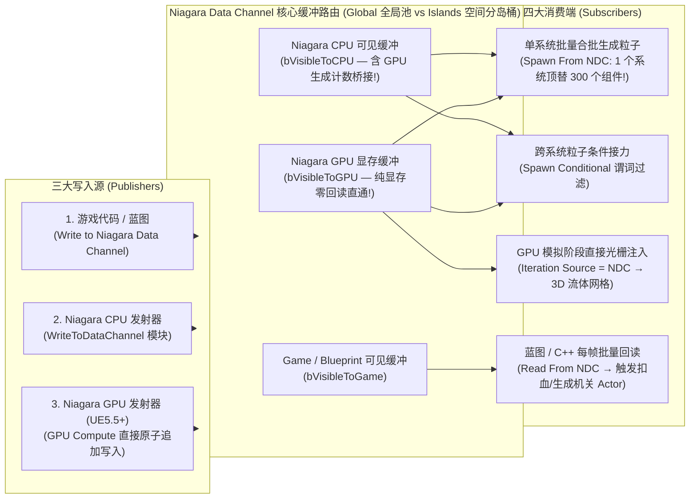

# 03 · 数据通道（NDC）空间分岛分桶、高频合批读写与双向游戏通信全解（`Niagara_Data_Channels`）

> **本篇实测拆解关卡档案**
> - **关卡路径**：`/Game/Maps/VFX/Niagara_Data_Channels`（关卡总 Actor 数：`32` | 展台数：**`7`** | 示例 Actor 数：`12`）
> - **核心资产目录**：`/Game/ExampleContent/Niagara/DataChannels/`（涵盖 `Blueprint/` 下的 `BP_WriteToGlobalNDC`、`BP_WriteToIslandNDC`、`BP_ReadFromNDC` 与 `Niagara/` 下的 8 套读写示范系统，并跨模块联动引擎流体插件的 `/NiagaraFluids/NDC_Grid3D_Gas`）
> - **跨卷呼应**：在第二卷《Niagara Examples Pack》的弹道受击实战中，我们已经见识过 NDC 在射击游戏里的威力；而本篇回归 Content Examples 的原生实验室 `/Game/Maps/VFX/Niagara_Data_Channels`，将 NDC 最核心的**六大通信原语拓扑**从零剥茧抽丝、彻底讲透！

---

## 一、 为什么传统 `SpawnSystemAtLocation` 在大型多人激战中会成为帧率杀手？

设想一场 60 人同屏交火的战术射击游戏（如《Fortnite》或《绝地潜兵》）：20 把加特林机枪、霰弹枪与爆炸破片在一秒钟内产生了 **300 次墙面受击弹孔火星** 和 **200 个泥地涉水脚印**。
如果你按照传统直觉，每次射线命中都调一次蓝图节点 `Spawn System at Location`：
1. **GameThread 对象风暴**：主线程每帧要实例化几十个 `UNiagaraComponent`、注册进 `UWorld` 场景树、初始化各自的 `System Spawn` VectorVM 虚拟机、计算独立包围盒（哪怕开启了 Pooling 组件池，每帧 `Activate/Reset` 与 Transform 更新开销依然极其沉重）；
2. **RenderThread & RHI 合批粉碎**：300 个独立的 `UNiagaraSystem` 实例意味着 300 套完全隔离的粒子属性缓冲区！哪怕每个弹孔只喷出区区 **8 颗火星**，GPU 也无法将不同组件合并进同一个 Compute Dispatch 和同一个 Draw Call——显卡算力全浪费在几百次零碎的微型内核启动与绘制状态切换上！
3. **跨系统“次元壁”**：此前在 `Niagara_Advanced_Particles` 展台 `#8` 中学到的 `Particle Attribute Reader`，只能读取**同一个 `UNiagaraSystem` 内部**其他发射器的粒子；如果场景里飞过来一颗独立系统的火球 Actor，怎么无耦合地唤醒脚下另一套草地系统的燃烧粒子或搅动远处的体积烟雾系统？

**Niagara Data Channels（简称 NDC，数据通道）** 正是虚幻引擎 5.3 ~ 5.5 为彻底终结这三大痛点而打造的**强类型、零耦合、空间感知的帧级流式消息总线（Pub-Sub Stream Bus）**！

### 1.1 一张图看懂 NDC 的三大数据可见域路由（Visibility Flags）与空间分桶架构

在创建一个 `NiagaraDataChannelAsset` 时，你先定义好一条“数据包结构（Payload Schema，例如：`Position` + `Normal` + `LinearColor` + `Scale`）”，然后引擎底层会自动按读者的需求维护三块按需同步的帧缓冲池：

> [!IMPORTANT]
> **按需拷贝的极致吝啬美学**：每次调用写入节点时，你都可以精细勾选本次写入的数据需要暴露给谁（`Visible to Blueprint` / `Visible to CPU` / `Visible to GPU`）。例如在展台 `#6` 中，GPU 粒子写入流体源时**只勾选 `Visible to GPU`**——数据全程锁死在显卡 VRAM 内部闭环流转，连 1 个字节都不会跨过 PCIe 总线去打扰 CPU！

下面，让我们沿着这条精悍纯粹的 `65 米` 走廊，逐台解剖全部 **7 座展台** 的实测资产与底层玄机。

---

## 二、 `Niagara_Data_Channels` 逐展台（#1 ~ #7）全量实测拆解

### 展台 #1：`Niagara Data Channels` — 流式负载总线总导览

- **空间元数据**：展牌 Label `BP_DemoDisplay4` | 坐标 `(500, -900, 0)`
- **官方展牌原文**：
  > *"Niagara Data Channels (NDC) are a way to facilitate communication between game code and Nagara systems as well as Niagara systems with one another. At its most basic, a data channel is stream of data with a defined payload that game code or Niagara systems can write to. This room demonstrates a few of the many ways data channels can be used."*
- **展台陈列 Actor（1 个）**：`Actor`（挂载 `ChaosDebugDrawComponent_0`，为后续空间分岛包围盒可视化提供调试绘制支撑）。
- **核心概念锚定**：请记住 NDC 与材质参数集合（MPC）的本质区别——MPC 存的是“单值全局状态（比如当前风速）”，每帧覆盖旧值；而 **NDC 存的是“每帧追加的事件流数组（Array of Events）”**！一帧内蓝图哪怕连续调用 50 次 `Write`，这 50 条记录也会整整齐齐排队留在当前帧通道队列里，帧末消费完毕后自动清空迎接下一帧（除非显式开启跨帧保留）。

---

### 展台 #2：`1. Write into a NDC from Blueprint` — 蓝图高频写入，单系统合批吐出万千粒子

- **空间元数据**：展牌 Label `BP_DemoDisplay` | 坐标 `(1500, -900, 0)`
- **官方展牌原文**：
  > *"Position and Color is written into a Niagara Data Channel from blueprint. The data is available to CPU emitters, GPU emitters and other blueprints and game code. The NDC is used by a SINGLE Niagara emitter to spawn multiple particles per data entry. In this demo the NDC data is being read by a GPU emitter. The data is used to set the position and color of each new particle at spawn."*

#### 2.1 MCP 实测双端资产深拆
1. **生产者蓝图 `BP_WriteToGlobalNDC`**（`/Game/ExampleContent/Niagara/DataChannels/Blueprint/BP_WriteToGlobalNDC`）：
   - **MCP 实测成员变量与实例参数**：`EmitPosition = (0,0,0)`、`EmitColor = (1, 0, 0, 0)`、`Box Extent = (200, 150, 75)`、`Hide Box = true`、`Interval = 0.25`（每 0.25 秒触发一次写入）、`CountPerWrite = 1`、`Data Channel Writer`、以及场景定位指示球组件 `EmitLocator`（`/Engine/BasicShapes/Sphere`）。
   - **蓝图写入三步曲**：先调用 `Init Write` 申请本批次写入句柄 `Data Channel Writer`（指定批量条数 `CountPerWrite`），随后在循环中填入随机采样的世界坐标 `Position`（自动支持 LWC 双精度大世界坐标 `FVector`！）与渐变 `Color`，一次性压入全局通道！
2. **消费者粒子系统 `NS_SpawnFromGlobalNDC`**（`/Game/ExampleContent/Niagara/DataChannels/Niagara/NS_SpawnFromGlobalNDC`）：
   - 全场**有且仅有这 1 个 `NiagaraActor` 实例**！内部单发射器 `SpawnFromGlobalNDC`（挂载 `NiagaraSpriteRendererProperties`）。
   - 在 `Emitter Update` 中挂载 `Spawn From Data Channel` 模块：每当检测到通道里新进来 $K$ 条蓝图记录，可配置为**每条记录爆出 $M$ 颗新粒子**（一共单次合批诞生 $K \times M$ 颗粒子！）；
   - 在 `Particle Spawn` 中挂载 `Init Particle From NDC`（或通过 NDC Reader 按 `NDCIndex` 读取），将蓝图刚刚写入的 `Position` 和 `Color` 原封不动赋给对应的那批新生粒子！

---

### 展台 #3：`2. Island vs Global Data Channels` — 开放大世界救星：动态空间孤岛分桶（NDC Islands）

- **空间元数据**：展牌 Label `BP_DemoDisplay2` | 坐标 `(2500, -900, 0)`
- **官方展牌原文**：
  > *"A major advantage to using Data Channels is the ability to combine multiple spawn events into a single system. This methodology cuts down the number of components significantly, but can reduce the effectiveness of visibility culling etc. A single massive system could be simulating particles off screen, or even on the other side of your map. Island Data Channels subdivide the world into chunks. Each chunk is its own island with its own Niagara system. This is a good compromise to maintain some granularity within components while maintaining sensible component counts. For demonstration purposes, these islands have been made very small. For typical use cases, islands should be 10 to 20 times larger."*

#### 3.1 为什么看现场 Actor 清单里“居然没有摆 `NiagaraActor`”？！
仔细看 MCP 提取的 `#3` 号展台陈列清单：
- **全场只有 1 个蓝图 Actor `BP_WriteToIslandNDC`**（`Box Extent = (250, 25, 250)`，`Interval = 0.25`），**场景大纲里竟然连一个手动摆放的 `NiagaraActor` 都没有**！那屏幕上冒出来的粒子是谁画的？
- **答案正是 `UNiagaraDataChannel_Islands` 的全自动托管魔法**！在 Island 类型的数据通道资产内部，直接配置好了 **`Systems`（托管粒子系统模板列表，如 `NS_SpawnFromIslandNDC`）**！当蓝图往某个世界坐标 `SearchLocation` 写入数据时，NDC 子系统会自动在那个位置**按需从对象池唤醒（或动态生成）一座局部孤岛系统实例**，当该区域许久没有新事件且粒子死光后，孤岛自动休眠回收！

#### 3.2 架构师必考题：为什么大世界游戏决不能无脑用 Global NDC，而必须用 Island NDC？
假设在一张 $8\text{km} \times 8\text{km}$ 的大逃杀地图上，如果把全图所有弹孔都塞进 **1 个 Global NDC 系统**里：
1. **视锥与遮挡剔除彻底瘫痪（Zero Culling）**：哪怕你正盯着身前一堵墙，但因为这唯一的巨无霸系统包围盒横跨 8 公里（包含了你身后 5 公里外别人的交火点），引擎判定该组件“永远在视锥内”，屏幕外几公里看不见的粒子照样每帧白跑模拟！
2. **LWC 局部单精度浮点抖动（Float32 Precision Loss）**：单个系统的局部原点距离 `4000m` 处的粒子太远，GPU `float32` 局部坐标有效位数不够，远端粒子会肉眼可见地格点抽搐！
3. **可扩展性距离裁剪失效（Scalability Distance Culling）**：无法按离相机的远近单独关掉远处的系统。

**Island NDC 的“空间自适应分桶（Spatial Subdivision）”完美兼得鱼与熊掌**：
- 它按 `Initial Extents`（初始岛尺寸）与 `Max Extents`（最大扩容上限）将大世界切分成若干紧凑的局部包围盒孤岛：如果新事件落在已有孤岛附近且扩容后不超过 `Max Extents`，就直接并入该孤岛合批；如果太远，就新开一座孤岛！
- **谨记官方展牌的量产调参忠告**：为了在几米宽的展台里让你亲眼看见“左边生一座小岛、右边生另一座小岛”的分裂过程，示例故意把孤岛缩到了几十厘米级；**在真实开放世界项目中，请务必把 Island 尺寸放大 10 到 20 倍（例如单岛 `25 米 ~ 50 米` 见方）**——这样一个街区共享 1 个合批组件，而隔街相望的另一条街一旦转过身去就能被视锥/遮挡剔除干净利落地一刀切掉！

---

### 展台 #4：`3. Write into a NDC from Niagara` — 跨系统粒子无线接力与“CPU 统管生成权”底层铁律

- **空间元数据**：展牌 Label `BP_DemoDisplay3` | 坐标 `(3498, -900, 0)`
- **官方展牌原文**：
  > *"Data channels can be written to directly from Niagara. As of UE5.5 data can be written from CPU and GPU emitters. In this demo the blue CPU emitter and green GPU emitter are in their own system. The trailing particles are in a separate system, spawned from a GPU emitter reading all spawn information from the data channel. If you are using a CPU emitter or a GPU emitter, the act of spawning new particles always happens on the CPU. As a result, for both ring emitters, the NDC visibility is set to CPU. Any data required by the GPU for spawning is automatically sent by this process."*

#### 4.1 MCP 实测跨系统双 Actor 拓扑深拆
展台上放置了两个在场景树里**毫无父子或引用关系、彻底解耦的独立 `NiagaraActor`**：
1. **发送方系统 `NS_WriteToNDC`**（`/Game/ExampleContent/Niagara/DataChannels/Niagara/NS_WriteToNDC`）：
   - 内部并排跑着两个圆环发射器：**蓝色环 `RingCPU`**（`simTarget = CPUSim`）与 **绿色环 `RingGPU`**（**`simTarget = GPUComputeSim`**）！这直观印证了 **UE 5.5 的重大里程碑——不仅 CPU 粒子能写 NDC，现在连纯 GPU Compute 粒子也能直接往 NDC 里写数据了**！
2. **接收方系统 `NS_SpawnFromParticleNDC`**（`/Game/ExampleContent/Niagara/DataChannels/Niagara/NS_SpawnFromParticleNDC`）：
   - 内部单发射器 `SpawnFromParticleNDC`（`simTarget = GPUComputeSim`），读取通道里的坐标与颜色，同时为蓝环和绿环拉出绚丽的星尘尾迹！

#### 4.2 极其烧脑但必须吃透的官方揭秘：为什么接收方明明是 GPU 发射器，发送方却要把 Visibility 设成 `CPU`？！
重读一遍上面官方展牌的最后三句话——这是理解 Niagara 引擎心脏的一把金钥匙：
- 在虚幻引擎中，无论接收方是 CPU 发射器还是 GPU 发射器，**“决定这一帧要新分配多少颗粒子槽位（Spawning）”的调度权永远掌握在 CPU 的 `Emitter Update` 手里**（除非使用专门的实验性 GPU Indirect Spawn）！
- 因此，如果下游消费者准备用 `Spawn From NDC` 根据通道条目数来**生成新粒子**，上游写入者（哪怕是 `RingGPU`）就必须勾选 `Visibility = CPU`（底层通过极轻量的异步计数/缓冲桥接通知 CPU 发射器本帧有多少条生成请求，随后引擎会自动把这批生成负载打包上传给下游 GPU 的 `Particle Spawn` 使用）！
- **反过来问**：有没有一种办法，连这丁点 CPU 生成调度都不走，让上游 GPU 粒子写的数据 **100% 留在显卡里** 被下游消费？有！请看两步之外的 **展台 `#6`（不生粒子，直接注入 Simulation Stage 网格）**！

---

### 展台 #5：`4. Conditional Spawning` — 消费者端零侵入谓词过滤（高度门限裁剪）

- **空间元数据**：展牌 Label `BP_DemoDisplay6` | 坐标 `(4505, -900, 0)`
- **官方展牌原文**：
  > *"When spawning from data channel variables, it is possible to compare the incoming data against a value to limit spawning. In this example the data channel contains a Height variable. The Spawn module is told to only spawn new particles if the module input (100) is greater than the data channel 'Height' variable."*

#### 5.1 MCP 实测双系统拓扑深拆
- **发送方**：`NS_WriteToNDCConditional`（内含 `RingCPU` [`CPUSim`] + `RingGPU` [`GPUComputeSim`]），圆环上下旋转时将每颗粒子当前的相对高度写入 NDC 的浮点字段 `Height`。
- **接收方**：`NS_SpawnFromParticleConditionalNDC`（内含 `SpawnFromParticleNDC` [`GPUComputeSim`]），挂载 **`Spawn Conditional`** 模块，设置比较算子使阈值 `100 > NDC.Height` 时才允许生成尾迹粒子——于是圆环转到下半圈（低于 100）时拖出浓密星尾，转到上半圈（高于 100）时瞬间断尾！

#### 5.2 工程解耦价值：一条广播流，喂养十种不同口味的听众
想象武器系统向一条统一的 `NDC_BulletImpacts` 广播了全图所有子弹命中记录（附带 `ImpactEnergy` 动能与 `SurfaceWaterDepth` 积水深度）：
- **小火星系统**监听全部记录；
- **重型龟裂震波系统**用 `Spawn Conditional (ImpactEnergy > 500)` 只在大口径狙击枪命中处生成；
- **水花飞溅系统**用 `Spawn Conditional (SurfaceWaterDepth > 2.0)` 只在有积水的地面炸开水柱！
**发送方武器代码一行都不用改，所有过滤逻辑完全内聚在各自的 VFX 接收资产内部**！

---

### 展台 #6：`5. Read from a Simulation Stage` — 100% 纯显存闭环！GPU 粒子直注三维流体解算网格

- **空间元数据**：展牌 Label `BP_DemoDisplay5` | 坐标 `(5500, -900, 0)`
- **官方展牌原文**：
  > *"Niagara Data Channels can be used as an Iteration Source for Simulation Stages. In this case the fluid source data is read from a NDC and splatted directly into the grid. Simulation Stages run on the GPU. By using a GPU system to write to the data channel we can avoid any data having to go to the CPU. On write the data is only made visible to GPU."*

#### 6.1 MCP 实测粒子-流体跨界耦合拓扑深拆
1. **源粒子发送方 `NS_WriteToNDCFluid`**（`/Game/ExampleContent/Niagara/DataChannels/Niagara/NS_WriteToNDCFluid`）：
   - 单发射器 `RingGPU`（**`GPUComputeSim`**），直接引用引擎流体插件预设通道 **`/NiagaraFluids/NDC_Grid3D_Gas`**！
   - 因为下游根本不需要“生成新粒子”，只需要往固定体素格子里涂抹密度和速度，所以在写入时**仅开启 `Visible to GPU`**！
2. **三维流体接收方 `NS_FluidNDC`**（`/Game/ExampleContent/Niagara/DataChannels/Niagara/NS_FluidNDC`）：
   - 单发射器 `Grid3D_Gas_Master_Emitter`（**`GPUComputeSim`**），同时挂载 `NiagaraMeshRendererProperties`（翻转法线包围盒 `/Engine/EngineMeshes/s_cube_1cm_flippednormals`）与 **`NiagaraVolumeRendererProperties`**！
   - **MCP 实测捕获的用户参数**：`User.ResolutionMaxAxis = 128`（最长轴 128 体素精度）、`User.WorldSpaceSize = (500, 50, 150)`、`User.SourceOffset = (-200, 0, -50)`、`User.DrawBounds = true`，并调用了边界遮罩动态输入 `/NiagaraFluids/DynamicInput/MaskFloatByBoundary` 与 `MaskVectorByBoundary`。

#### 6.2 惊艳绝伦的纯 GPU 间接派发机制（Indirect Dispatch Iteration Source）
在 `NS_FluidNDC` 内部，我们新建一个 `Simulation Stage`，把它的 **`Iteration Source` 直接指向 `NDC_Grid3D_Gas` 数据接口**！
- 上游 `RingGPU` 的 Compute Shader 刚往显存缓冲里写完 $N$ 条流体源记录（GPU 端维护原子长度计数器 `ElementCountBuffer`）；
- 下游 `NS_FluidNDC` 的 Simulation Stage 直接通过 RHI **`DispatchComputeShaderIndirect`** 读取显存里的 `ElementCountBuffer` 启动恰好 $N$ 个线程，每个线程取出一条 NDC 记录，把烟雾密度、温度与搅动速度直接光栅化涂抹（Splat）进 `Grid3DCollection` 体素网格！
- **全程 0 字节经过 CPU、0 帧回读延迟**！这意味着战场上任何角色挥出的火焰刀光、飞过的火箭弹尾焰、爆炸飞溅的燃烧碎片，无论来自多少个不同的武器系统，只要往 `/NiagaraFluids/NDC_Grid3D_Gas` 里一写，全场的体积浓烟都会瞬间被真实推开、点燃并卷起湍流漩涡！

---

### 展台 #7：`6. Write from Niagara. Read from BP` — 粒子碰撞反向唤醒游戏逻辑的双向闭环

- **空间元数据**：展牌 Label `BP_DemoDisplay7` | 坐标 `(6500, -900, 0)`（本馆收官展台）
- **官方展牌原文**：
  > *"The falling particles are spawned from a GPU emitter. When they collide they write into a global data channel. Data channels can be written to from CPU or GPU emitters. The data can be made visible to any combination of CPU emitters, GPU emitters and blueprints. In this case the data is only visible to blueprints. The BP_ReadFromNDC blueprint is reading all the elements within the data channel every frame. For each entry in the data channel a new actor is spawned."*

#### 7.1 MCP 实测 GPU $\to$ 蓝图回读闭环深拆
1. **GPU 粒子碰撞写入方 `NS_WriteToBPNDC`**（`/Game/ExampleContent/Niagara/DataChannels/Niagara/NS_WriteToBPNDC`）：
   - 单发射器 `WriteToNDC`（**`simTarget = GPUComputeSim`**，`NiagaraSpriteRendererProperties`）。下落的 GPU 粒子在检测到碰撞布尔标志 `HasCollided` 的那一帧，调用写入模块将碰撞点坐标压入全局通道，且将可见性精确限定为 **`Only Visible to Blueprints (Game)`**！
2. **游戏逻辑读取方 `BP_ReadFromNDC`**（`/Game/ExampleContent/Niagara/DataChannels/Blueprint/BP_ReadFromNDC`）：
   - 暴露监控变量 `NDC Element Count`。在每帧 `Event Tick` 中获取 `Data Channel Reader`，查询 `Num()` 得到本帧回传的碰撞条目总数，遍历读取每条记录的三维坐标并直接在落点生成真正的游戏 `AActor`（如毒液陷阱实体、可拾取金币、或调用范围扣血检测）！

#### 7.2 为什么它彻底取代了上一章展台 `#22` 的旧版 `Export Particle Data`？
对比 `02_Niagara_Advanced_Particles` 展台 `#22` 的 `INiagaraParticleCallbackHandler`：
- 旧版回调要求你必须把蓝图 `UObject` 实例指针手动塞进每个 Niagara 组件的 `User.BPCallbackHandler` 变量里（1 对 1 强耦合），且固定只能传 `Position + Size + Velocity` 三个死字段；
- 而新版 **NDC 回读** 彻底解耦了发送方与接收方（10 个不同的 GPU 毒雾系统同时往 `NDC_AcidSplash` 写，全局只需要 1 个伤害管理器 `Subsystem / Manager Actor` 统一读取结算！），并且支持任意自定义字段组合（伤害类型枚举、暴击倍率、归属阵营 ID 随心加）！

---

## 三、 本章 NDC 六大通信模式工程速查表

在迈入终极流体力学殿堂之前，请将这张 **UE5.5+ Niagara Data Channels 架构师速查表** 收入囊中：

| 通信方向与模式 | 代表展台与资产 | 写入端最佳 `Visibility` 勾选 | 核心量产实战场景 |
| :--- | :--- | :--- | :--- |
| **蓝图 $\to$ 全局单系统合批生成** | `#2` `BP_WriteToGlobalNDC` $\to$ `NS_SpawnFromGlobalNDC` | `CPU` (+ 若 GPU 发射器需读属性引擎自动上传) | 室内竞技场 UI 反馈特效、全屏天气落雷汇总。 |
| **蓝图 $\to$ 开放世界空间分岛合批** | `#3` `BP_WriteToIslandNDC` (`Islands`) | `CPU` | **大世界首选！** 全图机枪弹孔、载具轮胎扬尘、暴雨积水涟漪（单岛推荐 `25m ~ 50m`）。 |
| **Niagara (CPU/GPU) $\to$ 跨系统生成** | `#4, #5` `NS_WriteToNDC` $\to$ `NS_SpawnFromParticleNDC` | `CPU`（因下游需在 CPU 计算 Spawn 配额） | 母弹跨系统唤醒地表焦痕系统、配合 `Spawn Conditional` 按能量分级爆水花。 |
| **Niagara GPU $\to$ 模拟阶段网格直注** | `#6` `NS_WriteToNDCFluid` $\to$ `NS_FluidNDC` | **仅勾选 `GPU`（零 CPU 往返！）** | **次世代交互巅峰！** 任意技能刀光/弹丸实时搅动 `Grid3D` 体积烟火或 `Shallow Water` 水面。 |
| **Niagara GPU $\to$ 蓝图/C++ 逻辑回读** | `#7` `NS_WriteToBPNDC` $\to$ `BP_ReadFromNDC` | **仅勾选 `Blueprint / Game`** | 漫天散射火雨落地生成燃烧火海机关、群体飞虫叮咬玩家结算扣血。 |

还记得刚刚在展台 `#6` 惊鸿一瞥的那个 `/NiagaraFluids/NDC_Grid3D_Gas` 和 `Grid3D_Gas_Master_Emitter` 吗？那块神秘的 $128^3$ 体素盒子里，究竟是如何在一帧几毫秒内解算出好莱坞电影级的翻滚浓烟、黑体辐射烈焰、浅水船尾波与破坝飞溅洪水的？

深吸一口气——让我们推开本卷 VFX 实验室的最后一扇、也是最震撼人心的大门：**`04_Niagara_Fluids`**！
