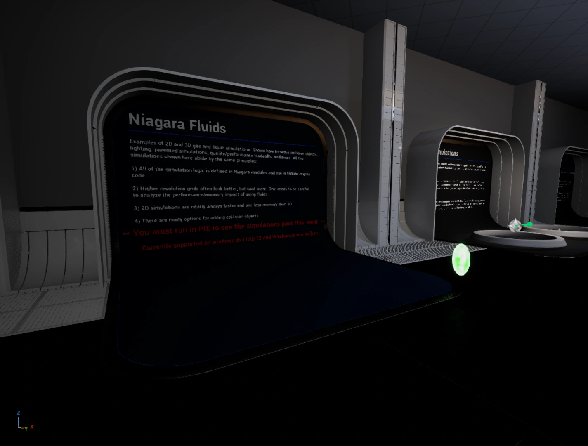
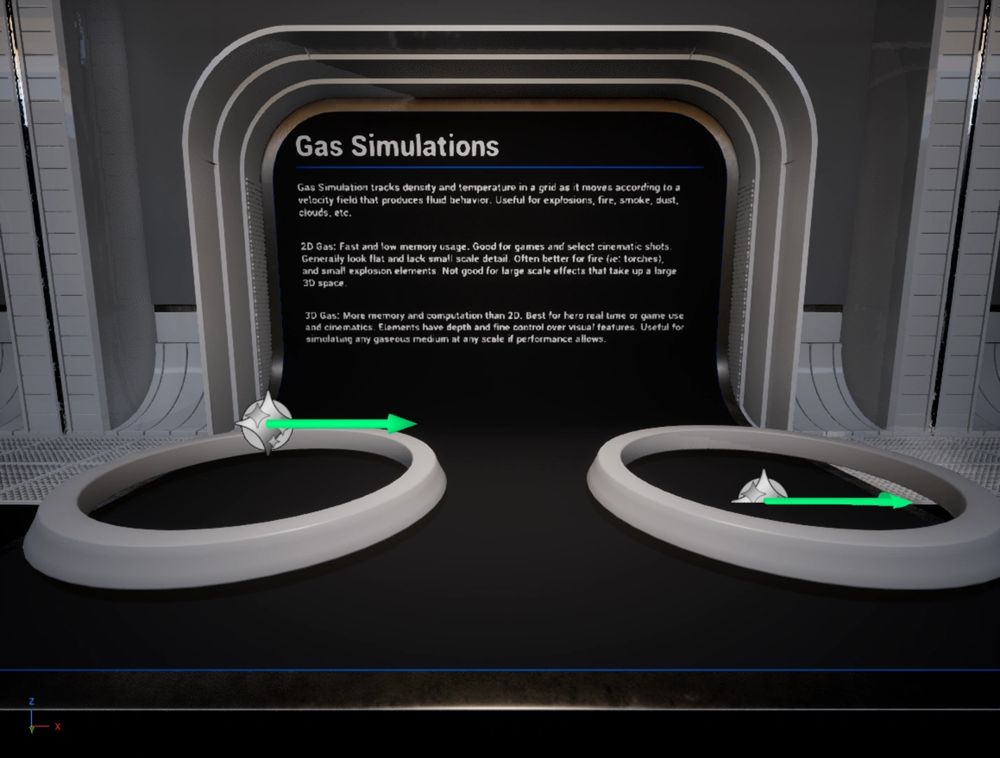
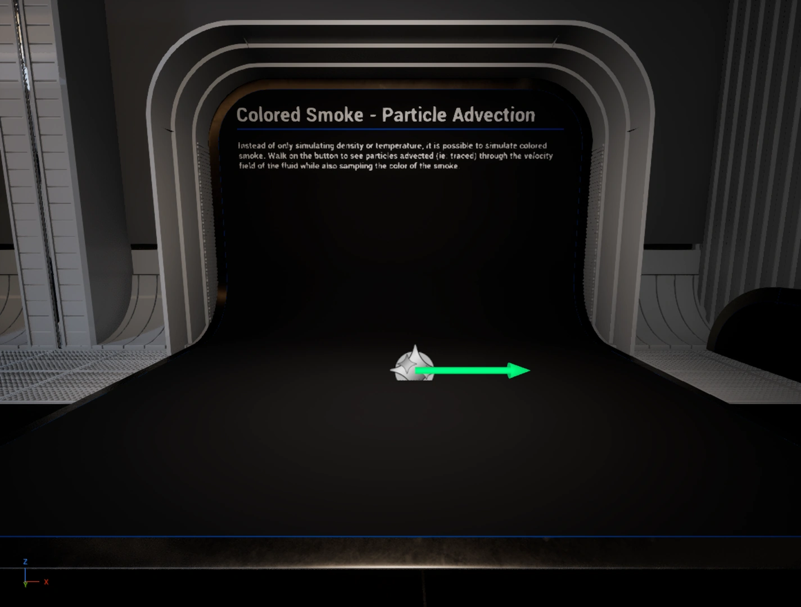
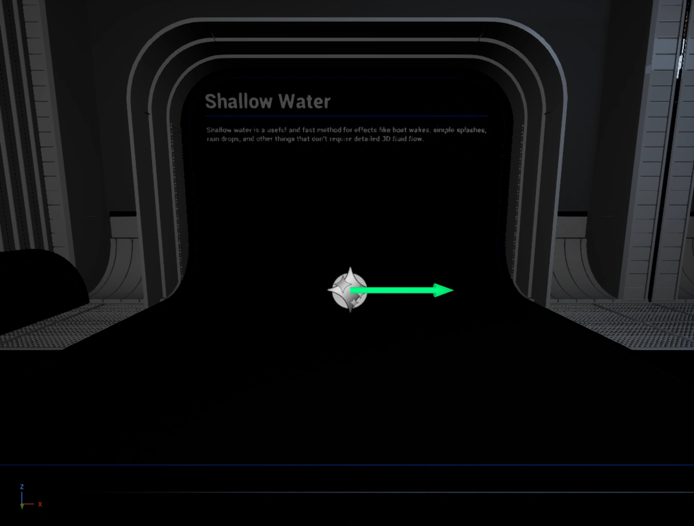

# 04 · 内置 Grid2D 浅水波方程、Grid3D 纳维-斯托克斯烟火与 FLIP 飞溅液体解算器全解（`Niagara_Fluids`）

> **本篇实测拆解关卡档案**
> - **关卡路径**：`/Game/Maps/VFX/Niagara_Fluids`（关卡总 Actor 数：`123` | 展台数：**`15`** | 示例 Actor 数：`94`）
> - **关卡脚本类**：`/Game/Maps/VFX/Niagara_Fluids.Niagara_Fluids_C`
> - **核心资产目录**：`/Game/ExampleContent/Niagara/`（涵盖 `2DGas/`、`3DGas/`、`2DLiquid/`、`3DLiquid/`、`Blueprints/`、`Meshes/` 共 17 套实时气液流体系统、3 套交互压力踏板蓝图与 2 套动态碰撞动画序列，底层由引擎内置 `NiagaraFluids` 插件白盒模块驱动）

---

## 一、 当好莱坞离线解算器走进 60FPS 游戏视口：为什么说 Niagara Fluids 是彻底的“白盒奇迹”？

在过去二十年的视觉特效工业中，“真流体模拟（CFD，计算流体力学）”一直是 Houdini、EmberGen 或 Maya Bifrost 离线渲染农场的专属领地——一帧 $256^3$ 的爆炸蘑菇云动辄解算几秒甚至几分钟，游戏美术只能把烤好的几秒钟动画压成一张 $8 \times 8$ 的序列帧贴图（Flipbook）贴在纸片上循环播放。一旦风向变了、角色挥剑劈过烟雾、或者巨石砸进水池，死板的序列帧贴图瞬间露馅。

直到你走进 `/Game/Maps/VFX/Niagara_Fluids` 这座长达 **165 米**（`X` 从 `502` 延伸至 `16502`）的殿堂——**请务必运行关卡（PIE）并亲自踩上每座展台前的触发区（`trigger1 ~ trigger13`）与地面压力踏板**！你将亲眼目睹实时翻滚自投影的彩色浓烟、纯粹由温度黑体辐射点燃的烈火、随挥舞火把拖曳惯性尾焰的局部解算器、实时荡漾船首波的浅水池，以及玩具小牛跃入水中激起千层晶莹浪花的 3D FLIP 破坝水池！

更震撼的是展台 `#1` 牌匾写下的第一条宣言：**这里没有一行藏在引擎 C++ 黑盒里的魔法代码！所有的平流、浮力、涡量限制、压力泊松迭代与等值面网格化，100% 是用你在第 02 章学过的 `Simulation Stages` + `Grid2DCollection / Grid3DCollection` 拼出来的纯白盒 Niagara 模块！**

在逐台拆解全部 **15 座展台** 之前，让我们先用一张全局物理求解管线图，把统治整座展厅的**三大流体力学数学引擎**一次看穿：

---

## 二、 三大实时流体求解器的物理图景与核心偏微分方程直觉导读

千万不要被流体力学的偏微分方程吓倒——它们每一项对应的都是你在厨房烧水、往水盆里扔石子时最朴素的日常物理直觉！

### 2.1 欧拉气云引擎（Grid2D / Grid3D Gas）：不可压缩 Navier-Stokes 算子分裂四步曲

对于烟雾、火焰与爆炸气浪，我们不再追踪几百万颗气体分子，而是在空间架设一座固定的三维体素笼子（**交错 MAC 网格，Marker-and-Cell Staggered Grid**：把标量密度 $\rho$、温度 $T$、压强 $p$ 存在格子正中心，而把速度分量 $u, v, w$ 分别存在格子的左右、前后、上下六个正交边界面中心，以彻底根除棋盘格压力伪影！）。每帧通过 **算子分裂法（Operator Splitting）** 依次跑完四个 `Simulation Stage`：

1. **平流（Advection — 随波逐流）**：烟雾密度 $\rho$、温度 $T$ 乃至速度场 $\mathbf{u}$ 自己顺着风速搬家：
   $$\frac{Dq}{Dt} = \frac{\partial q}{\partial t} + (\mathbf{u} \cdot \nabla) q = 0$$
   在 GPU 上采用无条件稳定的**半拉格朗日逆向回溯**（一阶线性插值快但会轻微糊掉小漩涡；高画质可切二阶 **BFECC / MacCormack** 预测校正平流！）。
2. **热浮力与燃烧热力学（Buoyancy & Combustion — 热气升腾、浓烟下沉）**：根据 Boussinesq 近似，温度高于环境温度 $T_{\text{amb}}$ 的热燃气受浮力向上猛冲，而沉重的冷黑烟颗粒受重力下坠：
   $$\mathbf{f}_{\text{buoy}} = \Big( \alpha (T - T_{\text{amb}}) - \beta \rho \Big) \hat{\mathbf{z}}$$
3. **涡量限制（Vorticity Confinement — 找回蘑菇云的脆爽卷边！）**：因为实时游戏体素网格较粗（如 $128^3 \sim 256^3$），数值插值就像自带高斯模糊一样会把精细的小卷涡抹平。Fedkiw 等人发明的**涡量限制**先算出流场的旋转剧烈程度（涡度 $\boldsymbol{\omega} = \nabla \times \mathbf{u}$），再找到指向涡心最陡峭的单位向量 $\mathbf{N} = \frac{\nabla |\boldsymbol{\omega}|}{|\nabla |\boldsymbol{\omega}|| + \epsilon}$，人为在切向补上一脚旋转助推力：
   $$\mathbf{f}_{\text{conf}} = \varepsilon \Delta x (\mathbf{N} \times \boldsymbol{\omega})$$
   哪怕只有 $128^3$ 分辨率，也能瞬间炸出层次分明的影视级翻滚花椰菜烟云！
4. **压力泊松投影去散度（Pressure Projection — 流体灵魂 $\nabla \cdot \mathbf{u} = 0$！）**：
   经历了前三步外力推挤后，中间速度场 $\mathbf{u}^*$ 往往违反质量守恒——有的格子里气体只进不出（散度 $\nabla \cdot \mathbf{u}^* < 0$，被无限压缩），有的格子只出不进。**亥姆霍兹-霍奇分解定理（Helmholtz-Hodge Decomposition）** 告诉我们：只需解出一个虚拟压强场 $p$，让高压区把多余气体往低压区推开，就能完美消除所有压缩发散！代入 $\nabla \cdot \mathbf{u}^{n+1} = 0$ 即得经典的**压力泊松方程（Pressure Poisson Equation）**：
   $$\nabla^2 p = \frac{\rho_0}{\Delta t} \nabla \cdot \mathbf{u}^*$$
   在 Niagara 的 `Simulation Stage` 中，GPU 对所有体素并行跑 **20 ~ 60 轮雅可比迭代（Jacobi Iteration）或红黑棋盘高斯-赛德尔松弛（Red-Black Gauss-Seidel）**（奇偶格交错更新，收敛速度翻倍！），最后用中间速度减去压强梯度：
   $$\mathbf{u}^{n+1} = \mathbf{u}^* - \frac{\Delta t}{\rho_0} \nabla p \implies \nabla \cdot \mathbf{u}^{n+1} = 0$$
   **神奇的一幕就在这一刻诞生**：原本直挺挺往上冲的一股热柱，撞上静止空气的瞬间因为不能压缩对方，被迫向四周优雅地翻卷分流，化作一朵完美的蘑菇云！

### 2.2 圣维南二维浅水波引擎（2D Shallow Water Equations, SWE）：高度场上的行波交响曲

如果要模拟一片 $20\text{m} \times 20\text{m}$ 的浅滩或河面涟漪，开 3D 体素太奢侈了。既然水的深度 $h(x, y, t)$ 远小于水平跨度，我们沿着竖直方向把速度积分平均，三维水体瞬间坍缩为一张极速二维网格，仅需求解两条守恒律：
- **水柱高度连续性方程（体积守恒）**：流入减流出等于水位涨落：
  $$\frac{\partial h}{\partial t} + \frac{\partial (hu)}{\partial x} + \frac{\partial (hv)}{\partial y} = 0$$
- **水平通量动量方程（重力水压驱动波浪传播，设河床高程为 $b(x,y)$，自由水面高程 $\eta = h + b$）**：
  $$\frac{\partial (hu)}{\partial t} + \frac{\partial}{\partial x}\left(hu^2 + \frac{1}{2}gh^2\right) + \frac{\partial (huv)}{\partial y} = -gh \frac{\partial b}{\partial x}$$
  水位高出的鼓包会产生静水压力梯度 $-gh\nabla(h + b)$ 向四周推水，形成以特征波速 $c = \sqrt{gh}$ 扩散反射的真实涟漪与开尔文船尾 V 字波！

### 2.3 混合拉格朗日-欧拉引擎（PIC / FLIP Liquid）：兼顾无压缩水压与狂野飞溅水珠

浅水方程虽快，但它只是单值高度图 $h(x,y)$，**画不出卷曲拍岸的管浪、悬空瀑布与飞溅水滴**！可如果纯用欧拉体素装水，气液交界面几次平流就会模糊蒸发掉一半水量；如果纯用粒子（SPH），几万颗水珠压在水池底又极难维持严格不可压缩。
电影工业标准解法 **PIC / FLIP（Fluid-Implicit-Particle，Zhu & Bridson 2005）** 把粒子和网格结成了天作之合：
- **用拉格朗日粒子负责“记位置与运水”（零体积蒸发、天生擅长飞溅水花）**；
- **用欧拉交错网格负责“算不可压缩压力投影 $\nabla \cdot \mathbf{u} = 0$”（几十万粒子挤在一起也绝不坍缩！）**。
每帧循环四步：**① P2G（粒子把动量涂到网格上，每格约 `8` 颗粒子） $\to$ ② 网格加重力、做固壁碰撞并迭代 `150 ~ 200` 轮求解不可压缩新网格速度 $\mathbf{u}^{n+1}$ $\to$ ③ G2P（网格把速度传回给粒子） $\to$ ④ 粒子移动并提取光滑等值面网格（Surfacing）**。
其中最精妙的灵魂就在第 ③ 步 **PIC 与 FLIP 的差异**：
- **纯 PIC** 直接用网格新速度覆盖粒子速度：$\mathbf{v}_p^{n+1} = \text{Interp}(\mathbf{u}^{n+1})$——每次往返插值都像抹了一层胶水，水花两秒钟就死气沉沉；
- **纯 FLIP** 只把**网格上算出来的速度变化量 $\Delta \mathbf{u} = \mathbf{u}^{n+1} - \mathbf{u}^*$** 累加到粒子原本的速度上：
  $$\mathbf{v}_p^{n+1} = (1 - \alpha)\underbrace{\text{Interp}(\mathbf{u}^{n+1})}_{\text{PIC 平滑抑噪项 (约 5\%)}} + \alpha \underbrace{\Big(\mathbf{v}_p^n + \text{Interp}(\mathbf{u}^{n+1} - \mathbf{u}^*)\Big)}_{\text{FLIP 零耗散湍流项 (约 95\%)}}$$
  粒子自身携带的次网格高频湍流与飞溅动量丝毫无损，水花撞上礁石的瞬间碎玉四溅、活力四射！

---

## 三、 `Niagara_Fluids` 逐展台（#1 ~ #15）全量实测拆解

> **关卡性能优化细节**：细读 MCP 提取的 Actor 清单你会发现，从 `#2` 到 `#15` 几乎每座流体展台脚下都埋设了一个隐形的 `TriggerBox`（`trigger1` ~ `trigger13`）！因为十几个高分辨率 3D 气液解算器如果同时全开会吃满整张显卡，关卡蓝图通过触发盒实现了**“玩家走到哪座展台前，才动态激活哪台流体解算器”**的智能按需休眠机制！

---

### 展台 #1：`Niagara Fluids` — 流体实验室四大黄金设计准则

- **空间元数据**：展牌 Label `BP_DemoDisplay` | 坐标 `(502, -890, 0)`
- **官方展牌原文（四大设计宪章）**：
  > *"Examples of 2D and 3D gas and liquid simulations. Shows how to setup collision objects, lighting, parented simulations, quality/performance tradeoffs, and more. All the simulations shown here abide by the same principles:*
  > *1) All of the simulation logic is defined in Niagara modules and not in hidden engine code.*
  > *2) Higher resolution grids often look better, but cost more. One needs to be careful to analyze the performance/memory impact of using fluids.*
  > *3) 2D simulations are nearly always faster and use less memory than 3D*
  > *4) There are many options for adding collision objects."*
- **展台环境 Actor（共 6 个）**：`DirectionalLight`（`Intensity = 10`, `Movable`）、`SkyLight`（`Intensity = 1`）、`SkyAtmosphere`、`ExponentialHeightFog`、`Actor`（`ChaosDebugDrawComponent_0`）与 `1.1 Actor Replication Doc Actor`（外加全局 `PostProcessVolume`）。

---

### 展台 #2：`Gas Simulations ` — 二维平面烟火 vs 三维体素气云同台对决

- **空间元数据**：展牌 Label `BP_DemoDisplay1` | 坐标 `(1502, -900, 0)`
- **官方展牌原文**：
  > *"Gas Simulation tracks density and temperature in a grid as it moves according to a velocity field that produces fluid behavior. Useful for explosions, fire, smoke, dust, clouds, etc. 2D Gas: Fast and low memory usage. Good for games and select cinematic shots. Generally look flat and lack small scale detail. Often better for fire (ie: torches), and small explosion elements. Not good for large scale effects that take up a large 3D space. 3D Gas: More memory and computation than 2D. Best for hero real time or game use and cinematics. Elements have depth and fine control over visual features. Useful for simulating any gaseous medium at any scale if performance allows."*

#### 2.1 MCP 实测左右火盆双系统深拆（共 5 个 Actor，含唤醒框 `trigger13`）
1. **左火盆 `S_Firepit4` + `2DGasIntro`**（`/Game/ExampleContent/Niagara/2DGas/2DGasIntro`）：
   - **拓扑摘要**：`SourceParticles`（`GPUComputeSim`，发射燃料源粒子） + **`Grid2D_Gas_SmokeFire_Emitter`**（`GPUComputeSim`，挂载 `SpriteRenderer` 将二维流体网格结果 `User.SimRT` 绘制在火盆上方的平面广告牌上）。
   - **算力账本**：假设网格为 $128 \times 128$，总共只有 **$16,384$ 个二维格点**！显存不到 `2 MB`，每帧 GPU 耗时往往不足 `0.2 ms`，在正面观看时篝火跳动与浓烟卷曲极具欺骗性。
2. **右火盆 `S_Firepit5` + `3DGasIntro`**（`/Game/ExampleContent/Niagara/3DGas/3DGasIntro`）：
   - **MCP 实测捕获的全部 8 个 `User.*` 高阶接口**：
     - 空间与精度：**`User.ResolutionMaxAxis = 196`**，**`User.WorldSpaceSize = (500, 500, 1000)`**（宽 5m × 深 5m × 高 10m 的竖长方体解算域，则体素数约为 $98 \times 98 \times 196 \approx \mathbf{188\text{ 万体素}}$，是左边 2D 网格的 **115 倍**！）；
     - 调试辅助：`User.DrawBounds = true`、`User.ShowOverlays = true`；
     - 碰撞与双光源属性读取器：`User.Collide_GeometryCollection`（Chaos 破碎体碰撞）、`User.Collide_Meshes`（`NiagaraDataInterfaceRigidMeshCollisionQuery`）、**`User.DirectionalLight1` & `User.DirectionalLight2`**（通过 `UObjectPropertyReader` 实时抓取场景主副平行光的方向与色温直接照亮三维烟云！）。

---

### 展台 #3：`Liquid Simulations` — 二维 PIC/FLIP 飞溅池 vs 三维体素粒子混合水体总览

- **空间元数据**：展牌 Label `BP_DemoDisplay2` | 坐标 `(2512, -900, 0)`
- **官方展牌原文**：
  > *"Liquid simulation involves tracking particles whose velocity is determined by a grid-based process that gives it fluid motion. 2D Liquids: Fast and low memory usage. Good for games and some cinematic shots. Useful for quick splashes, waterfalls, drips, etc. Not a good choice for pools of water or rivers (Shallow Water can be a good 2D choice, though). 3D Liquids: More memory and computation than 2D. Often requires a lot of particles. Can be used for any type of water effect, and especially good for turbulent rivers, ocean waves breaking on sand, and detailed splash effects with character interaction. Mostly useful for cinematics and water-centric games/real time uses."*

#### 3.1 MCP 实测左右水体双系统深拆
1. **左池 `2DLiquidPool`**（`/Game/ExampleContent/Niagara/2DLiquid/2DLiquidPool`）：
   - 单发射器 **`PIC_FLIP_Fluid`**（`GPUComputeSim`，`SpriteRenderer`）。在二维竖直切片网格上运行 PIC/FLIP 混合解算，几千颗水滴粒子在重力 `GravityForce` 下拍打容器四壁翻起二维浪花，非常适合横版动作游戏或贴墙瀑布飞沫。
2. **右池 `3DLiquidIntro`**（`/Game/ExampleContent/Niagara/3DLiquid/3DLiquidIntro`）：
   - **MCP 实测关键解算参数**：
     - **`User.Num Cells Max Axis = 75`**（液态 FLIP 的背景压力网格根本不需要像烟雾那样飙到 256！因为精细水花轮廓是由每格内部的**粒子**承载的，`64 ~ 92` 格足矣！）；
     - **`User.Particles Per Cell = 8`**（每个有水的三维体素格内初始撒入 $2 \times 2 \times 2 = 8$ 颗拉格朗日水粒子以防止网格空洞断流）；
     - **`User.Pressure Iterations = 200`**（水比空气沉重且绝对不可压缩，因此压力泊松迭代高达 **200 轮**，确保底层水柱绝不被上层水重压扁坍缩！）；
     - 同时预置了刚体网格 `Collide_Meshes`、破碎体 `GeometryCollectionCollisions`、地形 `LandscapeCollisions` 与角色物理资产 `PhysicsCollisions` 四大碰撞接口。

---

### 展台 #4：`Explosion - Quality vs Performance` — 体素分辨率三次方定律（$O(N^3)$）交互实验

- **空间元数据**：展牌 Label `BP_DemoDisplay3` | 坐标 `(4005, -900, 0)`
- **官方展牌原文**：
  > *"This explosion simulates both temperature and density. Values are sourced into the grid from a second particle emitter. The number of simulated grid cells reduces when you walk on the button. The fewer cells you simulate, the faster/less memory your simulation uses at the cost of losing a lot of detail."*

#### 4.1 MCP 实测高低精度双实例与压力踏板深拆（共 4 个 Actor）
- **交互踏板**：`BP_Button_Resolution`（类 `/Game/ExampleContent/Niagara/Blueprints/BP_PressureButton_Resolution`，继承自 `BP_PressureButton_Parent`，持有 `MainNiagaraSystem` 与 `LowNiagaraSystem` 两个引用）。
- **高精度爆炸 `3DGasExplosion` vs 低精度对照 `3DGasExplosion_lowres`**（均引用 `/Game/ExampleContent/Niagara/3DGas/3DGasExplosion`，唤醒框 `trigger12`）：
  - **双 GPU 发射器拓扑**：`ParticleSourceEmitter`（向外爆射高速火球弹道粒子，通过 `/NiagaraFluids/NDC_Grid3D_Gas` 沿途注入高温与浓烟） + `Grid3D_Gas_Master_Emitter`（挂载翻转法线立方体 `s_cube_1cm_flippednormals` 的 `MeshRenderer` 与原生 `NiagaraVolumeRendererProperties`！）；
  - **高精度默认参数**：`User.ResolutionMaxAxis = 256`、`User.WorldSpaceSize = (300, 300, 500)`、`User.SourceOffset = (0, 0, 100)`。

#### 4.2 算力账本：为什么分辨率砍一半，速度能快 **8 倍**？！
踩下踏板对比两朵爆炸蘑菇云时，请牢记三维欧拉网格残酷的 **$O(N^3)$ 三次方缩放铁律**：
- 当最长轴分辨率从 `256` 降到 `128`（仅缩小 $2$ 倍）时，总立体素数缩小了 $2 \times 2 \times 2 = \mathbf{8\text{ 倍}}$！显存带宽、平流采样次数与每一轮压力泊松迭代的线程数同步暴降 **87.5%**！
- **跨卷工程秘籍**：在实际商业开放世界动作游戏中，除了关键 Boss 过场特写直接开 `ResolutionMaxAxis = 192 ~ 256` 实时跑之外，最聪明的工业流正是利用本展台这套 `3DGasExplosion` 在引擎内置的 **Baker（烘焙器）** 中渲染成带六向光照法线与黑体温度通道的序列帧贴图（正如第二卷《Niagara Examples Pack》里的 `EOO` 爆炸烟雾所做的那样！）——离线享受 `256^3` 真流体细节，运行时只需 `0.05 ms`！

---

### 展台 #5：`Fire - Rendering` — 零烟雾密度！纯粹温度场与普朗克黑体辐射烈焰

- **空间元数据**：展牌 Label `BP_DemoDisplay11` | 坐标 `(5001, -900, 0)`
- **官方展牌原文**：*"This fire simulation emanates from a static mesh. Density is set to zero so all we render here is the temperature."*

#### 5.1 MCP 实测资产深拆：`3DGasFire`
- **陈列 Actor（共 3 个）**：燃料源静态网格 `Basic_Asset2`（`/Game/ExampleContent/StaticMeshes/Meshes/Basic_Asset2`） + `3DGasFire`（`/Game/ExampleContent/Niagara/3DGas/3DGasFire`） + `trigger11`。
- **MCP 实测参数**：`User.ResolutionMaxAxis = 256`、`User.WorldSpaceSize = (200, 200, 400)`（体素尺寸精细至 $400\text{cm} / 256 \approx \mathbf{1.56\text{ cm}}$！），通过 `User.StaticMesh`（`NiagaraDataInterfaceStaticMesh`）在 `Basic_Asset2` 表面发射高温源粒子注入网格。
- **体积火焰着色光学原理**：
  为什么这团火晶莹剔透、丝毫不见黑灰浓烟遮挡？因为系统将烟尘消光密度设为了 **`Density = 0`**！光线步进器（Raymarcher）穿过体素盒子时完全不发生散射遮挡，只读取每个体素的**开尔文热力学温度场 $T(\mathbf{x})$**，代入**普朗克黑体辐射近似曲线（Blackbody Radiation）**直接累加自发光辐射度：
  - 外缘冷却区（$T \approx 900\text{K} \sim 1300\text{K}$）：暗红 $\to$ 绯红微光，即将熄灭消散；
  - 中层剧烈燃烧区（$T \approx 1800\text{K} \sim 2800\text{K}$）：饱满跃动的明橙与金黄色火舌；
  - 根部富氧核心区（$T > 3500\text{K}$）：炽白耀眼的高能焰心，配合 PostProcess Bloom 呈现逼真热浪！

---

### 展台 #6：`Smoke - Lighting` — 异质体积渲染（Heterogeneous Volumes）双色聚光自阴影与地面投射影

- **空间元数据**：展牌 Label `BP_DemoDisplay12` | 坐标 `(5998, -900, 0)`
- **官方展牌原文**：
  > *"3D fluid simulations can use lights defined in your map. This example has a rim and a fill light. Shadow casting has been activated for Heterogeneous Volumes in the Project Settings. As the Cast Shadows toggle is active on this system you can see the shadows being cast onto the ground as well as the self shadows within the smoke. This simulation also collides against a static mesh."*

#### 6.1 MCP 实测冷暖双光影棚与拱门绕流配置（共 5 个 Actor）
- **冷暖对打影棚布光**：
  1. `SpotLight`（冰蓝轮廓光 Rim Light）：`lightColor = (0.518, 0.871, 1.0)`，`Intensity = 20`，`AttenuationRadius = 1000`，`CastShadows = true`，`Stationary`；
  2. `SpotLight2`（暖橙补光 Fill Light）：`lightColor = (1.0, 0.733, 0.431)`，`Intensity = 20`，`AttenuationRadius = 1000`，`CastShadows = true`，`Stationary`。
- **拱门障碍物与流体系统**：`SM_PanelArch`（`/Game/ExampleContent/Niagara/Meshes/SM_PanelArch_no_convex`） + `3DGasLitSmoke`（`ResolutionMaxAxis = 256`，`WorldSpaceSize = (700, 400, 700)`，挂载 **`NiagaraVolumeRendererProperties`**）。

#### 6.2 次世代体积渲染革命：什么是 `Heterogeneous Volumes`（异质体积）？
早期的流体只能挂在一个反面立方体 Mesh 上手写简易光线步进材质，既吃不到场景里任意数量聚光灯/点光源的阴影，也无法往水泥地面上投下浓烟的影子！
而在 UE5 原生 **`NiagaraVolumeRendererProperties`（基于 Heterogeneous Volumes 渲染管线）** 下：
1. **比尔-朗伯定律体积自阴影（Beer-Lambert Volumetric Self-Shadowing）**：光线从冰蓝轮廓灯和暖橙补光灯射入浓烟内部时，沿光路积分光学厚度计算透射率 $T(s) = \exp\left(-\int_0^s \sigma_t(\mathbf{x}(t))\,dt\right)$（构建自适应体积阴影贴图 AVSM / Beer Shadow Map），烟团背光褶皱处自然呈现出深邃厚重的冷暖立体体积感！
2. **向场景不透明地面投射真实软阴影**：浓烟不仅自己遮挡自己，还会接入延迟光照阴影通道，在拱门和展台地板上投下随烟雾翻滚实时变形的柔和投影！同时浓烟撞上 `SM_PanelArch` 拱门顶壁后被阻挡分流，从拱门两侧盘旋涌出！

---

### 展台 #7：`Colored Smoke - Particle Advection` — 多通道彩色烟云与拉格朗日示踪粒子平流可视化

- **空间元数据**：展牌 Label `BP_DemoDisplay13` | 坐标 `(6990, -900, 0)`
- **官方展牌原文**：
  > *"Instead of only simulating density or temperature, it is possible to simulate colored smoke. Walk on the button to see particles advected (ie: traced) through the velocity field of the fluid while also sampling the color of the smoke."*

#### 7.1 MCP 实测三发射器架构与交互踏板深拆（共 3 个 Actor）
- **交互按钮**：`BP_Button_Advection`（`BP_PressureButton_Advection`）切换用户参数 **`User.DisplayAdvection`**（默认 `0`）。
- **核心资产 `3DGasColoredSmoke`**（`ResolutionMaxAxis = 200`，`WorldSpaceSize = (600, 225, 600)`）：
  1. `ParticleSourceEmitter`：从不同方位喷入红、绿、蓝、黄多股彩烟源；
  2. `Grid3D_Gas_Master_Emitter`：不仅平流标量密度，还额外在 `Grid3DCollection` 中开辟了 **`RGB Color` 三通道属性缓冲**！当两股不同颜色的烟流在涡旋中交汇时，RGB 色度随无散速度场自然丝滑晕染交融；
  3. **`Advect_Particles_With_Grid`（点睛之笔！）**：当你踩下踏板唤醒该发射器时，成千上万颗轻盈的 GPU Sprite 示踪粒子（Tracer Particles）在 `Particle Update` 中通过三次线性插值读取 `Grid3D` 当前体素的速度 $\mathbf{u}(\mathbf{x}_p)$ 与烟雾颜色 $\mathbf{C}(\mathbf{x}_p)$：
     $$\mathbf{x}_p^{n+1} = \mathbf{x}_p^n + \Delta t \cdot \text{SampleGridVelocity}(\mathbf{x}_p^n)$$
     **实战妙用**：做魔法冰风雪、篝火火星或龙卷风碎屑时，直接让几十万颗廉价的 GPU 火星/雪花粒子顺着一团低分辨率 3D 流体速度场平流飞舞，就能用极低成本赋予离散粒子无与伦比的真流体漩涡灵魂！

---

### 展台 #8：`Smoke and Fire - Camera Facing` — 二维流体的“朝向相机广告牌”与“世界固定平面”博弈

- **空间元数据**：展牌 Label `BP_DemoDisplay4` | 坐标 `(8495, -900, 0)`
- **官方展牌原文**：*"2D fluid containers can be aligned to the camera (left example), or placed/oriented in world space (right)."*
- **MCP 实测左右对照（共 5 个 Actor，唤醒框 `trigger6`）**：
  - **左火盆 `S_Firepit` + `2DGasSmokeFire_CameraFacing`**：二维欧拉解算框每帧实时旋转法线正对主摄像机（Billboarded）。优点是玩家绕着火盆走一圈，永远不会看到“纸片侧面缩成一条线”的穿帮；但注意——如果你急速绕火盆大幅度甩镜头，解算平面跟着急转会导致视差错觉。
  - **右火盆 `S_Firepit2` + `2DGasSmokeFire_Fixed`**：解算框死锁在世界空间固定平面上。适合玩家视角受限的场景（如 2.5D 横版过关、走廊尽头背景火墙、固定机位过场），任凭镜头微晃也绝无平面自转伪影！

---

### 展台 #9：`Torch - Parented Sim` — 移动参考系局部解算与惯性拖尾补偿艺术

- **空间元数据**：展牌 Label `BP_DemoDisplay5` | 坐标 `(9503, -900, 0)`
- **官方展牌原文**：
  > *"This system is parented to moving geometry, and can inherit the motion to give natural results. The sim moves with the torch, and can be tuned to be as small (fast) as possible."*

#### 9.1 MCP 实测动态火炬序列深拆（共 4 个 Actor）
- **动画驱动**：`TorchSequence`（`/Game/ExampleContent/Niagara/2DGas/TorchSequence`，`30 fps`，帧区间 `[0, 81]`），通过 `MovieScene3DTransformTrack` 驱动火炬网格 **`SM_FirePit`** 在空中大幅度左右挥舞摇晃；
- **跟随流体**：**`2DGasTorch`**（`/Game/ExampleContent/Niagara/2DGas/2DGasTorch`）直接挂载绑定在挥舞的火炬上！

#### 9.2 巧夺天工的工程优化：为什么不用一个覆盖整个房间的巨大世界网格？
如果主角举着火把在森林里奔跑 1 公里，你显然不可能建一个 1 公里大的流体盒子！
`2DGasTorch` 展示了**局部移动非惯性参考系（Moving Local Container）**的绝技：
1. **极小巧的紧致包围盒**：流体网格永远只有火把头上方半米见方大小，跟着角色手腕一起平移旋转，显存与算力恒定极低；
2. **世界位移逆向平流 / 惯性速度注入（World-Space Motion Inheritance）**：如果网格完全死板锁在局部空间，火把往左猛挥时火苗也会像塑料假火一样直挺挺跟着往左平移！因此系统每帧计算容器本体的世界位移差 $\Delta \mathbf{X}_{\text{owner}} = \mathbf{X}^n - \mathbf{X}^{n-1}$，在局部平流阶段对场内已有烟火施加反向相对偏移 $-\text{WorldToLocal}(\Delta \mathbf{X}_{\text{owner}})$ 并按继承比例（Motion Inheritance Scale）注入惯性风速——火把往左挥，烈焰立刻向右后方拉出逼真的拖曳火舌！

---

### 展台 #10：`2D Collisions` — 动态碰撞粒子群实时推挤二维烟流

- **空间元数据**：展牌 Label `BP_DemoDisplay6` | 坐标 `(10497, -900, 0)`
- **官方展牌原文**：*"2D fluids can have moving collision particles that push the fluid around."*
- **MCP 实测三发射器耦合拓扑**：`2DGasSmokeWithCollisions`（配合 `S_Firepit3` 与 `trigger3`）：
  1. `SourceParticles`：在底部火盆持续生成升腾浓烟源；
  2. **`Fountain`（碰撞障碍粒子发射器，`GPUComputeSim`）**：像喷泉一样发射一串串实体碰撞圆球穿过烟柱；
  3. `Grid2D_Gas_SmokeFire_Emitter`：在 Simulation Stage 中将 `Fountain` 粒子的圆形包络光栅化写入二维网格的 `Solid Boundary Mask`（固体占据掩码）与 `Obstacle Velocity`（障碍物运动速度场）。在随后的压力泊松投影中，烟雾不仅无法穿透圆球，还会继承高速飞球拍击过来的动量，被硬生生砸开一道道翻卷的真空裂口！

---

### 展台 #11：`Shallow Water` — 圣维南二维浅水波尾迹、实时法线重构与浪尖白沫图

- **空间元数据**：展牌 Label `BP_DemoDisplay8` | 坐标 `(11997, -900, 0)`
- **官方展牌原文**：
  > *"Shallow water is a useful and fast method for effects like boat wakes, simple splashes, rain drops, and other things that don't require detailed 3D fluid flow."*

#### 11.1 MCP 实测资产与 4 张核心 RenderTarget 通道深拆
- **陈列 Actor**：`2DLiquidWake` $\to$ `/Game/ExampleContent/Niagara/2DLiquid/2DShallowWaterWake`（唤醒框 `trigger5`）
- **MCP 实测捕获的全部 9 个核心 `User.*` 参数**：
  - **超低开销网格配置**：**`User.ResolutionMaxAxis = 64`**，覆盖 **`User.WorldGridSize = (2000, 2000)`**（整整 $20\text{m} \times 20\text{m}$ 的宽阔水面，仅仅用了 $64 \times 64 = \mathbf{4,096}$ 个格点！水池底深 `User.BottomDepth = -50`）；
  - **双碰撞源输入**：`User.Collide_Meshes`（移动的搅水球体 `/Engine/EngineMeshes/MaterialSphere`） + `User.Landscape`（地形河床高低起伏接口）；
  - **四路外部纹理缓冲输出**：
    1. **`User.SimRT`**（`TextureRenderTarget`）：存储每格实时解算出的水面高度 $h(x,y)$ 与水平流速 $(u,v)$，直接送入水面平面网格 `/Engine/BasicShapes/Plane` 的材质 `World Position Offset` 顶起三维波浪起伏！
    2. **`User.NormalRT`**（`TextureRenderTarget`）：在 Simulation Stage 中对相邻格水位做中心差分求偏导：$\mathbf{N} = \text{normalize}\big(-\frac{\partial \eta}{\partial x}, -\frac{\partial \eta}{\partial y}, 1\big)$，赋予水面丝滑细腻的天空菲涅尔高光反射！
    3. **`User.FoamRT`**：监测水平速度场汇聚散度与波峰陡峭曲率，自动生成久久不散并随波漂移的浪花白沫遮罩！
    4. **`User.ProfileBufferRT`**：性能与水位剖面监控缓冲。

> [!TIP]
> **开放世界涉水交互性价比之王**：对比后面几百万体素/粒子的 3D FLIP 水池，`2DShallowWaterWake` 的 GPU 开销连它的十分之一都不到！在《刺客信条》或《荒野大镖客》级别的涉水浅滩、泥泞车辙积水、角色趟河尾迹设计中，将一块跟随玩家平移的局部 `Shallow Water` 高度图叠加到主河流水面材质上，是全行业公认的最高性能工程标准解！

---

### 展台 #12：`Waterfall - Collisions` — 屏幕深度图碰撞驱动的低成本二维飞溅瀑布

- **空间元数据**：展牌 Label `BP_DemoDisplay9` | 坐标 `(13009, -900, 0)`
- **官方展牌原文**：*"Depth map collisions with 2D camera facing liquids can produce convincing results."*
- **MCP 实测场景深拆（共 4 个 Actor）**：
  - 两块真实的天然三维岩石静态网格 **`SM_Rock`** 与 **`SM_Rock2`**（`/Game/ExampleContent/Landscapes/Meshes/SM_Rock`）；
  - 二维液体系统 **`2DLiquidWaterfall`**（`/Game/ExampleContent/Niagara/2DLiquid/2DLiquidWaterfall`，双 GPU 发射器 `Source` + `PIC_FLIP_Fluid`）。
- **巧思拆解**：在悬崖峭壁上挂十几条远景交互瀑布，如果全开 3D FLIP 算力吃不消，纯播序列帧又没法跟崖壁上凸出的乱石真实碰撞。`2DLiquidWaterfall` 把一张朝向相机的 **2D PIC/FLIP 液体切片** 贴在三维岩石 `SM_Rock` 前方，直接通过 **Depth Map（场景深度缓冲碰撞）** 感知后方三维岩石的凹凸轮廓——水流倾泻而下砸在凸起的石头棱角上瞬间左右分流、溅起漫天白沫！

---

### 展台 #13：`Pool - Particles/Surfacing` — 破坝实验、等值面网格化（Surfacing）与距离场碰撞精度对比

- **空间元数据**：展牌 Label `BP_DemoDisplay10` | 坐标 `(14479, -900, 0)`
- **官方展牌原文**：
  > *"3D liquids are simulated as particles, but rendered as a surface that stretches over them. Particles Per Cell controls how many particles your sim has. More particles gives better stability at the cost of performance. The button togglesbetween particle and surface rendering. The statue and cow are static meshes that have collision shapes. When distance fields are enabled, those will affect collisions, otherwise, it uses physics shapes, which less accurately model your mesh."*

#### 13.1 MCP 实测破坝水池全家福深拆（共 6 个 Actor）
- **核心三维水体 `3DLiquidDamBreak`**（引用 `/Game/ExampleContent/Niagara/3DLiquid/3DLiquidSurfacing`）：
  - `User.Num Cells Max Axis = 75` | `User.Particles Per Cell = 8` | `User.Pressure Iterations = 200`；
- **动态落水小牛序列**：`CowSequence`（`30 fps`，帧区间 `[0, 100]`）驱动玩具奶牛 **`SM_Toy_Cow`**（`/Game/ExampleContent/Niagara/Meshes/SM_Toy_Cow_no_convex`）反复掉进水池激起巨浪，池中另立一座静态雕像 **`SM_Statue`**（`SM_Statue_no_convex`）；
- **交互切换踏板**：`BP_Button_Surfacing`（`BP_PressureButton_Surfacing`），一键切换 **“底层 FLIP 粒子球视图”** 与 **“连续折射水面网格（Surfacing）视图”**！

#### 13.2 两大核心技术真相：从离散水珠到光滑水面（Surfacing） + `_no_convex` 后缀的秘密！
1. **等值面提取（Liquid Surfacing）是怎么把几十万颗圆球变成一整张连续玻璃水面的？**
   当你踩下 `BP_Button_Surfacing` 时，真相一目了然：FLIP 解算器在后台跑的永远是一颗颗离散的粒子球！为了把它画成晶莹剔透的水面，引擎每帧执行一套极速 GPU 几何重建管线：
   - **粒子球烘焙至隐式水平集（Particle-to-LevelSet SDF）**：将每颗水粒子看作一颗半径为 $r$ 的水滴球，光栅化融合进一块更高精度的 3D 有向距离场体素网格 $\phi(\mathbf{x})$；
   - **平均曲率平滑滤波（SDF Smoothing / Mean Curvature Flow）**：消除单个粒子球表面的凹凸麻点感，使液面在平静处光滑如镜；
   - **等值面网格化渲染（Marching Cubes / Volumetric Ray-Surfacing）**：沿着 $\phi(\mathbf{x}) = 0$ 的零等值面实时提取连续三角网（或步进求交）并套用带单层水体折射吸收（`SingleLayerWater`）的高光水材质！
2. **为什么小牛和雕像的模型名字特意带了 `_no_convex` 后缀？**
   看官方展牌最后一句点拨：这两个模型故意去掉了粗糙的凸包物理碰撞盒（Convex Hulls），就是为了向你证明——开启项目的 **`Generate Mesh Distance Fields`** 后，`NiagaraDataInterfaceRigidMeshCollisionQuery` 会直接采样模型高精度的 **Mesh SDF**！洪水冲过时，水流能精准灌进奶牛四条腿之间的空隙与雕像凹槽，而不会被一个臃肿的凸包方盒挡在外面！

---

### 展台 #14：`Pool - Collisions` — 四维一体全类型碰撞矩阵（骨骼角色、地形、刚体与破碎）

- **空间元数据**：展牌 Label `BP_DemoDisplay7` | 坐标 `(15504, -900, 0)`
- **官方展牌原文**：
  > *"The 3D gas and liquid simulators support a wide range of collision object types, including static and skeletal meshes, landscapes, and Geometry Collections used for destruction."*

#### 14.1 MCP 实测角色趟水配置（共 3 个 Actor）
- **奔跑人体模型 `Run_Fwd`**（`SkeletalMeshActor` $\to$ `/Game/Characters/Mannequins/Meshes/SKM_Quinn_Simple`）；
- **三维交互水池 `3DLiquidCollisions`**（引用 `/Game/ExampleContent/Niagara/3DLiquid/3DLiquidPool`）：`Num Cells Max Axis = 64`、`Particles Per Cell = 8`、`Pressure Iterations = 150`。
- **工程全明星碰撞矩阵总结**：观察 `3DLiquidPool` 暴露的四个标准 DataInterface 插槽，Niagara Fluids 将游戏世界里所有可能下水的物体一网打尽：
  1. **静态/刚体网格（`User.Collide_Meshes` $\to$ `RigidMeshCollisionQuery`）**：优先读 Mesh SDF，回退读简单盒/球/胶囊体；
  2. **骨骼动画角色（`User.PhysicsCollisions` $\to$ `NiagaraDataInterfacePhysicsAsset`）**：骨骼网格因为每帧蒙皮变形没有静态 SDF，解算器直接读取角色 `PhysicsAsset`（如 `SKM_Quinn_Simple` 绑在大腿、小腿、躯干上的胶囊体阵列）及其骨骼角速度，角色迈腿狂奔时小腿胶囊体精准踢起水花！
  3. **大地形（`User.LandscapeCollisions` $\to$ `NiagaraDataInterfaceLandscape`）**：直接采样地形高度图纹理作为不可穿透河床底界；
  4. **Chaos 破碎建筑（`User.GeometryCollectionCollisions` $\to$ `NiagaraDataInterfaceGeometryCollection`）**：大桥炸塌时，几十块崩落水中的混凝土碎块实时排开水体激起巨浪！

---

### 展台 #15：`Constant Emission` — 地形河道持续涌流、粒子生命周期守恒与白水泡沫（Whitewater）

- **空间元数据**：展牌 Label `BP_DemoDisplay14` | 坐标 `(16502, -900, 0)`（全四馆终极压轴展台！）
- **官方展牌原文**：
  > *"Effects like rivers are possible when constantly emitting particles. Note in these types of cases, care must be taken to kill particles so you don't accumulate too many. Whitewater particles are on by default for all liquid systems, and provide detail in areas that churn water."*

#### 15.1 MCP 实测湍流河道全场景深拆（共 12 个展台 Actor + 全局挡板）
- **真实地形河床**：`Landscape`（包含 `LandscapeComponent_0 ~ 4` 共 5 块起伏地形组件），两侧辅以多块覆写 `HideGeo` 隐形材质的 `PhAT_FloorBox` 防止河水漫出展台；
- **核心奔腾河流系统 `3DLiquidConstantEmission`** $\to$ `/Game/ExampleContent/Niagara/3DLiquid/3DLiquidRiver`：
  - **MCP 实测参数**：**`User.Num Cells Max Axis = 92`**（拉长河道跨度因此提升最大轴网格数至 92）、`User.Particles Per Cell = 8`、`User.Pressure Iterations = 200`、绑定 `User.LandscapeCollisions` 直接顺着 `Landscape` 河道坡度奔涌而下！

#### 15.2 开放式流体（Open-Channel Flow）的两大收官秘籍
1. **进水口与排水口动态平衡（Inflow / Outflow Budget Control）**：
   前面 `#13, #14` 的水池都是封闭一缸水（只在第 0 帧 `SpawnBurst` 一次，粒子总数恒定）。但河流必须在源头每帧 `SpawnRate` 源源不断注入新水粒子！**铁律警告**：如果不给水粒子设置寿命上限或在河道下游末端设置**边界销毁盒（Kill Volume / Boundary Sink）**，几分钟后粒子数就会突破百万撑爆显存导致整条河卡死停流！
2. **电影级点睛之笔——次级白水粒子系统（Whitewater：Spray 飞沫 / Foam 浮沫 / Bubbles 气泡）**：
   只有晶莹透明的 `Surfacing` 主水体在湍急河滩上会显得像一块流动的透明果冻，缺乏真实激流那种“雪白翻滚”的力量感！
   因此 Niagara 3D Liquid 模板默认内置了耦合的 **Whitewater 次级发射器**：每当主 FLIP 水体在礁石跌水处检测到**高曲率浪尖（Wave Crest）+ 剧烈速度湍流卷吸空气（Trapped Air Potential）**时，就会自动爆发出成千上万颗极轻量的次级白水粒子：
   - 飞离液面进入空气的（$\phi > 0$）受重力抛物线坠落，化作**水雾飞沫（Spray）**；
   - 紧贴液面零等值面的（$\phi \approx 0$）随表面流速平流漂移，化作**浪花白沫（Foam）**；
   - 卷入水底深处的（$\phi < 0$）受浮力向上升腾，化作**水下气泡（Bubbles）**！

---

## 四、 `11_VFX_内置Niagara与流体实验室` 四篇全景收官选型总表

至此，我们已经完整踏遍了 Content Examples 内置 VFX 实验室的全部 **4 张地图、73 座展牌（26 + 25 + 7 + 15）与上百套核心 Niagara 资产**！在合上第一卷这册 VFX 秘籍走向实战项目前，请用下面这张总表为你的每一次技术选型精准定航：

| 特效需求量级与场景形态 | 最优架构选型 | 展厅权威参考模板 | 帧耗时预算参考 (桌面端) |
| :--- | :--- | :--- | :--- |
| **高频自包含短效（火星、弹孔烟尘、拾取物、环境浮尘）** | **`Lightweight (Stateless)` 无状态发射器** | `01_Niagara_Particles` `#10 ~ #15` | `< 0.05 ms`（支持 `Fastest` 零 VM 脚本通道） |
| **全地图多点高频爆发合批（百人交火弹道、暴雨积水）** | **`Niagara Data Channels` (`Islands` 空间分岛)** | `03_Niagara_Data_Channels` `#2 ~ #5` | `< 0.15 ms`（消除上百个离散组件开销） |
| **万级粒子群体智能、刚性堆叠碰撞、铁链与神经网** | **`Simulation Stages` + `NeighborGrid3D`** | `02_Niagara_Advanced_Particles` `#11 ~ #20` | `0.2 ~ 0.8 ms`（$O(N)$ 空间哈希并行） |
| **大面积角色涉水涟漪、船首尾迹、浅滩波浪** | **`Grid2D Shallow Water`（二维浅水波方程）** | `04_Niagara_Fluids` `#11` (`2DShallowWaterWake`) | `0.15 ~ 0.4 ms`（$64^2 \sim 256^2$ 高度场直驱材质） |
| **火炬交互尾焰、横版烟雾碰撞、峭壁贴石瀑布** | **`Grid2D Gas` / `2D PIC-FLIP Liquid`** | `04_Niagara_Fluids` `#2, #8 ~ #10, #12` | `0.2 ~ 0.6 ms`（比 3D 流体省一个数量级） |
| **影视特写巨龙吐息、实时光影浓烟、破坝洪水与烘焙母版** | **`Grid3D Gas` (Heterogeneous Vol) / `3D FLIP Liquid`** | `04_Niagara_Fluids` `#4 ~ #7, #13 ~ #15` | `1.5 ~ 6.0+ ms`（英雄级奇观或离线烘焙 `EOO` 贴图） |
