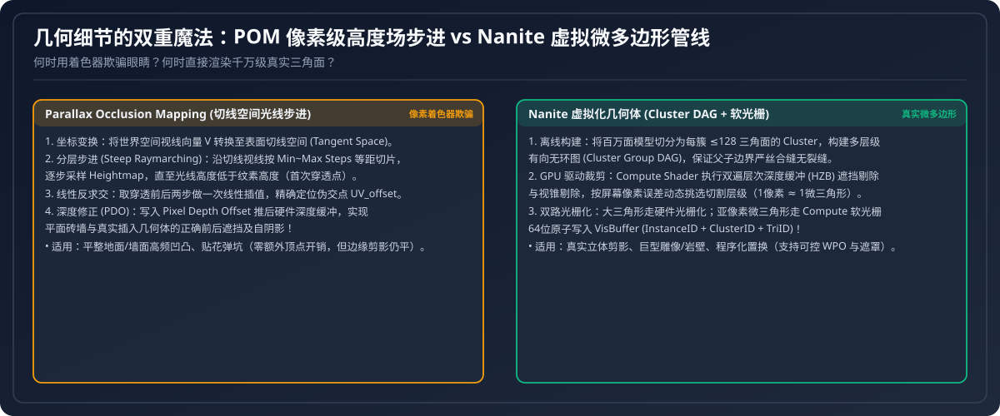

# 01 · `Math_Hall` 数学大厅：向量、点积、叉积、插值、三角波与空间变换 75 展台逐号精讲

> **对应关卡路径**：`/Game/Maps/Misc/Math_Hall`
> **核心资产目录**：`/Game/ExampleContent/Math_Hall/`（联动全局滑块 `/Game/Global/Blueprints/BP_Slider`）
> **关卡实测规模**：总 Actor 数 `392` | 官方展台（`BP_DemoDisplay`）总数 **`75` 座** | 交互与演示示例 Actor 数 `181` | 3D 空间悬浮标注 `123` 处

---

## 序章：为什么 `Math_Hall` 是虚幻引擎最具启发性的“图形学与游戏数学圣殿”？

在游戏研发中，无数初学者与中级开发者都会撞上一堵无形的墙：
- 打开材质编辑器（Material Editor）或 Niagara 粒子脚本，满屏都是 `Frac`、`FMod`、`Abs`、`OneMinus`、`Power`、`Lerp`、`HeightLerp`、`SphereMask`、`Dot`、`Cross`、`TransformVector`；
- 翻开线性代数与微积分教材，看到的却是干瘪的符号推导——你明明背得出点乘公式 $x_1 x_2 + y_1 y_2 + z_1 z_2$，却在需要写出**“积雪自动只覆盖在岩石朝天的表面”**、**“守卫前方 $90^\circ$ 扇形警戒视野”**、**“无贴图纯数学生成圆角倒角地砖法线”**、或者**“不产生透视边缘畸变的 GPU 粒子广告牌（Billboard）”**时束手无策。

Epic Games 的技术美术大师们在 Content Examples 中建造的 **`Math_Hall`（数学大厅）**，正是为了彻底击碎这堵墙而生。它把枯燥的公式变成了**可拖拽、可缩放、实时发光跳动的视觉实验室**：


在这条长达 **280 米**（世界坐标 $X$ 从 `0` 延伸至 `28,006` 厘米）的科幻长廊里，75 座 `BP_DemoDisplay` 展台按教学逻辑严密铺开。左侧用自定义导数绘图着色器实时绘制红色函数曲线 $y = f(x)$，右侧立刻用动态交互材质球、顶点动画或三维空间箭头告诉你：**“这个数学算子在真实游戏里到底能变出什么魔法！”**

> [!IMPORTANT]
> **本文导览说明（75 座展台一个不少！）**
> 在实测提取 `/Game/Maps/Misc/Math_Hall` 关卡数据时，由于部分展牌标题带有 `2.1`～`2.22` 前缀而另一部分直接使用算子名（如 `ABS Math`），引擎序列化生成的档案序号为 `#1`～`#75`。
> 为了让你获得**最顺畅的展厅漫步顿悟体验**，正文严格按照你走进大门、沿 $X$ 轴由浅入深穿过**四大展厅（序厅 -> 第一长廊：标量代数与波形塑形 -> 第二长廊：三维向量几何与空间变换）**的真实空间动线逐一精讲；同时**每一座展台均完整标明其实测档案编号 `#1`～`#75`、展牌 Label、三维坐标与内部材质/蓝图节点连线**，并在文末附上严格按 `#1`～`#75` 排序的全量核对速查总表！

---

## 一、 进馆必读：空间布局、GPU 导数画线黑科技与基础代数基石

### 1.1 四大展厅空间拓扑与“三联展台”建筑结构

实测关卡中的 `BP_DemoRoom`（坐标 `(0, 0, 0)`，总段数 `28.5`）将整座数学大厅划分为首尾相连的四个空间区块：

| 展厅分区 (`roomName`) | 空间跨度（长度段 $\times$ 宽度） | $X$ 轴世界坐标范围 | 教学核心主题 | 包含展台数量 |
| :--- | :--- | :--- | :--- | :--- |
| **1. `Introduction`（序厅）** | `2` 段 $\times$ `16` 宽 | `X = 497 ~ 1524` | 展厅总纲、函数图像阅读规范、`BP_Slider` 交互指南 | **3 座**（`#11`～`#13`） |
| **2. `Functions`（标量函数长廊）** | `14` 段 $\times$ `22` 宽（暗调聚光：`intensityShift = -0.56`） | `X = 3059 ~ 15919` | 15 大核心标量/插值/波形/距离场算子的图像与着色器实例 | **45 座**（`#14`～`#58`，共 15 组“三联展台”） |
| **3. `Vectors`（向量概念厅）** | `2` 段 $\times$ `16` 宽 | `X = 17515 ~ 18505` | 向量定义、1D 路标加减法、2D 平面坐标寻路 | **4 座**（`#1`～`#4`） |
| **4. `Vector Examples`（三维向量与空间变换长廊）** | `9` 段 $\times$ `16` 宽 | `X = 19984 ~ 28006` | 欧氏距离、3D 向量、归一化、朝向旋转、三平面投射、相机向量、广告牌、点积、叉积、正交标架、三角函数 | **23 座**（`#5`～`#10`、`#59`～`#75`） |

细心的读者在浏览第一长廊（`Functions`）时会发现一个极其精妙的设计：**每一种数学函数都由 3 座 `BP_DemoDisplay` 组合成一座“三联展位（Triad Booth）”**：
1. **中央地面总铭牌（`Function - XXX`）**：宽度跨过左右两翼，负责在走廊地面投射醒目的巨型白色立体标题（如 `Function - ABS`）；
2. **数学图像分展台（`XXX Math`）**：搭载 `BP_Graph` 动态曲线画板与 2～4 个 `BP_Slider` 交互滑块，实时绘制函数曲线；
3. **着色器实战分展台（`XXX Example`）**：搭载 `BP_Mat_with_Slider` 圆形展盘（`S_MathHall_DisplayButton_01`）或球体网格，把左边的函数直接变成顶点弹跳、纹理马赛克、高度混合或程序化水波！

---

### 1.2 揭秘画板背后的黑科技：`PlotFunctionOnGraph_Derivative` 与 `BP_Graph`

在逐号拆解展台前，我们先撬开第一长廊所有曲线画板共用的核心蓝图 `/Game/ExampleContent/Math_Hall/Blueprint/BP_Graph` 与引擎内置调试材质函数 `/Engine/Functions/Engine_MaterialFunctions01/Debug/PlotFunctionOnGraph_Derivative`：

1. **为什么普通着色器画高斜率曲线会“断线”？偏导数等宽抗锯齿原理！**
   如果在像素着色器里直接判断 $\lvert y - f(x) \rvert < w$ 来画线，当函数曲线几乎垂直（例如 $\tan(x)$ 或高次幂 $x^8$，导数 $\lvert f'(x) \rvert \gg 1$）时，$x$ 稍微移动一点点，$f(x)$ 就剧烈跳变，竖直方向虽然很宽，**法向垂直线宽却被压缩成 $\frac{w}{\sqrt{1 + f'(x)^2}}$，导致陡峭处线条细如蛛丝甚至断裂**！
   注意材质中每个算子都出现了**成对的两个节点**（如 `MaterialExpressionAbs_2` 与 `MaterialExpressionAbs_3`、`MaterialExpressionSine_2` 与 `MaterialExpressionSine_3`）！因为 `PlotFunctionOnGraph_Derivative` 利用微积分有限差分（或屏幕空间偏导指令 `ddx` / `ddy`）在相邻采样点分别求值 $f(x)$ 与 $f(x + \Delta x)$，近似算出切线斜率 $f'(x)$，再用勾股修正距离：
   $$d_{\perp}(x, y) = \frac{\lvert y - f(x) \rvert}{\sqrt{1 + \left(\frac{df}{dx}\right)^2}}$$
   无论曲线多么陡峭，红色发光曲线 `f(x) = y` 在屏幕上永远保持均匀恒定的像素线宽（`LineThickness = 1`）！
2. **`BP_Graph` 蓝图的动态联动链路**：
   - 构造脚本与运行时事件（`SetRange`、`GetSliderValues`、`GetAdjustedVariableSlider`）在 `GraphMesh`（`EditorPlane`）上创建动态材质实例 `GraphMID`；
   - 读取横轴滑块 `X-Slider` 与纵轴滑块 `Y-Slider` 的值，拼装成四维向量参数 `Range = (-XMax, +XMax, -YMax, +YMax)` 传入 `GraphMID`，实现**无损矢量缩放坐标系**；
   - 若函数带额外参数（如 `Power` 的指数、`Lerp` 的 Alpha、`SphereMask` 的半径与硬度），则读取小滑块 `VariableSlider` / `VariableSlider2` 实时写入标量参数 `Value` / `Value2`，并同步更新展板左侧的 `FormulaText` 文本组件！

---

### 1.3 零号预备课：着色器最底层的四则运算、极值与平滑阶跃基石

`Math_Hall` 默认你已熟悉四则运算，直接从 `ABS` 起步。但在正式步入 `#11` 号展台前，请把以下 **6 组“空气级”基础代数算子**装进你的直觉工具箱——后面几乎每个展台的材质连线都由它们串联而成：

| 基础算子 | 数学表达式 | 几何/信号直觉 | 着色器与蓝图黄金法则 |
| :--- | :--- | :--- | :--- |
| **`Add` / `Subtract`**（加 / 减） | $x \pm c$ | **平移（Offset / Bias）**：对 UV 做加减 = 纹理平移滚动（`Panner` 本质）；对函数值做加减 = 曲线整体上下升降。 | 区间中心化：把 $u \in [0, 1]$ 变成对称区间 $[-0.5, 0.5]$ 只需 `u - 0.5`。 |
| **`Multiply` / `Divide`**（乘 / 除） | $x \cdot s,\ \frac{x}{s}$ | **缩放与调频（Scale / Tiling）**：对 UV 乘 $N$ = 纹理平铺重复 $N$ 次；对输出颜色乘 $k$ = 亮度/对比度增益。 | **永远优先用乘法替代除法**！GPU 计算 `x * 0.5` 比 `x / 2.0` 更快，且无需担心除零产生 `NaN` / `Inf` 黑斑。 |
| **`ConstantBiasScale`**（偏移缩放合一） | $(x + \text{Bias}) \times \text{Scale}$ | **区间重映射神器**：把 $[-1, 1]$ 的正弦波或切线法线映射到 $[0, 1]$，只需 `Bias = 1.0, Scale = 0.5`；反向解包 `[0, 1] -> [-1, 1]` 则设 `Bias = -0.5, Scale = 2.0`。 | 硬件底层单条乘加指令 **`MAD` / `FMA`（Fused Multiply-Add，1 个时钟周期完成！）**，将在 `#38`、`#39`、`#45` 展台频繁登场。 |
| **`Min` / `Max`**（取小 / 取大） | $\min(a,b),\ \max(a,b)$ | **包络裁剪与布尔交并集**：在 SDF（有符号距离场）中，$\min(d_1, d_2)$ 是两个形状的**并集（Union）**，$\max(d_1, d_2)$ 是**交集（Intersection）**！ | 兰伯特漫反射避免背光出现负值黑洞：`max(0, dot(N, L))`。 |
| **`Step`**（硬阶跃） | $\begin{cases} 0, & x < a \\ 1, & x \ge a \end{cases}$ | **一刀切二值化遮罩**：小于阈值 $a$ 全黑，大于等于阈值 $a$ 瞬间变纯白。 | 溶解特效（Dissolve）硬裁剪边缘：`Step(DissolveThreshold, NoiseTexture)`（对应 Masked 材质的 `OpacityMaskClipValue`）。 |
| **`SmoothStep`**（平滑埃尔米特阶跃） | $3t^2 - 2t^3$，其中 $t = \text{saturate}\!\left(\frac{x-a}{b-a}\right)$ | **S 形丝滑过渡曲线**：在端点 $a$ 和 $b$ 处一阶导数均为 `0`，彻底消除线性折角（Mach Banding 马赫带视觉折痕）！ | 当你觉得 `Clamp` 太生硬、`Lerp` 转折处有机械感时，无脑换 `SmoothStep(Min, Max, X)`。 |

---

## 二、 第一长廊（上篇）：入口导览与离散化、取余、幂曲线塑形（展台 `#11`～`#31`）

现在，让我们在 `Default Player Start` 出生，沿 $+X$ 方向正式踏入数学大厅！

### 2.1 序厅导览区（Room 1: Introduction，`X = 497 ~ 1524`）

#### 展台 #11：`Math Hall`
- **展牌标识与坐标**：`BP_DemoDisplay90` | 坐标 `(497, -900, 0)` | 逻辑编号：`1.1`
- **官方展牌核心内容**：宣告整座 `Math_Hall` 的两大篇章——第一部分 **`1. Functions`**（走廊两侧展示基础数学函数与材质函数的实时图像，每一座图像旁都配有对应的着色器实战案例）；第二部分 **`2. Basic Trigonometry & Vectors`**（揭示基础向量数学如何解锁游戏脚本的无限可能：让物体朝向玩家、测量目标距离、利用点积判定方位、利用叉积生成正交标架）。
- **展台关联环境 Actor 实测**：此处挂载了全馆的光影与物理调试基座，包括 `PostProcessVolume`、`SkyLight`、`SkyAtmosphere`、`ExponentialHeightFog`、`Default Player Start` 以及 2 个挂载 `ChaosDebugDrawComponent_0` 的调试 Actor。

#### 展台 #12：`Graph Explanation`
- **展牌标识与坐标**：`BP_DemoDisplay22` | 坐标 `(1524, -895, 0)` | 逻辑编号：`1.2`
- **展台 3D 悬浮标注 (`TextRenderActor`)**：`RED Line: plots y = f(x)`、`GREY Line: plots y = x (slope of 1)`
- **数学与视觉拆解**：
  在阅读后面所有 `BP_Graph` 画板时，请认准画板上的**三重视觉信息**：
  1. **橙红色主曲线（RED Line）**：绘制当前目标函数 $y = f(x)$；
  2. **灰白色对角参考线（GREY Line）**：绘制恒等函数 $y = x$（斜率恒为 $1$）。为什么要画这条灰线？因为当你单独调节 X 轴或 Y 轴滑块改变画板量程时，坐标系纵横比（Aspect Ratio）会发生拉伸，只要看一眼 $y = x$ 斜线的倾角，你就能瞬间判断当前图像有没有被压扁或拉长！
  3. **画板顶部的横向黑白渐变条（Gradient Bar）**：把相同的函数输出 $f(x)$ 直接映射为 $[0, 1]$ 灰度色带（$\le 0$ 纯黑，$\ge 1$ 纯白），让你一眼建立**“一维数学曲线 $\Longleftrightarrow$ 二维着色器明暗遮罩”**的双向条件反射！

#### 展台 #13：`How to use Sliders`
- **展牌标识与坐标**：`BP_DemoDisplay43` | 坐标 `(1492, 893, 0)` | 逻辑编号：`1.3`
- **关联核心蓝图拆解**：`BP_Slider_28` & `BP_Slider_43`（`/Game/Global/Blueprints/BP_Slider`）
  - **核心成员变量**：`Start` / `End`（滑轨起止局部坐标）、`Range`（输出数值映射区间，此处为 `[0, 1]`）、`Value`（当前插值结果）、`Sensetivity`、`bAllowScroll`、`AutoMove` / `AutoMoveSpeed`、`OnReleaseSliderED`（松开滑块事件分发器）。
  - **交互技巧与底层数学**：对准滑块按住鼠标左键（LMB）不仅能左右/上下推拉，还可以**直接滚动鼠标滚轮进行高精度步进微调**！其内部正是将射线命中点投影到滑轨向量 $\vec{SE} = \mathbf{E} - \mathbf{S}$ 上求归一化比例 $t \in [0, 1]$，再通过 $\text{Lerp}(\text{Range.X}, \text{Range.Y}, t)$ 输出实时参数。

---

### 2.2 第 1 组三联展台：绝对值对称折叠 `ABS`（左翼 `X = 3059 ~ 3784`）

#### 展台 #16：`Function - ABS`
- **展牌标识与坐标**：`BP_DemoDisplay44` | 坐标 `(3436, -1098, 0)` | 逻辑编号：`1.4`（总铭牌）
- **结构角色与算子深挖**：横跨 `#14`（图像）与 `#17`（实例）的地面总铭牌展位。在 HLSL 中，`abs(x)` 是**零额外时钟周期开销**的硬件源寄存器符号位清零修饰符（直接把 IEEE 754 浮点数的最高位符号位 `Sign Bit` 置 `0`）！它的几何本质是**把数轴负半轴沿着原点对折到正半轴**，也是构造**对称三角波（Triangle Wave）**的核心积木：
  $$\text{TriangleWave}(u) = 1 - \lvert 2\,\text{frac}(u) - 1 \rvert \in [0, 1]$$
  只要把 UV 从 $[0,1]$ 映射到 $[-1,1]$ 取 `Abs` 再做 `OneMinus`，就能得到中心 $u=0.5$ 处为峰值 `1.0`、向两侧线性归零的完美激光束/丝带中心遮罩！

#### 展台 #14：`ABS Math`
- **展牌标识与坐标**：`BP_DemoDisplay21` | 坐标 `(3059, -1091, 6)` | 逻辑编号：`1.4A`


- **数学定义**：
  $$f(x) = \lvert x \rvert = \begin{cases} x, & x \ge 0 \\ -x, & x < 0 \end{cases}$$
- **实测资产与材质连线拆解**（`/Game/ExampleContent/Math_Hall/Materials/M_MathHall_Mats_ABS_01`）：
  - **陈列 Actor**：`BP_Graph_5`（默认视窗 `Default Range = (-1, 1, -1, 1)`，公式文本 `"ABS(x)"`）+ 横纵量程滑块 `BP_Slider_7`、`BP_Slider_8`（量程 `[1, 10]`）。
  - **材质节点链路（11 节点）**：`Range (Vector4)` 经 `ComponentMask` 与 `AppendVector` 传入 `PlotFunctionOnGraph_Derivative`，核心运算由 `MaterialExpressionAbs_2` 与 `MaterialExpressionAbs_3` 求得绝对值并输出至主材质 `MP_EmissiveColor` 引脚。
  - **视口图像观察**：如上方实拍图所示，右半轴（$x \ge 0$）橙红曲线与灰白 $y=x$ 参考线完全重合；左半轴（$x < 0$）原本掉入负数的斜线被硬生生折向上方，形成锐利的 **V 字折角**（在 $x=0$ 处连续但不可导），顶部灰度条呈现出中心黑、两侧亮的镜像对称渐变！

#### 展台 #17：`ABS Example`
- **展牌标识与坐标**：`BP_DemoDisplay86` | 坐标 `(3784, -1091, 6)` | 逻辑编号：`1.4B`
- **官方展牌说明**：对 `Time` 求正弦 `Sine` 后再套一层 `ABS`，将其输入小球的顶点着色器（Vertex Shader），瞬间生成富有重力感的拍皮球弹跳动画！
- **数学公式与物理直觉**：
  $$z(t) = H \cdot \lvert \sin(\omega t) \rvert$$
  为什么不用普通正弦波 $0.5 + 0.5\sin(\omega t)$ 做弹跳球？因为普通正弦波在最低点（波谷）导数为 `0`，小球快落地时会像悬浮气球一样“减速缓冲”；而 $\lvert \sin(\omega t) \rvert$ 在波峰处平缓减速（模拟重力抛物线最高点滞空），在触地瞬间（$\sin = 0$ 处）**斜率突变反号**，完美拟真弹性小球砸向地面瞬间反弹的动量反转！
- **实测材质连线拆解**（`M_MathHall_Mats_ABS_Example` 赋给 `EditorSphere_3`）：
  ```
  [Time] ──▶ [Sine] ──▶ [Abs] ──▶ (Alpha) [Lerp (A=0, B=(0,0,1)*Height)] ──▶ MP_WorldPositionOffset
  ```
  全材质仅 **6 个节点**（`Time_5`、`Sine_5`、`Abs_0`、`Constant3Vector_4(0,0,1)`、`Multiply_14`、`LinearInterpolate_8`），CPU 零 Tick 开销，纯靠 GPU 顶点偏移让小球永动弹跳！

---

### 2.3 第 2 组三联展台：向下取整阶梯量化 `Floor`（右翼 `X = 3081 ~ 3785`）

#### 展台 #19：`Function - Floor`
- **展牌标识与坐标**：`BP_DemoDisplay46` | 坐标 `(3436, 1198, 0)` | 逻辑编号：`1.5`（总铭牌）
- **结构角色与取整家族辨析**：右翼第 1 组展位的地面总铭牌。在游戏工程中，务必分清三兄弟在**负数区间**的行为差异：
  - **`Floor(x)`（向下取整 $\lfloor x \rfloor$）**：永远向 $-\infty$ 方向找最近整数，故 `Floor(-1.2) = -2.0`（周期网格划分唯一正确的选择！）；
  - **`Truncate(x)`（向零截断）**：直接砍掉小数点后数字，`Trunc(-1.2) = -1.0`（会导致原点 `0` 附近格子宽度翻倍畸变！）；
  - **`Round(x)`（四舍五入 $\lfloor x + 0.5 \rfloor$）**：就近取整，常用于将连续坐标吸附到像素/体素中心点。

#### 展台 #18：`Floor Math`
- **展牌标识与坐标**：`BP_DemoDisplay19` | 坐标 `(3785, 1192, 6)` | 逻辑编号：`1.5A`
- **数学定义**：
  $$f(x) = \lfloor x \rfloor = \max\{n \in \mathbb{Z} \mid n \le x\}$$
- **实测资产与材质连线拆解**（`M_MathHall_Mats_Floor_01`）：
  - **陈列 Actor**：`BP_Graph_3`（默认视窗扩大为 `Default Range = (-3, 3, -3, 3)` 以便清晰展示多级台阶，公式 `"Floor(x)"`）+ `BP_Slider_3`、`BP_Slider_4`。
  - **材质节点链路（7 节点）**：核心为 `MaterialExpressionFloor_2` 与 `MaterialExpressionFloor_3` 连入 `PlotFunctionOnGraph_Derivative` 输出自发光。在 $[0, 0.999]$ 内恒输出 `0`，在 $[1, 1.999]$ 内恒输出 `1`，绘制出经典的**水平阶梯波（Staircase Function）**。

#### 展台 #15：`Floor Example`
- **展牌标识与坐标**：`BP_DemoDisplay81` | 坐标 `(3081, 1192, 6)` | 逻辑编号：`1.5B`
- **官方展牌说明**：将 UV 的 X 坐标乘以滑块变量 $A$，取 `Floor` 后再除以 $A$，把平滑连续的渐变切割成硬朗的离散色带（Discrete Bands）。
- **数学公式（色阶量化 Quantization / Posterization）**：
  $$q(u) = \frac{\lfloor u \cdot A \rfloor}{A}$$
- **实测材质连线拆解**（`M_MathHall_Mats_Floor_Example` 赋给 `BP_Mat_with_Slider_9`，默认 `Value = 5`，滑块 `BP_Slider_48` 范围 `[0, 10]`）：
  ```
  [TexCoord] ──▶ [Mask (R)] ──┐
                              ├──▶ [Multiply] ──▶ [Floor] ──▶ [Divide (B=Value)] ──▶ MP_BaseColor
  [ScalarParam: Value=5] ─────┴─────────────────────────────────────▲
  ```
- **高频实战妙用**：**日式三渲二卡通着色（Cel / Toon Shading）**！把兰伯特光照结果 $N \cdot L \in [0, 1]$ 代入 $\frac{\lfloor \text{saturate}(N \cdot L) \cdot 3 \rfloor}{3}$，原本油腻的写实平滑明暗过渡立刻变成干脆利落的三层赛璐璐动画色阶！

---

### 2.4 第 3 组三联展台：取小数周期锯齿波 `Frac`（左翼 `X = 4806 ~ 5526`）

#### 展台 #22：`Function - Frac`
- **展牌标识与坐标**：`BP_DemoDisplay45` | 坐标 `(5168, -1098, 0)` | 逻辑编号：`1.6`（总铭牌）
- **底层公式与 Shader 伪随机黑科技**：
  在 UE 材质与 HLSL 中，`frac(x)` 的严格定义是**减去向下取整**：
  $$\text{frac}(x) = x - \lfloor x \rfloor \in [0, 1)$$
  > [!WARNING]
  > **负数区的反直觉行为（新手必踩大坑）**：
  > 对 `-0.2` 求 `Frac` 得到的是 **`+0.8`**（因为 $-0.2 - \lfloor -0.2 \rfloor = -0.2 - (-1) = 0.8$），而不是 `-0.2` 或 `+0.2`！正因如此，`Frac(UV)` 无论在正负象限都能生成**方向完全一致、无缝衔接的周期平铺锯齿波**！
  > 此外，正如 `#20` 展牌提示的那样，把高频正弦震荡与 `Frac` 结合，就是图形学最经典的**无贴图白噪声伪随机哈希（Shader Hash）**：
  > $$\text{rand}(\mathbf{p}) = \text{frac}\!\left(\sin(\mathbf{p} \cdot (12.9898, 78.233)) \times 43758.5453\right)$$

#### 展台 #20：`Frac Math`
- **展牌标识与坐标**：`BP_DemoDisplay20` | 坐标 `(4806, -1091, 6)` | 逻辑编号：`1.6A`
- **实测资产与材质连线拆解**（`M_MathHall_Mats_Frac_01`）：
  - **陈列 Actor**：`BP_Graph_2`（公式 `"Frac(x)"`）+ 量程滑块 `BP_Slider_5`、`BP_Slider_6`。
  - **材质节点链路（7 节点）**：`MaterialExpressionFrac_2` 与 `MaterialExpressionFrac_3` 驱动曲线绘制。图像呈现出一排排斜率为 `1`、从 `0` 匀速爬升至 `1` 后瞬间垂直跌落回 `0` 的**周期锯齿波（Sawtooth Wave）**。

#### 展台 #24：`Frac Example`
- **展牌标识与坐标**：`BP_DemoDisplay61` | 坐标 `(5526, -1091, 6)` | 逻辑编号：`1.6B`
- **官方展牌说明**：`Time` 节点会随游戏运行不断累加突破 `1` 直奔无穷大，但只要对 `Time` 套一层 `Frac`，就能把它驯服成永远在 `0.0` 到 `1.0` 之间循环重播的周期计时器！
- **三大陈列材质实测拆解**：
  1. **`M_MathHall_Mats_Frac_Example`**（赋给中央圆盘 `BP_Mat_with_Slider_3`）：仅 **2 个节点** `Time_1 -> Frac_3 -> MP_BaseColor`，圆盘每秒由纯黑渐变提亮到纯白，到 `1.0` 瞬间闪回黑色重新蓄力；
  2. **`M_Time`**（赋给左读数板 `EditorPlane_17`，标注 `'The raw value of time is:'`）：`Time_2 -> DebugScalarValues` 输出至 `BaseColor` 与 `OpacityMask`，实时在三维面板上打印不断飙升的原始秒数（如 `142.85`）；
  3. **`M_Frac_Time`**（赋给右读数板 `EditorPlane_18`，标注 `'The frac of time is:'`）：`Time_2 -> Frac_1 -> DebugScalarValues`，不管左边数字涨到几千几万，右边永远优雅地在 `0.00 ~ 0.99` 之间滚动！

---

### 2.5 第 4 组三联展台：向上取整与马赛克滤镜 `Ceil`（右翼 `X = 4810 ~ 5516`）

#### 展台 #23：`Function - Ceil`
- **展牌标识与坐标**：`BP_DemoDisplay47` | 坐标 `(5168, 1198, 0)` | 逻辑编号：`1.7`（总铭牌）
- **结构角色与恒等关系**：右翼第 2 组展位总铭牌。对于一切非整数 $x \notin \mathbb{Z}$，恒有 $\lceil x \rceil = \lfloor x \rfloor + 1$；而在整数点 $x \in \mathbb{Z}$ 上，$\lceil x \rceil = \lfloor x \rfloor = x$。在制作“只要有一丝伤害溢出就消耗整格护盾（如 `0.1` 点伤害也扣 `1` 格盾）”的 UI 血条材质时，`Ceil` 比 `Floor` 更符合逻辑（因为 `0` 值依然精确保持为 `0`，而任何 `> 0` 的微弱输入都会立刻点亮第 `1` 档）。

#### 展台 #25：`Ceil Math`
- **展牌标识与坐标**：`BP_DemoDisplay24` | 坐标 `(5516, 1192, 6)` | 逻辑编号：`1.7A`
- **数学定义**：
  $$f(x) = \lceil x \rceil = \min\{n \in \mathbb{Z} \mid n \ge x\}$$
- **实测资产与材质连线拆解**（`M_MathHall_Mats_Ceil_01`）：
  - **陈列 Actor**：`BP_Graph_4`（`Default Range = (-3, 3, -3, 3)`，公式 `"Ceil(x)"`）+ `BP_Slider_12`、`BP_Slider_13`。
  - **材质节点链路（7 节点）**：`MaterialExpressionCeil_2` 与 `MaterialExpressionCeil_3` 绘制出比 `Floor` 整体高出一格的阶梯曲线。

#### 展台 #21：`Ceil Example`
- **展牌标识与坐标**：`BP_DemoDisplay82` | 坐标 `(4810, 1192, 6)` | 逻辑编号：`1.7B`
- **官方展牌说明**：为了避免与 `Floor Example` 重复，本展台对二维 UV 整体做“乘 $N \to$ 取 `Ceil` $\to$ 除 $N$”，把虚幻 Logo 贴图实时打碎成颗粒大小可控的**复古马赛克滤镜（Mosaic / Pixelate）**！
- **二维空间量化公式**：
  $$\mathbf{uv}_{\text{mosaic}} = \frac{\lceil \mathbf{uv} \cdot N \rceil}{N}$$
  当 $N = 10$ 时，$[0, 1]^2$ 的整张 UV 画布被划分成 $10 \times 10 = 100$ 个小方格，每个方格内所有像素的 UV 都被强行坍缩到该方格右上角的同一个采样坐标，从而采样出完全相同的纯色块！
- **实测材质连线拆解**（`M_MathHall_Mats_Ceil_Example` 赋给 `BP_Mat_with_Slider_10` 实力参数 `defaultValue = 31`，滑块 `BP_Slider_49` 范围 `[2, 100]`）：
  ```
  [TexCoord] ──▶ [Multiply (B=Value)] ──▶ [Ceil] ──▶ [Divide (B=Value)] ──▶ (UVs) [TextureSample: T_UE_Logo_Simple_M] ──▶ MP_BaseColor
  ```

---

### 2.6 第 5 组三联展台：浮点取模与奇偶方波 `FMod`（左翼 `X = 6557 ~ 7259`）

#### 展台 #28：`Function - Fmod`
- **展牌标识与坐标**：`BP_DemoDisplay49` | 坐标 `(6905, -1098, 0)` | 逻辑编号：`1.8`（总铭牌）
- **深度避坑指南（`FMod` vs `Frac`）**：
  `FMod(x, y)`（Floating-Point Modulus 浮点取余）在 HLSL 底层的定义为向零截断取余：
  $$\text{fmod}(x, y) = x - y \cdot \text{trunc}\!\left(\frac{x}{y}\right)$$
  - 当 $x \ge 0, y > 0$ 时，$\text{fmod}(x, 1) = \text{frac}(x)$，且 $\text{fmod}(x, y)$ 能生成**任意周期宽度 $y$、峰值高度也为 $y$ 的锯齿波**；
  - **关键区别**：当 $x < 0$ 时，`fmod(-0.3, 1.0) = -0.3`（保留被除数负号，关于原点中心对称！），而 `frac(-0.3) = +0.7`！如果你在世界空间坐标 `WorldPosition.XY`（跨过世界原点正负轴）上用 `FMod` 做条纹，原点 `(0,0)` 两侧会出现对称镜像翻转；若不想翻转，应改用 `frac(x / y) * y`！

#### 展台 #26：`Fmod Math`
- **展牌标识与坐标**：`BP_DemoDisplay16` | 坐标 `(6557, -1091, 6)` | 逻辑编号：`1.8A`
- **实测资产与材质连线拆解**（`M_MathHall_Mats_FMod_01`）：
  - **陈列 Actor**：`BP_Graph_7`（`Default Range = (-5, 5, -5, 5)`，公式 `"Fmod(x, "`）+ 量程滑块 `BP_Slider_14`、`BP_Slider_15` + **模数调节小滑块 `BP_Slider_16`**（范围 `[1, 10]`，默认 `Value = 2`）。
  - **材质节点链路（8 节点）**：`MaterialExpressionFmod_3` 与 `MaterialExpressionFmod_4` 接收 `Value` 作为除数 $B$。拖动小滑块增大 $B$ 时，正半轴锯齿周期拉宽至 $[0, B)$，负半轴则在 $(-B, 0]$ 之间反向震荡。

#### 展台 #30：`Fmod Example`
- **展牌标识与坐标**：`BP_DemoDisplay83` | 坐标 `(7259, -1091, 6)` | 逻辑编号：`1.8B`
- **官方展牌说明**：结合 `Floor` 与 `FMod(..., 2)` 构造**奇偶交替黑白方波条纹（Square Wave / Zebra Stripes）**——偶数号条纹返回 `0`（纯黑），奇数号条纹返回 `1`（纯白）！
- **方波与程序化棋盘格数学公式**：
  - **一维方波条纹**：$S(u) = \text{fmod}(\lfloor u \cdot N \rfloor,\ 2)$
  - **二维程序化棋盘格（Checkerboard 进阶公式）**：只要把 U、V 两个方向的整数格号相加再对 `2` 取模，零贴图 4 个节点就能画出无限精度的标准测试棋盘格：
    $$\text{Checker}(u, v) = \text{fmod}\!\left(\lfloor u \cdot N \rfloor + \lfloor v \cdot N \rfloor,\ 2\right)$$
- **实测材质连线拆解**（`M_MathHall_Mats_Fmod_Example` 赋给 `BP_Mat_with_Slider_11`，滑块 `BP_Slider_50` 范围 `[0, 100]`，默认 `5` 条纹）：
  ```
  [TexCoord.R] ──▶ [Multiply (Value)] ──▶ [Floor] ──▶ (A) [Fmod (B=Constant 2)] ──▶ MP_BaseColor
  ```

---

### 2.7 第 6 组三联展台：幂指数对比度塑形 `Power`（右翼 `X = 6557 ~ 7259`）

#### 展台 #29：`Function - Power`
- **展牌标识与坐标**：`BP_DemoDisplay51` | 坐标 `(6905, 1198, 0)` | 逻辑编号：`1.9`（总铭牌）
- **UE 引擎底层防崩保护机制揭秘**：
  在线性代数与实变函数中，负数的小数次幂（如 $(-0.5)^{2.3} = e^{2.3 \ln(-0.5)}$）在实数域无意义，直接调用原生 GPU 指令 `exp2(y * log2(x))` 会吐出 **`NaN`（Not a Number）**——一旦传染进后处理泛光（Bloom），整张屏幕都会爆出巨大的黑方块！
  因此，UE 材质编辑器的 `Power` 节点在编译 HLSL 时默认调用 `PositiveClampedPow` 或自动对底数取绝对值保护（如 `#31` 展牌所言：*“Notice that negative values become positive just like ABS. A power of 1 gives the same result as ABS.”*）！

#### 展台 #31：`Power Math`
- **展牌标识与坐标**：`BP_DemoDisplay23` | 坐标 `(7259, 1187, 6)` | 逻辑编号：`1.9A`
- **数学定义（UE 安全幂函数）**：
  $$f(x) = \lvert x \rvert^p$$
- **实测资产与材质连线拆解**（`M_MathHall_Mats_Power_01`）：
  - **陈列 Actor**：`BP_Graph_6`（`Default Range = (-3, 3, -3, 3)`，公式 `"Pow(x,"`）+ 量程滑块 `BP_Slider_9`、`BP_Slider_10` + **指数滑块 `BP_Slider_11`**（范围 `[0, 10]`，默认 `Value = 2`）。
  - **曲线形态核心锚点法则**：无论指数 $p > 0$ 如何变化，曲线**永远死死钉住 $(0, 0)$ 和 $(1, 1)$ 两个不动点**！
    - 当 **$p > 1$**（如 $p=2, 4, 8$）：$[0,1]$ 区间曲线向下凹陷——中间调被大幅压暗，只有极靠近 `1.0` 的高亮区才陡峭冲顶（**收窄高光、锐化菲涅尔边缘光**）；
    - 当 **$0 < p < 1$**（如 $p=0.4545 \approx 1/2.2$，即 sRGB Gamma 编码曲线）：$[0,1]$ 区间曲线向上拱起——暗部被迅速提亮扩张，对比度降低柔和化！

#### 展台 #27：`Power Example`
- **展牌标识与坐标**：`BP_DemoDisplay59` | 坐标 `(6557, 1192, 6)` | 逻辑编号：`1.9B`


- **实测资产与材质连线拆解**（`M_MathHall_Mats_Power_Example` 赋给 `BP_Mat_with_Slider_2`，滑块 `BP_Slider_27`）：
  - **材质节点列表（8 节点）**：采样草地贴图 `T_CleanGrass_D` 与鹅卵石贴图 `T_Cobble_01_D`，通过 `LinearInterpolate_5`（带注释节点 `Add_0`: `"Makes it blend to 0.25 instead of 1"`）混合基底纹理后，送入 `MaterialExpressionPower_0`（指数由标量参数 `Value` 控制）做幂次塑形，最终经 `Multiply_1` 输出至 `MP_BaseColor`。
  - **视口观察**：如上方实拍图所示，当 `Exponent value = 2.0` 时，草地与石纹的暗部细节变得更加深邃浓郁，亮部苔藓反差鲜明；将滑块拉向 `< 1` 时，整个绿盘瞬间泛白柔和。

---

## 三、 第一长廊（下篇）：插值混合、区间钳制、三角谐振波与距离场遮罩（展台 `#32`～`#58`）

继续沿第一长廊向东深入（`X = 8337 ~ 15919`），接下来登场的是决定次世代材质质感与动态节奏的 **9 组高阶塑形算子（共 27 座展台）**。

### 3.1 第 7 组三联展台：线性插值之王 `Lerp`（左翼 `X = 8348 ~ 9049`）

#### 展台 #34：`Function - Lerp`
- **展牌标识与坐标**：`BP_DemoDisplay52` | 坐标 `(8689, -1098, 0)` | 逻辑编号：`1.10`（总铭牌）
- **代数本质、FMA 指令优化与反插值（InverseLerp）**：
  `LinearInterpolate`（快捷键按住 **`L` + 左键**）是整个虚幻引擎出镜率第一的节点：
  $$\text{Lerp}(A, B, \alpha) = (1 - \alpha)A + \alpha B = A + \alpha(B - A)$$
  1. **硬件极速实现**：GPU 将其展开为 $A + \alpha \cdot (B - A)$，只需一次减法加一条单周期 **`FMA`（乘加融合）** 指令！
  2. **外推魔法（Extrapolation）**：注意 UE 的 `Lerp` 默认**不会自动钳制 $\alpha$**！如果传入 $\alpha = 2.0$，它会算出 $2B - A$——这在增强法线强度（`Lerp((0,0,1), NormalMap, BumpScale)`，设 `BumpScale = 2.5`）或提升色彩饱和度（`Lerp(GreyLuminance, RGB, Saturation)`，设 `Saturation = 1.8`）时简直是神来之笔！
  3. **逆运算 `InverseLerp`**：已知起点 $A$、终点 $B$ 和当前值 $X$，反求进度比例 $\alpha = \frac{X - A}{B - A}$，正是 `SmoothStep` 与距离衰减的底层核心。

#### 展台 #32：`Lerp Math`
- **展牌标识与坐标**：`BP_DemoDisplay18` | 坐标 `(8348, -1091, 6)` | 逻辑编号：`1.10A`
- **展台 3D 悬浮标注**：`a = x`、`b = 1`
- **本展台特定图像方程**：
  $$f(x) = \text{Lerp}(x,\ 1,\ \alpha) = (1 - \alpha)x + \alpha$$
- **实测资产与材质连线拆解**（`M_MathHall_Mats_Lerp_01`）：
  - **陈列 Actor**：`BP_Graph_8`（公式 `"Lerp (a, b,"`）+ 量程滑块 `BP_Slider_17`、`BP_Slider_18`（量程 `[0, 2]`）+ **Alpha 权重滑块 `BP_Slider_19`**（范围 `[0, 1]`）。
  - **动态几何直觉**：当滑块 $\alpha = 0$ 时，输出 $100\%$ 的 $a=x$（橙红线与对角线 $y=x$ 重合）；随着 $\alpha$ 向 $1$ 推进，整条直线**绕着右上角不动点 $(1, 1)$ 顺时针旋转抬升**；当 $\alpha = 1$ 时，彻底变成水平常数直线 $y = 1$！

#### 展台 #36：`Lerp Example`
- **展牌标识与坐标**：`BP_DemoDisplay42` | 坐标 `(9049, -1091, 6)` | 逻辑编号：`1.10B`
- **官方展牌说明**：使用**两个并联的 `Lerp` 节点**共用同一个滑块 Alpha 参数——一个混合草地与鹅卵石的漫反射贴图（Diffuse/BaseColor），另一个同步混合两者的法线贴图（Normal Map）！
- **实测材质连线拆解**（`M_MathHall_Mats_Lerp_Example` 赋给 `BP_Mat_with_Slider`，默认 `defaultValue = 0.5`，滑块 `BP_Slider_2`）：
  ```
  [T_CleanGrass_D] ────────▶ (A) [Lerp_3] ──▶ MP_BaseColor
  [T_Cobble_01_D]  ────────▶ (B)    ▲
  [ScalarParam: Value] ─────────────┼───────┐
  [T_CaveRock_Detail_N_2] ─▶ (A) [Lerp_4] ──┼──▶ MP_Normal
  [T_Cobble_01_N]         ─▶ (B)    ▲       │
                                    └───────┘
  ```
- **视觉痛点伏笔**：把滑块停在 `0.5` 仔细观察——你会发现草地像一层半透明绿纱浮在鹅卵石凸起表面上（俗称“鬼影混合 Ghosting”）。怎么让草先从石缝长出来？马上看 `#38`～`#42` 的 **`HeightLerp`**！

---

### 3.2 第 8 组三联展台：边界守门员 `Clamp`（右翼 `X = 8337 ~ 9023`）

#### 展台 #35：`Function - Clamp`
- **展牌标识与坐标**：`BP_DemoDisplay50` | 坐标 `(8689, 1198, 0)` | 逻辑编号：`1.11`（总铭牌）
- **GPU 性能优化黄金铁律（`Clamp` vs `Saturate`）**：
  $$\text{Clamp}(x, m, M) = \min(\max(x, m),\ M)$$
  在 UE 材质编辑器中，如果你的 `Min = 0.0` 且 `Max = 1.0`，**请务必使用 `Saturate` 节点替代 `Clamp` 节点**！
  为什么？因为任意区间的 `Clamp(x, Min, Max)` 需要消耗实打实的比较选择 ALU 指令；而钳制到 $[0, 1]$ 的 **`saturate(x)` 在现代 GPU 架构上是完全免费的指令输出修饰符（Output Modifier，0 额外周期！）**，还能顺带将任何潜在的 `-Inf` 钳制回 `0`！

#### 展台 #37：`Clamp Math`
- **展牌标识与坐标**：`BP_DemoDisplay30` | 坐标 `(9023, 1187, 6)` | 逻辑编号：`1.11A`
- **实测资产与材质连线拆解**（`M_MathHall_Mats_Clamp_01`）：
  - **陈列 Actor**：`BP_Graph_9`（`functionType = "Clamp"`，默认视窗 `(-3, 3, -3, 3)`）+ 量程滑块 `BP_Slider_20`、`BP_Slider_21` + **上限调节滑块 `BP_Slider_22`**（范围 `[0, 2]`）。
  - **材质节点链路（9 节点）**：`MaterialExpressionClamp_8` 与 `Clamp_9` 将输入 $x$ 限制在 `[-Value, +Value]`（或 `[0, Value]`）之间，图像呈现出典型的**“中间斜坡 + 两端水平削顶（Clipping）”**形态——这也是音频过载失真（Hard Clipping）与 HDR 色彩截断的直观写照。

#### 展台 #33：`Clamp Example`
- **展牌标识与坐标**：`BP_DemoDisplay84` | 坐标 `(8337, 1187, 6)` | 逻辑编号：`1.11B`
- **官方展牌说明**：使用 `Clamp` 动态限制一张海洋波浪高度遮罩图的上限峰值（Max Value）。
- **实测材质连线拆解**（`M_MathHall_Mats_Clamp_Example` 赋给 `BP_Mat_with_Slider_12`，滑块 `BP_Slider_51` 范围 `[0, 1]`，默认 `0.5`）：
  仅 **3 个极简节点**：采样 `/Game/ExampleContent/Math_Hall/Textures/T_OceonNormalShift2_M`（Masks 采样模式），连入 `MaterialExpressionClamp_0` 的输入端，`Min` 保持 `0`，`Max` 连接标量参数 `Value`，直接输出至 `MP_BaseColor`。拉低滑块时，原本高耸的亮白波峰被削成平坦的灰色台地——在地形生成中常用来制作**平顶山（Mesa / Plateau）地貌**！

---

### 3.3 第 9 组三联展台：次世代材质缝隙混合灵魂 `HeightLerp`（左翼 `X = 10136 ~ 10836`）

#### 展台 #40：`Function - HeightLerp`
- **展牌标识与坐标**：`BP_DemoDisplay53` | 坐标 `(10473, -1098, 0)` | 逻辑编号：`1.12`（总铭牌）
- **剥开引擎内置函数 `HeightLerp` 的数学内核**：
  为什么 `#36` 的普通 `Lerp` 混合草地与鹅卵石显得假？因为真实世界里，泥土和青苔有重力，它们会**先填满低洼的鹅卵石石缝（Height 接近 0），随着泥土厚度增加，最后才漫过凸起的鹅卵石顶部（Height 接近 1）**！
  打开引擎函数 `/Engine/Functions/Engine_MaterialFunctions02/Texturing/HeightLerp`，它的核心算式其实极其优雅（结合了 `Add`、`Lerp` 与 `CheapContrast`）：
  $$\alpha_{\text{height}} = \text{CheapContrast}\!\left(\text{saturate}\!\left(H + \text{Lerp}(-1, 1, T)\right),\ \text{Contrast}\right)$$
  其中 $H \in [0,1]$ 是高度图，$T \in [0,1]$ 是过渡阶段（Transition Phase）：
  - 当 $T = 0$ 时，$H - 1 \le 0$，全图权重为 `0`（纯材质 A）；
  - 当 $T = 0.5$ 时，高度偏移为 $0$，高凸处（$H > 0.5$）经对比度拉升已变成 `1.0`（露出完整的石头顶），低洼石缝（$H < 0.5$）仍死死压在 `0.0`（长满茂密绿草），交界处由 `Contrast` 控制软硬过渡；
  - 当 $T = 1$ 时，$H + 1 \ge 1$，全图权重为 `1`（纯材质 B）！

#### 展台 #38：`HeightLerp Math`
- **展牌标识与坐标**：`BP_DemoDisplay73` | 坐标 `(10136, -1091, 6)` | 逻辑编号：`1.12A`
- **展台 3D 悬浮标注**：`a = 0`、`b = 1`
- **实测资产与材质连线拆解**（`M_MathHall_Mats_HeightLerp`）：
  - **陈列 Actor**：`BP_Graph_16` + 量程滑块 `BP_Slider_32`、`BP_Slider_44` + 振幅滑块 `BP_Slider_31`。
  - **材质节点链路（15 节点）**：材质用周期为 `0.25` 的高频正弦波 `Sine` 经 `ConstantBiasScale` 模拟出一道道高低起伏的“伪石块高度图 $H(x)$”，再与线性斜坡 $x$ 一起送入 `HeightLerp` 函数（`MaterialFunctionCall_10` / `11`）。画板上原本笔直的斜线立刻变成了随着正弦波峰波谷抢先凸起与凹陷的波浪爬升曲线！

#### 展台 #42：`HeightLerp Example`
- **展牌标识与坐标**：`BP_DemoDisplay75` | 坐标 `(10836, -1091, 6)` | 逻辑编号：`1.12B`
- **实测 27 节点工程级材质拆解**（`M_MathHall_Mats_HeightLerp_Example` 赋给 `BP_Mat_with_Slider_4`，滑块 `BP_Slider_45`）：
  - 采样鹅卵石专属高度图 **`T_Cobble_01_H`**（`TextureSample_22`）；
  - 利用世界空间距离场 **`SphereMask_2(WorldPosition.XY, ActorPositionWS.XY, Radius=200)`** 生成从圆盘中心向外衰减的基础过渡梯度；
  - 送入两个 `HeightLerp` 函数节点（`MaterialFunctionCall_20` / `21`），滑块参数 `Value` 控制混合对比度宽度，最终驱动 `LinearInterpolate_3`（混合 `T_CleanGrass_D` 与 `T_Cobble_01_D`）和 `LinearInterpolate_4`（混合 `T_CaveRock_Detail_N_2` 与 `T_Cobble_01_N`）！
  - **惊艳效果**：拖动滑块，你会看到一颗颗圆润立体的鹅卵石从青草丛中自然“浮出水面”，草叶严丝合缝地嵌在石头缝隙里，再也没有一丝半透明伪影！

---

### 3.4 第 10 组三联展台：周期谐振与四大波形合成 `Sine`（右翼 `X = 10141 ~ 10828`）

#### 展台 #41：`Function - Sine`
- **展牌标识与坐标**：`BP_DemoDisplay54` | 坐标 `(10473, 1198, 0)` | 逻辑编号：`1.13`（总铭牌）
- **全虚幻材质系统头号天坑预警（`Period = 1.0` vs $2\pi$）！**
  > [!CAUTION]
  > **务必牢记 UE 材质 `Sine` / `Cosine` 节点的特殊设定**：
  > 在高等数学课本、C++ `FMath::Sin()`、HLSL `sin()` 乃至 Niagara 脚本中，$\sin(x)$ 的默认周期都是 **$2\pi \approx 6.283185$ 弧度**；
  > **唯独在 UE 材质编辑器（Material Editor）的 `Sine` 和 `Cosine` 节点中，细节面板里的默认属性 `Period`（周期）被设为了 `1.0`！**
  > 这意味着材质节点内部默认悄悄帮你乘了一个 $2\pi$：$\text{UE\_Material\_Sine}(x) = \sin(2\pi x)$！当输入 $x$ 从 `0` 增加到 `1` 时，它刚好跑完一整圈正弦波！如果你在材质里多此一举先给 `Time` 乘了 $2\pi$ 再连进默认 `Period = 1.0` 的 `Sine` 节点，动画频率会莫名其妙暴涨 **6.28 倍**！（除非你手动选中 `Sine` 节点把 `Period` 改成 `6.283185` 或 `0`）。

- **着色器四大经典周期波形一行公式合成表**（把之前学的 `Frac`、`Abs`、`Floor`、`FMod`、`Sine` 彻底融会贯通！）：

  | 波形名称 | 归一化周期 $u = t \cdot f$ 下的标准公式（值域 $[0, 1]$） | 导数连续性与运动质感 | 典型游戏特效/动画场景 |
  | :--- | :--- | :--- | :--- |
  | **正弦波（Sine Wave）** | $0.5 + 0.5\sin(2\pi u)$ | $C^\infty$ 无限阶光滑，两端柔和加减速 | 宝箱/道具悬浮呼吸、水波荡漾、草木随风摇曳 |
  | **锯齿波（Sawtooth Wave）** | $\text{frac}(u)$ | 匀速单向推进，期末瞬间归零复位 | 全息雷达扫描线、流光刀光扫掠、循环粒子寿命 |
  | **三角波（Triangle Wave）** | $1 - \lvert 2\,\text{frac}(u) - 1 \rvert$ | 折线匀速往返，波峰波谷硬折返（无停滞感） | 机械巡逻探照灯匀速摆头、乒乓循环动画 |
  | **方波（Square Wave）** | $\text{step}(0.5,\ \text{frac}(u))$ 或 $\text{fmod}(\lfloor 2u \rfloor, 2)$ | 瞬时高低电平跳变（占空比可调） | 警报红灯频闪、数字故障艺术（Glitch）、黑白条纹 |

#### 展台 #43：`Sine Math`
- **展牌标识与坐标**：`BP_DemoDisplay28` | 坐标 `(10828, 1187, 6)` | 逻辑编号：`1.13A`
- **实测资产与材质连线拆解**（`M_MathHall_Mats_Sine_01`）：
  - **陈列 Actor**：`BP_Graph_10`（`Default Range = (-2, 2, -2, 2)`，公式 `"Sin(x)"`）+ 量程滑块 `BP_Slider_23`、`BP_Slider_24`。
  - **图像验证**：注意观察画板上 `[-2, 2]` 的横轴区间内，橙红正弦曲线整整重复了 **4 个完整周期**（每 `1.0` 单位一个完整波峰+波谷），直观印证了 UE 材质 `Sine` 默认周期 `Period = 1.0` 的铁律！同时注意顶部灰度条：凡是正弦波跌入负半轴（$[-1, 0)$）的半个周期，灰度条全部死黑一片——这就引出了 `#39` 展台的区间重映射。

#### 展台 #39：`Sine Example`
- **展牌标识与坐标**：`BP_DemoDisplay77` | 坐标 `(10141, 1187, 6)` | 逻辑编号：`1.13B`


- **官方展牌说明**：对 `Time` 求 `Sine`（值域 $[-1, 1]$），将其重映射到 $[0, 1]$ 区间后作为 `Lerp` 的 Alpha，让圆盘在暗红与亮绿两种颜色间柔和呼吸切换。
- **数学公式**：
  $$\alpha(t) = (\sin(2\pi t) + 1) \times 0.5 \in [0, 1]$$
- **实测材质连线拆解**（`M_MathHall_Mats_Sine_Example` 赋给 `BP_Mat_with_Slider_5`，共 **6 个节点**）：
  ```
  [Time_3] ──▶ [Sine_4] ──▶ [ConstantBiasScale (Bias=1.0, Scale=0.5)] ──▶ (Alpha) [Lerp (A=(0.5,0,0), B=(0,1,0))] ──▶ MP_BaseColor
  ```

---

### 3.5 第 11 组三联展台：归一化反相镜像 `OneMinus`（左翼 `X = 11926 ~ 12614`）

#### 展台 #47：`Function - OneMinus`
- **展牌标识与坐标**：`BP_DemoDisplay56` | 坐标 `(12263, -1098, 0)` | 逻辑编号：`1.14`（总铭牌）
- **结构角色与 PBR 管线核心用途**：`OneMinus`（快捷键按住 **`O` + 左键**）计算 $f(x) = 1 - x$。在 `[0, 1]` 归一化遮罩体系中，它是**等价于逻辑“非（NOT）”的反相器**：
  - 把旧世代 `Glossiness / Smoothness`（光滑度贴图）导入 UE PBR 管线时，连一个 `OneMinus` 直接转为 `Roughness`（粗糙度）；
  - 计算菲涅尔边缘光：中心视线与法线点积 `dot(N, V)` 在模型正中央为 `1`、轮廓边缘为 `0`，套一个 `OneMinus` 立刻变成**中心透明为 `0`、边缘高亮为 `1` 的能量护盾外壳**！

#### 展台 #44：`OneMinus Math`
- **展牌标识与坐标**：`BP_DemoDisplay29` | 坐标 `(11926, -1091, 6)` | 逻辑编号：`1.14A`
- **实测资产与材质连线拆解**（`M_MathHall_Mats_OneMinus_01`）：
  - **陈列 Actor**：`BP_Graph_11`（公式 `"1 - x"`，默认视窗 `(-1, 1, -1, 1)`）+ `BP_Slider_25`、`BP_Slider_26`。
  - **几何直觉**：斜率为 $-1$ 的橙红直线 $y = 1 - x$ 与灰白参考线 $y = x$ 恰好在 **`(0.5, 0.5)` 中灰不动点**正交相交！输入 `0` 变 `1`，输入 `1` 变 `0`，输入 `0.5` 岿然不动。

#### 展台 #49：`OneMinus Example`
- **展牌标识与坐标**：`BP_DemoDisplay78` | 坐标 `(12614, -1091, 6)` | 逻辑编号：`1.14B`
- **官方展牌说明与奇妙代数现象**：使用滑块在反相贴图 $1 - C$ 与原始贴图 $C$ 之间做 `Lerp` 渐变。当你把滑块推到正中间 $\alpha = 0.5$ 时，整张虚幻 Logo 贴图竟然完全消失，变成了一块**纯均匀的 `0.5` 中灰色圆盘**！
- **一句话代数揭秘**：
  $$\text{Lerp}(1 - C,\ C,\ 0.5) = 0.5(1 - C) + 0.5C = 0.5 - 0.5C + 0.5C \equiv 0.5$$
  不论原图像素 $C$ 是黑是白，在 $\alpha = 0.5$ 处全部精确抵消坍缩为常量 `0.5`！
- **实测材质连线拆解**（`M_MathHall_Mats_OneMinus_Example` 赋给 `BP_Mat_with_Slider_6`，滑块 `BP_Slider_52`）：
  `ScaleUVsByCenter(0.96)` 缩放采样 `T_UE_Logo_Simple_M` $\to$ 一路经过 `OneMinus_0` 入 `Lerp.A`，原图入 `Lerp.B` $\to$ `Value` 控制过渡输出至 `MP_BaseColor`。

---

### 3.6 第 12 组三联展台：余弦波与程序化流体法线 `Cosine`（右翼 `X = 11843 ~ 12539`）

#### 展台 #46：`Function - Cosine`
- **展牌标识与坐标**：`BP_DemoDisplay55` | 坐标 `(12197, 1198, 0)` | 逻辑编号：`1.15`（总铭牌）
- **正余弦正交伙伴关系**：$\cos(2\pi x) = \sin\!\left(2\pi(x + 0.25)\right)$。单用 `Cosine` 做波浪和 `Sine` 几乎一样，但当**`Cosine` 与 `Sine` 双剑合璧**时，它们就构成了二维平面上的**单位圆参数方程与旋转变换矩阵（`CustomRotator` 底层源码）**：
  - 圆周环绕轨迹：$\mathbf{p}(t) = R \cdot (\cos t,\ \sin t)$；
  - 2D UV 旋转角 $\theta$：$\begin{bmatrix} u' \\ v' \end{bmatrix} = \begin{bmatrix} \cos\theta & -\sin\theta \\ \sin\theta & \cos\theta \end{bmatrix} \begin{bmatrix} u \\ v \end{bmatrix}$。

#### 展台 #48：`Cosine Math`
- **展牌标识与坐标**：`BP_DemoDisplay39` | 坐标 `(12539, 1187, 6)` | 逻辑编号：`1.15A`
- **实测资产与材质连线拆解**（`M_MathHall_Mats_Cosine`）：
  - **陈列 Actor**：`BP_Graph_12`（`Default Range = (-2, 2, -2, 2)`，公式 `"Cos(x)"`）+ `BP_Slider_29`、`BP_Slider_30`。
  - **图像对称性**：与过原点的奇函数 `Sine` 不同，`Cosine` 是关于 $Y$ 轴左右对称的**偶函数**（$\cos(-x) = \cos(x)$），在原点 $x = 0$ 处直接取得波峰最大值 `1.0`！这意味着如果你需要一个在距离中心 $r = 0$ 处最亮、向外平滑衰减的波纹脉冲，`Cosine` 比 `Sine` 省去了一次相位偏移。

#### 展台 #45：`Cosine Example`
- **展牌标识与坐标**：`BP_DemoDisplay85` | 坐标 `(11843, 1187, 6)` | 逻辑编号：`1.15B`
- **官方展牌说明**：对 `UV.Y + Time` 求 `Cosine`，无需任何法线贴图，直接在切线空间合成动态滚动的**流体水面波浪法线（Procedural Wave Normal）**，配合头顶专属点光源 `PointLight_2` 折射出粼粼波光！
- **切线空间法线扰动公式**：
  平面默认切线空间法线垂直朝上，为 $\mathbf{N}_0 = (0, 0, 1)$。沿 $V$（即 $G$）方向传播的余弦水波斜率扰动叠加在 $Y$ 分量上：
  $$\mathbf{N}_{\text{wave}} = (0,\ 0,\ 1) + \cos\big(k \cdot (v + \omega t)\big) \cdot (0,\ A,\ 0)$$
- **实测 15 节点材质连线拆解**（`M_MathHall_Mats_Cosine_Example` 赋给 `BP_Mat_with_Slider_13`）：
  - 深海蓝基底色 `Constant3Vector_0 = (0, 0.03, 0.08)` 连入 `MP_BaseColor`，低粗糙度镜面反射连入 `MP_Roughness`；
  - `TexCoord_9` 经 `ComponentMask_5 (G)` 提取 $V$ 坐标，与缩放后的 `Time_4` 相加（`Add_2`），送入 `Cosine_0`；
  - 将余弦结果乘以切线侧向扰动幅度向量 `Constant3Vector_2 = (0, 0.25, 0)`，再加上基准朝上法线 `Constant3Vector_3 = (0, 0, 1)`（`Add_3`），连入 **`MP_Normal`**！

---

### 3.7 第 13 组三联展台：高斯指数雾化衰减 `Exponential Density`（左翼 `X = 13678 ~ 14373`）

#### 展台 #52：`Function - Exponential Density`
- **展牌标识与坐标**：`BP_DemoDisplay57` | 坐标 `(14007, -1098, 0)` | 逻辑编号：`1.16`（总铭牌）
- **大气物理背景（Beer-Lambert 比尔-朗伯消光定律与平方指数雾）**：
  在真实大气光学中，光线穿过均匀烟雾介质后的透射率（Transmittance）服从指数衰减 $T(d) = e^{-\sigma d}$。而在游戏体积雾（ExponentialSquared Fog）与软粒子边缘柔化中，为了消除距离 $d = 0$ 处的导数尖角、让中心区域保持通透而远端迅速平滑消散，引擎材质函数 `/Engine/Functions/Engine_MaterialFunctions01/Density/ExponentialDensity` 采用了**二阶高斯型平方指数衰减**：
  $$f(x, d) = \frac{1}{e^{(x \cdot d)^2}} = e^{-(x \cdot d)^2}$$
  这实际上就是标准正态分布（高斯钟形曲线）的核心项——**在中心 $x=0$ 处与无穷远处两端全部具备完美的零斜率平滑渐近过渡**！

#### 展台 #50：`Exponential Density Math`
- **展牌标识与坐标**：`BP_DemoDisplay15` | 坐标 `(13678, -1091, 6)` | 逻辑编号：`1.16A`
- **实测资产与材质连线拆解**（`M_MathHall_Mats_ExponentialDensity_01`）：
  - **陈列 Actor**：`BP_Graph_13`（`Default Range = (-3, 3, -1, 1)`，公式前缀 `"1/e^(x^"`）+ 量程滑块 `BP_Slider_34`、`BP_Slider_35` + **密度系数滑块 `BP_Slider_33`**（范围 `[0, 2]`，默认 `Value = 2`）。
  - **材质节点链路（8 节点）**：调用引擎函数 `ExponentialDensity`（`MaterialFunctionCall_16` / `17`）。调节小滑块增大密度 $d$ 时，优雅的高斯钟形曲线向中间收拢变窄；减小 $d$ 时，雾化过渡向两侧舒展铺开。

#### 展台 #54：`Exponential Density Example`
- **展牌标识与坐标**：`BP_DemoDisplay79` | 坐标 `(14373, -1091, 6)` | 逻辑编号：`1.16B`
- **官方展牌说明**：使用 `ExponentialDensity` 改造一颗三维半透明球体网格（`EditorSphere`）的不透明度衰减，做出没有任何多边形硬边痕迹的**局部体积雾球（Volumetric Fog Sphere）**！
- **实测材质连线拆解**（`M_MathHall_Mats_ExponentialDensity_Example` 赋给 `BP_Mat_with_Slider_7`，滑块 `BP_Slider_46` 范围 `[0, 5]`）：
  - **材质核心属性**：混合模式切换为 **`BLEND_Translucent`（半透明）**，着色模型 **`MSM_Unlit`（无光照）**；
  - **节点链路（8 节点）**：调用 `SphereGradient-3D`（输入球心 `ActorPositionWS` / `ObjectPositionWS` 与半径 `Constant_11 = 100`）算出穿过球体的三维弦长深度，送入 `ExponentialDensity`（受滑块密度 `Value` 控制）算出透射率，最后经 **`OneMinus_1`** 反相得到吸光不透明度（$\text{Opacity} = 1 - e^{-(d \cdot \text{Density})^2}$）输出至 `MP_Opacity`，自发光赋予幽蓝色 `(0.1, 0.2, 0.4)`！

---

### 3.8 第 14 组三联展台：跨维度交互局部遮罩神器 `SphereMask`（右翼 `X = 13531 ~ 14240`）

#### 展台 #53：`Function - Sphere Mask`
- **展牌标识与坐标**：`BP_DemoDisplay58` | 坐标 `(13866, 1198, 0)` | 逻辑编号：`1.17`（总铭牌）
- **为什么 `SphereMask` 是技术美术最爱的“万能橡皮擦”？**
  `SphereMask(A, B, Radius, Hardness)` 极其罕见地支持**多态维度自适应输入**：
  - 传入 **1D 标量** $A=x, B=c$：生成一维区间软硬脉冲门窗；
  - 传入 **2D UV** $A=\mathbf{uv}, B=(0.5, 0.5)$：生成二维圆形聚光灯/按钮波纹遮罩；
  - 传入 **3D 世界坐标** $A=\text{WorldPosition}, B=\text{HitLocation}$：生成三维球形体积裁剪遮罩（如子弹打穿墙壁洞口、角色靠近时隐藏遮挡屋顶、脚踩雪地局部凹陷、交互扫描波扩散）！
  - 传入 **4D 颜色向量** $A=\text{BaseColor}, B=\text{KeyColor}$：**绿幕色度抠像（Chroma Keying）**！按颜色空间欧氏距离一键抠掉指定背景色！
- **精确底层 HLSL 等价公式**（注：材质节点面板上百分比 `HardnessPercent` 为 $0\sim 100$，内部输入引脚归一化硬度 $h \in [0, 1)$）：
  $$\text{SphereMask}(\mathbf{A}, \mathbf{B}, R, h) = \text{saturate}\!\left(\frac{1 - \frac{\lVert \mathbf{A} - \mathbf{B} \rVert}{R}}{1 - h}\right)$$
  当 $h = 0$ 时，从中心 `1.0` 线性衰减到半径 $R$ 处的 `0.0`；当 $h \to 1$ 时，分母趋近 `0`，斜率趋近无穷大，变成半径为 $R$ 的锐利硬边圆盘！

#### 展台 #55：`SphereMask Math`
- **展牌标识与坐标**：`BP_DemoDisplay40` | 坐标 `(14240, 1187, 6)` | 逻辑编号：`1.17A`
- **展台 3D 悬浮标注**：`Hardness`、`Radius`
- **实测资产与材质连线拆解**（`M_MathHall_Mats_SphereMask`）：
  - **陈列 Actor**：全场唯一拥有 **4 个交互滑块**的画板 `BP_Graph_14`！除了横纵量程滑块 `BP_Slider_36`、`BP_Slider_37` 外，还配有 **`BP_Slider_38`（控制 `Radius` 标量参数 `Value`）** 和 **`BP_Slider_39`（控制 `Hardness` 标量参数 `Value2`）**。
  - **曲线演变观察**：设 $A = x, B = 0$。当 `Hardness = 0` 时，图像是一座金字塔形的等腰三角波；推高 `Hardness` 时，金字塔腰部向两侧外推鼓起，顶部变成宽阔平坦的高原（梯形脉冲），直至 `Hardness = 1` 变成垂直升降的矩形门函数！

#### 展台 #51：`SphereMask Example`
- **展牌标识与坐标**：`BP_DemoDisplay80` | 坐标 `(13531, 1187, 6)` | 逻辑编号：`1.17B`


- **实测 15 节点材质连线拆解**（`M_MathHall_Mats_SphereMask_Example` 赋给 `BP_Mat_with_Slider_8`，滑块 `BP_Slider_47` 默认 `Hardness = 0.5`）：
  ```
  [WorldPosition.RG] ───▶ (A) [SphereMask (Radius=100, Hardness=Value)] ──▶ (Alpha) [Lerp: Grass <-> Cobble]
  [ActorPositionWS.RG] ─▶ (B)
  ```
  如上方实拍图所示，以圆盘自身世界中心 `ActorPositionWS` 为圆心、`100` 厘米为半径，`SphereMask` 像手电筒一样在绿草地上“擦”出了一个圆形窗口，露出底下的立体鹅卵石纹理与法线；左右滑动 `Hardness` 滑块即可实时切换羽毛般柔和的边缘与刀切般锐利的圆环边界！

---

### 3.9 第 15 组三联展台：二维球面高度场与纯程序化法线烘焙 `SphereGradient-2D`（右翼 `X = 15229 ~ 15919`）

#### 展台 #57：`Function - SphereGradient-2D`
- **展牌标识与坐标**：`BP_DemoDisplay60` | 坐标 `(15572, 1198, 0)` | 逻辑编号：`1.18`（总铭牌）
- **`SphereGradient-2D` vs `SphereMask` 的核心几何差异**：
  很多开发者分不清这两者：`SphereMask(Hardness=0)` 生成的是斜率恒定的**圆锥体（Cone）线性衰减** $1 - d/R$；而 `/Engine/Functions/Engine_MaterialFunctions01/Gradient/SphereGradient-2D` 计算的是**真实三维球体上半球面的高度解析方程**！根据球面方程 $x^2 + y^2 + z^2 = R^2$，归一化高度 $z/R$ 为：
  $$H_{\text{sphere}}(\mathbf{uv}, \mathbf{c}, R) = \sqrt{\max\!\left(0,\ 1 - \frac{\lVert \mathbf{uv} - \mathbf{c} \rVert^2}{R^2}\right)}$$
  它的剖面不是尖顶圆锥，而是**中心平缓圆润、边缘垂直切入地面的完美圆拱半球（Hemisphere）**！

#### 展台 #58：`SphereGradient-2D Math`
- **展牌标识与坐标**：`BP_DemoDisplay41` | 坐标 `(15919, 1187, 6)` | 逻辑编号：`1.18A`
- **展台 3D 悬浮标注**：`Radius`
- **实测资产与材质连线拆解**（`M_MathHall_Mats_SphereGradient`）：
  - **陈列 Actor**：`BP_Graph_15` + 量程滑块 `BP_Slider_40`、`BP_Slider_41` + 半径滑块 `BP_Slider_42`（范围 `[0, 1]`）。
  - **材质节点链路（11 节点）**：调用 `SphereGradient-2D`（`MaterialFunctionCall_20` / `21`）绘制出一道饱满的半圆弧线——这正是制作铆钉、水滴、圆角瓷砖高度场的数学原型！

#### 展台 #56：`SphereGradient-2D Example`
- **展牌标识与坐标**：`BP_DemoDisplay87` | 坐标 `(15229, 1187, 6)` | 逻辑编号：`1.18B`
- **全场最硬核的纯程序化建模材质（77 节点零贴图生成圆角倒角金属砖法线！）**：
  本展台陈列着底座模型 `SM_Base2` 与点光源 `PointLight`，其材质 `/Game/ExampleContent/Math_Hall/Materials/M_MathHall_Mats_SphereGradient2d_example` **没有引用任何一张外部纹理贴图**，却渲染出了媲美 Substance Designer 烘焙的**高光圆角倒角黑色抛光地砖**！
- **实测 77 节点三步流水线拆解**：
  1. **第一步：构造重复方格线性边缘梯度**
     利用前面学过的全套算子组合：`TexCoord -> Multiply(Tiling) -> Frac -> Subtract(0.5) -> Multiply(2) -> Abs -> OneMinus -> Clamp`，在 U 和 V 两个通道上分别构造出方砖中心平顶、四边线性斜坡的盒状梯度；
  2. **第二步：用 `SphereGradient-2D` 将硬折角重映射为圆弧倒角（Round Bevel）**
     将线性边缘斜坡送入 `SphereGradient-2D`（设 `CenterPosition = 1`），把生硬的 $45^\circ$ 斜切倒角重映射为饱满顺滑的四分之一圆弧剖面高度场 $h(u, v)$；
  3. **第三步：`NormalFromFunction` 偏导数实时求取切线空间法线！**
     注意材质中为什么同一套 UV 高度场逻辑被复制了整整三份（共 77 个节点）？因为引擎内置函数 `/Engine/Functions/Engine_MaterialFunctions03/Procedurals/NormalFromFunction` 需要接收 **`Function(UV)`、`Function(UV + (offset, 0))`、`Function(UV + (0, offset))` 三路错位采样输入**！它通过有限差分精确求出高度场在 U、V 方向的偏导数（梯度斜率），直接叉积归一化合成高精度无损法线：
     $$\mathbf{N}_{\text{tangent}} = \text{ normalize}\!\left(-\frac{\partial h}{\partial u},\ -\frac{\partial h}{\partial v},\ 1\right)$$
     配合极暗金属底色 `BaseColor = 0.05` 与极高光滑度 `Roughness = 0.05`，点光源照耀下的每一块瓷砖圆角边缘都闪烁着丝滑锐利的镜面高光，凑到 1 毫米看也绝无半点像素锯齿！

---

## 四、 第二长廊：三维向量几何、相机空间基变换、点积视野与叉积正交标架（展台 `#1`～`#10`、`#59`～`#75`）

穿过第一长廊的收窄门廊，踏入 `X = 17,515 ~ 28,006` 的后半馆（`Vectors` 与 `Vector Examples` 两大展厅，共 **27 座展台**）。如果说前半馆教会了你如何雕琢“一个数字（标量）”的变化曲线，那么后半馆将彻底赋予你**在三维宇宙中操控方向、距离、旋转、视角与坐标空间的“上帝之眼”**！

---

### 4.1 向量本质与一维/二维寻路减法法则（Room 3: Vectors，`X = 17515 ~ 18505`）

#### 展台 #1：`2.1 Intro to Vector Math`
- **展牌标识与坐标**：`BP_DemoDisplay25` | 坐标 `(17515, -900, 0)` | 逻辑编号：`2.1`
- **官方展牌核心命题**：向量数学对材质很有用，而对**蓝图与 Gameplay 编程则是生死攸关的基石**！三大最常见的蓝图向量工程问题：
  1. **朝向控制**：如何让炮塔、NPC 或摄像机自动转身面向玩家？（见 `#7`）
  2. **视线与方位判定**：如何检测玩家是否正朝着某个机关或敌人看？（见 `#69`、`#72`、`#75`）
  3. **空间测距**：如何实时算出玩家距离任务目标点还有多远？（见 `#59`～`#61`）

#### 展台 #2：`2.2 What is a vector`
- **展牌标识与坐标**：`BP_DemoDisplay26` | 坐标 `(18505, -900, 0)` | 逻辑编号：`2.2`


- **展台 3D 悬浮数轴标注**：`-5 ... -1(B) | 0 | 1 ... 4(A) 5`
- **数学定义与点/向量二象性**：
  向量的严格物理定义是**“同时具备方向（Direction）与大小/模长（Magnitude）的量”**。1D 向量含 `1` 个分量，2D 含 `(X, Y)`，3D 含 `(X, Y, Z)`。
  > [!TIP]
  > **游戏引擎中的“位置点”与“位移向量”为何共用同一个 `FVector`？**
  > 在严格仿射几何中，“空间点（Point $P$）”只有位置没有方向，“自由向量（Vector $\mathbf{v}$）”只有方向和长度没有固定起点（齐次坐标中点为 $(x, y, z, 1)$，向量为 $(x, y, z, 0)$）。在 UE 中两者都存储为 `FVector(X, Y, Z)`——当你把它当**位置点**看时，它其实是从世界原点 $(0,0,0)$ 指向该点的径矢！如上方实拍图所示，把一维数轴想象成一条公路：你的起点是 $A(4)$，目的地是 $B(-1)$。

#### 展台 #3：`2.3 1D Vectors`
- **展牌标识与坐标**：`BP_DemoDisplay27` | 坐标 `(17515, 900, 0)` | 逻辑编号：`2.3`
- **陈列 Actor**：三维箭头模型 `SM_Arrow_7`（`SM_Arrow3`）与一维刻度尺文本。
- **游戏开发第一铁律——“指向谁，就用谁减！”（终点减起点法则）**：
  怎样求从起点 $A(4)$ 走向终点 $B(-1)$ 的位移向量 $\vec{AB}$？
  $$\vec{AB} = B - A = (-1) - 4 = -5$$
  - **方向含义**：负号 `-` 代表沿着数轴负方向（向左）走；若反过来从 $B$ 走向 $A$，则是 $\vec{BA} = A - B = 4 - (-1) = +5$（向右走 5 格）。
  - **大小（模长 Magnitude）**：$\lvert -5 \rvert = 5$。距离永远是非负标量！
  - **永不写反的肌肉记忆口诀**：在写蓝图或 Shader 时，很多人每次求“敌人指向玩家”都要猜到底是 `Player - Enemy` 还是 `Enemy - Player`（猜错再乘 `-1`）。记住一句话：**箭头尖指向谁（Target），谁就是被减数放在前面：`Dir = Target - Source`！**

#### 展台 #4：`2.4 2D Vectors`
- **展牌标识与坐标**：`BP_DemoDisplay9` | 坐标 `(18505, 900, 0)` | 逻辑编号：`2.4`
- **展台 3D 悬浮标注**：起点 `A (3, 1)`，终点 `B (2, 4)`，网格四角 `(0,0)`、`(5,0)`、`(0,5)`、`(5,5)`。
- **二维分量寻路计算**：
  对 X、Y 两个独立维度分别套用“终点减起点”：
  $$\vec{AB} = \mathbf{B} - \mathbf{A} = \begin{bmatrix} 2 - 3 \\ 4 - 1 \end{bmatrix} = \begin{bmatrix} -1 \\ 3 \end{bmatrix}$$
  翻译成白话导航指令：**“从 A 点出发，沿 X 轴退 1 步，再沿 Y 轴进 3 步，即达 B 点！”**
- **关联资产拆解**：箭头 `SM_Arrow_8` 架在绘制 $5\times 5$ 蓝底网格的平面 `EditorPlane` 上，其材质 `/Game/ExampleContent/Math_Hall/Materials/M_MathHall_Mats_BLANK`（14 节点）通过 `TexCoord * Range(5)` 采样引擎内置网格贴图 `/Engine/EditorMaterials/T_1x1_Grid` 乘上深蓝自发光 `(0, 0.05, 0.25)` 生成标准笛卡尔坐标纸。

---

### 4.2 欧氏距离推导、三维左手坐标系与向量归一化（`X = 19984 ~ 21030`）

#### 展台 #59：`Distance`（勾股定理几何推导）
- **展牌标识与坐标**：`BP_DemoDisplay10` | 坐标 `(20189, -892, 6)` | 逻辑编号：`2.5A`
- **展台 3D 悬浮推导式与陈列物**：绿色斜边箭头 `SM_Arrow_11`（`M_Arrows_Green`）与直角边文字分解 `(-1)^2 + (3)^2 = c^2`、`1 + 9 = 10`、`sqrt(10) = 3.1622`。
- **欧几里得距离与模长公式**：
  连接 $A(3,1)$ 到 $B(2,4)$ 的位移向量 $\vec{AB} = (-1, 3)$ 正好构成直角三角形的斜边，两条直角边长度就是各分量的差值：
  $$d(\mathbf{A}, \mathbf{B}) = \lVert \mathbf{B} - \mathbf{A} \rVert = \sqrt{(x_B - x_A)^2 + (y_B - y_A)^2} = \sqrt{(-1)^2 + 3^2} = \sqrt{10} \approx 3.1622$$
  推广到 3D 空间只需加上 $(z_B - z_A)^2$：$\lVert \mathbf{v} \rVert = \sqrt{x^2 + y^2 + z^2}$。
  > [!TIP]
  > **百万级 AI / 弹幕距离检测性能优化秘籍（`DistSquared` 免开方）**：
  > 平方根指令 `sqrt` 比加减乘法慢得多！如果你只是想判断“怪物离玩家是否小于 500 厘米（攻击半径 $R = 500$）”，**千万不要调 `Distance < 500`**，而是直接比较模长平方 **`VectorLengthSquared(B - A) < 250000`**（即 $(B-A)\cdot(B-A) < R^2$），彻底省掉昂贵的开根号运算！

#### 展台 #60：`Distance`（蓝图实时测距）
- **展牌标识与坐标**：`BP_DemoDisplay48` | 坐标 `(20533, -900, 0)` | 逻辑编号：`2.5B`（总铭牌与蓝图侧）
- **实测蓝图与陈列 Actor 拆解**：
  - 陈列红橙双色直角分量箭头 `SM_Arrow_9`、`SM_Arrow_10`（`M_Arrows_Red`）与测距蓝图实例 **`BP_PlayerDistanceFromTarget`**（指向目标网格 `StaticMeshActor_111`）。
  - **蓝图逻辑连线**（贴图展板 `M_BP_Distance_01` 同步展示 `T_Distance_BPNodes_01` 节点截图）：
    ```
    [Get Player Pawn] ──▶ [GetActorLocation] ──┐
                                               ├──▶ [Subtract (Vector - Vector)] ──▶ [VectorLength] ──▶ [SetText (PlayerDistance)]
    [TargetActor]     ──▶ [GetActorLocation] ──┘
    ```
    （注：现代 UE5 蓝图中也可直接调用一步封装节点 **`Get Distance To`**，其 C++ 源码就是 `(GetActorLocation() - OtherActor->GetActorLocation()).Size()`）。

#### 展台 #61：`Distance Example`（材质距离计算与 MID 联动）
- **展牌标识与坐标**：`BP_DemoDisplay12` | 坐标 `(20893, -892, 6)` | 逻辑编号：`2.6`
- **实测蓝图 + 着色器双端协作拆解**：
  本展台在右侧放了一座虚幻金属标志 `UELogo`，与 `#60` 用 CPU `TextRender` 打印文字不同，右侧的实时距离数字是**完全在材质像素着色器内部算出并渲染出来的**！
  1. **供数蓝图 `BP_PlayerDistanceFromTarget_MID`**：每帧获取玩家坐标与 `UELogo` 坐标，通过 `SetVectorParameterValue` 写入动态材质实例 `MID` 的两个三维参数 `"Player"` 与 `"Mesh"`；
  2. **测距材质 `M_MathHall_Mats_PlayerDistance`（4 节点） + 节点图示板 `M_BP_Distance_Matnodes_01`（`T_Distance_MatNodes_01`）**：
     ```
     [VectorParam: Player] ──▶ (A) [Distance] ──▶ [DebugScalarValues] ──▶ MP_EmissiveColor & MP_OpacityMask
     [VectorParam: Mesh]   ──▶ (B)
     ```
     当你操纵角色走近或远离虚幻 Logo 时，左右两侧（CPU 蓝图算法 vs GPU 着色器 `Distance` 节点）显示的浮点数分毫不差！

#### 展台 #5：`2.7 3D Vectors`
- **展牌标识与坐标**：`BP_DemoDisplay17` | 坐标 `(19984, 897, 0)` | 逻辑编号：`2.7`
- **实测 15 个空间组件搭建的全息立体网格**：
  Epic 用 12 张挂载加法混合半透明蓝格材质 **`M_MathHall_Mats_Translucent`**（`BLEND_Additive`、`twoSided = true`，采样 `T_1x1_Grid` 乘蓝光 `(0, 0.1, 1)`）的平面 `SM_Plane_100x100`，在空中搭起了一座量程 $[0, 4]^3$ 的全息三维立方体坐标系！立方体内从起点 `A (0, 0, 1)` 射出一支三维箭头 `SM_Arrow_4` 指向蓝色球体 `EditorSphere` 所在的 `B (4, 2, 4)`，因此三维向量为：
  $$\vec{AB} = (4 - 0,\ 2 - 0,\ 4 - 1) = (4,\ 2,\ 3)$$
  > [!IMPORTANT]
  > **牢记 Unreal Engine 的三维左手坐标系与单位制**：
  > - **坐标轴指向**：**`+X` = 正前方（Forward，红轴）**，**`+Y` = 正右方（Right，绿轴）**，**`+Z` = 正上方（Up，蓝轴，Z-Up）**；
  > - **长度单位**：**1 Unreal Unit (UU) = 1 厘米（cm）**。

#### 展台 #6：`2.8 Normalized Vectors`
- **展牌标识与坐标**：`BP_DemoDisplay13` | 坐标 `(21030, 897, 0)` | 逻辑编号：`2.8`
- **官方展牌实例与数学公式**：
  **单位向量（Normalized Vector，常记作戴尖帽的 $\hat{\mathbf{v}}$）** 是模长严格等于 **`1.0`** 的纯方向向量。将任意非零向量 $\mathbf{v} = (x, y, z)$ 归一化，只需将其每个分量除以它的总模长 $d = \sqrt{x^2 + y^2 + z^2}$：
  $$\hat{\mathbf{v}} = \frac{\mathbf{v}}{\lVert \mathbf{v} \rVert} = \left(\frac{x}{d},\ \frac{y}{d},\ \frac{z}{d}\right)$$
  以前一展台的向量 $\mathbf{v} = (4, 2, 3)$ 为例：
  1. 求模长：$d = \sqrt{4^2 + 2^2 + 3^2} = \sqrt{16 + 4 + 9} = \sqrt{29} \approx 5.38516$；
  2. 逐分量相除：$\hat{\mathbf{v}} = \left(\frac{4}{5.3851}, \frac{2}{5.3851}, \frac{3}{5.3851}\right) \approx (0.7428,\ 0.3714,\ 0.5571)$，验证模长平方 $0.7428^2 + 0.3714^2 + 0.5571^2 = 1.0$！
- **工程铁律**：
  - 在图形渲染管线中，**光照方向 $\hat{\mathbf{L}}$、表面法线 $\hat{\mathbf{N}}$、视线向量 $\hat{\mathbf{V}}$、半角向量 $\hat{\mathbf{H}}$ 必须全部归一化**，否则点乘算出的亮度会随距离远近暴涨暴跌！
  - 在蓝图与 C++ 中，**永远使用安全归一化节点 `Normalize`（底层对应 `GetSafeNormal(Tolerance=1e-8)`）**——当两个物体坐标完全重合导致 $\mathbf{v} = (0,0,0)$ 时，除以 `0` 不会崩溃产生 `NaN`，而是安全返回零向量 `(0,0,0)`！

---

### 4.3 向量转旋转朝向、世界坐标变换与三平面贴图（左翼 `X = 21999 ~ 23983`）

#### 展台 #7：`2.9 Vector as rotation`
- **展牌标识与坐标**：`BP_DemoDisplay14` | 坐标 `(21999, -900, 0)` | 逻辑编号：`2.9`
- **陈列 Actor 实测**：蓝图实例 **`BP_ActorFacesPlayer`** 驱动女性骨骼角色 **`Echo`**（带 `Eyebrown` 与毛发组件 `Groom`）在展台上实时转身，无论你跑到左边还是右边，她始终直立注视着你！
- **经典 Gameplay 陷阱与完美解法拆解**：
  怎样让站在高台上的 NPC 转身面向矮处的玩家，但**绝不低头把身子斜插进地板里**？
  1. 求指向玩家的原始三维向量：$\mathbf{D} = \mathbf{P}_{\text{player}} - \mathbf{P}_{\text{mesh}}$；
  2. **关键一步——水平面投影拍平 Z 分量**：将 $\mathbf{D}$ 乘以 **`(1, 1, 0)`** 得到 $(D_x, D_y, 0)$ 并 `Normalize`！如果不抹零 $Z$ 分量，当你走到角色脚边时，$\mathbf{D}$ 斜向下指，转换出的旋转会产生剧烈的俯仰角（Pitch），导致整个角色模型滑稽地前倾栽进地里！
  3. **向量转欧拉旋转器（`RotationFromXVector` / `MakeRotFromX`）**：UE 中的 Actor 旋转以 `FRotator(Roll, Pitch, Yaw)`（绕 X 翻滚、绕 Y 俯仰、绕 Z 偏航，单位为角度 Degrees）存储。调用 `RotationFromXVector` 将角色正前方向轴（`+X`）对齐到水平单位向量 $\hat{\mathbf{D}}_{xy}$，此时 `Pitch = 0, Roll = 0`，唯有水平转体角 $\text{Yaw} = \text{atan2}(D_y, D_x) \times \frac{180}{\pi}$ 丝滑跟随玩家！（注：现代蓝图更推荐调用 `Find Look at Rotation` 后只拆出 `Yaw` 引脚重组 `Make Rotator(0, 0, Yaw)`，异曲同工）。

#### 展台 #8：`2.10 World Position`
- **展牌标识与坐标**：`BP_DemoDisplay88` | 坐标 `(22983, -900, 0)` | 逻辑编号：`2.10`
- **局部空间（Local Space）到世界空间（World Space）的齐次矩阵变换**：
  在材质中，`Absolute World Position` 节点在像素着色器阶段返回每个像素的三维世界坐标，在顶点着色器阶段返回每个顶点的世界坐标。
  而在蓝图 **`BP_WorldPosition`** 中，设计师勾选了向量变量 `Location = (138.09, -10.92, 16.45)` 的 **`Show 3D Widget`（视口小菱形拖拽手柄）**。由于 3D Widget 存储在 Actor 自身的**局部空间（Local Space）**，当 Actor 在关卡里平移旋转缩放（构成变换矩阵 $\mathbf{M}_{\text{Actor}}$）后，必须调用 **`Transform Location`** 节点（`T = GetActorTransform()`）才能算出该手柄真实的世界坐标：
  $$\mathbf{P}_{\text{world}} = \mathbf{M}_{\text{Actor}} \cdot \begin{bmatrix} x_{\text{local}} \\ y_{\text{local}} \\ z_{\text{local}} \\ 1 \end{bmatrix}$$
- **实测材质拆解**（`M_MathHall_Mats_WorldPosition_01` 赋给 `TextPlane`）：接收蓝图传入的向量参数 `WPos`，通过引擎调试函数 **`DebugFloat3Values`**（`MaterialFunctionCall_4`）在悬浮平面上直接以红、绿、蓝三色实时打印出精确到小数位的 `(X, Y, Z)` 世界坐标读数！

#### 展台 #9：`2.11 World Aligned Texture`
- **展牌标识与坐标**：`BP_DemoDisplay89` | 坐标 `(23983, -900, 0)` | 逻辑编号：`2.11`
- **告别极点拉伸与拼缝：三平面世界对齐贴图（Triplanar Mapping）数学原理！**
  给一颗球体（`EditorSphere_2`）或陡峭悬崖贴砖块贴图 `T_Bricks_D` 时，传统球面 UV 会在南北两极挤成一团菊花状畸变，且把石头放大 5 倍砖块也会跟着傻大 5 倍！
  材质 **`M_MathHall_Mats_WorldAlignedTexture_01`** 仅用 **2 个节点**（`TextureObject(T_Bricks_D)` 连入引擎函数 `/Engine/Functions/Engine_MaterialFunctions01/Texturing/WorldAlignedTexture`）就彻底解决了这两个顽疾：
  1. **三正交平面世界投影**：完全抛弃模型自带 UV，直接用像素世界坐标除以贴图世界尺寸 $S$（如 `64cm`），在三个正交平面上采样三次：
     - 顶/底面投影（XY 平面）：采样 $\text{Tex}(P_x / S,\ P_y / S)$；
     - 前/后面投影（YZ 平面）：采样 $\text{Tex}(P_y / S,\ P_z / S)$；
     - 左/右面投影（XZ 平面）：采样 $\text{Tex}(P_x / S,\ P_z / S)$。
  2. **表面法线绝对值权重混合**：读取像素世界空间法线 $\hat{\mathbf{N}} = (N_x, N_y, N_z)$，取绝对值并经 `CheapContrast` 锐化交界过渡后作为混合权重：
     $$\mathbf{w} = \text{normalize\_sum}\!\left(\lvert \hat{\mathbf{N}} \rvert^k\right), \quad C_{\text{final}} = w_x C_{YZ} + w_y C_{XZ} + w_z C_{XY}$$
  无论你把山石拉扯成什么形状、拼在一起堆叠多少块，砖纹/岩纹密度永远全场景统一且严丝合缝！

---

### 4.4 相机向量辨析与两种 GPU 顶点广告牌（Billboarding）巅峰对决（右翼 `X = 22161 ~ 24819`）

这一区域（展台 `#62`～`#67`）解答了所有渲染程序员与特效师最容易混淆的一对核心概念：**`Camera Forward Vector`（相机前向向量）** vs **`CameraVector`（逐像素视线向量）**！

#### 展台 #63：`Camera vectors`
- **展牌标识与坐标**：`BP_DemoDisplay63` | 坐标 `(22548, 897, 0)` | 逻辑编号：`2.12/2.13`（总铭牌）
- **观察空间（View Space）到世界空间（World Space）的正交基定义**：
  在 UE 材质管线的 **View Space（相机观察空间）** 中，相机自己永远坐在原点：
  - `(1, 0, 0)` 是屏幕水平方向（相机右/左轴）；
  - `(0, 1, 0)` 是屏幕竖直方向（相机上轴）；
  - **`(0, 0, 1)` 是相机镜头正前方直视的视轴方向（View Forward）**！
  通过材质节点 **`TransformVector (Source: View Space -> Destination: World Space)`**，我们随时可以把这三个干净的局部基向量旋转到世界空间中！

#### 展台 #62：`Camera Forward Vector`
- **展牌标识与坐标**：`BP_DemoDisplay36` | 坐标 `(22161, 892, 4)` | 逻辑编号：`2.12`
- **陈列 Actor 实测**：一台摄像机模型 `MatineeCam_SM_2`，前方整整齐齐排列着 **7 支完全平行的绿色箭头** `SM_Arrow_22`～`SM_Arrow_28`！
- **数学特征**：
  $$\mathbf{F}_{\text{cam}} = \mathbf{R}_{\text{View}\to\text{World}} \cdot \begin{bmatrix} 0 \\ 0 \\ 1 \end{bmatrix}$$
  **它是全屏幕恒定的全局常量向量（Uniform per frame）**！不管采样点在屏幕最左上角还是最右下角，`Camera Forward Vector` 返回的永远是镜头机身正朝向的那唯一一个方向，就像一排平推过去的激光束。

#### 展台 #64：`Camera Vector`
- **展牌标识与坐标**：`BP_DemoDisplay35` | 坐标 `(22896, 893, 4)` | 逻辑编号：`2.13`


- **陈列 Actor 与实拍图精析**：如上方实拍图所示，同样是一台摄像机 `MatineeCam_SM`，但射出的 **6 支绿色箭头 `SM_Arrow_15`～`SM_Arrow_20` 呈扇形向外放射散开**！
- **数学公式与方向细节（千万注意箭头指向！）**：
  在 UE 材质编辑器中，内置节点 **`CameraVectorWS`** 的精确定义为**从世界空间着色点指向相机镜头中心的单位向量**（以便直接和朝外的表面法线 $\hat{\mathbf{N}}$ 做正值点乘）：
  $$\text{CameraVectorWS}(\mathbf{P}) = \text{normalize}\!\left(\mathbf{P}_{\text{camera}} - \mathbf{P}_{\text{world}}\right)$$
  - **逐像素变化（Varying per pixel）**：屏幕上每一个像素对应的世界坐标 $\mathbf{P}_{\text{world}}$ 不同，因此 `CameraVector` 处处不同！
  - **与视场角 FOV 的关系**：透视相机 FOV 越大（广角镜头），屏幕边缘像素的 `CameraVector` 外扩张角越大；唯有当正交相机（Orthographic Camera，等效 $\text{FOV} \to 0^\circ$）时，所有像素的 `-CameraVector` 才会退化收敛为平行的 `Camera Forward Vector`！

#### 展台 #66：`Camera Facing Math`
- **展牌标识与坐标**：`BP_DemoDisplay64` | 坐标 `(24456, 897, 0)` | 逻辑编号：`2.14/2.15`（总铭牌与对比台）
- **同台巅峰对决**：本总展台中央并排摆放了两块 `100x100` 绿色发光面片——左面片 `EditorPlane_37` 挂载 `#65` 的 **`M_CameraForwardVector_Sprite`**，右面片 `EditorPlane_23` 挂载 `#67` 的 **`M_CameraVector_to_Object`**。当你左右横移镜头把它们推向屏幕边缘时，立刻就能看清两种 GPU 顶点着色器广告牌（Sprite Billboarding）的微妙分野！

#### 展台 #65：`Camera Facing math 2`（视平面平行广告牌 —— 粒子烟雾首选）
- **展牌标识与坐标**：`BP_DemoDisplay8` | 坐标 `(24089, 893, 3)` | 逻辑编号：`2.14`
- **陈列 Actor**：8 块并排展开的平面 `EditorPlane_32`～`36`, `38`～`40`，全部挂载 22 节点材质 **`M_CameraForwardVector_Sprite`**。
- **实测 WPO 顶点重构数学拆解**：
  怎样在顶点着色器里把一块原本乱摆的网格拍扁并重新张成一块正对屏幕的矩形？
  1. **先归零原始顶点相对偏移**：用 `ActorPositionWS - WorldPosition` 抵消顶点原来的网格坐标，把所有顶点先拉回物体中心 `ActorPositionWS`；
  2. **提取相机视平面横纵正交基**：用 `TransformVector(View -> World)` 将观察空间横轴 `(1, 0, 0)` 与纵轴 `(0, 1, 0)` 变换到世界空间，得到全屏统一的 $\hat{\mathbf{U}}_{\text{cam}}$ 与 $\hat{\mathbf{V}}_{\text{cam}}$；
  3. **用 UV 重新撑开矩形**：将网格 `UV` 从 $[0,1]$ 中心化到 $[-0.5, 0.5]$，分别乘以宽高参数（`Width = -20`, `Height = 40`）和基向量，相加写入 **`MP_WorldPositionOffset`**：
     $$\text{WPO} = (\mathbf{P}_{\text{actor}} - \mathbf{P}_{\text{world}}) + (u - 0.5)W \cdot \hat{\mathbf{U}}_{\text{cam}} + (v - 0.5)H \cdot \hat{\mathbf{V}}_{\text{cam}}$$
  - **适用场景**：8 块面片永远彼此**严格平行于摄像机胶片平面**，即使转动镜头视角，屏幕边缘的烟雾粒子面片也绝不会发生倾斜扭曲穿帮！

#### 展台 #67：`Camera Facing math`（镜头中心注视点广告牌 —— 远景十字树牌首选）
- **展牌标识与坐标**：`BP_DemoDisplay37` | 坐标 `(24819, 893, 3)` | 逻辑编号：`2.15`
- **陈列 Actor**：8 块平面 `EditorPlane_24`～`31`，挂载 26 节点材质 **`M_CameraVector_to_Object`**。
- **实测 WPO 顶点重构数学拆解**：
  与 `#65` 不同，这里先计算**每个物体中心指向镜头中心的专属视线向量**：
  $$\hat{\mathbf{D}}_{\text{obj}} = \text{normalize}(\mathbf{P}_{\text{camera}} - \mathbf{P}_{\text{object}})$$
  然后将 $\hat{\mathbf{D}}_{\text{obj}}$ 与世界朝上轴 `(0, 0, 1)` 送入函数 **`CreateThirdOrthogonalVector`**（将在 `#73` 详解！），动态叉乘生成垂直于该物体视线的专属右向量 `Vector3` 与上向量 `Vector2`，再去撑开 UV 矩形！
  - **视觉差异**：注意展台最外侧的面片会**明显向内偏转（Camber Inwards）**，像向日葵围着太阳一样齐刷刷聚焦指向你的眉心！这在制作远景树木公告牌（Impostor / Foliage Cards，绕 Z 轴独立朝向玩家个体而非随镜头乱转）时是唯一物理正确的解法！

---

### 4.5 游戏数学皇冠上的双子星：点积（Dot Product）与叉积（Cross Product）（`X = 25026 ~ 27440`）

#### 展台 #68：`Dot Product`（交互滑块总控台）
- **展牌标识与坐标**：`BP_DemoDisplay65` | 坐标 `(25374, -901, 0)` | 逻辑编号：`2.16`（总铭牌与交互滑块）
- **陈列 Actor**：挂载交互滑块 **`BP_Slider`**（量程 `[0, 1]`）及右上象限坐标标注 `'1,1'`、`'1,0'`，实时驱动隔壁 `#69` 展台的动态几何投影演示器。

#### 展台 #69：`Dot Product`（几何投影与余弦相似度）
- **展牌标识与坐标**：`BP_DemoDisplay11` | 坐标 `(25026, -896, 3)` | 逻辑编号：`2.16A`
- **陈列核心蓝图拆解**：**`BP_DotProductGraph`** + 固定红色基准箭头 `SM_Arrow_14`（沿 X 轴 `(1, 0, 0)`）+ 1x1 坐标纸 `M_MathHall_Mats_BLANK_1x1`。
- **点积的几何灵魂——“余弦量角器”与“影子长度机”**：
  $$\mathbf{A} \cdot \mathbf{B} = \lVert \mathbf{A} \rVert \lVert \mathbf{B} \rVert \cos\theta$$
  在 `BP_DotProductGraph` 中，当你拖动 `#68` 的滑块旋转橙色单位箭头 $\hat{\mathbf{A}}$ 时，蓝图实时画出一条垂直落向红色单位箭头 $\hat{\mathbf{B}} = (1, 0, 0)$ 的虚线，并用**绿色线段 `DotLine` 标出橙色箭头在红轴上投下的“影子长度（Scalar Projection）”**！
  当 $\hat{\mathbf{A}}$ 与 $\hat{\mathbf{B}}$ 均为单位向量（模长 $= 1$）时，$\hat{\mathbf{A}} \cdot \hat{\mathbf{B}} = \cos\theta \in [-1, 1]$：
  - **`dot = +1.0`（$\theta = 0^\circ$）**：两方向完全重合；
  - **`dot > 0`（$0^\circ < \theta < 90^\circ$）**：目标在**正前方半空间**（如 $\theta = 45^\circ$ 时，`dot = 0.707`）；
  - **`dot = 0.0`（$\theta = 90^\circ$）**：两向量**严格正交垂直**；
  - **`dot < 0`（$90^\circ < \theta < 180^\circ$）**：目标在**背后半空间**；
  - **`dot = -1.0`（$\theta = 180^\circ$）**：两向量彻底背道而驰！
  - **如果只有一个向量归一化**（例如速度向量 $\mathbf{V}$ 点乘地面斜坡单位切向 $\hat{\mathbf{T}}$）：$\mathbf{V} \cdot \hat{\mathbf{T}} = \lVert \mathbf{V} \rVert \cos\theta$，直接算出角色沿斜坡方向的分速度标量大小！

#### 展台 #70：`Deriving Dot Product Algebraically`（点积的代数秒算与等价性证明）
- **展牌标识与坐标**：`BP_DemoDisplay32` | 坐标 `(25766, -896, 3)` | 逻辑编号：`2.17`
- **展台 3D 悬浮算式**：`a = (0.707, 0.707, 0)`、`b = (1, 0, 0)`、`dot(a,b) = (0.707)(1) + (0.707)(0) + (0)(0) = 0.707`
- **为什么电脑不用算三角函数，只靠“对应分量相乘再相加”就能算出夹角余弦？**
  $$\mathbf{a} \cdot \mathbf{b} = a_x b_x + a_y b_y + a_z b_z$$
  **三行余弦定理顿悟证明**：以 $\mathbf{a}, \mathbf{b}$ 为两边构成的三角形，第三边为 $\mathbf{c} = \mathbf{a} - \mathbf{b}$。由中学余弦定理：
  $$\lVert \mathbf{a} - \mathbf{b} \rVert^2 = \lVert \mathbf{a} \rVert^2 + \lVert \mathbf{b} \rVert^2 - 2\lVert \mathbf{a} \rVert \lVert \mathbf{b} \rVert \cos\theta$$
  把左边按坐标展开 $(a_x - b_x)^2 + (a_y - b_y)^2 + (a_z - b_z)^2$，两边的 $a_x^2 + a_y^2 + a_z^2$ 和 $b_x^2 + b_y^2 + b_z^2$ 瞬间全部消掉，只剩下 $-2(a_x b_x + a_y b_y + a_z b_z) = -2\lVert \mathbf{a} \rVert \lVert \mathbf{b} \rVert \cos\theta$，两边同除以 $-2$ 即证毕！
  **这就是点积伟大的原因**：GPU 硬件执行一条 `DP3` 指令（仅需 2 次乘加运算，不到 1 纳秒），就白拿了原本需要查表迭代十几条指令的反三角角度判定！

#### 展台 #74：`Dot Product Examples`（点积实战总铭牌）
- **展牌标识与坐标**：`BP_DemoDisplay66` | 坐标 `(27080, -901, 0)` | 逻辑编号：`2.18/2.19`（总铭牌）
- **游戏工业四大封神点积套路汇总**：
  1. **兰伯特直接光照**：$I_{\text{diffuse}} = \text{saturate}(\hat{\mathbf{N}} \cdot \hat{\mathbf{L}})$；
  2. **菲涅尔边缘光（Fresnel）**：$F = \left(1 - \text{saturate}(\hat{\mathbf{N}} \cdot \hat{\mathbf{V}})\right)^p$；
  3. **世界法线程序化山顶积雪/青苔覆层**：$\text{SnowMask} = \text{saturate}\!\left(\frac{\hat{\mathbf{N}}_{\text{world}} \cdot (0,0,1) - \text{Threshold}}{1 - \text{Threshold}}\right)$——无论美术怎么旋转摆放岩石，积雪永远只落在朝天的顶面上！
  4. **零射线开销的屏幕视线锁定与准星检测**——正是左右两翼 `#72` 与 `#75` 现场演示的绝活！

#### 展台 #72：`Dot Product Example`（逐像素视线聚光锁定）
- **展牌标识与坐标**：`BP_DemoDisplay34` | 坐标 `(26721, -895, 4)` | 逻辑编号：`2.18`
- **陈列 Actor**：圆形按钮模型 `SM_Button2` 挂载 13 节点材质 **`M_ViewDotProduct`**（零蓝图参与！）。
- **实测材质节点链路拆解**：
  ```
  [CameraPositionWS] ─┐
                      ├─▶ [Subtract] ─▶ [Normalize] ─┐
  [ActorPositionWS]  ─┘                              ├─▶ [DotProduct] ─▶ [Abs] ─▶ [Power (400)] ─▶ (Alpha) [Lerp: Red(1,0,0) <-> Green(0,2,0)] ──▶ MP_EmissiveColor
  [CameraVectorWS] ──────────────────────────────────┘
  ```
- **神奇视觉现象解析**：不管你怎么转动摄像机视角，按钮正中心永远钉着一团翠绿色的圆形高光斑，向四周柔和过渡为红色！
  为什么？因为 `Normalize(CameraPositionWS - ActorPositionWS)` 是从圆盘中心射向镜头的固定基准线，而 `CameraVectorWS` 是圆盘上每个像素射向镜头的逐像素射线——唯有圆盘正中心那个像素的两条射线 $100\%$ 重合（`dot = 1.0`），越往圆盘外圈夹角越大（`dot = 0.998...`），经过 **`Power(..., 400)` 高次幂锐化放大微小角度差**后，立刻聚焦成一颗精准锁死在物体几何中心的绿色瞄准核心！

#### 展台 #75：`Dot Product Example 2`（相机前向注视交互检测）
- **展牌标识与坐标**：`BP_DemoDisplay38` | 坐标 `(27440, -895, 4)` | 逻辑编号：`2.19`
- **陈列 Actor**：圆形按钮模型 `SM_Button3` 挂载 12 节点材质 **`M_CameraForwardVector_Dot`**。
- **把 `#72` 改一个节点，效果天翻地覆！**
  在 `M_CameraForwardVector_Dot` 中，去掉了逐像素变化的 `CameraVectorWS`，改用 `Constant3Vector(0, 0, 1)` 经 **`TransformVector(View -> World)`** 得到的 **`Camera Forward Vector`（屏幕准星正前方向）**，与 `Normalize(ActorPositionWS - CameraPositionWS)` 做点乘再求 400 次幂！
  - **交互奇观**：由于两个参与点乘的向量都不随像素位置变化，整颗按钮全表面颜色完全一致！**当你转动鼠标把屏幕中心准星对准这颗按钮时，整颗按钮轰然亮起耀眼的翠绿色；当你把视线移开看向别处时，按钮瞬间熄灭变回深红！**
  - **工程价值**：不发一条物理射线（LineTrace）、不写一行蓝图 Tick，纯靠 GPU 12 个材质节点就实现了 VR/FPS 游戏中经典的**“眼神注视高亮交互提示（Gaze Highlight）”**！

#### 展台 #71：`Cross Product`（三维叉积与垂直法向量生成）
- **展牌标识与坐标**：`BP_DemoDisplay6` | 坐标 `(26005, 897, 0)` | 逻辑编号：`2.20`
- **陈列 Actor**：红色主向量箭头 `EditorPlane_15`、蓝色朝上参考箭头 `EditorPlane_8` `(0, 0, 1)`、叉乘生成的绿色垂直箭头 `EditorPlane_14` 以及 4 根直角辅助框线 `SM_Line`。
- **三维叉积代数公式与几何法则**：
  给定两个不共线的三维向量 $\mathbf{A} = (A_x, A_y, A_z)$ 与 $\mathbf{B} = (B_x, B_y, B_z)$，它们的叉积 $\mathbf{C} = \mathbf{A} \times \mathbf{B}$ 返回一个**同时严格垂直于 $\mathbf{A}$ 和 $\mathbf{B}$ 的全新三维向量**：
  $$\mathbf{A} \times \mathbf{B} = \begin{vmatrix} \mathbf{i} & \mathbf{j} & \mathbf{k} \\ A_x & A_y & A_z \\ B_x & B_y & B_z \end{vmatrix} = \begin{bmatrix} A_y B_z - A_z B_y \\ A_z B_x - A_x B_z \\ A_x B_y - A_y B_x \end{bmatrix}, \quad \lVert \mathbf{A} \times \mathbf{B} \rVert = \lVert \mathbf{A} \rVert \lVert \mathbf{B} \rVert \sin\theta$$
  1. **反对易律（顺序一换，方向倒转！）**：$\mathbf{B} \times \mathbf{A} = -(\mathbf{A} \times \mathbf{B})$！在 UE 左手坐标系中，判断 $\mathbf{A} \times \mathbf{B}$ 方向请用**左手定则**（或记基准轴验证：`Forward(1,0,0) × Right(0,1,0) = Up(0,0,1)`）；
  2. **AI 转向左右方位秒判**：已知赛车正前方向 $\mathbf{F}$ 与指向下一个路点的方向 $\mathbf{D}$，只需算 $(\mathbf{F} \times \mathbf{D}).Z = F_x D_y - F_y D_x$——在 UE 俯视平面中，若结果 **`> 0` 说明路点在车身右侧（向右打方向盘）**，若 **`< 0` 说明路点在车身左侧（向左打方向盘）**！
  3. **展牌留下的关键悬念**：仔细看展台里的红、蓝、绿三支箭头——绿色箭头同时垂直于红和蓝，**但蓝色箭头 `(0,0,1)` 本身跟倾斜的红色箭头并不是 $90^\circ$ 垂直的！** 怎样把蓝色箭头也掰正，凑齐三根两两 $90^\circ$ 垂直的三维坐标轴？请看紧挨着的 `#73`！

#### 展台 #73：`Create Third Orthogonal Vector`（双叉积正交标架重构）
- **展牌标识与坐标**：`BP_DemoDisplay7` | 坐标 `(26992, 897, 0)` | 逻辑编号：`2.21`
- **展台 3D 悬浮标注**：`Red vector = Vector 1`、`Blue vector = Vector 2`、`Green vector = Vector 3`
- **揭秘 3D 引擎最核心的“正交基制造机”（Gram-Schmidt 叉积正交化）**：
  只要你在游戏里做过“坦克履带贴合斜坡地形”、“蜘蛛沿着曲面墙壁爬行”、“切线空间 TBN 矩阵构建”或 `#67` 的注视广告牌，底层全都是这三步连环叉积（引擎内置函数 `/Engine/Functions/Engine_MaterialFunctions02/Math/CreateThirdOrthogonalVector`）：
  已知任意主方向向量 $\mathbf{V}_1$（红色，例如相机视线或斜坡法线）和一个辅助参考上向量 $\mathbf{U}_{\text{up}} = (0, 0, 1)$（只要不与 $\mathbf{V}_1$ 完全平行即可）：
  1. **归一化主轴**：$\hat{\mathbf{e}}_1 = \text{normalize}(\mathbf{V}_1)$（输出 `Vector1`）；
  2. **第一次叉乘造出侧轴**：$\hat{\mathbf{e}}_3 = \text{normalize}(\hat{\mathbf{e}}_1 \times \mathbf{U}_{\text{up}})$（输出绿色 `Vector3`，严格垂直于红蓝平面）；
  3. **第二次叉乘反推修正上轴**：$\hat{\mathbf{e}}_2 = \text{normalize}(\hat{\mathbf{e}}_3 \times \hat{\mathbf{e}}_1)$（输出掰正后的新蓝色 `Vector2`，此时红 $\hat{\mathbf{e}}_1$、新蓝 $\hat{\mathbf{e}}_2$、绿 $\hat{\mathbf{e}}_3$ 三轴两两精确成 $90^\circ$ 直角，构成完美的三维旋转正交矩阵 $\mathbf{R} = [\hat{\mathbf{e}}_1\ \ \hat{\mathbf{e}}_2\ \ \hat{\mathbf{e}}_3]$）！

---

### 4.6 数学大厅终章：直角三角形解算与反三角函数（右翼尽头 `X = 28006`）

#### 展台 #10：`2.22 Sine, Cosine and Tangent`
- **展牌标识与坐标**：`BP_DemoDisplay33` | 坐标 `(28006, 897, 0)` | 逻辑编号：`2.22`
- **陈列 Actor 与 3D 标注**：5 根橙色线段模型 `SM_Line`（`M_Arrows`）拼出一座巨型发光直角三角形，标注角 `X`、对边 `Opposite (O)`、邻边 `Adjacent (A)`、斜边 `Hypotenuse (H)`，并给出了风趣的英文首字母记忆口诀：**"Our House is A House Of Animals"**（中文读者更熟悉中学口诀，英文圈也常用 **SOH-CAH-TOA**）：
  $$\sin X = \frac{\text{Opposite}}{\text{Hypotenuse}}\ (\text{O/H}), \qquad \cos X = \frac{\text{Adjacent}}{\text{Hypotenuse}}\ (\text{A/H}), \qquad \tan X = \frac{\text{Opposite}}{\text{Adjacent}}\ (\text{O/A})$$
- **从三角比走向游戏实战反解（`Atan2` 全象限雷达角）**：
  已知直角三角形任意两条边，如何反求夹角 $X$？在游戏工程中，千万少用单参数 `atan(y / x)`（因为当 $x = 0$ 时会除零崩溃，且无法区分第一象限 $(+1,+1)$ 与第三象限 $(-1,-1)$，值域只有 $(-\frac{\pi}{2}, \frac{\pi}{2})$）！
  **永远优先使用双参数 `Atan2(y, x)`（材质节点 `Arctangent2` / `Arctangent2Fast`）**：它自动根据 $(x, y)$ 的正负号覆盖完整的 $(-\pi, \pi]$ 即 $360^\circ$ 全象限！把像素 UV 中心化后算 $\frac{\text{atan2}(v - 0.5,\ u - 0.5)}{2\pi} + 0.5$，瞬间就能生成技能冷却圆形扇扫进度条（Radial Wipe / Clockwise Cooldown）与极坐标旋涡纹理！

---

## 五、 从 `Math_Hall` 迈向次世代实战：反射向量、切线空间 POM 光线步进与弹簧阻尼

走完 75 座展台后，你其实已经集齐了拼装任何高阶图形算法与丝滑 Gameplay 手感的全部原子积木！让我们用三个工业级经典综合案例，亲眼见证上面学到的 `Dot`、`Transform`、`Lerp` 与指数函数如何产生化学反应：

### 5.1 镜面反射向量推导（`ReflectionVectorWS`）

当视线或光线 $\mathbf{I}$（指向表面）撞击单位法线为 $\hat{\mathbf{N}}$ 的镜面或水面时，反射向量 $\mathbf{R}$ 怎么用点积算出来？
把入射向量 $\mathbf{I}$ 分解为平行于表面法线的垂直分量 $\mathbf{I}_{\perp} = (\mathbf{I} \cdot \hat{\mathbf{N}})\hat{\mathbf{N}}$（注意此时 $\mathbf{I} \cdot \hat{\mathbf{N}} < 0$）和平行于镜面的切向分量 $\mathbf{I}_{\parallel} = \mathbf{I} - \mathbf{I}_{\perp}$。镜面反射保持切向分量不变，仅将法向分量反向（$-\mathbf{I}_{\perp}$）：
$$\mathbf{R} = \mathbf{I}_{\parallel} - \mathbf{I}_{\perp} = \mathbf{I} - 2(\mathbf{I} \cdot \hat{\mathbf{N}})\hat{\mathbf{N}}$$
仅仅 **1 次点乘 + 1 次乘减**！这就是 UE 材质节点 `ReflectionVectorWS` 与 HLSL 内置函数 `reflect(I, N)` 的完整源码，支撑着全引擎的天空盒环境反射（Cubemap Reflection）与水面倒影！

---

### 5.2 空间基变换 + 线性反插值的巅峰之作：视差遮蔽映射（POM）vs Nanite

还记得我们在 `#62`～`#67` 学的坐标空间变换 `TransformVector`，以及在 `#32`～`#42` 学的高度场与 `Lerp` 吗？把它们组合起来，就是材质系统欺骗人眼立体感的巅峰技法——**Parallax Occlusion Mapping（POM，视差遮蔽映射）**！



对照上方管线原理图左侧面板，看看 POM 是如何把 `Math_Hall` 的知识点串成一条完美珠链的：
1. **切线空间基变换（`#63` + `#73` TBN 矩阵）**：用 `TransformVector(World -> Tangent)` 将世界空间视线向量 $\hat{\mathbf{V}}$ 变换到网格表面由法线 $\hat{\mathbf{N}}$、切线 $\hat{\mathbf{T}}$、副切线 $\hat{\mathbf{B}}$ 张成的切线空间，算出每下降单位高度 UV 需要横向偏移的步长向量 $\Delta \mathbf{uv} = \frac{\mathbf{V}_{xy}}{V_z} \cdot \frac{\text{HeightRatio}}{N_{\text{steps}}}$（注意当视线掠过表面时 $\hat{\mathbf{N}} \cdot \hat{\mathbf{V}}$ 越小，步数自动在 `MinSteps` 与 `MaxSteps` 间做 **`Lerp`** 加密采样！）；
2. **高度场步进穿透检测（`#33` 高度图比较）**：沿着切线视线一步步递减光线高度 $h_{\text{ray}}$ 并采样 `Heightmap`，直到某一步发现光线高度首次低于纹素高度（$h_{\text{ray}}^{(k)} < h_{\text{tex}}^{(k)}$，发生表面穿透）；
3. **一步线性反插值（`#34` `InverseLerp` 精确定位交点）**：取穿透前一步的高度差 $\delta_1 = h_{\text{ray}}^{(k-1)} - h_{\text{tex}}^{(k-1)} > 0$ 与穿透后一步的高度差 $\delta_2 = h_{\text{tex}}^{(k)} - h_{\text{ray}}^{(k)} > 0$，利用相似三角形权重 $w = \frac{\delta_2}{\delta_1 + \delta_2}$ 在前后两个 UV 之间做一次 **`Lerp`**，精准锁定亚纹素级伪交点并写入 `Pixel Depth Offset`！
4. **何时用 POM，何时用 Nanite？** 如右图所示，POM 纯靠像素着色器数学欺骗（零顶点开销，适合平整地面高频砖缝与贴花弹坑，但模型外轮廓剪影仍是平的）；而面对巨型雕花石柱、嶙峋岩壁等需要真实立体剪影与自遮挡的资产，直接启用 UE5 **Nanite 虚拟微多边形管线**（`Cluster Group DAG` 无缝层级 + Compute 软光栅直写 64 位 `VisBuffer`）才是次世代正道！

---

### 5.3 Gameplay 丝滑手感密码：帧率无关指数平滑与二阶弹簧阻尼（Spring-Damper）

在写摄像机跟随（Camera Lag）、UI 弹窗回弹或准星后坐力恢复时，千万不要在 `Event Tick` 里直接写死 **`Current = Lerp(Current, Target, 0.1)`**！
- **为什么那是帧率灾难？** 在 30 FPS 下每秒只插值 30 次，而在 240 FPS 电竞屏下每秒插值 240 次——高帧率玩家的镜头会快得像抽风！
- **一阶帧率无关指数衰减插值（结合 `#34` `Lerp` + `#50` 指数衰减，对应蓝图 `FInterp To`）**：
  $$x(t + \Delta t) = \text{Lerp}\!\left(x_{\text{target}},\ x(t),\ e^{-\lambda \Delta t}\right)$$
  无论帧时间 $\Delta t$ 怎么波动，由指数半衰期定律 $e^{-\lambda \Delta t_1} \cdot e^{-\lambda \Delta t_2} = e^{-\lambda(\Delta t_1 + \Delta t_2)}$ 保证在 30 FPS 和 240 FPS 下走过的轨迹**在数学上 $100\%$ 绝对重合**！
- **二阶临界/欠阻尼弹簧振子（对应蓝图 `Float Spring Interp` / `Vector Spring Interp`）**：
  想要做出《任天堂》级别带微妙过冲回弹（Overshoot）或零过冲极速刹停（临界阻尼 $\zeta = 1$）的物理弹性手感，底层正是胡克定律与阻尼力合成的二阶常微分方程：
  $$m \ddot{x} + c \dot{x} + k(x - x_{\text{target}}) = 0 \quad \Longleftrightarrow \quad \ddot{x} + 2\zeta\omega_n \dot{x} + \omega_n^2 (x - x_{\text{target}}) = 0$$
  - 当阻尼比 **`0 < ζ < 1`（欠阻尼 Underdamped）**：解为指数包络乘余弦波 $e^{-\zeta\omega_n t}\cos(\omega_d t)$——也就是把 `#50` 的指数衰减和 `#48` 的余弦波乘在一起！产生富有生命力的 Q 弹抖动；
  - 当阻尼比 **`ζ = 1.0`（临界阻尼 Critically Damped）**：以最快速度平滑抵达目标且**绝不产生哪怕一丝过冲震荡**——这是 3A 第三人称动作游戏相机跟随的黄金标配！

---

## 六、 附录：`Math_Hall` 全部 75 座展台（`#1`～`#75`）全量核对速查总表

为方便你在虚幻编辑器打开 `/Game/Maps/Misc/Math_Hall` 时按实测档案编号 `#1`～`#75` 或展牌 `Label` 一秒检索定位，下表完整收录全部 **75 座展台**的空间坐标与核心资产索引：

| 档案编号 | 官方展牌标题 (`Title`) | 展牌 Actor 标签 | 世界坐标 `(X, Y, Z)` | 核心拆解材质 / 蓝图资产 | 正文章节定位 |
| :---: | :--- | :--- | :---: | :--- | :--- |
| **#1** | `2.1 Intro to Vector Math` | `BP_DemoDisplay25` | `(17515, -900, 0)` | 向量导论展牌 | §4.1 |
| **#2** | `2.2 What is a vector` 📷 | `BP_DemoDisplay26` | `(18505, -900, 0)` | 1D 路标数轴 `TextRender` | §4.1 |
| **#3** | `2.3 1D Vectors` | `BP_DemoDisplay27` | `(17515, 900, 0)` | `SM_Arrow3` 终点减起点演示 | §4.1 |
| **#4** | `2.4 2D Vectors` | `BP_DemoDisplay9` | `(18505, 900, 0)` | `M_MathHall_Mats_BLANK` | §4.1 |
| **#5** | `2.7 3D Vectors` | `BP_DemoDisplay17` | `(19984, 897, 0)` | `M_MathHall_Mats_Translucent` (x12 切片) | §4.2 |
| **#6** | `2.8 Normalized Vectors` | `BP_DemoDisplay13` | `(21030, 897, 0)` | 三维模长归一化推导 | §4.2 |
| **#7** | `2.9 Vector as rotation` | `BP_DemoDisplay14` | `(21999, -900, 0)` | `BP_ActorFacesPlayer` + `Echo` | §4.3 |
| **#8** | `2.10 World Position` | `BP_DemoDisplay88` | `(22983, -900, 0)` | `BP_WorldPosition` + `M_MathHall_Mats_WorldPosition_01` | §4.3 |
| **#9** | `2.11 World Aligned Texture` | `BP_DemoDisplay89` | `(23983, -900, 0)` | `M_MathHall_Mats_WorldAlignedTexture_01` | §4.3 |
| **#10** | `2.22 Sine, Cosine and Tangent` | `BP_DemoDisplay33` | `(28006, 897, 0)` | `SM_Line` 直角三角形 + `M_Arrows` | §4.6 |
| **#11** | `Math Hall` | `BP_DemoDisplay90` | `(497, -900, 0)` | 序厅总纲 + 全局光照大气组件 | §2.1 |
| **#12** | `Graph Explanation` | `BP_DemoDisplay22` | `(1524, -895, 0)` | 红线 $y=f(x)$ 与灰线 $y=x$ 规范 | §2.1 |
| **#13** | `How to use Sliders` | `BP_DemoDisplay43` | `(1492, 893, 0)` | `/Game/Global/Blueprints/BP_Slider` | §2.1 |
| **#14** | `ABS Math` 📷 | `BP_DemoDisplay21` | `(3059, -1091, 6)` | `BP_Graph` + `M_MathHall_Mats_ABS_01` | §2.2 |
| **#15** | `Floor Example` | `BP_DemoDisplay81` | `(3081, 1192, 6)` | `M_MathHall_Mats_Floor_Example` | §2.3 |
| **#16** | `Function - ABS` | `BP_DemoDisplay44` | `(3436, -1098, 0)` | `ABS` 三联展位地面总铭牌 | §2.2 |
| **#17** | `ABS Example` | `BP_DemoDisplay86` | `(3784, -1091, 6)` | `M_MathHall_Mats_ABS_Example` (WPO 弹跳球) | §2.2 |
| **#18** | `Floor Math` | `BP_DemoDisplay19` | `(3785, 1192, 6)` | `BP_Graph` + `M_MathHall_Mats_Floor_01` | §2.3 |
| **#19** | `Function - Floor` | `BP_DemoDisplay46` | `(3436, 1198, 0)` | `Floor` 三联展位地面总铭牌 | §2.3 |
| **#20** | `Frac Math` | `BP_DemoDisplay20` | `(4806, -1091, 6)` | `BP_Graph` + `M_MathHall_Mats_Frac_01` | §2.4 |
| **#21** | `Ceil Example` | `BP_DemoDisplay82` | `(4810, 1192, 6)` | `M_MathHall_Mats_Ceil_Example` (马赛克) | §2.5 |
| **#22** | `Function - Frac` | `BP_DemoDisplay45` | `(5168, -1098, 0)` | `Frac` 三联展位地面总铭牌 | §2.4 |
| **#23** | `Function - Ceil` | `BP_DemoDisplay47` | `(5168, 1198, 0)` | `Ceil` 三联展位地面总铭牌 | §2.5 |
| **#24** | `Frac Example` | `BP_DemoDisplay61` | `(5526, -1091, 6)` | `M_MathHall_Mats_Frac_Example` + `M_Time` + `M_Frac_Time` | §2.4 |
| **#25** | `Ceil Math` | `BP_DemoDisplay24` | `(5516, 1192, 6)` | `BP_Graph` + `M_MathHall_Mats_Ceil_01` | §2.5 |
| **#26** | `Fmod Math` | `BP_DemoDisplay16` | `(6557, -1091, 6)` | `BP_Graph` + `M_MathHall_Mats_FMod_01` | §2.6 |
| **#27** | `Power Example` 📷 | `BP_DemoDisplay59` | `(6557, 1192, 6)` | `M_MathHall_Mats_Power_Example` | §2.7 |
| **#28** | `Function - Fmod` | `BP_DemoDisplay49` | `(6905, -1098, 0)` | `Fmod` 三联展位地面总铭牌 | §2.6 |
| **#29** | `Function - Power` | `BP_DemoDisplay51` | `(6905, 1198, 0)` | `Power` 三联展位地面总铭牌 | §2.7 |
| **#30** | `Fmod Example` | `BP_DemoDisplay83` | `(7259, -1091, 6)` | `M_MathHall_Mats_Fmod_Example` (奇偶斑马纹) | §2.6 |
| **#31** | `Power Math` | `BP_DemoDisplay23` | `(7259, 1187, 6)` | `BP_Graph` + `M_MathHall_Mats_Power_01` | §2.7 |
| **#32** | `Lerp Math` | `BP_DemoDisplay18` | `(8348, -1091, 6)` | `BP_Graph` + `M_MathHall_Mats_Lerp_01` | §3.1 |
| **#33** | `Clamp Example` | `BP_DemoDisplay84` | `(8337, 1187, 6)` | `M_MathHall_Mats_Clamp_Example` | §3.2 |
| **#34** | `Function - Lerp` | `BP_DemoDisplay52` | `(8689, -1098, 0)` | `Lerp` 三联展位地面总铭牌 | §3.1 |
| **#35** | `Function - Clamp` | `BP_DemoDisplay50` | `(8689, 1198, 0)` | `Clamp` 三联展位地面总铭牌 | §3.2 |
| **#36** | `Lerp Example` | `BP_DemoDisplay42` | `(9049, -1091, 6)` | `M_MathHall_Mats_Lerp_Example` | §3.1 |
| **#37** | `Clamp Math` | `BP_DemoDisplay30` | `(9023, 1187, 6)` | `BP_Graph` + `M_MathHall_Mats_Clamp_01` | §3.2 |
| **#38** | `HeightLerp Math` | `BP_DemoDisplay73` | `(10136, -1091, 6)` | `BP_Graph` + `M_MathHall_Mats_HeightLerp` | §3.3 |
| **#39** | `Sine Example` 📷 | `BP_DemoDisplay77` | `(10141, 1187, 6)` | `M_MathHall_Mats_Sine_Example` | §3.4 |
| **#40** | `Function - HeightLerp` | `BP_DemoDisplay53` | `(10473, -1098, 0)` | `HeightLerp` 三联展位地面总铭牌 | §3.3 |
| **#41** | `Function - Sine` | `BP_DemoDisplay54` | `(10473, 1198, 0)` | `Sine` 三联展位地面总铭牌 | §3.4 |
| **#42** | `HeightLerp Example` | `BP_DemoDisplay75` | `(10836, -1091, 6)` | `M_MathHall_Mats_HeightLerp_Example` (27 节点) | §3.3 |
| **#43** | `Sine Math` | `BP_DemoDisplay28` | `(10828, 1187, 6)` | `BP_Graph` + `M_MathHall_Mats_Sine_01` | §3.4 |
| **#44** | `OneMinus Math` | `BP_DemoDisplay29` | `(11926, -1091, 6)` | `BP_Graph` + `M_MathHall_Mats_OneMinus_01` | §3.5 |
| **#45** | `Cosine Example` | `BP_DemoDisplay85` | `(11843, 1187, 6)` | `M_MathHall_Mats_Cosine_Example` (水波法线) | §3.6 |
| **#46** | `Function - Cosine` | `BP_DemoDisplay55` | `(12197, 1198, 0)` | `Cosine` 三联展位地面总铭牌 | §3.6 |
| **#47** | `Function - OneMinus` | `BP_DemoDisplay56` | `(12263, -1098, 0)` | `OneMinus` 三联展位地面总铭牌 | §3.5 |
| **#48** | `Cosine Math` | `BP_DemoDisplay39` | `(12539, 1187, 6)` | `BP_Graph` + `M_MathHall_Mats_Cosine` | §3.6 |
| **#49** | `OneMinus Example` | `BP_DemoDisplay78` | `(12614, -1091, 6)` | `M_MathHall_Mats_OneMinus_Example` | §3.5 |
| **#50** | `Exponential Density Math` | `BP_DemoDisplay15` | `(13678, -1091, 6)` | `BP_Graph` + `M_MathHall_Mats_ExponentialDensity_01` | §3.7 |
| **#51** | `SphereMask Example` 📷 | `BP_DemoDisplay80` | `(13531, 1187, 6)` | `M_MathHall_Mats_SphereMask_Example` | §3.8 |
| **#52** | `Function - Exponential Density` | `BP_DemoDisplay57` | `(14007, -1098, 0)` | `Exponential Density` 三联展位地面总铭牌 | §3.7 |
| **#53** | `Function - Sphere Mask` | `BP_DemoDisplay58` | `(13866, 1198, 0)` | `SphereMask` 三联展位地面总铭牌 | §3.8 |
| **#54** | `Exponential Density Example` | `BP_DemoDisplay79` | `(14373, -1091, 6)` | `M_MathHall_Mats_ExponentialDensity_Example` | §3.7 |
| **#55** | `SphereMask Math` | `BP_DemoDisplay40` | `(14240, 1187, 6)` | `BP_Graph` + `M_MathHall_Mats_SphereMask` (4 滑块) | §3.8 |
| **#56** | `SphereGradient-2D Example` | `BP_DemoDisplay87` | `(15229, 1187, 6)` | `M_MathHall_Mats_SphereGradient2d_example` (77 节点圆角砖) | §3.9 |
| **#57** | `Function - SphereGradient-2D` | `BP_DemoDisplay60` | `(15572, 1198, 0)` | `SphereGradient-2D` 三联展位地面总铭牌 | §3.9 |
| **#58** | `SphereGradient-2D Math` | `BP_DemoDisplay41` | `(15919, 1187, 6)` | `BP_Graph` + `M_MathHall_Mats_SphereGradient` | §3.9 |
| **#59** | `Distance` (勾股推导) | `BP_DemoDisplay10` | `(20189, -892, 6)` | `M_Arrows_Green` + 勾股定理公式 | §4.2 |
| **#60** | `Distance` (蓝图测距) | `BP_DemoDisplay48` | `(20533, -900, 0)` | `BP_PlayerDistanceFromTarget` | §4.2 |
| **#61** | `Distance Example` (材质测距) | `BP_DemoDisplay12` | `(20893, -892, 6)` | `BP_PlayerDistanceFromTarget_MID` + `M_MathHall_Mats_PlayerDistance` | §4.2 |
| **#62** | `Camera Forward Vector` | `BP_DemoDisplay36` | `(22161, 892, 4)` | `MatineeCam_SM_2` + 7 支平行 `SM_Arrow3` | §4.4 |
| **#63** | `Camera vectors` | `BP_DemoDisplay63` | `(22548, 897, 0)` | 相机向量对比地面总铭牌 | §4.4 |
| **#64** | `Camera Vector` 📷 | `BP_DemoDisplay35` | `(22896, 893, 4)` | `MatineeCam_SM` + 6 支放射状 `SM_Arrow3` | §4.4 |
| **#65** | `Camera Facing math 2` | `BP_DemoDisplay8` | `(24089, 893, 3)` | `M_CameraForwardVector_Sprite` (22 节点平行广告牌) | §4.4 |
| **#66** | `Camera Facing Math` | `BP_DemoDisplay64` | `(24456, 897, 0)` | 两种相机广告牌同台对比总展台 | §4.4 |
| **#67** | `Camera Facing math` | `BP_DemoDisplay37` | `(24819, 893, 3)` | `M_CameraVector_to_Object` (26 节点球面注视广告牌) | §4.4 |
| **#68** | `Dot Product` (滑块控台) | `BP_DemoDisplay65` | `(25374, -901, 0)` | `BP_Slider` + 点积展位地面总铭牌 | §4.5 |
| **#69** | `Dot Product` (几何投影) | `BP_DemoDisplay11` | `(25026, -896, 3)` | `BP_DotProductGraph` + `M_MathHall_Mats_BLANK_1x1` | §4.5 |
| **#70** | `Deriving Dot Product Algebraically` | `BP_DemoDisplay32` | `(25766, -896, 3)` | 分量乘加代数证明 | §4.5 |
| **#71** | `Cross Product` | `BP_DemoDisplay6` | `(26005, 897, 0)` | 红/蓝/绿三维箭头正交叉乘模型 | §4.5 |
| **#72** | `Dot Product Example` | `BP_DemoDisplay34` | `(26721, -895, 4)` | `M_ViewDotProduct` (逐像素聚光圆心) | §4.5 |
| **#73** | `Create Third Orthogonal Vector` | `BP_DemoDisplay7` | `(26992, 897, 0)` | `CreateThirdOrthogonalVector` 正交基重构 | §4.5 |
| **#74** | `Dot Product Examples` | `BP_DemoDisplay66` | `(27080, -901, 0)` | 点积材质实战双展位地面总铭牌 | §4.5 |
| **#75** | `Dot Product Example 2` | `BP_DemoDisplay38` | `(27440, -895, 4)` | `M_CameraForwardVector_Dot` (准星注视检测按钮) | §4.5 |

---

> **下一篇预告**：走出了三维向量与着色器曲线交织的数学圣殿，如果我们要在这款顶尖的 3D 引擎里打造一款像《八方旅人（Octopath Traveler）》那样的 **HD-2D 光影像素风 RPG**，或者像《空洞骑士》《死亡细胞》那样手感凌厉的 **2D 横版动作游戏**，虚幻引擎又是如何用三维渲染管线与受限平面 Chaos 物理来承载 2D 精灵与序列帧动画的？请翻开本目录第 02 篇：**[`Paper2D` 2D 精灵 Sprite、序列帧 Flipbook、瓦片地图与 2D 物理碰撞全解](./02_Paper2D_2D精灵Sprite序列帧Flipbook瓦片地图与2D物理碰撞全解.md)**！
