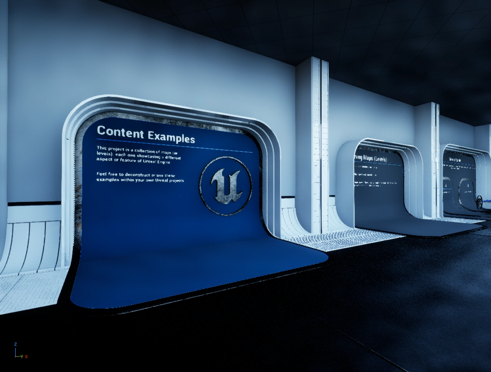

# UE Content Examples（虚幻引擎官方内容示例）一关一专章·逐展台完全解析百科

欢迎来到 **UE Content Examples 完全解析教程**！不同于走马观花的关卡级简介，本仓库采取**“一关一独立深度专章、每一座编号展台（`#1, #2, #3...`）100% 零遗漏逐台深拆”**的百科全书标准打造：

- **全关卡无死角覆盖**：完整囊括 `/Game/Maps/` 下全部 **64 张独立展厅关卡** 与 **9 张子关卡**（共 **73 个关卡世界**），按技术脉络划分为 **13 大领域子目录**；
- **逐展台源码级拆解**：将全部 **1,106+ 座编号展台** 与展位内的示例 Actor、3D 文字标签、`2,270+` 项材质表达式节点、`510` 个蓝图/UMG/ControlRig 逻辑图、Niagara 模块栈、PCG 拓扑、StateTree 状态树与 Sequencer 轨道逐一还原；
- **高清实拍图文并茂**：正文总计 **25,300+ 行（约 179.4 万字符）**，内嵌 **287+ 张实时视口展厅与展台正对特写实拍图** 及 **12 幅定制原理架构图**。

---

## 🧭 四条推荐进阶学习路线

1. **技术美术（TA / 渲染向）主线**：`12_Misc/01_Math_Hall`（打通游戏数学任督二脉） $\rightarrow$ `01_Materials`（01~10 全通，重点吃透 `POM`、`PivotPainter2` 与 `Substrate` 物质板） $\rightarrow$ `02_Geometry/03_Geometry_Nanite` $\rightarrow$ `03_Lighting` + `04_Level/05_Level_PostProcessing` $\rightarrow$ `11_VFX`（粒子邻域网格与三维流体）
2. **游戏玩法与系统架构（Gameplay / 蓝图向）主线**：`00_Welcome` $\rightarrow$ `05_Blueprints`（01~11 全通，重点吃透四大通信范式、Enhanced Input 与网络复制相关性） $\rightarrow$ `08_AI`（NavMesh $\rightarrow$ StateTree $\rightarrow$ Mass ECS） $\rightarrow$ `09_UI`（UMG + CommonUI + SlatePostBuffer）
3. **次世代角色动画与物理表现主线**：`06_Animation`（01 基石 $\rightarrow$ 03/04 IKRig 与跨体型重定向 $\rightarrow$ 05 ControlRig $\rightarrow$ 06 Chooser 选择器 $\rightarrow$ 07~10 物理控制、DeformerGraph 与 Groom 毛发 $\rightarrow$ 11 Sequencer 电影导演） $\rightarrow$ `07_Physics`（刚体约束、布料与 Chaos 破碎）
4. **大型开放世界与自动化工具链主线**：`02_Geometry` $\rightarrow$ `04_Level`（流送、地形、DataLayers、World Partition 与 `08_Level_PCG` 33 展台全解） $\rightarrow$ `05_Blueprints/11_Blueprint_EditorUtilities` $\rightarrow$ `10_Audio`（传统声学与 `MetaSounds` 106 展台全解）

---

## 📚 全 13 大领域 · 64 篇独立关卡深度专章总目录

### 00 · 欢迎大厅与展厅交互底座 (Welcome & DemoRoom)

| 总序 | 关卡名称 (`Map`) | 独立深度专章链接 | 展台数 | 篇幅行数 | 字数规模 |
| :---: | :--- | :--- | :---: | :---: | :---: |
| **01** | `ExampleProjectWelcome` | [00_ExampleProjectWelcome_欢迎大厅与DemoRoom展厅系统.md](./00_Welcome_总导读与展厅架构/00_ExampleProjectWelcome_欢迎大厅与DemoRoom展厅系统.md) | `13` | `374` 行 | `22,727` 字 |

### 01 · 材质与着色器艺术 (Materials & Substrate — 10 关)

| 总序 | 关卡名称 (`Map`) | 独立深度专章链接 | 展台数 | 篇幅行数 | 字数规模 |
| :---: | :--- | :--- | :---: | :---: | :---: |
| **02** | `Material_Properties` | [01_Material_Properties_材质基础属性与混合着色模式.md](./01_Materials_材质与着色器/01_Material_Properties_材质基础属性与混合着色模式.md) | `11` | `326` 行 | `23,141` 字 |
| **03** | `Material_Nodes` | [02_Material_Nodes_核心材质节点与PBR物理引脚全解.md](./01_Materials_材质与着色器/02_Material_Nodes_核心材质节点与PBR物理引脚全解.md) | `13` | `343` 行 | `22,567` 字 |
| **04** | `Material_Instances` | [03_Material_Instances_母子材质继承与动态材质实例MID.md](./01_Materials_材质与着色器/03_Material_Instances_母子材质继承与动态材质实例MID.md) | `5` | `266` 行 | `16,478` 字 |
| **05** | `Material_Advanced` | [04_Material_Advanced_高阶材质函数与分层材质体系.md](./01_Materials_材质与着色器/04_Material_Advanced_高阶材质函数与分层材质体系.md) | `6` | `257` 行 | `18,913` 字 |
| **06** | `Material_Decals` | [05_Material_Decals_DBuffer延迟贴花与多通道表面叠加.md](./01_Materials_材质与着色器/05_Material_Decals_DBuffer延迟贴花与多通道表面叠加.md) | `8` | `321` 行 | `21,472` 字 |
| **07** | `Material_ParallaxOcclusionMapping` | [06_Material_ParallaxOcclusionMapping_视差遮蔽映射与光线步进PDO.md](./01_Materials_材质与着色器/06_Material_ParallaxOcclusionMapping_视差遮蔽映射与光线步进PDO.md) | `11` | `338` 行 | `27,097` 字 |
| **08** | `Material_Skin_SubsurfaceRendering` | [07_Material_Skin_SubsurfaceRendering_皮肤渲染与次表面散射全解.md](./01_Materials_材质与着色器/07_Material_Skin_SubsurfaceRendering_皮肤渲染与次表面散射全解.md) | `6` | `250` 行 | `18,573` 字 |
| **09** | `Material_PivotPainter` | [08_Material_PivotPainter_初代轴心烘焙与程序化风场动画.md](./01_Materials_材质与着色器/08_Material_PivotPainter_初代轴心烘焙与程序化风场动画.md) | `24` | `297` 行 | `23,448` 字 |
| **10** | `Material_PivotPainter2` | [09_Material_PivotPainter2_二代层级UV轴心烘焙与零骨骼植被动画.md](./01_Materials_材质与着色器/09_Material_PivotPainter2_二代层级UV轴心烘焙与零骨骼植被动画.md) | `6` | `210` 行 | `16,090` 字 |
| **11** | `Material_Substrate` | [10_Material_Substrate_次世代物质板BSDF架构208展台全解.md](./01_Materials_材质与着色器/10_Material_Substrate_次世代物质板BSDF架构208展台全解.md) | `34` | `633` 行 | `69,262` 字 |

### 02 · 几何建模管线与 Nanite 虚拟几何体 (Geometry — 4 关)

| 总序 | 关卡名称 (`Map`) | 独立深度专章链接 | 展台数 | 篇幅行数 | 字数规模 |
| :---: | :--- | :--- | :---: | :---: | :---: |
| **12** | `StaticMeshes` | [01_StaticMeshes_静态网格体碰撞UV与LOD管线.md](./02_Geometry_几何建模与Nanite/01_StaticMeshes_静态网格体碰撞UV与LOD管线.md) | `13` | `345` 行 | `26,201` 字 |
| **13** | `FBX_Import_Options` | [02_FBX_Import_Options_FBX资产导入管线与切线法线控制.md](./02_Geometry_几何建模与Nanite/02_FBX_Import_Options_FBX资产导入管线与切线法线控制.md) | `8` | `221` 行 | `16,708` 字 |
| **14** | `Geometry_Nanite` | [03_Geometry_Nanite_虚拟微多边形几何体与置换光栅化全解.md](./02_Geometry_几何建模与Nanite/03_Geometry_Nanite_虚拟微多边形几何体与置换光栅化全解.md) | `23` | `407` 行 | `29,545` 字 |
| **15** | `Geometry_ModelingTools` | [04_Geometry_ModelingTools_内置几何体建模与布尔网格处理工具箱.md](./02_Geometry_几何建模与Nanite/04_Geometry_ModelingTools_内置几何体建模与布尔网格处理工具箱.md) | `36` | `483` 行 | `28,420` 字 |

### 03 · 实时光照体系与 Lumen 全局光照 (Lighting — 1 关)

| 总序 | 关卡名称 (`Map`) | 独立深度专章链接 | 展台数 | 篇幅行数 | 字数规模 |
| :---: | :--- | :--- | :---: | :---: | :---: |
| **16** | `Lighting_Realtime` | [01_Lighting_Realtime_实时光源体系与Lumen全局光照和阴影全解.md](./03_Lighting_实时光照与Lumen/01_Lighting_Realtime_实时光源体系与Lumen全局光照和阴影全解.md) | `14` | `312` 行 | `28,327` 字 |

### 04 · 世界构建、流送、World Partition 与 PCG (Level — 8 关 + 6 子关)

| 总序 | 关卡名称 (`Map`) | 独立深度专章链接 | 展台数 | 篇幅行数 | 字数规模 |
| :---: | :--- | :--- | :---: | :---: | :---: |
| **17** | `Level_Volumes` | [01_Level_Volumes_关卡体积盒机制与空间触发器全解.md](./04_Level_世界构建与PCG/01_Level_Volumes_关卡体积盒机制与空间触发器全解.md) | `10` | `345` 行 | `21,093` 字 |
| **18** | `Level_Scripting` | [02_Level_Scripting_关卡脚本蓝图与跨Actor导演逻辑.md](./04_Level_世界构建与PCG/02_Level_Scripting_关卡脚本蓝图与跨Actor导演逻辑.md) | `9` | `307` 行 | `17,685` 字 |
| **19** | `Level_Streaming` | [03_Level_Streaming_传统子关卡流送与无缝加载机制.md](./04_Level_世界构建与PCG/03_Level_Streaming_传统子关卡流送与无缝加载机制.md) | `11` | `346` 行 | `23,268` 字 |
| **20** | `Level_Landscape` | [04_Level_Landscape_大型地形雕刻材质图层与地形样条线.md](./04_Level_世界构建与PCG/04_Level_Landscape_大型地形雕刻材质图层与地形样条线.md) | `15` | `295` 行 | `24,470` 字 |
| **21** | `Level_PostProcessing` | [05_Level_PostProcessing_后期处理体积与电影级调色镜头特效全解.md](./04_Level_世界构建与PCG/05_Level_PostProcessing_后期处理体积与电影级调色镜头特效全解.md) | `39` | `541` 行 | `31,470` 字 |
| **22** | `Level_DataLayers` | [06_Level_DataLayers_数据层动态世界状态切换与运行时流送.md](./04_Level_世界构建与PCG/06_Level_DataLayers_数据层动态世界状态切换与运行时流送.md) | `14` | `392` 行 | `27,690` 字 |
| **23** | `Level_WorldPartitionStreaming` | [07_Level_WorldPartitionStreaming_世界分区自动网格流送与打包关卡实例.md](./04_Level_世界构建与PCG/07_Level_WorldPartitionStreaming_世界分区自动网格流送与打包关卡实例.md) | `12` | `318` 行 | `26,597` 字 |
| **24** | `Level_PCG` | [08_Level_PCG_程序化内容生成图节点与空间点云算子全解.md](./04_Level_世界构建与PCG/08_Level_PCG_程序化内容生成图节点与空间点云算子全解.md) | `33` | `646` 行 | `49,639` 字 |

### 05 · 蓝图可视化编程与多人网络及编辑器工具 (Blueprints — 11 关)

| 总序 | 关卡名称 (`Map`) | 独立深度专章链接 | 展台数 | 篇幅行数 | 字数规模 |
| :---: | :--- | :--- | :---: | :---: | :---: |
| **25** | `Blueprint_Overview` | [01_Blueprint_Overview_蓝图核心结构组件构造脚本与事件图.md](./05_Blueprints_蓝图编程全解/01_Blueprint_Overview_蓝图核心结构组件构造脚本与事件图.md) | `8` | `328` 行 | `18,880` 字 |
| **26** | `Blueprint_Communication` | [02_Blueprint_Communication_蓝图四大通信范式直连转换接口与事件分发器.md](./05_Blueprints_蓝图编程全解/02_Blueprint_Communication_蓝图四大通信范式直连转换接口与事件分发器.md) | `11` | `373` 行 | `24,683` 字 |
| **27** | `Blueprint_Input_Examples` | [03_Blueprint_Input_Examples_经典输入响应与交互控制实例.md](./05_Blueprints_蓝图编程全解/03_Blueprint_Input_Examples_经典输入响应与交互控制实例.md) | `5` | `208` 行 | `12,059` 字 |
| **28** | `Blueprint_EnhancedInput` | [04_Blueprint_EnhancedInput_增强输入系统Action与MappingContext修改器触发器全解.md](./05_Blueprints_蓝图编程全解/04_Blueprint_EnhancedInput_增强输入系统Action与MappingContext修改器触发器全解.md) | `12` | `296` 行 | `18,630` 字 |
| **29** | `Blueprint_Mouse_Interaction` | [05_Blueprint_Mouse_Interaction_鼠标点击悬停射线拾取与三维拖拽交互.md](./05_Blueprints_蓝图编程全解/05_Blueprint_Mouse_Interaction_鼠标点击悬停射线拾取与三维拖拽交互.md) | `1` | `142` 行 | `8,197` 字 |
| **30** | `Blueprint_Splines` | [06_Blueprint_Splines_样条线组件与样条网格体程序化变形动画.md](./05_Blueprints_蓝图编程全解/06_Blueprint_Splines_样条线组件与样条网格体程序化变形动画.md) | `8` | `226` 行 | `13,127` 字 |
| **31** | `Blueprint_Advanced` | [07_Blueprint_Advanced_高阶蓝图算法随机流程序生成与性能优化.md](./05_Blueprints_蓝图编程全解/07_Blueprint_Advanced_高阶蓝图算法随机流程序生成与性能优化.md) | `10` | `481` 行 | `30,855` 字 |
| **32** | `Blueprint_ProceduralMesh` | [08_Blueprint_ProceduralMesh_程序化网格体顶点三角面UV实时构建与切片.md](./05_Blueprints_蓝图编程全解/08_Blueprint_ProceduralMesh_程序化网格体顶点三角面UV实时构建与切片.md) | `5` | `254` 行 | `16,203` 字 |
| **33** | `Blueprint_RenderToTarget` | [09_Blueprint_RenderToTarget_渲染到纹理RTT画布绘制高度水波与动态贴图.md](./05_Blueprints_蓝图编程全解/09_Blueprint_RenderToTarget_渲染到纹理RTT画布绘制高度水波与动态贴图.md) | `4` | `243` 行 | `16,474` 字 |
| **34** | `Blueprint_Network` | [10_Blueprint_Network_多人网络同步权威性属性复制RepNotify与RPC全解.md](./05_Blueprints_蓝图编程全解/10_Blueprint_Network_多人网络同步权威性属性复制RepNotify与RPC全解.md) | `11` | `359` 行 | `24,344` 字 |
| **35** | `Blueprint_EditorUtilities` | [11_Blueprint_EditorUtilities_编辑器工具蓝图EUW批处理资产与自动化管线.md](./05_Blueprints_蓝图编程全解/11_Blueprint_EditorUtilities_编辑器工具蓝图EUW批处理资产与自动化管线.md) | `12` | `359` 行 | `24,566` 字 |

### 06 · 角色动画、IK/重定向、ControlRig、Chooser 与 Sequencer (Animation — 11 关 + 2 子关)

| 总序 | 关卡名称 (`Map`) | 独立深度专章链接 | 展台数 | 篇幅行数 | 字数规模 |
| :---: | :--- | :--- | :---: | :---: | :---: |
| **36** | `Animation_Basics` | [01_Animation_Basics_骨骼动画基石混合空间状态机蒙太奇与瞄准偏移百展台全解.md](./06_Animation_角色动画与控制绑定/01_Animation_Basics_骨骼动画基石混合空间状态机蒙太奇与瞄准偏移百展台全解.md) | `18` | `444` 行 | `33,708` 字 |
| **37** | `Animation_MorphTargets` | [02_Animation_MorphTargets_变形目标顶点融合与表情肌肉微调.md](./06_Animation_角色动画与控制绑定/02_Animation_MorphTargets_变形目标顶点融合与表情肌肉微调.md) | `6` | `205` 行 | `15,068` 字 |
| **38** | `Animation_IKRig` | [03_Animation_IKRig_逆向运动学绑定目标求解器与全身IK解算.md](./06_Animation_角色动画与控制绑定/03_Animation_IKRig_逆向运动学绑定目标求解器与全身IK解算.md) | `16` | `312` 行 | `20,227` 字 |
| **39** | `Animation_Retargeting` | [04_Animation_Retargeting_跨体型动画重定向IKRetargeter链映射与根运动修正.md](./06_Animation_角色动画与控制绑定/04_Animation_Retargeting_跨体型动画重定向IKRetargeter链映射与根运动修正.md) | `40` | `568` 行 | `34,029` 字 |
| **40** | `Animation_ControlRig` | [05_Animation_ControlRig_引擎内程序化控制绑定正向逆向解算与模块化Rig全解.md](./06_Animation_角色动画与控制绑定/05_Animation_ControlRig_引擎内程序化控制绑定正向逆向解算与模块化Rig全解.md) | `43` | `674` 行 | `48,682` 字 |
| **41** | `Animation_Choosers` | [06_Animation_Choosers_动态资产选择器Chooser多维条件评估与MotionMatching衔接.md](./06_Animation_角色动画与控制绑定/06_Animation_Choosers_动态资产选择器Chooser多维条件评估与MotionMatching衔接.md) | `24` | `587` 行 | `45,091` 字 |
| **42** | `Animation_PhysicsControl` | [07_Animation_PhysicsControl_物理控制组件空间弹簧阻尼驱动与受击平衡恢复.md](./06_Animation_角色动画与控制绑定/07_Animation_PhysicsControl_物理控制组件空间弹簧阻尼驱动与受击平衡恢复.md) | `26` | `476` 行 | `32,571` 字 |
| **43** | `PhysicalAnimation` | [08_PhysicalAnimation_物理动画组件电机强度曲线与主动布娃娃混合.md](./06_Animation_角色动画与控制绑定/08_PhysicalAnimation_物理动画组件电机强度曲线与主动布娃娃混合.md) | `6` | `187` 行 | `12,163` 字 |
| **44** | `Animation_Deformer` | [09_Animation_Deformer_机器学习与GPU计算着色器网格变形器DeformerGraph全解.md](./06_Animation_角色动画与控制绑定/09_Animation_Deformer_机器学习与GPU计算着色器网格变形器DeformerGraph全解.md) | `6` | `206` 行 | `15,587` 字 |
| **45** | `Animation_Grooms` | [10_Animation_Grooms_Alembic发丝级毛发渲染物理模拟与LOD绑定管线.md](./06_Animation_角色动画与控制绑定/10_Animation_Grooms_Alembic发丝级毛发渲染物理模拟与LOD绑定管线.md) | `4` | `206` 行 | `15,694` 字 |
| **46** | `Sequencer` | [11_Sequencer_非线性电影过场动画轨道关键帧相机切换与动态绑定百展台全解.md](./06_Animation_角色动画与控制绑定/11_Sequencer_非线性电影过场动画轨道关键帧相机切换与动态绑定百展台全解.md) | `51` | `1106` 行 | `82,341` 字 |

### 07 · Chaos 刚体物理、XPBD 布料与几何体破碎场 (Physics — 3 关)

| 总序 | 关卡名称 (`Map`) | 独立深度专章链接 | 展台数 | 篇幅行数 | 字数规模 |
| :---: | :--- | :--- | :---: | :---: | :---: |
| **47** | `Physics` | [01_Physics_Chaos刚体动力学物理约束马达弹簧与阻尼场实例全解.md](./07_Physics_Chaos物理与破碎布料/01_Physics_Chaos刚体动力学物理约束马达弹簧与阻尼场实例全解.md) | `9` | `347` 行 | `25,916` 字 |
| **48** | `Physics_Cloth` | [02_Physics_Cloth_Chaos布料解算距离蒙皮权重风场空气动力学与碰撞穿插防护.md](./07_Physics_Chaos物理与破碎布料/02_Physics_Cloth_Chaos布料解算距离蒙皮权重风场空气动力学与碰撞穿插防护.md) | `7` | `262` 行 | `20,626` 字 |
| **49** | `Physics_Destruction` | [03_Physics_Destruction_Chaos几何体集合层级簇破碎连接图与Field力场系统全解.md](./07_Physics_Chaos物理与破碎布料/03_Physics_Destruction_Chaos几何体集合层级簇破碎连接图与Field力场系统全解.md) | `27` | `503` 行 | `43,693` 字 |

### 08 · 人工智能：NavMesh 寻路、StateTree 与 Mass ECS 万级群体 (AI — 4 关)

| 总序 | 关卡名称 (`Map`) | 独立深度专章链接 | 展台数 | 篇幅行数 | 字数规模 |
| :---: | :--- | :--- | :---: | :---: | :---: |
| **50** | `AI_NavMesh` | [01_AI_NavMesh_导航网格寻路动态障碍NavLink跳点与区域代价路由.md](./08_AI_智能体与群体模拟/01_AI_NavMesh_导航网格寻路动态障碍NavLink跳点与区域代价路由.md) | `4` | `241` 行 | `15,782` 字 |
| **51** | `AI_StateTree` | [02_AI_StateTree_轻量级层级状态树评估器进入条件Task与Transition全解.md](./08_AI_智能体与群体模拟/02_AI_StateTree_轻量级层级状态树评估器进入条件Task与Transition全解.md) | `13` | `367` 行 | `25,585` 字 |
| **52** | `AI_StateTreeAIController` | [03_AI_StateTreeAIController_AI控制器状态树感知刺激智能对象与战术决策全解.md](./08_AI_智能体与群体模拟/03_AI_StateTreeAIController_AI控制器状态树感知刺激智能对象与战术决策全解.md) | `11` | `309` 行 | `22,917` 字 |
| **53** | `AI_Mass` | [04_AI_Mass_面向数据ECS万级群体模拟Trait与Fragment和LOD避障全解.md](./08_AI_智能体与群体模拟/04_AI_Mass_面向数据ECS万级群体模拟Trait与Fragment和LOD避障全解.md) | `20` | `369` 行 | `25,309` 字 |

### 09 · 现代 UI 工程：UMG、CommonUI 与 SlatePostBuffer 实时折射 (UI — 3 关)

| 总序 | 关卡名称 (`Map`) | 独立深度专章链接 | 展台数 | 篇幅行数 | 字数规模 |
| :---: | :--- | :--- | :---: | :---: | :---: |
| **54** | `UI_UMG` | [01_UI_UMG_虚幻运动图形界面布局锚点富文本材质UI与3D空间交互全解.md](./09_UI_界面框架与Slate后处理/01_UI_UMG_虚幻运动图形界面布局锚点富文本材质UI与3D空间交互全解.md) | `17` | `610` 行 | `37,626` 字 |
| **55** | `UI_CommonUI` | [02_UI_CommonUI_跨平台手柄键鼠自适应路由激活栈与模块化UI架构全解.md](./09_UI_界面框架与Slate后处理/02_UI_CommonUI_跨平台手柄键鼠自适应路由激活栈与模块化UI架构全解.md) | `8` | `369` 行 | `27,232` 字 |
| **56** | `UI_SlatePostBuffer` | [03_UI_SlatePostBuffer_Slate后备缓冲实时背景毛玻璃模糊与UI级动态折射特效.md](./09_UI_界面框架与Slate后处理/03_UI_SlatePostBuffer_Slate后备缓冲实时背景毛玻璃模糊与UI级动态折射特效.md) | `8` | `327` 行 | `21,323` 字 |

### 10 · 空间声学与 MetaSounds 采样级程序化 DSP 图谱 (Audio — 2 关)

| 总序 | 关卡名称 (`Map`) | 独立深度专章链接 | 展台数 | 篇幅行数 | 字数规模 |
| :---: | :--- | :--- | :---: | :---: | :---: |
| **57** | `Audio` | [01_Audio_传统音频体系空间衰减混响并发控制调制与音频体积73展台全解.md](./10_Audio_音频系统与MetaSounds/01_Audio_传统音频体系空间衰减混响并发控制调制与音频体积73展台全解.md) | `20` | `579` 行 | `41,424` 字 |
| **58** | `Audio_Metasounds` | [02_Audio_Metasounds_次世代采样级程序化音频图DSP振荡器滤波触发器106展台全解.md](./10_Audio_音频系统与MetaSounds/02_Audio_Metasounds_次世代采样级程序化音频图DSP振荡器滤波触发器106展台全解.md) | `106` | `1365` 行 | `90,869` 字 |

### 11 · 内置 Niagara 粒子、NeighborGrid3D、NDC 与 2D/3D 流体解算 (VFX — 4 关)

| 总序 | 关卡名称 (`Map`) | 独立深度专章链接 | 展台数 | 篇幅行数 | 字数规模 |
| :---: | :--- | :--- | :---: | :---: | :---: |
| **59** | `Niagara_Particles` | [01_Niagara_Particles_内置粒子基础渲染器碰撞力场光束丝带事件62展台全解.md](./11_VFX_内置Niagara与流体实验室/01_Niagara_Particles_内置粒子基础渲染器碰撞力场光束丝带事件62展台全解.md) | `26` | `541` 行 | `36,036` 字 |
| **60** | `Niagara_Advanced_Particles` | [02_Niagara_Advanced_Particles_高阶GPU计算模拟阶段NeighborGrid3D邻域网格与PBD群体全解.md](./11_VFX_内置Niagara与流体实验室/02_Niagara_Advanced_Particles_高阶GPU计算模拟阶段NeighborGrid3D邻域网格与PBD群体全解.md) | `25` | `468` 行 | `30,630` 字 |
| **61** | `Niagara_Data_Channels` | [03_Niagara_Data_Channels_数据通道NDC空间分桶高频读写双向游戏通信全解.md](./11_VFX_内置Niagara与流体实验室/03_Niagara_Data_Channels_数据通道NDC空间分桶高频读写双向游戏通信全解.md) | `7` | `214` 行 | `15,822` 字 |
| **62** | `Niagara_Fluids` | [04_Niagara_Fluids_内置Grid2D浅水方程与Grid3D烟火FLIP液体解算器全解.md](./11_VFX_内置Niagara与流体实验室/04_Niagara_Fluids_内置Grid2D浅水方程与Grid3D烟火FLIP液体解算器全解.md) | `15` | `352` 行 | `26,875` 字 |

### 12 · 数学大厅 75 展台逐号精讲与 Paper2D 横版系统 (Misc — 2 关)

| 总序 | 关卡名称 (`Map`) | 独立深度专章链接 | 展台数 | 篇幅行数 | 字数规模 |
| :---: | :--- | :--- | :---: | :---: | :---: |
| **63** | `Math_Hall` | [01_Math_Hall_数学大厅向量点积叉积插值三角波空间变换75展台逐号精讲.md](./12_Misc_数学大厅与2D横版/01_Math_Hall_数学大厅向量点积叉积插值三角波空间变换75展台逐号精讲.md) | `75` | `985` 行 | `71,083` 字 |
| **64** | `Paper2D` | [02_Paper2D_2D精灵Sprite序列帧Flipbook瓦片地图与2D物理碰撞全解.md](./12_Misc_数学大厅与2D横版/02_Paper2D_2D精灵Sprite序列帧Flipbook瓦片地图与2D物理碰撞全解.md) | `7` | `279` 行 | `20,724` 字 |

### 📖 全工程全局检索附录

- **[99_附录_全73世界1106展台与核心资产总检索词典.md](./99_附录_全73世界1106展台与核心资产总检索词典.md)** — 按关卡与展台编号全量列出 `1,106+` 座展牌原文标题、空间坐标与核心资产索引，支持 `Ctrl + F` 全局秒级检索。

---

## 📄 开源许可与知识产权声明 (License & Intellectual Property Notice)

依据 `CC BY-SA 4.0` 国际公共许可协议第 2(a)(1) 条、官方第三方材料标注规范（详见 [THIRD_PARTY_NOTICES.md](./THIRD_PARTY_NOTICES.md)）及 Epic Games 相关法律条款，本仓库全部内容的权利归属与使用边界严格界定如下：

### 一、 原创教学内容授权范围（适用 [CC BY-SA 4.0](./LICENSE)）

本仓库中由作者独立创作并享有著作权的原创表达内容——包括**中文技术解析正文、教学编排体系、数学与渲染/物理管线推导阐释、原创归纳对比表格以及独立绘制的原理架构图（`images/arch_*.svg` 矢量图与 Mermaid 图表）**——均依据本仓库根目录所附 **[Creative Commons Attribution-ShareAlike 4.0 International Public License（知识共享 署名-相同方式共享 4.0 国际公共许可协议，简称 CC BY-SA 4.0）](./LICENSE)** 进行授权（**明确排除**下方第二条及 [THIRD_PARTY_NOTICES.md](./THIRD_PARTY_NOTICES.md) 所列之全部第三方权利材料）：

1. **署名（Attribution / BY）**：任何复制、转载、节选或演绎均须清晰保留原仓库署名、原始出处链接及 [LICENSE](./LICENSE) 协议链接，并如实注明是否对原文作了修改；不得以任何方式暗示原作者为您或您的使用行为背书。
2. **相同方式共享与禁止附加限制（ShareAlike / SA & No Downstream Restrictions）**：若您对上述原创内容进行重混、转换、翻译、扩充或编写衍生教学材料，您必须以相同的 **[CC BY-SA 4.0](./LICENSE)** 协议向公众开放共享该演绎作品，且不得对其施加任何额外的法律限制条款或技术保护措施（DRM / 加密限制 / 禁止二次传播条款）。
3. **技术思想与工程实践自由（Idea-Expression Dichotomy）**：本许可协议仅约束对本教程“图文表达内容”本身的复制、分发与演绎；读者通过阅读本教程所理解与掌握的计算机图形学算法、数学公式及虚幻引擎开发方法，可完全自由地运用于个人或闭源商业游戏及软件项目开发，不受本协议之限制或传染。

### 二、 第三方材料排除与 Epic Games 知识产权保留（详见 [THIRD_PARTY_NOTICES.md](./THIRD_PARTY_NOTICES.md)）

下列材料**明确排除在本仓库 `CC BY-SA 4.0` 许可协议的授权范围之外**，本仓库作者不对该等材料主张著作权，亦不对其授予任何开源代码许可或再分发权利：

1. **引擎与官方示例短代码/配置引用**：教程正文中为技术评述与教学解说之必要而少量引用的 Unreal Engine 接口名称、官方示例材质 `Custom` 节点 HLSL 短片段（全库严格控制在 UE EULA 允许公开讨论的不超过 30 行短代码片段范围内）、蓝图节点标识及 `.ini` 配置参数；
2. **视口截图中的官方示例资产画面**：教程内嵌视口实拍截图（`images/maps/*.webp` 等）中所呈现的三维网格模型、材质球、贴图纹理、粒子特效与展厅关卡场景（源自 Epic Games, Inc. 发布的 *Content Examples* 官方示例工程）。
3. **权利归属与合规义务**：上述被排除材料的全部著作权、专利权及其他知识产权均归 **Epic Games, Inc.** 及其许可方所有。任何在实际软件、游戏或商业项目中使用、复制或分发 Unreal Engine 源码及官方示例工程资产的行为，均须自行向 Epic Games 获取合法授权并严格遵守 **[Unreal Engine 最终用户许可协议（Unreal Engine End User License Agreement, UE EULA）](https://www.unrealengine.com/eula)** 及 **[Epic Games 粉丝内容政策（Fan Content Policy）](https://www.epicgames.com/site/en-US/fan-art-policy)**。
4. **非官方背书与商标声明**：本仓库仅包含独立编写的教学文档与配图，**不包含亦不分发任何原始 `.uasset`、`.umap` 或引擎源码文件**。`Unreal®`、`Unreal Engine™` 及相关标识是 Epic Games, Inc. 在美国及其他国家或地区的商标或注册商标；本项目系社区独立创作的技术学习解析，与 Epic Games, Inc. 不存在任何隶属、合作、赞助或官方背书关系。

### 三、 免责与无担保声明（Disclaimer of Warranties）

本仓库按“现状（AS-IS）”提供，仅供技术研究与学习交流参考，不附带任何明示或暗示的准确性、完整性、特定用途适用性或不侵权担保；在适用法律允许的最大范围内，作者不对因使用或参考本教程所产生的任何直接或间接损失承担责任（详见 [LICENSE](./LICENSE) 第 5 条）。
